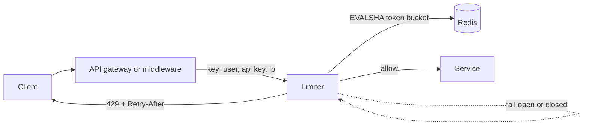

# Rate Limiting

> [!abstract] In one sentence
> Rate limiting decides, in under a millisecond, whether this request from this caller is within its allowance, so one tenant, one bug or one attacker cannot consume capacity meant for everyone — and tells rejected callers when to come back.

> [!tip] Deeper treatment in your system-design vault
> `system-design/03 Traffic Management/Rate Limiting.md` — read it *after* you have written your own explanation below.

**Map:** [[Architecture Patterns MOC]] → [[HLD MOC]]

## Definition

**Rate limiting** caps the number of operations a key (user, API key, IP, tenant, endpoint, or the whole service) may perform in a time window, rejecting or delaying the excess. A limiter has three parts: a **key** (who is being limited), an **algorithm** that tracks usage against a limit, and a **decision** (allow, reject with HTTP 429 and a `Retry-After` hint, or queue). It is a policy about fairness and protection, distinct from [[Backpressure]] (which reacts to actual saturation) and from quotas (long-horizon allowances like "10,000 calls per month").

## Problem solved

Capacity is finite and demand is not under your control. Without limits, one client with a retry bug, a scraper, a credential-stuffing attack or a legitimate batch job saturates shared resources and everyone else pays in latency and errors. Rate limiting makes the contract explicit — "600 requests per minute per key" — so capacity can be planned ([[Capacity Planning]]), fairness is enforced between tenants, cost-bearing operations (SMS, LLM tokens, PSP calls) are bounded, and brute force against login or OTP endpoints becomes impractical. It is a reliability control and a security control at once.

## How it works

The algorithms differ in burst tolerance, memory and accuracy:

1. **Token bucket.** A bucket holds up to `burst` tokens and refills at `rate` per second; each request takes one, and an empty bucket rejects. Allows bursts while bounding the long-run average; two numbers per key (tokens, last refill), refilled lazily. The default choice.
2. **Leaky bucket.** Requests queue and drain at a fixed rate; overflow is rejected. Smooths output for a downstream that hates bursts, at the cost of queueing delay.
3. **Fixed window.** A counter per key per window. Trivial, but allows 2x the limit across a window boundary.
4. **Sliding window log.** Every request timestamp per key, count those within the window. Exact, but memory grows with the limit.
5. **Sliding window counter.** Weight the previous window's count by its remaining overlap: `prev * (1 - elapsed/window) + current`. Near-exact with two counters per key; Cloudflare's published approach.

**Where the counters live.** A **local** limiter (Bucket4j, Resilience4j) is fastest and needs no coordination but limits per pod, so the effective limit is `limit x replicas`. A **distributed** limiter keeps counters in [[Redis]] with a Lua script doing read-refill-decrement atomically in one round trip; exact across replicas, but a dependency on every request. On Redis failure choose deliberately: **fail open** for most APIs, **fail closed** for abuse-sensitive endpoints like login.

```lua
-- token bucket in Redis, atomic; KEYS[1]=bucket, ARGV: rate, burst, now_ms
local t = redis.call('HMGET', KEYS[1], 'tokens', 'ts')
local tokens = tonumber(t[1]) or tonumber(ARGV[2])
local ts = tonumber(t[2]) or tonumber(ARGV[3])
tokens = math.min(tonumber(ARGV[2]), tokens + (tonumber(ARGV[3]) - ts) / 1000 * tonumber(ARGV[1]))
local allowed = tokens >= 1
if allowed then tokens = tokens - 1 end
redis.call('HSET', KEYS[1], 'tokens', tokens, 'ts', ARGV[3]); redis.call('PEXPIRE', KEYS[1], 60000)
return allowed and 1 or 0
```

The response contract matters as much as the algorithm: `429 Too Many Requests` with `Retry-After` and `RateLimit-*` headers, so well-behaved clients back off instead of hammering ([[Retry Storms]]).

## Architecture



## Use cases

- Multi-tenant APIs where one tenant must not degrade others; the requirement says "fair share" or "per-plan limits".
- Endpoints that cost money or are abuse targets: OTP, login, password reset, outbound SMS, LLM calls.
- Protecting a fixed-capacity downstream (a payment provider with its own limits, a legacy system) from your own fan-out.

## Limitations

- A limiter protects against *rate*, not *cost*: 100 cheap requests and 100 expensive ones count the same unless you weight them.
- Distributed limiters add a Redis dependency and a round trip on every request; local limiters are approximate under autoscaling.
- Keying is hard: IP-based limits punish users behind NATs and miss distributed attackers; user-based limits need authentication first. And limits do not know whether the system is actually saturated — [[Backpressure]] does.

## Trade-offs

| You gain | You sacrifice |
|---|---|
| Predictable capacity per caller and protection from any single client | Some legitimate requests rejected at the margin, and support tickets about 429s |
| A security control against brute force and scraping | A per-request dependency (Redis) or accuracy (local counters) |
| An explicit, documentable API contract with Retry-After | Tuning effort: limits that are too low throttle customers, too high protect nothing |

## Failure modes

- **Redis down or slow** → limiter latency or errors on every request → total outage if the limiter fails closed by accident; decide the policy and test it.
- **Hot key**: one tenant's counter on one Redis shard at 50k requests per second → that shard saturates and limits everyone sharing it ([[Hot Keys]]); shard the key or limit locally first.
- **Clock skew across pods** in time-based windows → inconsistent decisions → bursts slip through; use Redis server time (`TIME`) in the script.
- **Synchronised retries** after a 429 without jitter → a retry storm at exactly `Retry-After` seconds → the dependency is hit by a wave; document backoff with jitter.

## Performance

A local token bucket costs tens of nanoseconds. A Redis-backed decision is one Lua call — typically a fraction of a millisecond in-region; local pre-filtering of obviously over-limit callers reduces the load. Memory is tiny per key but multiplied by millions of keys, so set TTLs equal to the refill horizon so idle keys expire.

## Scalability

Local limiters scale with replicas; distributed ones scale with Redis throughput and key distribution. At 10x: limit at the edge ([[API Gateways]], CDN) before traffic reaches services, add hierarchical limits (global, per tenant, per user), hash keys across a Redis cluster ([[Consistent Hashing]]), and accept approximate counting for very hot keys via local buckets synced periodically.

## Operational impact

Low to run, but it needs observability: 429 rate per key and endpoint, limiter latency, Redis health and the fail-open/closed state. Limits should be configuration with per-tenant overrides, not a deploy. On-call will field "we are being rate limited", so expose current usage via headers and a dashboard.

## Alternatives

- **[[Backpressure]] and load shedding** — win when the goal is survival under real overload rather than fairness.
- **Quotas** (daily or monthly allowances) — win for commercial metering; usually combined with a short-window rate limit.
- **Queueing with bounded concurrency** ([[Bulkheads]]) — wins when the work can wait and you want smoothing rather than rejection.

## Real-world examples

- Cloudflare's published sliding-window counter design and edge rate limiting ([[Cloudflare - Rate Limiting at Scale]]).
- Stripe runs request and concurrency limiters in Redis and returns 429 with documented retry guidance; GitHub's API publishes per-token limits in `X-RateLimit-*` headers; AWS API Gateway throttles with a token bucket per stage and key.
- In a stack like yours: Bucket4j in Spring Boot or a NestJS guard backed by a Redis Lua token bucket, keyed on the JWT subject from the IAM service; fail-closed on OTP and login, fail-open elsewhere; 429 rate per client on the dashboard.

## Practical exercise

1. Implement an in-process token bucket in TypeScript or Java; hit it with k6 at 2x the limit and confirm the allowed rate and burst.
2. Run three replicas behind a load balancer in Docker Compose and observe the effective limit tripling.
3. Move the bucket to Redis with the Lua script above; confirm exactness across replicas and measure the added latency.
4. Stop Redis mid-test and implement both fail-open and fail-closed; compare success rate and limiter latency.
5. Compare fixed window and sliding window counter around a window boundary at the same nominal limit.

## Related concepts

### Prerequisites
- [[Throughput]] — the quantity being bounded
- [[Redis]] — where distributed counters live
- [[HTTP and HTTPS]] — 429 and Retry-After semantics
- [[Capacity Planning]] — knowing what limit to set

### Related
- [[Backpressure]] — reacting to actual saturation
- [[Graceful Degradation]] — what to do with rejected requests
- [[Retry Storms]] — what bad 429 handling causes
- [[Hot Keys]] — one tenant's counter can melt a shard
- [[Timeouts and Retries]] — client-side backoff with jitter
- [[Consistent Hashing]] — spreading keys across a Redis cluster

### Builds on this
- [[API Gateways]] — the natural enforcement point
- [[Bulkheads]] — per-tenant limits as capacity isolation
- [[Designing APIs and Contracts]] — limits and headers are part of the contract

### Design problems where it applies
- [[Design a Rate Limiter]]
- [[Design an API Gateway]]
- [[Design a Notification System]]
- [[Design a Webhook Delivery System]]

### Projects where it can be implemented
- [[Rate Limiter Library]]
- [[LLM Gateway]]

### Resources
- [[System Design Interview (Alex Xu)]] — the rate-limiter chapter and algorithm comparison
- [[Cloudflare - Rate Limiting at Scale]] — sliding window counters at the edge
- [[Bucket4j]] — a production token-bucket library for Java
- [[Resilience4j]] — the RateLimiter module alongside breakers and bulkheads

## Personal understanding

> [!question] Explain it without the source
> Write your own explanation here, from memory. Then compare it with the sections above and note what you missed.

### Mastery checklist
- [ ] I can explain it without the original resource
- [ ] I can describe the problem it solves
- [ ] I can compare it with its alternatives
- [ ] I can name its limitations and failure modes
- [ ] I can recognise when it is appropriate in a real system
- [ ] I have applied it in a system design
- [ ] I have validated my assumptions with an experiment or implementation

## Open questions

- [ ] How should cost-weighted limits (an LLM call worth 50 tokens, a read worth 1) be expressed to clients and in headers?
- [ ] For a limiter in Redis Cluster, what is the right key design so one tenant cannot create a hot shard?
- [ ] Which endpoints in an IAM service should fail closed when Redis is unavailable, and what does that do to login availability?
