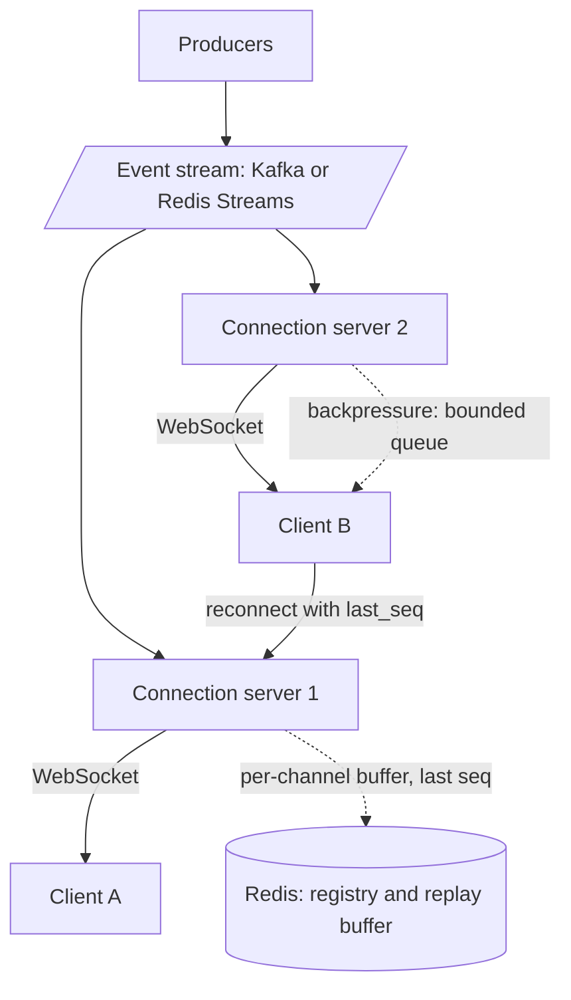

# Real-Time Systems

> [!abstract] In one sentence
> A real-time system keeps a stateful connection to every client and pushes events as they happen, so the design question is not "WebSockets or polling" but how the whole chain — stream, fan-out, backpressure, client state, ordering, reconnection, dedup and recovery — behaves when a connection drops or a producer bursts.

> [!tip] Deeper treatment in your system-design vault
> `system-design/02 Networking/WebSockets Server-Sent Events and Long Polling.md` — read it *after* you have written your own explanation below.

**Map:** [[Architecture Patterns MOC]] → [[HLD MOC]]

## Definition

In this vault, a **real-time system** delivers updates to clients within human-perceptible time — well under a second — by **pushing** over a persistent connection rather than waiting to be asked. (Soft real time; hard real-time systems with deadline guarantees are a different field.) Structurally it is a chain: producers emit events into a stream; a **connection tier** holds one long-lived connection per client and subscribes on its behalf; events are fanned out to the right connections; and both sides keep enough state to survive disconnects without losing, reordering or duplicating updates. This note is the hub; each link has its own note.

## Problem solved

Polling is simple and wrong at scale: most answers are "nothing new", latency equals the poll interval, and load is proportional to clients rather than events. Chat, dashboards, order tracking and presence need the server to speak first. But push makes the server stateful — it must remember who is connected and what they have seen — which is exactly what a stateless HTTP tier avoids. The chain below is the set of decisions that make that state reliable.

## How it works

The chain, in order, with the question each link answers:

1. **Transport — [[WebSockets]].** One full-duplex connection per client, held by a connection server; Server-Sent Events for server-to-client only, long polling as fallback. Each connection costs memory and a file descriptor, so the tier is sized by concurrent connections, not requests per second, and the [[Load Balancers|load balancer]] must tolerate long-lived connections.
2. **Event streaming — [[Pub-Sub]] and [[Kafka]].** Producers publish to topics; connection servers subscribe for their clients. Redis Pub/Sub is fire-and-forget; Kafka or Redis Streams keep history, which link 9 depends on.
3. **[[Fan-Out]].** One event may go to one client, a room of 200 or everyone. The tier maps subscriptions to connections in memory, with a Redis registry to find which server holds a user. Large rooms are where fan-out cost explodes.
4. **[[Backpressure]].** A slow client cannot drain its socket and unbounded send buffers exhaust server memory. Bound the per-connection queue, coalesce stale updates (keep only the latest price), disconnect clients that fall too far behind.
5. **Client state — [[Client State and Reconnection]].** Each client tracks a per-channel sequence number; the server keeps a short replay buffer per channel. Links 6–9 depend on this.
6. **[[Ordering Guarantees]].** Updates for one entity apply in order, guaranteed per channel or partition, never globally; the client applies strictly increasing sequences and requests gaps.
7. **Reconnection — [[Timeouts and Retries]].** Connections drop constantly (mobile handoffs, idle proxies, deploys). Clients reconnect with exponential backoff and jitter so a restart is not a [[Retry Storms|reconnect storm]]; heartbeats ([[Keep-Alive Connections]]) detect dead connections.
8. **Duplicates — [[Duplicate Message Processing]] and [[Idempotency]].** After a reconnect the client may receive events it already applied; event ids and sequences make application idempotent. For ephemeral data (typing indicators, cursors) choose [[At-Most-Once Delivery]].
9. **Recovery.** On reconnect the client sends its last sequence; the server replays from the buffer or stream ([[Redis]] Streams `XRANGE`, a Kafka offset) if the gap is within retention, otherwise tells the client to fetch a snapshot and resume from its version — the same mechanism as [[Event Sourcing]].

```text
client  -> CONNECT  {token, channels: [{id: "acct:42", last_seq: 1187}]}
server  -> REPLAY   acct:42 seq 1188..1203            (from buffer)
server  -> EVENT    acct:42 seq 1204 BalanceUpdated   (live)
```

## Architecture



## Use cases

- The requirement says "live", "instantly" or "without refreshing": chat, presence, order tracking, dashboards, collaborative editing.
- Server-initiated events users must see promptly: payment confirmation, fraud step-up, operational alerts.
- High fan-out of small updates where polling cost would dominate: prices, scores, metrics.

## Limitations

- A stateful tier is harder to scale, deploy and drain than stateless HTTP; every deploy disconnects clients unless drained gracefully.
- Not every update needs push; a dashboard polled every 30 seconds is simpler and often good enough.
- Guarantees are per channel and best-effort end to end; exactly-once display is client-side idempotency, not a transport feature. Proxies and mobile networks can be hostile to long-lived connections, so a fallback path is mandatory.

## Trade-offs

| You gain | You sacrifice |
|---|---|
| Sub-second delivery with load proportional to events, not clients | A stateless tier; connection servers need registries, draining and routing |
| Rich interaction (presence, typing, collaboration) | Simplicity; nine links each need a decision and a test |
| A durable stream that doubles as the recovery mechanism | Memory and retention cost for buffers and stream history |

## Failure modes

- **Reconnect storm** after a deploy: 100k clients reconnect at once → load balancer and auth path saturate → cascading failure; drain gradually, jitter backoff, cache token validation.
- **Slow-consumer memory blow-up**: no per-connection bound → one bad link takes the server down → OOM kills; bound queues and disconnect laggards.
- **Gap after failover**: a client resumes on a server whose buffer lacks its last sequence → stale state → replay from the durable stream or force a snapshot; alert on resume-miss rate.
- **Duplicate application**: replayed events applied twice (a balance incremented twice) → wrong UI state → apply by sequence or event id.

## Performance

End-to-end latency is producer → stream → connection server → socket: tens of milliseconds in-region when nothing is queued, dominated by stream lag and fan-out when it is. Per-connection memory and the fan-out multiplier size the tier; coalescing high-frequency updates and batching socket writes are the main levers.

## Scalability

Scale the connection tier horizontally by connections, with a Redis registry routing a user's events to the right server and subscriptions partitioned so each server subscribes only to channels its clients need. At 10x, fan-out is the bottleneck: pre-filter at the stream (one topic per user shard), shard hot rooms, move connection servers to the edge.

## Operational impact

High. The tier needs graceful draining on deploy, per-server connection and lag metrics, resume-miss and duplicate counters reported by clients, and per-tenant isolation ([[Bulkheads]]) so one hot room cannot starve the rest. Debugging requires client-side telemetry, and load tests must simulate reconnect waves, not just steady connections.

## Alternatives

- **Short polling** — wins for low client counts and tolerable staleness; zero server state.
- **Server-Sent Events** — win for one-directional feeds over plain HTTP; built-in reconnect and `Last-Event-ID` implement links 5 and 9 for free.
- **Push notifications (APNs/FCM)** — win for reaching backgrounded mobile apps; not a replacement for in-app real time.

## Real-world examples

- Slack's connection tier, Discord's Elixir gateway (millions of concurrent WebSockets) and WhatsApp's Erlang servers are the well-known large connection tiers; Server-Sent Events' `Last-Event-ID` header is a standardised version of the resume protocol above.
- In a stack like yours: a NestJS WebSocket gateway on EKS behind a headless Service, subscribing to Kafka or Redis Streams, Redis holding the user-to-pod registry and replay buffers, JWTs from the IAM service validated at connect, bounded per-socket queues and a 30-second heartbeat; Redis Streams suit this tier because `XRANGE` is the replay primitive.

## Practical exercise

1. Build a NestJS WebSocket gateway that subscribes to a Redis Stream `acct:42` and pushes events to clients; producers `XADD` balance updates.
2. Connect 1,000 clients with a k6 WebSocket script; measure memory per connection and `XADD`-to-client latency.
3. Make one client stop reading; watch the send buffer grow, then add a bounded queue with disconnect-on-overflow.
4. Kill the gateway pod; clients reconnect with backoff and `last_seq`; implement replay via `XRANGE` and prove no gaps and no duplicates.
5. Trim the stream below a client's `last_seq` and implement snapshot-then-resume.

## Related concepts

### Prerequisites
- [[WebSockets]] — the transport and the connection tier it implies
- [[Pub-Sub]] — how producers reach connection servers
- [[Kafka]] — a durable stream to replay from
- [[Latency]] — what "real time" means in numbers

### Related
- [[Fan-Out]] — one event to many connections
- [[Backpressure]] — protecting the tier from slow clients
- [[Client State and Reconnection]] — sequence numbers, buffers and resume
- [[Ordering Guarantees]] — per-channel order and gap handling
- [[Duplicate Message Processing]] — idempotent application on the client
- [[At-Most-Once Delivery]] — the right choice for ephemeral updates

### Builds on this
- [[Monitoring User-Facing Performance]] — measuring time-to-update and staleness assumes this chain
- [[Capacity Planning]] — sizing a connection tier by connections, fan-out and buffers

### Design problems where it applies
- [[Design a Chat System]]
- [[Design a Social Feed]]
- [[Design a Collaborative Document Editor]]
- [[Design a Notification System]]
- [[Design a Ride-Sharing Service]]

### Projects where it can be implemented
- [[Live Ops Dashboard]]
- [[Presence and Chat Service]]

### Resources
- [[Redis Streams Docs]] — `XADD`, `XRANGE` and consumer groups as the replay buffer
- [[Understanding Distributed Systems]] — backpressure and failure detection
- [[System Design Interview (Alex Xu)]] — the chat system chapter walks the connection tier
- [[Designing Data-Intensive Applications]] — logs, offsets and replay in chapter 11

## Personal understanding

> [!question] Explain it without the source
> Write your own explanation here, from memory. Then compare it with the sections above and note what you missed.

### Mastery checklist
- [ ] I can explain it without the original resource
- [ ] I can describe the problem it solves
- [ ] I can compare it with its alternatives
- [ ] I can name its limitations and failure modes
- [ ] I can recognise when it is appropriate in a real system
- [ ] I have applied it in a system design
- [ ] I have validated my assumptions with an experiment or implementation

## Open questions

- [ ] How long should the per-channel replay buffer be for a payments dashboard — sized by time, by events, or by the observed reconnect-gap distribution?
- [ ] What is the right drain protocol for a connection-server deploy on Kubernetes: a close frame with a retry hint, a readiness flip plus timeout, or both?
- [ ] For a user with three devices, should each device have its own sequence per channel, or does one per user with device-level acks work?
