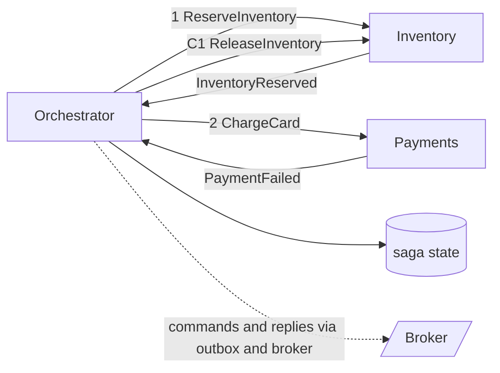

# Saga Pattern

> [!abstract] In one sentence
> A saga replaces one impossible cross-service transaction with a chain of local ones — each committed, each with a compensation — and a coordinator (explicit or emergent) that runs them forward or unwinds them, giving you eventual all-or-nothing without holding locks across the network.

> [!tip] Deeper treatment in your system-design vault
> `system-design/09 Messaging and Event-Driven/Saga Pattern.md` — read it *after* you have written your own explanation below.

**Map:** [[Architecture Patterns MOC]] → [[HLD MOC]]

## Definition

A **saga** is a sequence of local [[Transactions|transactions]] T1…Tn across services where each Ti has a **compensating transaction** Ci that semantically reverses it (refund a charge, release a reservation). If every Ti succeeds the saga completes; if Tk fails it runs Ck-1…C1 in reverse. The term comes from Garcia-Molina and Salem's 1987 paper on long-lived transactions. Sagas provide atomicity (eventually all or nothing) and durability, but **not isolation**: intermediate states are visible to other transactions.

## Problem solved

In a [[Microservices]] system, placing an order means reserving inventory, charging a card and creating a shipment in three services with three databases. One [[ACID]] transaction cannot span them, and [[Distributed Transactions|two-phase commit]] needs every participant's support, holds locks for the slowest network hop and blocks everyone when the coordinator dies. Business transactions also take minutes or days, which no lock-holding protocol survives. Sagas accept that each step commits on its own and make the *undo* a first-class business operation — which is how these processes worked on paper long before computers.

## How it works

1. **Define steps and compensations.** `ReserveInventory` / `ReleaseInventory`, `ChargeCard` / `RefundCard`, `CreateShipment` / `CancelShipment`. The **pivot** step is the one after which the saga must complete (money captured): compensable steps go before it, retryable steps after.
2. **Choose a coordination style.**
   - **Choreography.** Each service reacts to the previous step's event and emits its own: `OrderCreated` → `InventoryReserved` → `PaymentCaptured`. No central component, but the flow is implicit and compensation chains get hard past three or four steps ([[Event-Driven Architecture]]).
   - **Orchestration.** A persisted state machine sends commands, awaits replies, decides the next step and issues compensations on failure. Explicit and observable; one more component that must itself be durable.
3. **Make every step idempotent.** Commands and compensations carry the saga id and step id so redelivery ([[At-Least-Once Delivery]]) cannot double-charge ([[Idempotency]]); participants reply through an [[Outbox Pattern|outbox]].
4. **Classify failures.** Transient → retry with backoff ([[Retry Strategies]]); business failure (card declined) → compensate; compensation failure → retry until it works, then a [[Dead-Letter Queues|dead-letter]] or human queue. Compensations must be designed to eventually succeed.
5. **Manage missing isolation.** Between `ReserveInventory` and `ChargeCard` another saga can see reserved stock. Countermeasures: **semantic locks** (a `PENDING` status others respect), **commutative updates** (increment, not set), **pessimistic ordering** (risky step last) and re-reading state before acting.

```text
saga order-7f3a  state=CHARGING
  1 ReserveInventory  DONE   (comp: ReleaseInventory)
  2 ChargeCard        FAILED (card declined)
  -> compensate: ReleaseInventory -> DONE ; saga = CANCELLED
```

## Architecture



> [!example]- Excalidraw version — the same diagram as an editable canvas
> ![[Saga Pattern.excalidraw]]
> [[Saga Pattern.excalidraw|Open in Excalidraw]] — needs the Excalidraw plugin (see [[Plugins to Install]]).


## Use cases

- A business operation that updates two or more services' data and must end consistent: checkout, money transfer between ledgers in different services, trip booking.
- Long-running processes with waits: KYC verification, loan approval, multi-party settlement.
- Any time a design review asks "what happens if step 3 fails after steps 1 and 2 committed?" and the answer is not "it can't".

## Limitations

- No isolation: dirty reads and lost updates between concurrent sagas are real and must be designed around.
- Compensations are not rollbacks: an email cannot be unsent, and a refund is a new transaction with its own fees and delays.
- Choreography becomes unreadable beyond a few steps; orchestrators add a component and tempt you to put business logic in the coordinator. Testing is hard either way: every step can fail at every point, including during compensation.

## Trade-offs

| You gain | You sacrifice |
|---|---|
| Cross-service consistency without distributed locks or 2PC | Isolation; intermediate states are visible and must be made safe |
| Long-running flows that survive crashes and waits of hours | Simplicity; compensation design and idempotency are mandatory everywhere |
| Explicit, auditable workflow state (orchestration) | A durable coordinator to build or buy, and the discipline to keep logic in participants |

## Failure modes

- **Orchestrator crash mid-saga** without persisted state → sagas stuck half-done → stock reserved with no order; persist state before every command and recover on restart.
- **Compensation fails permanently** (refund API rejects) → money captured, order cancelled → found by reconciliation; needs a manual-intervention queue and alerts on sagas stuck compensating.
- **Duplicate command delivery** to a non-idempotent participant → double charge → found by complaint or reconciliation; idempotency keys on every step.
- **Isolation anomaly**: two sagas read "available" before either commits → oversell → conditional updates (`WHERE available >= 1`) and semantic locks.

## Performance

A saga's latency is the sum of its steps plus broker hops — tens to hundreds of milliseconds for a synchronous-feeling checkout, unbounded for processes that wait on humans. Throughput is limited by the slowest participant and the orchestrator's state writes (two per step). Unlike 2PC, no locks are held across the network, so participants' databases stay fast under concurrency.

## Scalability

Sagas scale horizontally because each participant commits locally and the orchestrator shards by saga id; Temporal partitions histories across workers the same way. At 10x the pressure is on the orchestrator's state store and on per-key ordering in the broker. Choreography scales organisationally until the number of steps makes the flow unknowable.

## Operational impact

High. You need visibility into every in-flight saga (state, age, last step), alerts on sagas stuck or compensating too long, idempotency stores per participant, DLQs for failed compensations and runbooks for manual completion. Orchestration pays off here: the state table *is* the dashboard. Repairing a saga by hand must be a designed operation, not an SQL update at 2 a.m.

## Alternatives

- **[[Distributed Transactions]] (2PC/XA)** — win when all participants are databases supporting it inside one trust domain and the transaction is short.
- **Redesign the boundary** — put the data that must change together in one service and one transaction ([[Domain-Driven Design|aggregate design]]); the best saga is the one you avoid.
- **Workflow engines** (Temporal, Step Functions) — win when you want a durable orchestrator, retries and timers as a platform rather than hand-built ([[Temporal Docs on Durable Execution]]).

## Real-world examples

- The original Sagas paper (Garcia-Molina and Salem, 1987) defined the model; Chris Richardson's [[microservices.io - Saga Pattern]] adapted it to microservices with the choreography/orchestration split.
- Uber built Cadence (later Temporal) to run durable orchestrations such as trip and payment flows; payment-provider integrations are sagas by necessity — authorise, capture, and void or refund are the steps and compensations every PSP exposes.
- In a stack like yours: a transfer flow across ledger, payments and notification services on Kafka or SQS, an orchestrator persisted in PostgreSQL (or Temporal), outbox-based messaging, idempotency keys per step, the ledger write as the pivot, and a dashboard of sagas by state and age.

## Practical exercise

1. In Docker Compose, run `orders`, `inventory` and `payments` (NestJS or Spring Boot) with their own PostgreSQL, plus Redpanda or Redis Streams.
2. Implement a choreographed checkout (`OrderCreated` → `InventoryReserved` → `PaymentCaptured`); make `payments` decline every fifth card and verify inventory is released.
3. `kill -9` `inventory` after it commits the reservation but before publishing; observe the stuck saga, then fix it with an outbox.
4. Rewrite as an orchestrator with a `sagas` table (`id, state, step, updated_at`); kill it mid-saga and prove it resumes on restart.
5. Run two concurrent checkouts for the last unit, observe the oversell, fix with a conditional update.

## Related concepts

### Prerequisites
- [[Transactions]] — each step is one
- [[Distributed Transactions]] — what sagas replace and why
- [[Event-Driven Architecture]] — the messaging substrate
- [[Idempotency]] — every step and compensation must be safe to repeat

### Related
- [[Outbox Pattern]] — how participants publish reliably
- [[Isolation Levels]] — what the saga lacks and why it matters
- [[Dead-Letter Queues]] — where failed compensations go
- [[Retry Strategies]] — transient failures between steps
- [[Event Sourcing]] — a natural persistence model for the orchestrator
- [[Duplicate Message Processing]] — the consumer-side discipline

### Builds on this
- [[Evaluating Architectural Complexity]] — sagas are the canonical cost of splitting a transaction boundary
- [[Data Ownership and Lifecycle]] — cross-service lifecycle operations (closure, erasure) are sagas

### Design problems where it applies
- [[Design a Payment System]]
- [[Design a Ticket Booking System]]
- [[Design a Ride-Sharing Service]]
- [[Design a Workflow Orchestrator]]
- [[Design an Inventory Management System]]

### Projects where it can be implemented
- [[Durable Job Scheduler]]
- [[Double-Entry Ledger Service]]

### Resources
- [[microservices.io - Saga Pattern]] — the definition with both coordination styles
- [[Temporal Docs on Durable Execution]] — durable orchestration as a platform
- [[Building Microservices]] — sagas versus distributed transactions
- [[Brandur - Implementing Idempotency Keys]] — idempotent multi-step requests in practice

## Personal understanding

> [!question] Explain it without the source
> Write your own explanation here, from memory. Then compare it with the sections above and note what you missed.

### Mastery checklist
- [ ] I can explain it without the original resource
- [ ] I can describe the problem it solves
- [ ] I can compare it with its alternatives
- [ ] I can name its limitations and failure modes
- [ ] I can recognise when it is appropriate in a real system
- [ ] I have applied it in a system design
- [ ] I have validated my assumptions with an experiment or implementation

## Open questions

- [ ] Where should the pivot step sit in a wallet transfer between two ledger services — and what is the compensation for a ledger entry that must never be deleted (a reversing entry)?
- [ ] How much business logic belongs in the orchestrator versus the participants before it becomes a distributed monolith?
- [ ] What does "saga timeout" mean for a flow that legitimately waits days, and how is it distinguished from a stuck saga?
