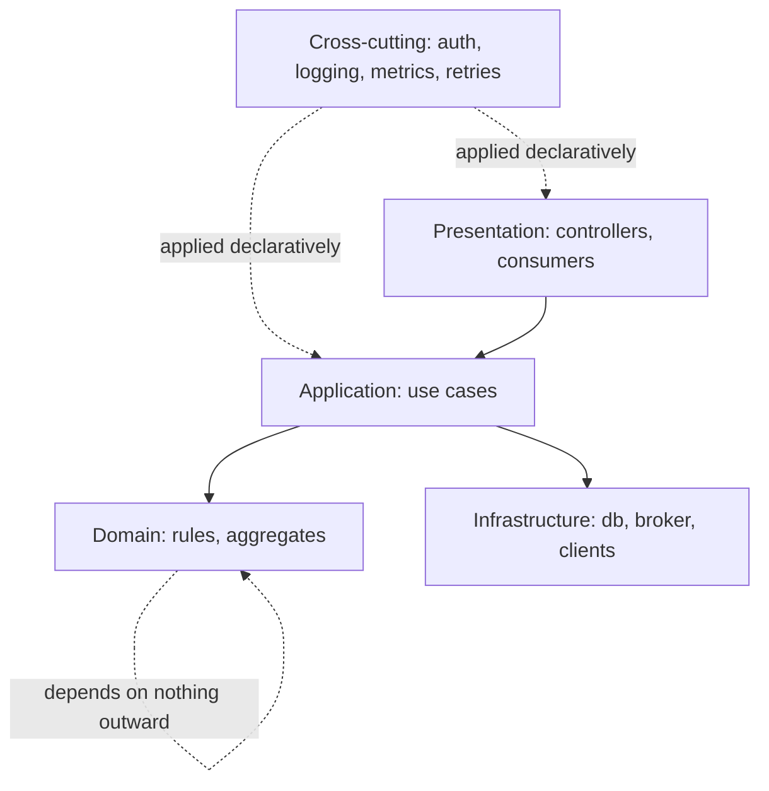

# Separation of Concerns

> [!abstract] In one sentence
> Separation of concerns is the discipline of making each function, module and service do one thing — high cohesion inside, low coupling between — and of handling cross-cutting needs like auth, logging and retries once, so that a change touches one place and a failure stays in one place.

**Map:** [[Architecture Patterns MOC]] → [[HLD MOC]]

## Definition

**Separation of concerns** (the phrase is Dijkstra's, 1974) is the principle that a system should be divided into parts, each addressing a distinct concern, with minimal overlap. Two measures describe how well it is applied: **cohesion** — how strongly the elements inside a part belong together — and **coupling** — how much one part depends on another's internals. Good separation is high cohesion and low coupling. **Layering** separates concerns by level of abstraction; **cross-cutting concerns** are those every layer or module needs (authentication, logging, metrics, retries, transactions) and should be implemented once and applied declaratively rather than copied into every feature.

## Problem solved

Without separation, every change is a wide change. A handler that parses HTTP, checks the [[JWT]], runs business rules, builds SQL, retries a downstream call and logs the result must be edited for any of six reasons, and a bug in one leaks into the others. Copy-pasted cross-cutting code (every endpoint re-implementing token checks) means security holes where one copy is missing. Coupling compounds: when A reaches into B's tables and C into A's classes, a schema change in B breaks both, and nobody can estimate the cost of anything. Separation makes the cost of change proportional to the size of the change, and it is the precondition for [[Hexagonal Architecture]], [[Modular Monoliths]] and [[Microservices]] to work at all.

## How it works

1. **One reason to change per unit.** At function level, single responsibility; at module level, one capability (`payments`), not one technical layer (`repositories`); at service level, a [[Domain-Driven Design|bounded context]].
2. **Layer by abstraction, depend inward.** Presentation knows the application layer; the application layer knows the domain; the domain knows nothing about either. Infrastructure sits at the edge, reached through interfaces the inner layers own.
3. **Measure coupling by what breaks.** "If I change this, what else must change?" Many dependants mark a part as stable and hard to change; many dependencies mark it as fragile. Cycles between modules are the smell to eliminate first.
4. **Pull cross-cutting concerns out.** Authentication, logging with correlation ids, metrics, tracing, retries, rate limiting and transaction boundaries are implemented once — as middleware, interceptors, aspects or a sidecar — and applied by annotation or configuration. A Spring `@Transactional` or a NestJS guard is separation made mechanical; an [[API Gateways|API gateway]] or a service mesh is the same idea at the network edge.
5. **Enforce it.** Conventions decay; rules in the build do not. ArchUnit tests and ESLint import boundaries make the separation a compile error rather than a code-review hope.

```ts
// NestJS: cross-cutting concerns applied declaratively, not inside the handler
@UseGuards(JwtAuthGuard)          // authentication
@UseInterceptors(LoggingInterceptor, TimeoutInterceptor)   // logging, timeout
@Post('/transfers')
async transfer(@Body() dto: TransferDto) { return this.transferFunds.execute(dto); }
```

The principle scales up: a service owning payments *and* notifications has low cohesion; two services sharing a table have high coupling. At system scale the cross-cutting concerns are auth, observability and resilience, and handling them once is why platforms exist.

## Architecture



## Use cases

- Any codebase expected to live more than a few months; the requirement says "maintainable", "we will add channels/providers later" or "multiple teams will work on this".
- Security-sensitive systems where auth and audit must be applied uniformly and verifiably ([[Authentication]], [[Audit Logs]]).
- Shared platform concerns across many services (tracing, retries, rate limits) that should not be re-implemented per team.

## Limitations

- Over-separation creates indirection: five layers for a CRUD endpoint, interfaces with one implementation, and a hunt through files to follow one request.
- Wrong boundaries are worse than none: separating along technical layers while cohesive business concepts are scattered across them is the common failure.
- Cross-cutting mechanisms hide behaviour; a developer who does not know the guard exists cannot reason about the request.
- It is a principle, not a recipe — it does not tell you where the concerns are; [[Domain-Driven Design]] and experience do.

## Trade-offs

| You gain | You sacrifice |
|---|---|
| Changes that stay local, and failures that stay contained | Some directness; following one request crosses more boundaries |
| Cross-cutting behaviour that is consistent and verifiable | Visibility of that behaviour inside the feature code |
| Parts that can be tested, replaced and owned independently | Up-front design effort and discipline to keep boundaries enforced |

## Failure modes

- **Layer leak**: an HTTP request object reaches the domain → the rules cannot run from a message consumer → noticed when the second entry point is built; fix the dependency direction.
- **Copy-pasted concern**: token validation duplicated per endpoint and missing on one → unauthenticated access → found in a security review or an incident; centralise and test the guard.
- **Hidden coupling through data**: two modules share a table → a column rename breaks a module that never imported the other → found in production; one owner per table.
- **Anaemic layering**: cohesive logic split across controller, service and repository by habit → every change touches all three → velocity decays; organise by capability.

## Performance

Negligible at runtime: an interceptor call or an interface dispatch costs nanoseconds. The risk is layers that hide costs — a repository issuing N+1 queries, a retry decorator stacked on another retry layer — so make cross-cutting mechanisms observable with a span per interceptor and a metric per policy.

## Scalability

This is what lets a system scale with its team: cohesive modules map to owners, low coupling lets teams change things without coordination, and cross-cutting platforms keep N services from implementing auth N ways. At 10x engineers, unseparated systems hit a coordination wall before a technical one.

## Operational impact

One logging interceptor means consistent correlation ids; one retry policy means one place to tune; one auth guard means one audit. The burden is keeping enforcement in CI and documenting the cross-cutting mechanisms so on-call knows a 401 came from the guard and a retry from the decorator.

## Alternatives

- **Convention over structure** (framework defaults, no enforced boundaries) — wins for small teams moving fast, with the cost paid later.
- **Vertical slices** (organise by feature end-to-end, minimal layers) — a different separation axis that wins when features rarely share logic.

## Real-world examples

- Dijkstra's 1974 essay "On the role of scientific thought" introduced the phrase; middleware chains (Spring filters, NestJS interceptors) and service meshes (Envoy sidecars for mTLS, retries and telemetry) are the same idea at two scales.
- Shopify's modularisation enforced boundaries with Packwerk precisely because convention alone had failed ([[Shopify - Deconstructing the Monolith]]).
- In a stack like yours: JWT validation as a Spring Security filter or NestJS guard rather than per-endpoint code, Resilience4j policies applied declaratively, logging and tracing via interceptors, and ArchUnit or ESLint rules keeping `domain` free of framework imports.

## Practical exercise

1. Take one endpoint in a NestJS or Spring Boot service that does auth, validation, business logic, persistence and logging inline.
2. Extract the auth check into a guard or filter, the logging into an interceptor, and the business rule into a use-case class; keep behaviour identical and prove it with the existing tests.
3. Add a second entry point (a Redis Streams or Kafka consumer) invoking the same use case; count lines reused versus duplicated.
4. Add an ArchUnit or ESLint rule that `domain` may not import `infrastructure` or framework packages; fix what it finds, then confirm with k6 that the interceptor chain's latency is noise.

## Related concepts

### Prerequisites
- [[Designing for Maintainability]] — the goal separation serves
- [[Functional vs Non-Functional Requirements]] — cross-cutting concerns are the non-functional requirements made concrete

### Related
- [[Evaluating Architectural Complexity]] — separation versus indirection
- [[Technical Debt]] — what unseparated code accrues
- [[Testing Strategies]] — separated units are testable units
- [[API Gateways]] — cross-cutting concerns at the network edge
- [[Authentication]] — the concern most dangerous to duplicate
- [[Logging]] — correlation ids applied once

### Builds on this
- [[Hexagonal Architecture]] — the dependency rule as a concrete structure
- [[Modular Monoliths]] — separation enforced at module scale
- [[Domain-Driven Design]] — cohesion applied to the business model
- [[Designing for Extensibility]] — stable boundaries are where extension points live

### Design problems where it applies
- [[Design an API Gateway]]
- [[Design a Payment System]]
- [[Design a Feature Flag Service]]

### Projects where it can be implemented
- [[Rate Limiter Library]]
- [[LLM Gateway]]
- [[Double-Entry Ledger Service]]

### Resources
- [[A Philosophy of Software Design (Talk)]] — deep modules, information hiding, and the cost of shallow layers
- [[Fundamentals of Software Architecture]] — layered style and its characteristics
- [[Simple Made Easy]] — complecting versus composing
- [[Hexagonal Architecture (Cockburn)]] — separation with a dependency rule

## Personal understanding

> [!question] Explain it without the source
> Write your own explanation here, from memory. Then compare it with the sections above and note what you missed.

### Mastery checklist
- [ ] I can explain it without the original resource
- [ ] I can describe the problem it solves
- [ ] I can compare it with its alternatives
- [ ] I can name its limitations and failure modes
- [ ] I can recognise when it is appropriate in a real system
- [ ] I have applied it in a system design
- [ ] I have validated my assumptions with an experiment or implementation

## Open questions

- [ ] When is a cross-cutting concern better as a library (Resilience4j in-process) versus a sidecar (service mesh), given polyglot Java and Node services?
- [ ] How many layers does a typical payments endpoint justify, and what is the test that an added layer is earning its indirection?
- [ ] Is the retry concern really cross-cutting, or does its idempotency dependence make it a per-operation decision?
