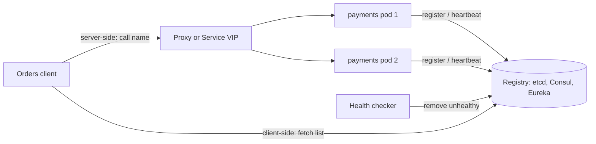

# Service Discovery

> [!abstract] In one sentence
> Service discovery answers "which healthy addresses currently serve `payments`?" from a continuously updated registry, so callers survive instances being rescheduled, scaled and replaced — the question is only whether the client or a proxy asks it.

> [!tip] Deeper treatment in your system-design vault
> `system-design/03 Traffic Management/Health Checks and Service Discovery.md` — read it *after* you have written your own explanation below.

**Map:** [[Architecture Patterns MOC]] → [[HLD MOC]]

## Definition

**Service discovery** is the mechanism by which a caller resolves a logical service name into the set of network endpoints currently able to serve it. It has three parts: **registration** (an instance announces itself, or the platform does on its behalf), **health integration** (unhealthy instances are removed, by heartbeats or [[Health Checks|health checks]]) and **lookup** (clients query the registry directly, or a proxy or [[DNS]] layer does it for them). In Kubernetes the registry is the API server's Endpoints objects, and a Service is the lookup.

## Problem solved

Before containers, services had stable hosts and a config file of addresses was fine. Under a scheduler, instances are created and destroyed constantly, IPs are ephemeral and autoscaling changes the set every minute; hard-coded addresses make every rescheduling an outage or a config deploy. Discovery turns topology into runtime data — the registry updates as instances start, stop and fail, and callers pick from the current set — which is what makes [[Microservices]] and rolling deployments ([[Deployment and Rollback Strategies]]) operable.

## How it works

1. **Registration.** Self-registration: the instance registers on start (Eureka client, Consul agent) and heartbeats; a missed window deregisters it. Third-party registration: the platform observes the instance (Kubernetes watches pods and readiness probes) and updates endpoints without the application knowing.
2. **Health.** Registration says "I exist"; health says "I can serve". The registry removes instances that fail probes, and readiness is separate from liveness so a warming-up instance gets no traffic.
3. **Lookup, two shapes:**
   - **Client-side.** The client library fetches the instance list, caches it, refreshes on a timer or watch, and balances itself. [[gRPC]] resolvers work this way: fewer hops, smarter balancing, logic in every language's client.
   - **Server-side.** The client calls a stable name; a proxy or [[Load Balancers|load balancer]] (a Kubernetes Service via kube-proxy, an Envoy sidecar) does the lookup. Simple clients, one more hop, policy in the platform.
4. **DNS-based.** `payments.default.svc.cluster.local` resolves to a virtual IP (ClusterIP) or to pod IPs (headless Service, used by gRPC clients for per-pod balancing). Cheap and universal, but TTLs and client caching delay updates.
5. **Registry consistency.** Registries built on [[Consensus]] (etcd, Consul) are consistent but unavailable during leader loss; AP designs (Eureka) keep serving a possibly stale list. Stale-but-available is usually right for discovery: a wrong address fails fast, no address fails everything.

```yaml
# Kubernetes: the platform registers pods; clients resolve the Service name
apiVersion: v1
kind: Service
metadata: { name: payments }
spec:
  selector: { app: payments }
  ports: [{ port: 80, targetPort: 8080 }]
```

## Architecture



> [!example]- Excalidraw version — the same diagram as an editable canvas
> ![[Service Discovery.excalidraw]]
> [[Service Discovery.excalidraw|Open in Excalidraw]] — needs the Excalidraw plugin (see [[Plugins to Install]]).


## Use cases

- Any environment where instances are scheduled dynamically: Kubernetes, ECS, autoscaling groups.
- Per-instance load balancing for long-lived connections ([[gRPC]], [[WebSockets]]) where a virtual IP would pin all traffic to one pod.
- Blue-green and canary rollouts that shift traffic by changing registry membership rather than client config.

## Limitations

- Lookup correctness depends on health signals; a shallow health check registers an instance that cannot actually serve.
- Caching at every layer (client, DNS, proxy) means removal is not instant; expect seconds of traffic to dead instances unless connections fail fast.
- Client-side discovery multiplies client libraries and policy drift across languages, and the registry itself becomes critical infrastructure whose availability bounds the whole system.

## Trade-offs

| You gain | You sacrifice |
|---|---|
| Callers survive rescheduling, scaling and failures without config changes | A critical registry whose availability you must now guarantee |
| Health-aware routing: traffic goes only to ready instances | Immediate accuracy; caches and TTLs make the view slightly stale |
| Topology changes become runtime events, enabling canaries and rollouts | Simplicity of a fixed address; debugging now includes "what did the registry say at that moment" |

## Failure modes

- **Stale entries** after a crash without deregistration → clients send requests to dead IPs until heartbeats expire → connection errors for the TTL window; fix with fast failure, outlier detection and retries to a different instance.
- **Registry unavailable** → new instances cannot register and clients cannot refresh → deployments stall and scaling fails; AP registries or cached last-known-good lists limit the blast radius.
- **Readiness lies** (probe passes before the connection pool or cache is warm) → the first requests after a deploy time out → noticed as error spikes during rollouts; make readiness reflect real dependencies.
- **Virtual-IP pinning** for long-lived connections → one new pod receives no traffic while old ones carry everything → uneven load found via per-pod metrics; use headless Services and client-side balancing.

## Performance

Lookup is a cached local read on the hot path, so per-request cost is negligible; server-side discovery adds a proxy hop (tens to hundreds of microseconds in-cluster). DNS-based discovery is bounded by TTL and resolver behaviour — Java's default DNS caching can hold entries far longer than the TTL unless configured, which turns a rollout into a slow failover.

## Scalability

Registries handle thousands of services and tens of thousands of instances; the pressure is churn (registrations and health updates per second) and fan-out of watch notifications. At 10x, batched updates, longer heartbeat intervals and per-cell registries keep the control plane calm; Kubernetes' EndpointSlices exist precisely to scale endpoint updates for large Services.

## Operational impact

On Kubernetes the registry is the platform's problem; your burden is correct readiness probes, graceful termination and understanding Service types. Running Consul or Eureka yourself adds a cluster to operate and upgrade. Debugging discovery means comparing the registry's view with reality, so expose per-instance registration state and age in dashboards.

## Alternatives

- **Static configuration or DNS round robin** — wins for a few long-lived hosts that rarely change.
- **A central [[Load Balancers|load balancer]] per service** — wins for simplicity when an extra hop is acceptable and the balancer itself registers backends.
- **Service mesh** (Envoy sidecars with a control plane) — wins when you also want mTLS, retries and telemetry uniformly; discovery becomes one feature among many.

## Real-world examples

- Netflix Eureka is the canonical AP, client-side registry; HashiCorp Consul and etcd are the consensus-backed ones, with Consul exposing DNS and health checks.
- Kubernetes Services, EndpointSlices and CoreDNS are the most widely deployed discovery system today; gRPC's name resolver implements client-side discovery over DNS or xDS.
- In a stack like yours: Spring Boot and NestJS services behind ClusterIP Services on EKS; headless Services plus client-side balancing for any gRPC or WebSocket tier; readiness probes gated on database and Redis connectivity so a pod is never routable before it can serve.

## Practical exercise

1. In a kind or minikube cluster, deploy a `payments` Deployment with three replicas, a ClusterIP Service and a headless Service.
2. From an `orders` pod, resolve both names with `nslookup` and compare: one VIP versus three pod IPs.
3. Open a long-lived gRPC connection through the ClusterIP, scale `payments` to six, and observe traffic staying on the original pod; repeat with the headless Service and a client-side balancer.
4. Set a readiness probe that fails for 30 s after start, roll the deployment, and watch `kubectl get endpointslices -w`.
5. `kill -9` a pod and measure how long a client keeps getting connection errors before endpoints update.

## Related concepts

### Prerequisites
- [[DNS]] — the oldest discovery mechanism and the one everything falls back to
- [[Health Checks]] — registration without health is a list of liars
- [[Load Balancers]] — where discovered instances get traffic
- [[Microservices]] — the architecture that makes discovery necessary

### Related
- [[Failure Detection]] — heartbeats, timeouts and the stale-entry window
- [[Consensus]] — consistent registries and what they cost in availability
- [[Gossip Protocols]] — how Consul agents spread membership
- [[gRPC]] — built-in client-side resolution and balancing
- [[Reverse Proxies]] — server-side discovery's workhorse

### Builds on this
- [[API Gateways]] — resolve upstreams through the registry
- [[Circuit Breakers]] — per-instance breakers need per-instance identity
- [[Deployment and Rollback Strategies]] — rolling and canary deploys are registry membership changes

### Design problems where it applies
- [[Design an API Gateway]]
- [[Design a Distributed Key-Value Store]]
- [[Design a Chat System]]

### Projects where it can be implemented
- [[Chaos Lab]]
- [[Mini-KV Store]]

### Resources
- [[Building Microservices]] — discovery options and their trade-offs
- [[etcd Raft Library]] — the consensus core under Kubernetes' registry
- [[Understanding Distributed Systems]] — failure detection and membership

## Personal understanding

> [!question] Explain it without the source
> Write your own explanation here, from memory. Then compare it with the sections above and note what you missed.

### Mastery checklist
- [ ] I can explain it without the original resource
- [ ] I can describe the problem it solves
- [ ] I can compare it with its alternatives
- [ ] I can name its limitations and failure modes
- [ ] I can recognise when it is appropriate in a real system
- [ ] I have applied it in a system design
- [ ] I have validated my assumptions with an experiment or implementation

## Open questions

- [ ] What should a readiness probe actually check for a service that depends on PostgreSQL, Redis and an IAM key set — and when does a deep probe cause cascading unreadiness?
- [ ] How does a client-side balancer in Java or Node discover new pods behind a headless Service without re-resolving on every call?
- [ ] For a multi-cluster setup, is DNS-based global discovery enough, or does it need a mesh with locality-aware routing?
