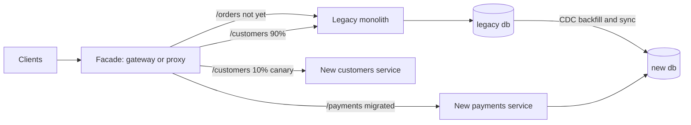

# Strangler Pattern

> [!abstract] In one sentence
> The strangler fig grows around a legacy system one feature at a time — a facade routes each migrated slice to the new implementation while the rest still hits the old one — so you never do a big-bang rewrite and can stop, pause or roll back at any slice.

> [!tip] Deeper treatment in your system-design vault
> `system-design/10 Architecture Styles/Strangler Fig Migration.md` — read it *after* you have written your own explanation below.

**Map:** [[Architecture Patterns MOC]] → [[HLD MOC]]

## Definition

The **strangler fig pattern** (Martin Fowler, 2004, after the vine that grows around a host tree until the tree dies) is an incremental migration strategy: place an interception layer — a [[Reverse Proxies|proxy]], [[API Gateways|gateway]] or in-code router — between callers and the legacy system; replace one capability at a time; switch its traffic to the new code; repeat until the legacy system is empty. Each step is small, shippable and reversible. The pattern says *how* to migrate, not *to what*: the target can be [[Microservices]], a [[Modular Monoliths|modular monolith]] or a new monolith.

## Problem solved

Big-bang rewrites fail on a schedule: the old system keeps changing while the new one is built, the new one must reach feature parity before delivering any value, and the cut-over is a single high-risk night nobody can fully test. The strangler turns a multi-year bet into a sequence of small deliveries that each retire a piece of the old system, produce value early, and keep a rollback path — flip the route back — at every step.

## How it works

1. **Insert the facade.** A routing layer in front of the legacy system that initially forwards everything unchanged. This alone gives you observability over which endpoints are actually used, and a place to switch traffic later.
2. **Pick the first slice.** Choose by value and safety: clear boundaries, high change rate or pain, low data entanglement. Do not start with what everything depends on (auth, the customer table).
3. **Build the replacement** behind the facade, with its own store if it is to be a service, consuming legacy data via API or [[Change Data Capture]].
4. **Synchronise data** for the overlap: an anti-corruption layer reading legacy data, or a one-time backfill plus CDC ([[Outbox Pattern|outbox]]-style, never two unguarded writes). Decide which side is the system of record for each table at each phase.
5. **Shift traffic** per route: shadow (send to both, compare, serve legacy), canary (1% to new), then full, controlled by [[Feature Flags]] or gateway weights.
6. **Retire** the legacy code path — actually delete it — then repeat. Finish when the legacy system serves nothing, or **stop** earlier if what remains is stable and cheap; the pattern is also a way to discover that.

```yaml
# gateway routes mid-migration
- path: /v1/payments/*   -> payments-service      # migrated
- path: /v1/orders/*     -> legacy-monolith        # not yet
- path: /v1/customers/*  -> canary: 10% customers-service, 90% legacy-monolith
```

## Architecture



## Use cases

- A legacy system that must be replaced but cannot be frozen or turned off: "we need to move off the monolith without a cut-over".
- Extracting one capability from a [[Monoliths|monolith]] to its own service for scaling or ownership reasons.
- Migrating between vendors or platforms (an old payment gateway to a new one) with traffic-splitting and comparison.
- Any migration a design review describes as "too risky to do at once".

## Limitations

- Needs an interception point: systems integrated through shared databases, batch files or direct library calls have no clean facade to insert.
- Data synchronisation during the overlap is the hard part and can outlast the code migration; two systems of record is a bug waiting to happen.
- Running old and new in parallel doubles infrastructure, on-call and cognitive load, and migrations stall: the last 20% is the ugliest, and the legacy system can live on "strangled" but never removed.

## Trade-offs

| You gain | You sacrifice |
|---|---|
| Incremental, reversible migration that delivers value from the first slice | A long period of running two systems with the cost and complexity that implies |
| Continuous learning about real usage and boundaries before committing | Clean slate: the new system is shaped by the legacy interfaces it must honour for a while |
| Rollback by route change, at every step | Speed: slice-by-slice is slower in calendar time than a successful big bang (which rarely exists) |

## Failure modes

- **Dual-write drift**: a write lands on one side only → wrong balances or missing records → found by reconciliation; use CDC or an outbox with one system of record per table.
- **Facade becomes a business-logic layer** (transformations, merges) → a new monolith at the edge → noticed when gateway deploys need both teams; keep the facade to routing.
- **Stalled migration**: easy slices done, hard core remains, funding ends → permanent double system → set a retirement target and track legacy traffic share.
- **Shadow comparison on status codes only** → subtle semantic differences (rounding, ordering) reach customers → compare response bodies and downstream effects.

## Performance

The facade adds a hop — a millisecond or less — on every request for the migration's duration, and an anti-corruption layer adds serialisation. Shadowing doubles load on the migrated path temporarily. Measure old and new under the same traffic before shifting; "the new one is faster" is an assumption until it is a graph.

## Scalability

The pattern scales to very large systems because the unit of work is a slice, and slices with low data entanglement can proceed in parallel across teams. The limiting factor is the shared legacy database: remaining tables and foreign keys constrain ordering, which is why the sequence is usually leaf capabilities first, core data last.

## Operational impact

High for the duration: two pipelines, two sets of dashboards, a routing config that is the riskiest thing in the system, sync jobs and reconciliation. Tag every request with its route decision so incidents can be attributed. The relief is that each step is small and rollback is a config change.

## Alternatives

- **Big-bang rewrite with a cut-over** — wins only for small systems with a hard deadline and a tolerable downtime window.
- **Refactor in place toward a [[Modular Monoliths|modular monolith]]** — wins when the problem is structure, not technology, and no service boundary is needed yet.
- **Branch by abstraction** — inside one codebase, put an interface in front of the component, implement a new one, and switch; the strangler's in-process sibling.

## Real-world examples

- Fowler's original [[Martin Fowler - Strangler Fig Application]] describes the vine metaphor and the incremental approach; SoundCloud's monolith decomposition, routing API slices to new services behind an edge layer over several years, is the widely cited case.
- Shopify's Rails modularisation ([[Shopify - Deconstructing the Monolith]]) is the in-place variant, and Stripe's online migrations ([[Stripe - Online Migrations at Scale]]) show the data-side discipline the pattern depends on.
- In a stack like yours: moving a notifications capability out of a Spring Boot monolith to a NestJS service behind the existing gateway, Debezium CDC from the legacy PostgreSQL to the new store, a 1%-10%-50%-100% route canary, and a legacy-traffic-share metric on the dashboard until it reads zero.

## Practical exercise

1. In Docker Compose, run a "legacy" app with `/orders` and `/payments` endpoints on one PostgreSQL, behind Kong or an Nginx facade that forwards everything.
2. Build a new `payments` service with its own database; backfill from legacy and keep it in sync with Debezium (or a polling sync for the exercise).
3. Shadow `/payments` traffic to both under k6 load; log and diff responses.
4. Shift 10%, then 100% by changing only facade config; roll back once to prove the path works, then delete the legacy payments code.

## Related concepts

### Prerequisites
- [[Monoliths]] — the usual host tree
- [[Reverse Proxies]] — the facade's mechanism
- [[Microservices]] — the usual destination, with its own costs

### Related
- [[API Gateways]] — the facade in practice
- [[Change Data Capture]] — keeping two stores aligned during the overlap
- [[Schema Evolution]] — expand-and-contract on the legacy database
- [[Feature Flags]] — controlling the traffic split per slice
- [[Modular Monoliths]] — the in-place alternative or the preparatory step
- [[Incremental Delivery]] — the delivery philosophy this applies to migration

### Builds on this
- [[Designing Systems for Changing Requirements]] — the migration capability a long-lived system needs
- [[Versioning and Migrations]] — a strangled system is a migration with a traffic switch

### Design problems where it applies
- [[Design a Payment System]]
- [[Design an API Gateway]]
- [[Design an IAM Service]]

### Projects where it can be implemented
- [[LLM Gateway]]
- [[Webhook Relay]]

### Resources
- [[Martin Fowler - Strangler Fig Application]] — the origin
- [[Shopify - Deconstructing the Monolith]] — the in-place variant
- [[Building Microservices]] — decomposition and data migration chapters
- [[Stripe - Online Migrations at Scale]] — the data-side playbook

## Personal understanding

> [!question] Explain it without the source
> Write your own explanation here, from memory. Then compare it with the sections above and note what you missed.

### Mastery checklist
- [ ] I can explain it without the original resource
- [ ] I can describe the problem it solves
- [ ] I can compare it with its alternatives
- [ ] I can name its limitations and failure modes
- [ ] I can recognise when it is appropriate in a real system
- [ ] I have applied it in a system design
- [ ] I have validated my assumptions with an experiment or implementation

## Open questions

- [ ] How do you strangle a capability whose data is joined by a dozen legacy queries — views over the new store, CDC back into the legacy schema, or a long dual-read period?
- [ ] What metrics decide when a migration is "done enough" to stop and leave the remainder in the legacy system?
- [ ] How do you keep the facade from becoming the place every team adds "just one" transformation?
