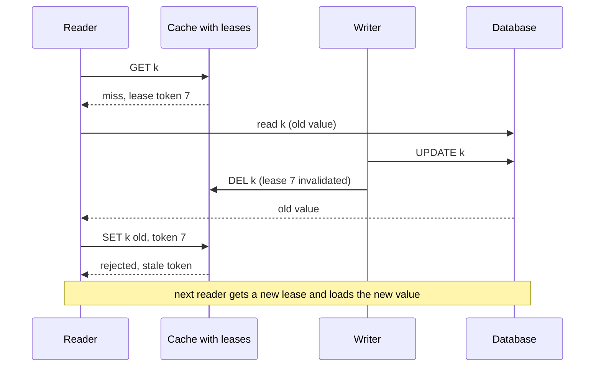

# Cache Consistency

> [!abstract] In one sentence
> Every cache lies a little — the only questions are for how long, to whom, and whether the lie costs money — and the answer is to classify each read by what a stale value would do, give the harmless ones a TTL, give the session-sensitive ones read-your-writes through versions or write-through, and send the dangerous ones to the source of truth.

> [!tip] Deeper treatment in your system-design vault
> `system-design/04 Caching and Redis/Cache Invalidation.md` — read it *after* you have written your own explanation below.

**Map:** [[Caching MOC]] → [[HLD MOC]]

## Definition

Cache consistency describes the relationship between the value a reader gets from a cache and the current value at the source of truth, expressed in the vocabulary of [[Consistency Models]]. A cache populated lazily and invalidated by deletes or expiry is an **eventually consistent replica with bounded staleness**: a read may return any value the key has had within the last TTL (or within the invalidation delay plus race windows). Stronger guarantees — **read-your-writes** (a client sees its own updates), **monotonic reads** (a client never sees an older value after a newer one), and in the limit **linearizability** — are not properties a cache has by default; each must be constructed for the keys and sessions that need it, at a cost in latency, complexity or hit rate.

## Problem solved

Teams add a cache for speed and discover its consistency model by incident: a user updates their profile and sees the old one; a permission is revoked and keeps working; a balance check passes against a stale number; two pods answer the same question differently. The underlying error is treating the cache as the database with lower latency. Naming the consistency model a given cache path actually provides, and matching it to what each reader can tolerate, turns stale reads from surprises into decisions: *this* read may be 60 seconds old, *that* one must reflect the caller's own write, and *this other* one must never be served from cache at all ([[Cache Invalidation]]).

## How it works

**1. The staleness window of a plain cache.** With [[Cache-Aside]] and delete-on-write, a value is stale for at most: the [[TTL]] if the delete is missed; the propagation delay from commit to delete (microseconds to seconds, depending on whether the writer deletes directly or an event pipeline does); plus the race windows in which a reader repopulates an old value (the read-miss/write race, the replica-lag race). For readers in another region with their own cache, add cross-region invalidation delay.

**2. Read-your-writes.** The options, cheapest first:

- **Write-through for that key** from the same service: the write updates the cache with the committed value, so the writer's next read is fresh ([[Write-Through Caching]]). Across pods with in-process caches, this needs an invalidation broadcast.
- **Version tokens**: the write returns a version (row version, LSN, timestamp); the client sends it with subsequent reads; the reader serves from cache only if the cached version is at least that, otherwise bypasses to the source. This is the same mechanism as LSN-based read-your-writes on [[Read Replicas]].
- **Bypass after write**: for a few seconds after a session writes an entity, route that session's reads for it to the source. Facebook's *remote markers* are the cross-region form: a write sets a marker in the local region's cache and the read path, seeing the marker, reads from the primary region's database instead of the local replica ([[Scaling Memcache at Facebook]]).

**3. Monotonic reads.** Violated when a client alternates between caches or replicas with different ages — two pods with in-process caches, a replicated cache tier where a replica is behind, or a cache plus a direct database read. Fixes: pin a session to one cache (sticky routing), carry the last-seen version and refuse to serve older ones, or avoid replicated caches for data where it matters.

**4. Leases — closing the stale-set race.** The cache issues a lease token to a client that misses; only a `SET` carrying a valid token is accepted; a `DELETE` for the key invalidates outstanding tokens. A reader that loaded an old value before a concurrent write can no longer install it, because the write's delete revoked its lease. Leases also rate-limit misses per key (one token per key per short interval; other missers wait or take a stale value) which is why they double as stampede prevention ([[Cache Stampedes]]). The same idea can be implemented in [[Redis]] with a Lua script: `SET` only if the key's lease version matches.

**5. When a stale read is acceptable, and when it is a bug.**

| Read | Stale is… | Model to provide |
|---|---|---|
| Product catalogue, public profiles, feeds, counts | Fine for seconds to minutes | Eventual, TTL-bounded |
| A user's own edits, their own order list | A confusing bug | Read-your-writes for the session |
| Permissions, token revocation, feature kill switches | A security or safety bug after the tolerance window | Short TTL plus immediate invalidation, or bypass |
| Balance at debit time, inventory at checkout, idempotency records, locks | A correctness bug: money or double effects | Bypass the cache; linearizable read at the source |

**6. Techniques for the dangerous reads.** Do not cache them; or cache the value together with a version and verify the version against the source with a cheap primary-key lookup before acting (a "dual check", which keeps the expensive part cached and the decision correct); or make the decision inside the database (`UPDATE ... WHERE balance >= ?`) so the cached value is only a hint ([[ACID]], [[Optimistic and Pessimistic Locking]]).

```text
Read-your-writes with a version token (service-level):
  write:  UPDATE profiles SET ..., version = version + 1 WHERE id = 42 RETURNING version   -> v = 18
          DEL profile:42
          respond { version: 18 }
  read:   client sends If-Version: 18
          cached = GET profile:42 ; if cached and cached.version >= 18 -> serve
          else load from primary, SET profile:42 (with version), serve

Lease in Redis (Lua, sketch):
  on miss:   token = INCR lease:42 ; return token to reader
  on delete: INCR lease:42 ; DEL profile:42
  on set:    if GET lease:42 == token then SET profile:42 value else reject
```

## Architecture



> [!example]- Excalidraw version — the same diagram as an editable canvas
> ![[Cache Consistency.excalidraw]]
> [[Cache Consistency.excalidraw|Open in Excalidraw]] — needs the Excalidraw plugin (see [[Plugins to Install]]).


## Use cases

- Any user-facing flow where someone writes and then reads: profile edits, settings, order placement — needs read-your-writes for that session.
- Security-relevant cached decisions: authorisation results, token validity, feature kill switches — need a stated and short staleness bound ([[Authorization]]).
- Multi-pod services with in-process caches: per-pod inconsistency must be bounded or broadcast-invalidated ([[Multi-Level Caching]]).
- Multi-region deployments with regional caches, where invalidation delay is seconds and writes go to one region ([[Replication]]).
- Design reviews: every cached read should have a one-line consistency statement attached to it.

## Limitations

- A cache cannot be made linearizable without becoming the primary store or coordinating on every operation, which removes its reason to exist.
- Read-your-writes mechanisms are per session; other users still see stale data within the bound, which is usually fine but must be said.
- Leases need cache-side support (Memcached variants, custom Lua in Redis) and a client protocol that honours tokens; off-the-shelf clients do not.
- Version checks add a round trip to the source for the reads that need them, eroding the cache's latency benefit on those paths.
- Consistency across composite views (a page built from ten cached entities) is weaker than any single entity's: the page can mix ages.

## Trade-offs

| You gain | You sacrifice |
|---|---|
| Explicit, per-read consistency statements instead of surprises | Design effort to classify reads and implement the stronger paths |
| Read-your-writes for sessions at low cost via versions or write-through | Extra metadata in responses and requests, and occasional bypass latency |
| Leases that close the stale-set race and tame stampedes | Cache-side logic and a client protocol most libraries lack |
| Safe decisions by bypassing or verifying for critical reads | Hit rate on exactly the keys that are most contended |

## Failure modes

- **Stale decision**: a debit is approved against a cached balance; the real balance was already lower. Noticed by reconciliation or overdraft; blast radius is every decision made on cached values during the window — the fix is never to decide on cached state.
- **Revoked but still valid**: a token or permission is cached for minutes after revocation. Noticed in a security review or by an attacker; bound the TTL to the policy and invalidate immediately on revoke ([[JWT]]).
- **Write then read shows the old value**: the write path deleted the key, the read hit a pod with an in-process copy or a lagging replica. Noticed as support tickets and user retries that create duplicates; needs read-your-writes for the session.
- **Non-monotonic reads**: a list shows an item, a refresh hides it, another refresh shows it — the client bounced between caches of different ages. Noticed as flickering UIs; pin or version.
- **Stale set after invalidation**: a reader installs an old value just after a delete; it stays until TTL. Noticed as "the update took a minute to appear, sometimes"; leases or a short TTL on recently invalidated keys fix it.

## Performance

Eventual, TTL-bounded reads are the fast path: one cache round trip. Read-your-writes via version tokens costs nothing on the hit path and a source read on the rare bypass; via write-through it costs a cache write per write. Leases add a token exchange on misses only. Dual-check reads cost an extra cheap database lookup per read, which is still far less than loading the full value but makes the database the latency floor for those paths ([[Latency]]). The cost of linearizable reads is the reason they must be reserved for the few paths that need them.

## Scalability

Weak consistency scales: eventual caches need no coordination across nodes or regions. Each strengthening adds coordination somewhere — version checks against the source, leases on the owner node, invalidation broadcasts to every pod or region — so the fraction of reads needing strong guarantees bounds how far the cache tier can offload the source. At 10x pods, in-process caches multiply inconsistency; a shared tier with a single owner per key keeps one copy to keep consistent ([[Distributed Caching]]).

## Operational impact

Document the consistency statement per cached read and the mechanism that provides it; review it when invalidation paths change. Monitor invalidation lag (commit-to-delete), replica lag where misses load from replicas, lease rejections (a signal of races happening), and bypass rates for version-checked reads. Incident response for "wrong data" starts with which cache served it and how old it was; include the cache key and version in logs for sensitive paths ([[Logging]]).

## Alternatives

- **Do not cache the data** — read from the primary, scale with replicas and indexes; wins when the staleness bound would need to be near zero.
- **Make the cache the source of truth** for that data (Redis as the primary store with persistence) — consistency becomes Redis's single-node model; wins for ephemeral state like sessions and presence, with Redis's durability caveats ([[Redis]]).
- **Materialised read models fed by events** ([[CQRS]]) — accept eventual consistency openly and design the UI for it; wins when reads vastly outnumber writes and the lag is visible and acceptable.
- **Strongly consistent distributed caches** (write-through with synchronous replication, or a database's own cache such as DAX) — win when the vendor provides the guarantee and the write latency is affordable.

## Real-world examples

- Facebook's memcache paper is the reference: leases against stale sets and thundering herds, remote markers for cross-region read-after-write, and an explicit acceptance of brief staleness for everything else ([[Scaling Memcache at Facebook]]).
- Amazon's Builders' Library caching article discusses the consequences of serving stale data under failure and the discipline of deciding, per use, whether stale is acceptable ([[AWS Builders Library - Caching Challenges]]).
- Database-integrated caches such as DynamoDB Accelerator document their consistency precisely (eventually consistent reads through the cache; strongly consistent reads bypass it) — the right shape for a cache's contract.
- In a stack like yours: merchant configuration can be minutes stale (TTL plus event invalidation); a merchant's own dashboard after an edit needs read-your-writes via a version returned by the admin API; token revocation in the IAM service needs a short TTL plus immediate invalidation broadcast to every pod; and ledger balances for authorisation are never read from cache — the decision happens in PostgreSQL with the cached balance used only for display.

## Practical exercise

1. Run PostgreSQL, Redis and a NestJS or Spring Boot service with two replicas behind nginx in Docker Compose, caching `profile:{id}` with cache-aside and an in-process L1 in each pod.
2. Write via one pod, read via the other immediately; count stale reads over 1,000 trials. This is the baseline inconsistency.
3. Add a version token: the write returns `version`, the read sends it and bypasses on a lower cached version; repeat and count. Then add a Redis pub/sub invalidation for the L1 and compare.
4. Implement leases in Redis with a Lua script; reproduce the stale-set race with an injected delay and show the rejected set.
5. Simulate a revocation: cache a permission with a 60-second TTL, revoke it, and measure how long requests keep succeeding; add immediate invalidation and remeasure.
6. Implement a dual-check read for a "balance" key (cached value plus a version verified against the database) and measure its latency against both the pure cache read and the pure database read.

## Related concepts

### Prerequisites
- [[Consistency Models]] — the vocabulary: eventual, read-your-writes, monotonic, linearizable
- [[Cache-Aside]] — the pattern whose consistency this note describes
- [[Cache Invalidation]] — the mechanisms whose delays and races set the staleness bound

### Related
- [[Read Replicas]] — the same read-your-writes problem with LSNs
- [[Eventual Consistency]] — what a cache offers by default
- [[Write-Through Caching]] — read-your-writes by construction for one cache
- [[Multi-Level Caching]] — inconsistency multiplied by layers
- [[Cache Stampedes]] — leases as the shared mechanism
- [[TTL]] — the bound under everything

### Builds on this
- [[Authorization]] — cached decisions with a revocation bound
- [[Distributed Caching]] — consistency across nodes and replicas
- [[CQRS]] — read models as deliberately stale caches
- [[Idempotency]] — why idempotency records must not be cached

### Design problems where it applies
- [[Design an IAM Service]]
- [[Design a Digital Wallet and Ledger]]
- [[Design a Social Feed]]
- [[Design a Distributed Cache]]
- [[Design an Inventory Management System]]

### Projects where it can be implemented
- [[Feature Flag Service and SDK]]
- [[Double-Entry Ledger Service]]

### Resources
- [[Scaling Memcache at Facebook]] — leases, remote markers and the staleness contract
- [[AWS Builders Library - Caching Challenges]] — deciding when stale is acceptable
- [[Jepsen Consistency Models]] — the precise definitions behind the guarantees

## Personal understanding

> [!question] Explain it without the source
> Write your own explanation here, from memory. Then compare it with the sections above and note what you missed.

### Mastery checklist
- [ ] I can explain it without the original resource
- [ ] I can describe the problem it solves
- [ ] I can compare it with its alternatives
- [ ] I can name its limitations and failure modes
- [ ] I can recognise when it is appropriate in a real system
- [ ] I have applied it in a system design
- [ ] I have validated my assumptions with an experiment or implementation

## Open questions

- [ ] For each cached read in a service I know, what is the written staleness bound, and which reads make a decision rather than display a value?
- [ ] What revocation latency does the IAM service promise, and does every consumer's token cache honour it with TTL plus invalidation?
- [ ] Is a lease protocol worth implementing in Redis for our hottest keys, or does a short TTL on recently invalidated keys give most of the benefit?
