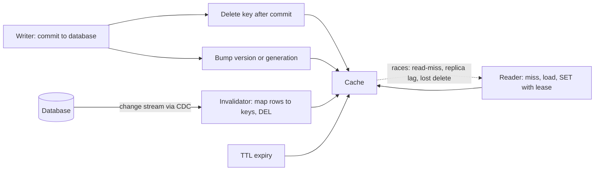

# Cache Invalidation

> [!abstract] In one sentence
> Invalidation is the hard half of caching because the cache and the source change at different times through different paths — TTL bounds the damage, delete-on-write handles the writers you control, versioned keys sidestep the race for immutable data, and change-stream invalidation covers writers you do not control — and the ordering of "update the database" and "delete the key" is not a style choice but the difference between a short race and a long one.

> [!tip] Deeper treatment in your system-design vault
> `system-design/04 Caching and Redis/Cache Invalidation.md` — read it *after* you have written your own explanation below.

**Map:** [[Caching MOC]] → [[HLD MOC]]

## Definition

Cache invalidation is the set of mechanisms by which a cached value is removed, replaced or marked unusable once the underlying data has changed, so that readers stop receiving the stale copy. The four families are: **time-based** (a [[TTL]] after which the entry is discarded regardless of changes), **write-triggered** (the writer deletes or updates the cached key after changing the source, as in [[Cache-Aside]] and [[Write-Through Caching]]), **key-versioned** (the key encodes a version, so a change produces a new key and the old entry becomes unreachable), and **change-driven** (a process watches the database's change stream and invalidates affected keys — [[Change Data Capture]]). Each delivers a different staleness bound and leaves a different race open; real systems layer them.

## Problem solved

A cache is a copy, and copies drift. Without invalidation, a cached value is correct only until the first write, after which readers see the past for as long as the entry lives — a changed price, a revoked permission, a cancelled order still showing as active. The classic difficulty is that writes happen in many places (services, batch jobs, admin tools, migrations) at times the cache cannot see, and that readers and writers race: a reader can be loading the old value at the exact moment a writer removes it. Phil Karlton's line that cache invalidation is one of the two hard problems in computer science is quoted because every team eventually discovers a stale-data bug whose root cause is an interleaving nobody drew. Invalidation design is the drawing of those interleavings in advance.

## How it works

**1. TTL — the floor.** Every cached entry gets an expiry derived from the reader's staleness tolerance; this bounds the staleness of every other method's failures. Alone, it means readers see stale data for up to the TTL after every write.

**2. Delete on write — the workhorse.** The writer commits to the database, then deletes the key. Three details decide its correctness:

- **After commit, not before.** Deleting inside the transaction lets a concurrent reader miss, read the pre-commit row from the database, and cache it; the commit then lands and the cache is stale until TTL. Delete after the commit returns.
- **Database first, then cache.** Deleting the key first and updating the database second opens a window in which a reader misses and repopulates the old value. The standard order is update → commit → delete, which leaves only the much shorter read-miss/write race (a reader that read the old row *before* the write and sets it *after* the delete).
- **Deletes can fail.** If the cache is unreachable the delete is lost and the key is stale until TTL; for keys where that matters, record the pending delete durably (an outbox row, [[Outbox Pattern]]) and retry.

Why delete rather than set the new value: deletes are idempotent and order-independent across concurrent writers; setting values races (writer A's older value can land after writer B's newer one), caches values nobody reads, and requires the writer to compute every derived representation.

**3. Versioned keys — invalidation by renaming.** Put a version in the key: `product:42:v17`, or a per-collection generation number `orders:merchant:7:gen:5:page:1`. A write bumps the version (in the database row, or in a small "generation" key in the cache); readers look up the version, then the versioned key. The old entries are never served again and expire or get evicted. There is no delete race because the old key is simply not read; the costs are an extra lookup for the version (cacheable, but that cache needs invalidating — usually by a short TTL or by storing the version on the parent row), orphaned entries occupying memory until eviction ([[Eviction Policies]]), and the need to bump the right generation for derived views. This is also how CDNs invalidate immutable assets: change the file name, not the cache.

**4. Change-driven invalidation — for writers you do not control.** A CDC connector tails the database log and emits row changes; an invalidator maps each change to cache keys and deletes them. Every write path, including batch jobs and other services, is covered automatically; the cost is a pipeline (Debezium, Kafka, an invalidator service) and a lag of milliseconds to seconds between commit and delete. Facebook's `mcsqueal` was exactly this: daemons tailing MySQL commit logs and sending deletes to memcache ([[Scaling Memcache at Facebook]]).

**5. The races that remain, and the tools for them.**

- *Read-miss/write race* (reader loads old, writer deletes, reader sets old): closed by **leases** — the cache hands the missing reader a token, a delete invalidates outstanding tokens, and a set with a stale token is rejected ([[Cache Consistency]]).
- *Replica-lag race* (reader misses after the delete, loads from a lagging replica): closed by reading the primary on miss for sensitive keys, or by a **delayed second delete** after the replication lag has passed, or by remote markers that force primary reads until the replica catches up ([[Read Replicas]]).
- *Derived data* (a cached list or page composed of many rows): invalidate by **tags** (CDN surrogate keys, or a set of dependent keys per row) or by **generation numbers** on the collection.
- *Lost delete*: bounded by TTL; eliminated by durable, retried deletes.

```text
Writer (cache-aside, correct order):
  BEGIN; UPDATE products SET price = 1999 WHERE id = 42; COMMIT;
  DEL product:42                      -- after commit; retry via outbox if the DEL fails

Versioned read:
  gen = GET merchant:7:orders:gen        (or read updated_at from the parent row)
  val = GET merchant:7:orders:gen:{gen}:page:1
Writer bumps:  INCR merchant:7:orders:gen   -- old pages are unreachable; no delete race

Delayed double delete (replica lag r):
  COMMIT; DEL k; sleep(r + margin); DEL k
```

## Architecture



## Use cases

- Any cache in front of mutable data where readers must see changes within a bound — which is nearly every cache except ones over immutable content.
- Multiple writers to the same data (services, jobs, admin tools): change-driven invalidation is the only method that covers them all.
- Derived views — lists, search pages, rendered documents — where a single row change invalidates many cached entries: tags or generations.
- Security-sensitive caches (permissions, tokens, revocations) where the staleness bound is a policy, not a performance knob ([[Authorization]]).
- Content with versions or hashes already (assets, documents, immutable events): versioned keys make invalidation a non-problem.

## Limitations

- No method gives linearizable reads through a cache; even leases plus CDC leave a small window after commit during which a reader may get the old value.
- Delete-on-write covers only the writers that call it; the forgotten path is the normal failure.
- Change-driven invalidation adds a pipeline with its own lag, ordering and failure modes, and it needs a mapping from row changes to keys that must be kept in sync with the key scheme.
- Versioned keys trade the delete race for orphaned memory and an extra lookup; generation bumps on hot collections can invalidate far more than changed.
- Invalidation of data cached in clients (browsers, mobile apps, in-process caches in other services) cannot be forced; only TTL and versioned URLs work there ([[Multi-Level Caching]]).

## Trade-offs

| You gain | You sacrifice |
|---|---|
| TTL: bounded staleness with no writer cooperation | Freshness within the window; reload traffic |
| Delete-on-write: freshness within milliseconds for writers you control | Coverage of writers you do not control; the read-miss race |
| Versioned keys: no delete race, natural fit for immutable data | Extra lookups, orphaned entries, generation bumps that over-invalidate |
| Change-driven: every write path covered, including external ones | A CDC pipeline to run, with its own lag and failure modes |

## Failure modes

- **Delete inside the transaction**: the key is removed before commit, a reader repopulates the pre-commit value, the commit lands, the cache is stale for a TTL. Noticed as "sometimes the update does not show"; blast radius is that key's readers for a TTL.
- **Forgotten write path**: a migration or batch job updates rows directly; keys stay stale until TTL — or forever if there is none. Noticed by customers; blast radius is every affected key.
- **CDC lag spike**: the connector falls behind during a bulk update; invalidations arrive minutes late and readers see old data in the meantime. Noticed via connector lag metrics ([[Change Data Capture]]); the TTL bounds the exposure.
- **Generation bump storm**: a hot collection's generation changes on every write; every cached page is invalidated each time, the cache hit rate collapses and the database takes the load ([[Cache Stampedes]]). Noticed as hit-rate drops correlated with write rate.
- **Lost delete during cache outage**: the cache was unreachable when the writer tried to delete; it recovers with stale entries intact. Noticed later; durable deletes or a cache flush on recovery are the fixes.

## Performance

Delete-on-write costs one extra cache round trip per write and one guaranteed miss per updated key; versioned keys cost an extra lookup per read (often served from an in-process cache) and leave orphans; change-driven invalidation adds no cost to the write path but consumes a pipeline's throughput and adds lag. TTL costs reloads proportional to hot keys ÷ TTL. The hidden cost is over-invalidation — deleting or bumping more than changed — which turns a correct scheme into a database load problem ([[Throughput]]).

## Scalability

Delete-on-write scales with the writers (each does its own small work); change-driven invalidation scales with the change stream and needs partitioning of the invalidator by key to keep up at high write rates; versioned keys scale well but need the version lookup to be cheap and cached. At 10x cache nodes, a single logical delete fans out to every node or partition holding the key, which is where [[Distributed Caching]] designs with a single owner per key (consistent hashing) beat replicated caches that must invalidate every replica ([[Fan-Out]]).

## Operational impact

Document every cached key's invalidation path and TTL, and keep the list of write paths per entity current; a review question for every schema or job change is "which keys does this invalidate?". Monitor stale-read indicators (reconciliation mismatches, support tickets tagged "did not update"), CDC lag if used, delete failure counts, and hit-rate changes after deploys. Provide an operational "flush keys by pattern" tool for incidents, and know its cost — a mass flush is a self-inflicted stampede.

## Alternatives

- **No cache for the data** — reads go to the source; wins when the staleness bound would have to be near zero and the read load is manageable with replicas and indexes.
- **Write-through with a shared cache** — the write *is* the invalidation; wins for single-service data with read-after-write needs ([[Write-Through Caching]]).
- **Materialised read models fed by events** — instead of invalidating, rebuild the view from the change stream ([[CQRS]]); wins when the view is expensive to compute and the lag is acceptable.
- **Immutable data with content-addressed keys** — design the data so it never changes in place; invalidation disappears ([[Event Sourcing]]).

## Real-world examples

- Facebook's memcache paper describes delete-on-write from the web tier, leases to prevent stale sets, `mcsqueal` for log-driven invalidation across regions, and remote markers for replica lag — a complete catalogue of the methods above at scale ([[Scaling Memcache at Facebook]]).
- Debezium's documentation and tutorials show CDC-driven cache invalidation as a standard pattern: row changes from the database log are consumed by a service that deletes or refreshes affected keys ([[Debezium]]).
- CDN providers (Fastly, Cloudflare, Akamai) implement tag-based purge ("surrogate keys") so that one content change invalidates every page that embedded it, alongside versioned asset URLs for immutable files.
- In a stack like yours: merchant and fee configuration updated by an admin service and by nightly jobs — delete-on-write from the admin service after commit, with an [[Outbox Pattern]] event that an invalidator consumes to cover the jobs and any other writer; token revocation stored with a short TTL plus an immediate delete; and generation numbers for cached transaction lists per merchant so that one new transaction invalidates the pages without a delete storm.

## Practical exercise

1. Run PostgreSQL (primary plus a streaming replica via Toxiproxy with 300 ms lag) and Redis in Docker Compose, with a NestJS or Spring Boot service caching `product:{id}` with cache-aside.
2. Implement delete-inside-transaction and reproduce the stale repopulation with a concurrent reader; move the delete after commit and show the window shrinks.
3. Route miss loads to the replica; reproduce the replica-lag race; then add a delayed second delete and measure the remaining stale reads.
4. Add a batch job that updates prices with raw SQL; observe permanent staleness; then run Debezium (or a polling relay on an outbox) feeding an invalidator and show the job's writes now invalidate within the pipeline's lag.
5. Convert a cached list endpoint to generation-numbered keys; measure hit rate under a write-heavy load and compare with per-key deletes.
6. Implement a lease in Redis with a Lua script (token on miss, delete invalidates, set checks token) and show the read-miss race no longer caches the old value.

## Related concepts

### Prerequisites
- [[Cache-Aside]] — the pattern whose write path is delete-on-write
- [[Transactions]] — why the delete must follow the commit
- [[TTL]] — the bound under every method

### Related
- [[Cache Consistency]] — what each method guarantees and the leases that close races
- [[Change Data Capture]] — the change-driven method's engine
- [[Read Replicas]] — the replica-lag race
- [[Outbox Pattern]] — durable deletes and invalidation events
- [[Eviction Policies]] — where orphaned versioned entries end up
- [[Multi-Level Caching]] — invalidation across layers you do not control

### Builds on this
- [[Distributed Caching]] — invalidation fan-out across nodes
- [[CDNs]] — purge by tag and versioned URLs at the edge
- [[CQRS]] — rebuilding views instead of invalidating them
- [[Search Indexing Pipelines]] — the same change-stream approach for indexes

### Design problems where it applies
- [[Design a Distributed Cache]]
- [[Design a Social Feed]]
- [[Design an IAM Service]]
- [[Design a Feature Flag Service]]
- [[Design an Inventory Management System]]

### Projects where it can be implemented
- [[Feature Flag Service and SDK]]
- [[LLM Gateway]]

### Resources
- [[Scaling Memcache at Facebook]] — the definitive production catalogue of invalidation mechanisms
- [[AWS Builders Library - Caching Challenges]] — practical guidance on TTLs and invalidation
- [[Debezium]] — change-driven invalidation in practice
- [[Designing Data-Intensive Applications]] — chapter 11 on derived data and keeping it in sync

## Personal understanding

> [!question] Explain it without the source
> Write your own explanation here, from memory. Then compare it with the sections above and note what you missed.

### Mastery checklist
- [ ] I can explain it without the original resource
- [ ] I can describe the problem it solves
- [ ] I can compare it with its alternatives
- [ ] I can name its limitations and failure modes
- [ ] I can recognise when it is appropriate in a real system
- [ ] I have applied it in a system design
- [ ] I have validated my assumptions with an experiment or implementation

## Open questions

- [ ] For each cached entity in a service I know, is the delete issued after commit, and what happens to it when Redis is unreachable?
- [ ] At our replica lag, is a delayed double delete practical, or should sensitive misses read the primary — and what does that do to primary load?
- [ ] Would a Debezium-driven invalidator cover all the write paths we have, and what is its lag during our nightly batch windows?
