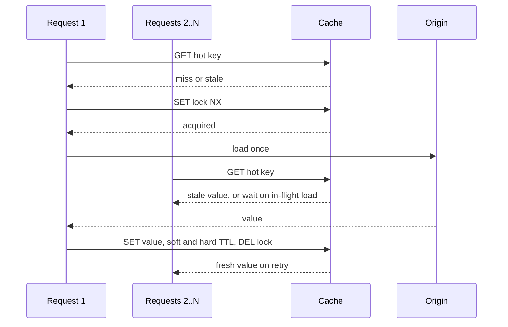

# Cache Stampedes

> [!abstract] In one sentence
> When a hot key expires, every request that misses in the next few milliseconds runs the same expensive load against the origin — a thundering herd that turns one cache miss into hundreds of database queries — and the fix is always some form of "one loads, the rest wait or take stale", applied in-process, in Redis, or at the edge.

> [!tip] Deeper treatment in your system-design vault
> `system-design/04 Caching and Redis/Cache Stampede and Thundering Herd.md` — read it *after* you have written your own explanation below.

**Map:** [[Caching MOC]] → [[HLD MOC]]

## Definition

A cache stampede (dogpile effect, thundering herd) is the burst of origin load that occurs when a cached value becomes unavailable — through [[TTL]] expiry, explicit invalidation, eviction or a cold start — while many requests want it concurrently. In a plain [[Cache-Aside]] implementation each of those requests misses, each queries the source, and each writes the result back; the source sees *N* identical expensive operations instead of one. The term also covers the synchronized variant where thousands of different keys expire at the same instant, and the cold-cache variant where an empty cache sends every request to the origin ([[Distributed Caching]]).

## Problem solved

The damage is non-linear. A key that normally costs the database one query per TTL suddenly costs it hundreds in a burst; if the query is slow (an aggregate, a join, a remote call), the burst holds connections and threads, latency rises, timeouts fire, clients retry, and the miss window widens because the first load has not finished — the stampede feeds itself ([[Retry Storms]]). The most popular keys are, by definition, the ones most requested at the moment they expire, so the problem concentrates exactly where it hurts most ([[Hot Keys]]). Stampede prevention keeps the origin cost of a hot key at *one* load per refresh regardless of concurrency, and decouples the user's latency from that load.

## How it works

Every defence is a variation on three ideas: **coalesce** concurrent loads into one, **serve stale** while refreshing, or **refresh before expiry** so there is no miss. They compose.

1. **Request coalescing (single-flight).** In-process, keep a map of in-flight loads per key; the first miss starts the load and stores a promise or future, later misses await the same one. Go's `singleflight`, Caffeine's `LoadingCache` (which loads once per key under a lock), and a `Map<string, Promise>` in NestJS all do this. Scope: one process — with 50 pods, 50 loads still happen, which is usually fine; the stampede of hundreds per pod is what hurts.
2. **Locks and leases across processes.** On a miss, try `SET lock:{key} token NX PX 2000` in Redis; the winner loads and sets the value, losers either wait briefly and retry the cache, or return a stale copy if one is kept. Facebook's leases make the cache itself do this: on a miss, memcache returns a lease token; further misses within a short window are told to wait; only the token holder may set, and a delete invalidates the token so a stale value cannot be set over a fresh invalidation. The paper reports peak database query rates on a hot key dropping from tens of thousands per second to around a thousand ([[Scaling Memcache at Facebook]]).
3. **Stale-while-revalidate.** Keep the value past its logical expiry (a soft TTL inside a longer hard TTL); when a read finds it logically expired, return the stale copy immediately and trigger one background refresh. No request waits, and the origin sees one load per refresh. HTTP has this built in (`Cache-Control: stale-while-revalidate=30`, RFC 5861) and CDNs implement it at the edge.
4. **Probabilistic early expiration (XFetch).** Each read decides, with a probability that rises as expiry approaches, to refresh the value early — so a hot key is almost always refreshed by one of its many readers before it expires, while a cold key waits until it is actually needed. The rule from Vattani, Chiochetti and Lowry (2015): recompute if `now − Δ × β × ln(rand()) ≥ expiry`, where Δ is the measured recompute time and β tunes eagerness (1 by default). It needs no locks and no coordination, and it is the right answer when refreshes are cheap enough to do slightly early.
5. **Warming and refresh-ahead.** Preload known hot keys at deploy or on a schedule; refresh them on a timer before they expire (Caffeine's `refreshAfterWrite`). Deterministic, but needs a known hot set.
6. **Jittered TTLs.** For the synchronized variant, add randomness to every TTL so that keys loaded together expire apart ([[TTL]]).
7. **Cold-start protection.** For an empty cache, ramp traffic gradually, warm from a snapshot or another cache cluster, and keep per-key coalescing so the storm is at most one load per key.

```typescript
// Single-flight plus stale-while-revalidate in one process
const inflight = new Map<string, Promise<Value>>();

async function get(key: string, loader: () => Promise<Value>): Promise<Value> {
  const entry = await redis.hgetall(key);                      // { value, softExpiry, hardExpiry }
  const now = Date.now();
  if (entry.value && now < Number(entry.softExpiry)) return parse(entry.value);     // fresh hit
  if (entry.value && now < Number(entry.hardExpiry)) {         // stale: serve it, refresh once
    if (!inflight.has(key)) inflight.set(key, refresh(key, loader).finally(() => inflight.delete(key)));
    return parse(entry.value);
  }
  if (!inflight.has(key)) inflight.set(key, refresh(key, loader).finally(() => inflight.delete(key)));
  return inflight.get(key)!;                                   // miss: everyone awaits one load
}

async function refresh(key: string, loader: () => Promise<Value>): Promise<Value> {
  const got = await redis.set(`lock:${key}`, "1", "PX", 2000, "NX");   // cross-process: one loader
  if (!got) { await sleep(50); return get(key, loader); }
  const v = await loader();
  await redis.hset(key, { value: serialize(v), softExpiry: Date.now() + 60_000, hardExpiry: Date.now() + 300_000 });
  await redis.del(`lock:${key}`);
  return v;
}
```

## Architecture



## Use cases

- Any cached value that is both popular and expensive to compute: dashboards, aggregates, search result pages, rendered templates, remote API lookups.
- Keys with very high read rates where even a cheap query multiplied by concurrent misses overwhelms the database ([[Hot Keys]]).
- Services whose caches are warmed at deploy or restart, where a cold start otherwise sends the full read load to the origin.
- Edge and CDN caching of popular objects, where origin protection is the main purpose of the cache ([[CDNs]]).
- Configuration and reference data read on every request — a miss storm there affects every endpoint at once.

## Limitations

- Single-flight is per process; across a large fleet you still get one load per pod unless you add a cross-process lock or lease.
- Locks add latency for waiters and a failure mode when the holder dies (the lock must have a TTL, and waiters need a bound); they also need a stale value to serve or the waiters just queue.
- Stale-while-revalidate serves old data by design; it is wrong for values that must be fresh after a write ([[Cache Consistency]]).
- XFetch needs a measured recompute time per key and assumes the early refresh is affordable; it does not help a cold cache.
- Warming requires knowing the hot set, which shifts; refresh-ahead keeps refreshing keys that are no longer read unless combined with access tracking.

## Trade-offs

| You gain | You sacrifice |
|---|---|
| Origin load per hot key bounded to one load per refresh | Code and state for in-flight tracking, locks or soft/hard TTLs |
| Flat user latency during refreshes with stale-while-revalidate | Freshness: readers see the previous value during the refresh window |
| No coordination at all with probabilistic early refresh | Slightly more refreshes than strictly necessary, and tuning of β and Δ |
| Protection from cold-start storms through warming and ramping | Warm-up procedures to maintain and a known hot set to keep current |

## Failure modes

- **Lock holder dies**: the loader crashes after taking the lock; waiters wait until the lock's TTL, then one of them loads — a latency spike equal to the lock TTL. Noticed as p99 spikes on hot keys; keep lock TTLs short and serve stale if available.
- **Synchronized expiry after a deploy**: all keys were warmed at the same moment with equal TTLs; every TTL period the database takes a spike. Noticed as a periodic sawtooth; jitter fixes it.
- **Stale served past acceptable age**: the background refresh keeps failing (origin down), and stale-while-revalidate serves hours-old data. Noticed only if refresh failures are alerted; the hard TTL bounds it, so set it deliberately.
- **Coalescing only in-process at scale**: 200 pods each perform one load; the origin still sees 200 concurrent heavy queries. Noticed as a smaller but still harmful spike; add a cross-process lease.
- **Retry amplification**: waiters that time out and retry with their own loads convert a controlled stampede back into an uncontrolled one. Noticed as load that keeps rising after the first miss; bound retries and prefer serving stale ([[Retry Storms]]).

## Performance

Coalescing costs a map lookup per request and makes waiters pay the one load's latency instead of their own; stale-while-revalidate removes even that for all but one request; XFetch costs one random number per read. A cross-process lock costs one extra Redis round trip per miss. The important metric is origin loads per key per minute versus requests per key per minute — a well-protected hot key shows a ratio near 1 / TTL regardless of request rate.

## Scalability

At 10x requests on the same hot key, in-process coalescing holds the origin load constant per pod; at 10x pods, a cross-process lease is needed to hold it constant overall. Stale-while-revalidate and XFetch scale with reads with no coordination. Cold-start storms scale with the size of the hot set and the fleet; warming from another cluster's cache rather than the origin is what makes very large caches restartable ([[Distributed Caching]]).

## Operational impact

Instrument misses, loads, lock waits, stale serves and refresh failures per key class; alert when loads per key per minute exceed what the TTL implies. Deploys and restarts need a warm-up step and a traffic ramp. On-call should know the hard TTL of stale-while-revalidate paths (how old can data get when the origin is down) and have a way to force a refresh. Stampede defences interact with invalidation: an explicit delete on a hot key is itself a stampede trigger, so pair deletes with coalescing or with set-on-write for those keys.

## Alternatives

- **Push-based refresh** — the writer or an event pipeline updates the cache on change, so popular keys never expire ([[Change Data Capture]], [[Write-Through Caching]]); wins when writers are known and the hot set is large.
- **Longer TTLs with explicit invalidation** — fewer expiries, fewer stampedes; wins when staleness after writes is handled by deletes.
- **Materialised views** in the database — the expensive computation is precomputed and the "miss" is a cheap read; wins when the origin cost, not the concurrency, is the problem.
- **Rate limiting the origin per key** — crude but effective last line: at most *k* concurrent loads per key, the rest fail fast or get stale ([[Rate Limiting]], [[Backpressure]]).

## Real-world examples

- Facebook's memcache leases were introduced specifically to stop thundering herds and stale sets on hot keys, with the paper giving the before-and-after database query rates ([[Scaling Memcache at Facebook]]).
- Nginx's `proxy_cache_lock` and Varnish's request coalescing collapse concurrent misses for the same object into one origin fetch — stampede prevention is a standard reverse-proxy feature ([[Reverse Proxies]]).
- The XFetch algorithm from the VLDB 2015 paper "Optimal Probabilistic Cache Stampede Prevention" is implemented in several cache libraries and is the standard reference for lock-free early refresh.
- In a stack like yours: merchant configuration and fee tables read on every payment request — a single Redis key per merchant, expiring under load, is a stampede on PostgreSQL waiting to happen; Caffeine's loading cache in each Spring Boot pod gives single-flight for free, a Redis lease bounds cross-pod loads, and a soft/hard TTL keeps authorisation latency flat during refreshes.

## Practical exercise

1. Run Redis and PostgreSQL in Docker Compose with a NestJS or Spring Boot endpoint whose loader runs a deliberately slow query (`pg_sleep(0.2)` plus an aggregate) cached with a 10-second TTL.
2. Load the endpoint with 300 virtual users in k6 and count database queries per second at each expiry; this is the stampede baseline.
3. Add in-process single-flight; repeat and count. Run three replicas of the service and observe the per-pod loads.
4. Add a Redis lock with a 2-second TTL and a stale value kept under a longer hard TTL; repeat; kill the lock holder mid-load and measure the waiters' latency.
5. Replace the lock with XFetch (β = 1, Δ measured per load); measure loads per minute and the age distribution of served values.
6. Flush Redis under load to simulate a cold start; compare the database spike with and without a traffic ramp and single-flight.

## Related concepts

### Prerequisites
- [[Cache-Aside]] — the pattern whose miss path stampedes
- [[TTL]] — expiry as the trigger
- [[Latency]] — why one slow load multiplied by concurrency matters

### Related
- [[Hot Keys]] — the keys that stampede
- [[Distributed Caching]] — cold starts and cross-node storms
- [[Retry Storms]] — the amplification loop
- [[Cache Consistency]] — leases and what stale serving means
- [[Backpressure]] — bounding loads when prevention fails

### Builds on this
- [[CDNs]] — stale-while-revalidate and request collapsing at the edge
- [[Multi-Level Caching]] — an L1 as the first line of coalescing
- [[Rate Limiting]] — per-key load caps as a last resort
- [[Graceful Degradation]] — serving stale as a deliberate degraded mode

### Design problems where it applies
- [[Design a Social Feed]]
- [[Design a Distributed Cache]]
- [[Design Search Autocomplete]]
- [[Design a URL Shortener]]

### Projects where it can be implemented
- [[LLM Gateway]]
- [[Feature Flag Service and SDK]]

### Resources
- [[Scaling Memcache at Facebook]] — leases and the measured effect on hot keys
- [[AWS Builders Library - Caching Challenges]] — jitter, request coalescing and origin protection
- [[Caffeine Cache]] — single-flight loading and refresh-ahead in process

## Personal understanding

> [!question] Explain it without the source
> Write your own explanation here, from memory. Then compare it with the sections above and note what you missed.

### Mastery checklist
- [ ] I can explain it without the original resource
- [ ] I can describe the problem it solves
- [ ] I can compare it with its alternatives
- [ ] I can name its limitations and failure modes
- [ ] I can recognise when it is appropriate in a real system
- [ ] I have applied it in a system design
- [ ] I have validated my assumptions with an experiment or implementation

## Open questions

- [ ] Which keys in a service I know are both hot and expensive, and what does the database see today when one of them expires under peak load?
- [ ] For a fleet of 50 pods, is in-process single-flight enough, or does the origin need a Redis lease — and how would I measure the difference?
- [ ] Where is stale-while-revalidate acceptable in a payments path, and what hard TTL would compliance tolerate for fee tables?
