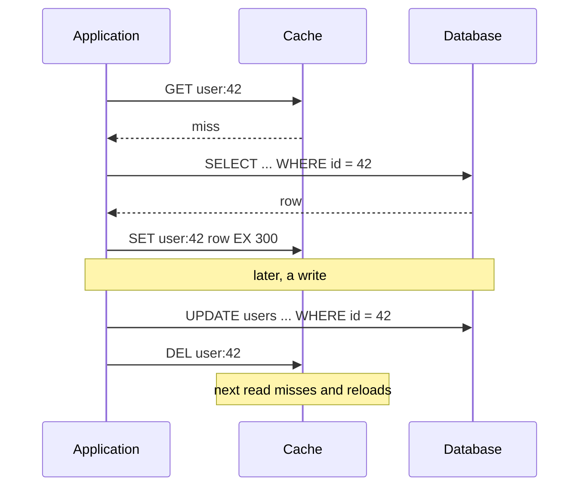

# Cache-Aside

> [!abstract] In one sentence
> Cache-aside keeps the cache beside the database rather than in front of it — the application reads the cache, falls back to the database and fills the cache on a miss, and on writes updates the database and deletes the key — which makes it the pattern you reach for first and the one whose race windows you must know by heart.

> [!tip] Deeper treatment in your system-design vault
> `system-design/04 Caching and Redis/Caching Strategies.md` — read it *after* you have written your own explanation below.

**Map:** [[Caching MOC]] → [[HLD MOC]]

## Definition

In the cache-aside (look-aside, lazy-loading) pattern the application code owns both sides of the cache: on a read it asks the cache, and on a miss it loads the value from the source of truth, stores it in the cache with a [[TTL]] and returns it; on a write it updates the source of truth and then **deletes** the cached key so the next read reloads it. The cache is passive — [[Redis]] or Memcached knows nothing about the database — and is populated lazily by reads, so it holds only keys that have actually been requested. The source of truth stays correct regardless of what the cache does; the cache can only be stale or empty.

## Problem solved

Reads of the same rows dominate most request paths, and every read that goes to the database costs a network round trip, query execution and a share of a scarce resource — connections, CPU, buffer pool. Cache-aside removes most of that load with a few lines of code and no change to the database: hot reads come from memory in well under a millisecond, the database tier can be sized for writes plus misses, and a cache outage degrades to "slower" rather than "down". The pattern also solves a deployment problem: it needs no cache-aware storage layer, works with any store and any cache, and can be introduced one read path at a time.

## How it works

**Read path.**

1. Compute the key (`user:42`, `merchant:7:config`).
2. `GET` from the cache. Hit → deserialise and return.
3. Miss → query the database.
4. `SET key value EX ttl` and return. If the value does not exist, consider caching a short-lived negative marker so repeated lookups for missing rows do not hit the database.

**Write path.**

1. Update the database inside its transaction.
2. After commit, `DEL key`. Do not write the new value into the cache.

**Why delete rather than update.** Two concurrent writers can update the database in one order and the cache in the other, leaving the cache holding the older value until TTL; deletes are idempotent and order-insensitive. Updating also caches values that may never be read again, and some cached values are derived (a rendered view, a joined aggregate) that the writer cannot cheaply compute. Delete-on-write costs one extra miss per update and buys correctness.

**The race windows that remain.** Cache-aside is not linearizable, and three interleavings leave stale data:

- **Read-miss / write race**: reader misses, reads the old row; writer updates the database and deletes the key; reader then sets the old value. The window is the duration of the reader's database read, which is small but real under load. Facebook's leases close it — the cache issues a token on a miss and rejects a `SET` whose token was invalidated by an intervening delete ([[Cache Consistency]]).
- **Delete-before-write ordering**: if the writer deletes first and then updates the database, a reader can miss in between and repopulate the old value; always update the database first, then delete.
- **Replica lag**: a reader who misses right after the delete may load from a lagging read replica and cache the old value for a full TTL ([[Read Replicas]]). Mitigations: read the primary on miss for keys that matter, delay a second delete until the replicas have caught up, or invalidate from the replication stream ([[Change Data Capture]]).

A TTL is the safety net for all three: the stale value is bounded in time even if an invalidation is missed or a race is lost ([[Cache Invalidation]]).

```typescript
async function getUser(id: string): Promise<User | null> {
  const key = `user:${id}`;
  const hit = await redis.get(key);
  if (hit !== null) return hit === "" ? null : JSON.parse(hit);
  const row = await db.users.findById(id);              // miss: source of truth
  await redis.set(key, row ? JSON.stringify(row) : "", "EX", row ? 300 : 30); // negative cache 30 s
  return row;
}

async function updateUser(id: string, patch: Partial<User>): Promise<void> {
  await db.users.update(id, patch);                     // 1. database first
  await redis.del(`user:${id}`);                        // 2. then invalidate
}
```

## Architecture



## Use cases

- Read-heavy entities with a clear key: user profiles, merchant configuration, product details, permissions — anything with a read/write ratio of ten or more.
- Expensive reads (joins, aggregates, external calls) where recomputing per request is the bottleneck ([[Bottleneck Analysis]]).
- Tolerance for bounded staleness: the requirement says "updates visible within a minute" rather than "immediately".
- Incremental adoption: a specific slow endpoint needs relief and the storage layer cannot change.
- Traffic that would otherwise overload the database on the read side, where the cache is the cheapest capacity available ([[Performance vs Cost Trade-offs]]).

## Limitations

- Every miss pays cache + database latency; a cold cache (after restart or eviction) can send a miss storm to the database ([[Cache Stampedes]]).
- Staleness windows exist by design; the pattern does not give read-your-writes or linearizability.
- The application carries cache logic on every read and write path; a forgotten delete on one write path is a permanent stale-data bug.
- Caches only single keys well; invalidating lists, pages or aggregates that depend on many rows needs versioning or tags.
- A down or slow cache adds latency and load to the database; the database must be able to survive the hit rate dropping to zero, or the read path needs a breaker.

## Trade-offs

| You gain | You sacrifice |
|---|---|
| Simple, store-agnostic, adopted one path at a time | Cache logic duplicated across every read and write path |
| Only requested data is cached, so memory is spent on the hot set | A miss penalty on first access and after every invalidation |
| Resilience: cache failure means slower, not down | Database capacity must still cover a cold-cache miss storm |
| Bounded staleness through TTL plus delete-on-write | Small race windows that can cache stale data for a TTL |

## Failure modes

- **Hot key expiry stampede**: a popular key expires, hundreds of concurrent misses all query the database and all set the cache. Noticed as periodic database spikes aligned with TTLs; blast radius is the database and every path on it ([[Cache Stampedes]]).
- **Stale value after lost race**: a reader repopulates an old value just after a delete; users see outdated data until TTL. Noticed by complaints, rarely by metrics; blast radius is that key's readers for one TTL.
- **Forgotten invalidation path**: a batch job or a second service updates rows without deleting keys; the cache serves stale data indefinitely until TTL, and forever if TTL is unset. Noticed by reconciliation or support; the fix is centralising write paths or event-driven invalidation.
- **Cache outage becomes database outage**: Redis is down, every read misses, database connections saturate, the whole service fails. Noticed as a correlated outage; the mitigation is capacity for the miss rate, a breaker that fails reads fast, or a local fallback cache ([[Multi-Level Caching]]).
- **Serialisation drift**: a deploy changes the cached object's shape; old entries deserialise into wrong fields. Noticed as errors right after deploy; version the key or the payload.

## Performance

A hit costs a network round trip to the cache — typically a few hundred microseconds within an AZ — plus deserialisation; a miss costs that plus the database read plus a write to the cache. With a hit rate *h* and costs *c* (cache) and *d* (database), mean read latency is roughly *c* + (1 − *h*) × *d*, so the hit rate is the number to watch: 90% versus 99% is the difference between the database seeing 10% and 1% of reads. Payload size matters — large values cost bandwidth on every hit and can make the cache the slow path ([[Hot Keys]]).

## Scalability

The read tier scales with the cache's capacity, which scales out by partitioning keys across nodes ([[Distributed Caching]]); the write tier is unchanged since every write still hits the database. At 10x reads with a stable hot set, the cache absorbs almost everything; at 10x keyspace, memory and eviction decide the hit rate ([[Eviction Policies]]). The limiting factor is often not the cache but the miss storm the database must survive after a cold restart or a deploy that changes keys.

## Operational impact

Monitor hit rate, miss latency, key count and memory, evictions, and the database's read load as the ground truth of cache effectiveness. Deploys that change key formats or serialisation must be rolled out with the miss storm in mind. Debugging staleness requires knowing every write path to the cached entity, including batch jobs and other services; an event-driven invalidation path reduces that list to one. TTLs need owners — a value chosen for one product requirement outlives the requirement.

## Alternatives

- **[[Write-Through Caching]]** (with read-through) — the cache is populated on write and loads itself on miss; wins when read-after-write matters and the write rate is moderate, costs write latency and caches unread data.
- **[[Write-Back Caching]]** — writes acknowledged by the cache and flushed later; wins for write-heavy, loss-tolerant counters and aggregates.
- **Refresh-ahead / background warming** — keys refreshed before expiry; wins for a small, known hot set with strict latency targets.
- **No cache, faster database** — indexes, read replicas, more memory; wins when the hit rate would be low (uniform access) or staleness is unacceptable ([[Read Replicas]]).

## Real-world examples

- Facebook's memcache deployment is the canonical large-scale look-aside cache: the web tier reads memcache, misses to MySQL, and writes invalidate via deletes — with leases and remote markers added to close exactly the races described above ([[Scaling Memcache at Facebook]]).
- Amazon's Builders' Library discusses the operational side of look-aside caches — negative caching, jittered TTLs, the danger of the database being unable to survive a cold cache ([[AWS Builders Library - Caching Challenges]]).
- Spring's `@Cacheable` / `@CacheEvict` and NestJS's cache manager are cache-aside made declarative: a read annotation fills the cache, an evict annotation deletes on write.
- In a stack like yours: merchant configuration, fee tables and JWT verification keys cached in Redis beside PostgreSQL, loaded lazily with a TTL of minutes, invalidated by `DEL` from the service that owns the write — and, where other services also write, by an event from the [[Outbox Pattern]] consumed by an invalidator.

## Practical exercise

1. Run PostgreSQL and Redis in Docker Compose with a small Spring Boot or NestJS service exposing `GET /users/:id` and `PATCH /users/:id` using the code above.
2. Load the read endpoint with k6 for 60 seconds and record hit rate, p50/p99 and database queries per second; repeat with the cache disabled.
3. Reproduce the read-miss/write race: add a 200 ms sleep between the database read and the cache set on a miss, run a concurrent `PATCH` plus `GET`, and observe the stale value persisting until TTL.
4. Swap the write path to delete-then-update and reproduce the second race; then restore update-then-delete.
5. Set a 10-second TTL on one hot key and load it with 200 virtual users; watch the database spike at expiry, then add a per-key lock or single-flight and compare.
6. Stop Redis mid-test and record the database's connection count and the service's error rate; add a 50 ms timeout and a breaker around the cache and compare.

## Related concepts

### Prerequisites
- [[Redis]] — the cache the pattern usually sits on
- [[Latency]] — the memory-versus-network gap the pattern exploits
- [[Transactions]] — the invalidation must follow the commit

### Related
- [[Cache Invalidation]] — delete-on-write and its alternatives
- [[Cache Consistency]] — the race windows, precisely
- [[TTL]] — the safety net
- [[Cache Stampedes]] — the miss storm on hot keys
- [[Write-Through Caching]] — the opposite ownership model
- [[Read Replicas]] — the replica-lag race

### Builds on this
- [[Multi-Level Caching]] — cache-aside at each layer
- [[Distributed Caching]] — scaling the aside cache across nodes
- [[Hot Keys]] — what happens when one aside key dominates
- [[Rate Limiting]] — counters that use the same read-check-write shape

### Design problems where it applies
- [[Design a URL Shortener]]
- [[Design a Distributed Cache]]
- [[Design a Social Feed]]
- [[Design an IAM Service]]

### Projects where it can be implemented
- [[LLM Gateway]]
- [[Feature Flag Service and SDK]]

### Resources
- [[Scaling Memcache at Facebook]] — look-aside at scale, with leases
- [[AWS Builders Library - Caching Challenges]] — operational guidance
- [[Caffeine Cache]] — the in-process form of the same pattern

## Personal understanding

> [!question] Explain it without the source
> Write your own explanation here, from memory. Then compare it with the sections above and note what you missed.

### Mastery checklist
- [ ] I can explain it without the original resource
- [ ] I can describe the problem it solves
- [ ] I can compare it with its alternatives
- [ ] I can name its limitations and failure modes
- [ ] I can recognise when it is appropriate in a real system
- [ ] I have applied it in a system design
- [ ] I have validated my assumptions with an experiment or implementation

## Open questions

- [ ] In a service I know, which write paths to cached entities exist outside the owning service (batch jobs, admin tools, other services), and which of them delete the key?
- [ ] How large is the read-miss/write race window under our real database latency, and is a lease mechanism worth implementing in Redis with a Lua script?
- [ ] For keys read from a lagging replica on miss, what is the right combination of primary-read-on-miss and delayed second delete?
