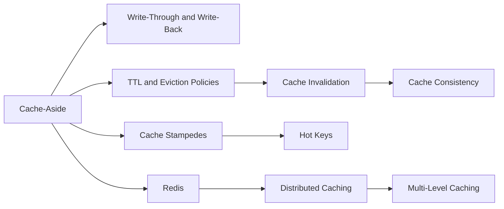

# Caching

> [!abstract] The highest-leverage performance tool and the fastest way to serve wrong data.
> Patterns (cache-aside, write-through, write-back), the hard part (invalidation and consistency), the failure modes (stampedes, hot keys) and Redis as the tool you already use everywhere.

**Map:** [[HLD MOC]] → this · [[Start Here]] for the reading plan · [[Engineering Dashboard]] for progress

## Start with these

[[Cache-Aside]] → [[Cache Invalidation]] → [[TTL]] → [[Cache Stampedes]] → [[Hot Keys]] → [[Redis]]

## How the ideas connect



## Concepts

### Core — know these cold for SDE-2

- [[Cache-Aside]] — Cache-aside has the application check the cache first, load from the database on a miss and populate the cache itself
- [[Cache Invalidation]] — Cache invalidation is deciding when a cached copy stops being served after the source changes
- [[Redis]] — Redis is an in-memory data-structure server that executes commands one at a time on a single thread
- [[Distributed Caching]] — A distributed cache spreads keys across many nodes so that memory and throughput scale out
- [[Cache Stampedes]] — A cache stampede is many concurrent requests missing the same key at once and each recomputing it from the origin
- [[Hot Keys]] — A hot key is one key, partition or shard that receives a disproportionate share of traffic
- [[Cache Consistency]] — A cache is a replica with a weak consistency model: it can offer bounded staleness

### Important — read once, revisit when a design needs it

- [[Write-Through Caching]] — Write-through caching sends every write through the cache to the store synchronously
- [[Write-Back Caching]] — Write-back caching acknowledges a write once the cache has it and flushes it to the store later, in batches and with repeated updates to the same key coalesced
- [[TTL]] — A TTL bounds how stale a cached value can be by discarding it after a fixed time
- [[Eviction Policies]] — An eviction policy decides which entry to drop when a cache is full
- [[Multi-Level Caching]] — Multi-level caching stacks caches from the browser and CDN through the gateway, the in-process cache and the distributed cache down to the database buffer pool, each…

## Where it shows up

**Design problems that lean on this category:** [[Design a Distributed Cache]], [[Design a Social Feed]], [[Design a URL Shortener]], [[Design an IAM Service]], [[Design a Rate Limiter]], [[Design Search Autocomplete]], [[Design a Feature Flag Service]], [[Design an Inventory Management System]]

**Projects that exercise it:** [[LLM Gateway]], [[Feature Flag Service and SDK]], [[Rate Limiter Library]], [[Mini-KV Store]], [[Streaming Fraud Rules Engine]], [[Presence and Chat Service]]

## Progress in this category

Status and confidence come from each note's properties — update them in the note, the table updates itself (native Bases, no plugin).

```base
filters:
  and:
    - file.hasTag("concept")
    - category == "Caching"
formulas:
  rank: 'if(priority == "high", 1, if(priority == "medium", 2, 3))'
properties:
  file.name:
    displayName: Concept
  formula.rank:
    displayName: "#"
views:
  - type: table
    name: Tracker
    order:
      - file.name
      - priority
      - status
      - confidence
      - last_reviewed
      - next_review
    sort:
      - property: formula.rank
        direction: ASC
      - property: file.name
        direction: ASC
    summaries:
      confidence: Average
```
