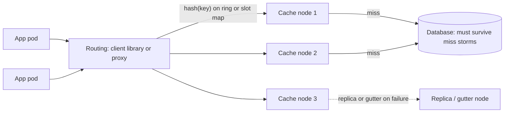

# Distributed Caching

> [!abstract] In one sentence
> Partition the cache across nodes with consistent hashing and you get memory and throughput that grow with the node count — and a new set of problems: routing, a cold start that sends every miss to the database at once, node failures that take their keys with them, and fan-out reads whose latency is the slowest node's.

> [!tip] Deeper treatment in your system-design vault
> `system-design/04 Caching and Redis/Redis Cluster and Sentinel.md` — read it *after* you have written your own explanation below.

**Map:** [[Caching MOC]] → [[HLD MOC]]

## Definition

A distributed cache is a cache whose key space is spread across multiple server nodes, so that the total memory, the total request throughput and the connection capacity exceed what one machine can provide. Each key has an owner node (or a small set, if replicated) chosen by a hash of the key; clients, a proxy or the cluster itself route each operation to the owner. Memcached with client-side hashing, [[Redis]] Cluster with hash slots, and proxy layers such as mcrouter or twemproxy are the common forms. The cache remains a cache — the source of truth lives elsewhere — but it becomes a distributed system, with partial failure, rebalancing and routing as first-class concerns.

## Problem solved

One cache node has a memory ceiling, a single core's worth of command throughput in Redis's case, and a network interface that saturates; it is also a single point of failure whose loss drops the hit rate to zero for the whole fleet. Vertical growth runs out and leaves the risk in place. Spreading keys across nodes lifts all three limits roughly linearly, isolates a node failure to its share of keys, and allows the cache tier to be grown incrementally. The price is that the application (or something in front of it) must know where each key lives, must cope with nodes coming and going, and must have a plan for the case where the cache tier as a whole cannot serve, because the database behind a well-tuned cache was never sized to take the full read load.

## How it works

**1. Key placement.** Naive `hash(key) mod N` remaps almost every key when *N* changes, which makes adding or losing a node a cluster-wide cold start. [[Consistent Hashing]] places nodes and keys on a ring so that only about 1/*N* of keys move when a node joins or leaves; virtual nodes (many ring points per server) even out the load. Redis Cluster uses a fixed table instead: 16,384 hash slots assigned to primaries, with slot ranges migrated explicitly when the cluster is resized — the same property (only moved slots' keys relocate) with explicit control.

**2. Where routing lives.**

- **Client-side**: the client library holds the node list and the hash function (Memcached's ketama clients, Redis Cluster clients that cache the slot map and follow `MOVED`/`ASK` redirections). Lowest latency, but every client must agree on the topology, and topology changes must reach every client.
- **Proxy**: clients talk to a local or sidecar proxy (mcrouter, twemproxy, Envoy's Redis filter) that owns routing, connection pooling and sometimes replication and failover logic. Adds a hop but centralises policy and collapses the connection count.
- **Cluster-managed**: nodes gossip topology and redirect clients; the client needs cluster awareness but the server is the authority. Redis Cluster is this.

**3. Node failure.** Memcached has no replication: a dead node means misses for its key share until it returns, plus a remap if the client removes it from the ring (which then moves keys and changes the miss pattern again). Redis Cluster promotes a replica per failed primary, so the key share stays warm at the cost of doubled memory. Facebook's **gutter** pool is a third option: a small set of spare servers that temporarily take misses for failed nodes with short TTLs, so the database is shielded without remapping the ring ([[Scaling Memcache at Facebook]]).

**4. Cold caches and warming.** A new node, a restarted cluster or a deploy that changes key formats produces a flood of misses that lands on the database at once. Mitigations: ramp traffic gradually onto cold nodes; warm from a snapshot or from another cluster's cache rather than the database (Facebook's cold-cluster warm-up reads misses from a warm cluster); keep the database provisioned for a realistic worst-case miss rate; and protect hot keys with per-key coalescing so one miss, not a thousand, reaches the source ([[Cache Stampedes]]).

**5. Cache-tier failure as a database outage.** If the cache serves 95% of reads, its loss multiplies database read load by twenty. Designs that survive this: a database tier with the headroom ([[Capacity Planning]]), [[Read Replicas]] for the overflow, a circuit breaker that fails reads fast rather than queueing them, a local in-process cache as a thin L1 that keeps the hottest keys answerable ([[Multi-Level Caching]]), load shedding of non-critical reads, and the gutter pattern. The honest alternative is to accept that the product degrades and to decide which features go first ([[Graceful Degradation]]).

**6. Fan-out reads and connections.** A page that needs 100 keys spread over 50 nodes issues parallel multi-gets; the response time is the slowest node's, and simultaneous responses can congest the client's network path (incast). Keep fan-out bounded, batch keys per node, and use a proxy or connection pooling so that *clients × nodes* connections do not exhaust file descriptors on either side ([[Fan-Out]], [[Latency]]).

```text
Routing a key with Redis Cluster:
  slot  = CRC16("order:{merchant:7}:42") mod 16384   -- hash tag {merchant:7} decides the slot
  node  = slotmap[slot]                             -- cached in the client, refreshed on MOVED
Memcached with ketama:
  point = hash(key) on a ring of (nodes x 160 virtual points); owner = next point clockwise
Resize cost:
  mod-N hashing:  ~(N-1)/N of keys remap on a change
  consistent:     ~1/N of keys remap
```

## Architecture



> [!example]- Excalidraw version — the same diagram as an editable canvas
> ![[Distributed Caching.excalidraw]]
> [[Distributed Caching.excalidraw|Open in Excalidraw]] — needs the Excalidraw plugin (see [[Plugins to Install]]).


## Use cases

- The hot set no longer fits in one node's memory, or the read rate exceeds one node's throughput ([[Bottleneck Analysis]]).
- Many application pods across AZs need the same cached data; a shared tier beats per-pod caches for consistency and hit rate.
- Loss of a single cache node must not take the hit rate to zero: partitioning limits the blast radius to 1/*N*.
- Multi-tenant platforms where one tenant's working set must not evict another's — partitioning plus per-tenant key design.
- Any system whose database is sized on the assumption of a high cache hit rate, which makes the cache tier's availability a product requirement.

## Limitations

- It is a distributed system: topology changes, partial failures, redirections and rebalancing all need handling in clients or proxies.
- Multi-key operations and transactions across nodes are unavailable or expensive; key design must keep related keys together.
- A partitioned cache does not replicate by default; node loss means misses, and replication doubles the memory bill.
- The database must still survive a cold or failed cache tier, which caps how much the cache can "save" in database capacity.
- Hot keys and hot slots concentrate load on one node regardless of how many nodes exist ([[Hot Keys]]).

## Trade-offs

| You gain | You sacrifice |
|---|---|
| Memory and throughput that scale with node count | Routing logic and topology management in clients or a proxy tier |
| Node failure isolated to a fraction of keys | Replication cost, or a miss storm for that fraction |
| A shared, consistent view across all application pods | A network hop on every access, and fan-out latency for multi-key reads |
| Incremental growth with bounded key movement | Rebalancing operations that must be run carefully to avoid cold-start storms |

## Failure modes

- **Cold-start storm**: a full restart or a key-format change makes every read miss; the database saturates and the service fails even though the cache is "up". Noticed as database CPU and connection saturation right after the event; blast radius is everything behind that database.
- **Topology disagreement**: half the clients see the old node list and half the new one; the same key lives in two places, invalidations hit one, readers see different values depending on the pod. Noticed as inconsistent responses; fixed by a proxy or cluster-managed topology.
- **Single node overloaded by a hot key**: one key takes 30% of traffic; its owner node saturates at the single-core limit while others idle. Noticed via per-node ops and latency; mitigated by client-side caching or key replication ([[Hot Keys]]).
- **Connection exhaustion**: 500 pods × 40 nodes × a pool of 10 is 200,000 connections; nodes run out of file descriptors or memory for client buffers. Noticed as connection errors after a scale-out; fixed with proxies or smaller pools.
- **Replica promotion with stale data**: in a replicated cluster a replica lagging behind is promoted; readers briefly see older values than they had already seen — a monotonic-reads violation ([[Cache Consistency]]).

## Performance

A hit costs one network round trip to the owner node (a few hundred microseconds within an AZ, more across AZs — placing cache nodes and their clients in the same AZ matters for both latency and transfer cost); multi-key reads cost the slowest of the nodes touched. Throughput scales with nodes until the client side or the network becomes the limit. Proxies add tens of microseconds and save connections and CPU on the nodes. Consistent-hashing balance is imperfect without enough virtual nodes; a 10–20% load spread between nodes is common and should be planned for.

## Scalability

Adding nodes adds memory and ops capacity linearly for evenly distributed keys; at 10x nodes the new limits are the fan-out per request, connection counts, topology propagation and the operational cost of rebalancing. Hot keys do not scale with nodes at all. Cross-region caching is usually a separate cluster per region with invalidation shipped between them, since a cache hop across regions costs more than a local database read.

## Operational impact

Operate the topology: node membership, slot or ring assignments, rebalancing procedures, and the client or proxy configuration that must follow them. Monitor per-node hit rate, memory, evictions, ops and latency, plus the database's load as the ground truth of cache effectiveness. Rehearse node loss and full-tier loss in game days, because the database behaviour under a miss storm is the real availability question. Deploys that change key formats or serialisation need a warm-up plan. Keep a gutter or replica strategy documented for on-call.

## Alternatives

- **One large cache node with a replica** — simpler, no routing; wins until memory or throughput exceeds one machine, which is further than most teams expect ([[Horizontal vs Vertical Scaling]]).
- **In-process caches only** — no shared tier; win for small, hot, slowly changing datasets where per-pod inconsistency is tolerable ([[Multi-Level Caching]]).
- **Database read replicas** instead of a cache — scale reads with the database's own replication; win when the access pattern is not cacheable (uniform, write-heavy) or staleness is unacceptable ([[Read Replicas]]).
- **A managed cache service** (ElastiCache, Memorystore, Upstash) — the provider owns topology and failover; wins when the team is small and the configuration options fit.

## Real-world examples

- Facebook's memcache deployment — thousands of servers, client-side routing via mcrouter, consistent hashing, gutter pools for failures, cold-cluster warm-up, and leases — is the reference architecture for a partitioned look-aside cache at scale ([[Scaling Memcache at Facebook]]).
- Redis Cluster's hash-slot design with client-side slot maps and `MOVED` redirection is the cluster-managed approach used by ElastiCache's cluster mode and most self-hosted Redis deployments beyond one node ([[Redis]]).
- Cloudflare's rate-limiting work describes the problem of counters and hot keys across a globally distributed cache tier, and the trade between accuracy and locality ([[Cloudflare - Rate Limiting at Scale]]).
- In a stack like yours: ElastiCache for Redis in cluster mode with primaries and replicas spread across AZs, hash tags keeping a merchant's keys in one slot, Spring's Lettuce or NestJS's ioredis clients handling slot maps, and an explicit answer to "what happens to RDS if the cluster is lost" — read replicas with headroom, a breaker on cache reads, and a Caffeine L1 for the hottest configuration keys.

## Practical exercise

1. Start a six-node Redis Cluster (three primaries, three replicas) with Docker Compose and a NestJS or Spring Boot service using a cluster-aware client with [[Cache-Aside]] over PostgreSQL.
2. Load with k6 and record per-node ops from `INFO` and the cluster-wide hit rate; use hash tags for a merchant's keys and verify they share a slot.
3. Kill one primary; observe failover time, the miss spike for its slots, and the database load during the gap. Repeat without replicas and compare.
4. Add a fourth primary and migrate slots while under load; measure the miss rate during migration and the number of keys that moved.
5. Flush the whole cluster under load to simulate a cold start; watch PostgreSQL connections and p99; then add per-key single-flight and a gradual traffic ramp and compare.
6. Implement a mock gutter: on a node timeout, route the miss to a small secondary Redis with a 10-second TTL, and measure the database load reduction during a node outage.

## Related concepts

### Prerequisites
- [[Consistent Hashing]] — how keys find their node with minimal movement
- [[Redis]] — the usual node implementation and its cluster mode
- [[Cache-Aside]] — the access pattern on top of the tier

### Related
- [[Cache Stampedes]] — the cold-start and hot-key miss storms
- [[Hot Keys]] — skew that defeats partitioning
- [[Fault Tolerance]] — replicas, gutters and blast radius
- [[Fan-Out]] — multi-key reads across nodes
- [[Connection Pooling]] — the clients-times-nodes problem
- [[Capacity Planning]] — sizing the database for cache loss

### Builds on this
- [[Multi-Level Caching]] — an L1 in front of the distributed tier
- [[Cache Consistency]] — invalidation and replica behaviour across nodes
- [[Rate Limiting]] — distributed counters on a partitioned cache
- [[Graceful Degradation]] — what the product does when the tier is gone

### Design problems where it applies
- [[Design a Distributed Cache]]
- [[Design a Social Feed]]
- [[Design a URL Shortener]]
- [[Design a Rate Limiter]]
- [[Design Search Autocomplete]]

### Projects where it can be implemented
- [[Mini-KV Store]]
- [[Rate Limiter Library]]

### Resources
- [[Scaling Memcache at Facebook]] — the canonical paper on a partitioned cache tier
- [[Cloudflare - Rate Limiting at Scale]] — distributed counters and hot keys
- [[Redis Eviction Policies Docs]] — per-node memory behaviour in a cluster
- [[Dynamo Paper]] — consistent hashing and virtual nodes in their original setting

## Personal understanding

> [!question] Explain it without the source
> Write your own explanation here, from memory. Then compare it with the sections above and note what you missed.

### Mastery checklist
- [ ] I can explain it without the original resource
- [ ] I can describe the problem it solves
- [ ] I can compare it with its alternatives
- [ ] I can name its limitations and failure modes
- [ ] I can recognise when it is appropriate in a real system
- [ ] I have applied it in a system design
- [ ] I have validated my assumptions with an experiment or implementation

## Open questions

- [ ] If the Redis cluster behind a service I know disappeared for ten minutes, what would the database's read load become, and would it survive — has anyone tested it?
- [ ] How many client connections does our fleet open to each cache node today, and at what pod count does that become the limit?
- [ ] Is a gutter pool or a Caffeine L1 the better shield for our hottest keys during a node failure, given our consistency needs?
