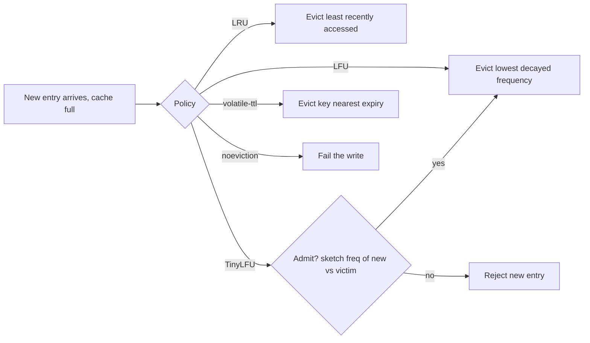

# Eviction Policies

> [!abstract] In one sentence
> When memory runs out, the eviction policy chooses what to forget, and that choice is the difference between a cache that keeps the hot 20% and one that keeps whatever was touched last — LRU wins on temporal locality, LFU on skewed popularity, TinyLFU on both while resisting scans, and Redis's sampled approximations get most of the benefit for a few bits per key.

> [!tip] Deeper treatment in your system-design vault
> `system-design/04 Caching and Redis/Cache Eviction Policies.md` — read it *after* you have written your own explanation below.

**Map:** [[Caching MOC]] → [[HLD MOC]]

## Definition

An eviction policy is the rule a bounded cache applies when it must make room for a new entry: which existing entry (or entries) to remove. The classical families are **LRU** (least recently used — evict what was touched longest ago), **LFU** (least frequently used — evict what has been touched fewest times), **FIFO** (evict the oldest inserted), **random**, and **TTL-aware** variants that prefer entries closest to expiry. Modern policies such as **W-TinyLFU** add an *admission* decision — whether a new entry deserves to displace an old one — using a compact frequency sketch. Eviction is distinct from expiry ([[TTL]]): expiry removes entries because they are old, eviction because the cache is full. The ideal policy (Belady's MIN) evicts the entry whose next use is furthest in the future, which needs knowledge of the future; every real policy is a heuristic that approximates it for some access pattern.

## Problem solved

A cache is useful because it is smaller than the data; being smaller means it must choose. A bad choice keeps the wrong entries and the hit rate collapses: a cache that evicts the most popular key because a bulk scan pushed a million one-off keys through it has just handed the database a storm it was meant to prevent. The policy is also what turns memory into a predictable resource — without one, [[Redis]] refuses writes when it hits `maxmemory`, and an in-process cache grows until the heap dies. Choosing the policy by the shape of the access distribution is what lets a fixed amount of memory deliver a stable hit rate under real traffic ([[Hot Keys]]).

## How it works

**The classical policies and what they assume.**

- **LRU** assumes temporal locality: what was used recently will be used again. Exact LRU keeps a doubly linked list ordered by last access and moves an entry to the head on every hit — cheap per operation but a contended global structure under concurrency. Weakness: a sequential scan of cold data flushes the hot set ("scan pollution"), and one-time accesses are kept as if they will recur.
- **LFU** assumes popularity is stable: what has been used often will keep being used. Weakness: stale popularity — an entry hot last week keeps a high count and squats on memory — unless counts decay with time; also new entries start at zero and are evicted before they can prove themselves.
- **FIFO** ignores access entirely; cheap, and surprisingly competitive on some workloads, but wrong whenever the hot set is long-lived.
- **Random** evicts an arbitrary entry; no metadata, no contention, and for uniform access it is as good as anything.
- **CLOCK** approximates LRU with one reference bit per entry and a sweeping hand; it is the operating system's page-replacement policy and PostgreSQL's buffer-pool policy (clock-sweep with a usage counter), chosen because it avoids a list update on every hit ([[Relational Database Internals]]).
- **Segmented and 2Q variants** (probation and protected segments) resist scans: a new entry must be hit again before it is promoted into the segment holding the hot set, so one-off keys cycle through a small probation area and never displace the protected set. Memcached's segmented LRU (hot, warm, cold) is this.
- **W-TinyLFU** (Caffeine): a tiny admission window (LRU) in front of a segmented main cache, with a Count-Min sketch tracking approximate access frequency of *all* keys, including ones not in the cache. A candidate evicted from the window is admitted to the main cache only if its sketch frequency beats the main cache's eviction victim. The sketch is periodically halved so popularity decays. The result is near-optimal hit rates across recency-biased and frequency-biased workloads with a few bits per key, and scan resistance by construction ([[Caffeine Cache]]).

**Redis's approximations.** Redis does not keep an exact LRU list; every key carries a 24-bit field used either as a coarse last-access clock (LRU mode) or as a combination of a logarithmic access counter and a decay timestamp (LFU mode). On eviction it samples `maxmemory-samples` keys (default 5) and evicts the best candidate, keeping a small pool of good candidates across samples to improve the approximation; raising the sample count makes it closer to exact at more CPU cost. In LFU mode the counter grows probabilistically (`lfu-log-factor`, default 10, so that a counter saturates only after a very large number of hits) and decays by `lfu-decay-time` minutes (default 1); new keys start at a small non-zero value so they are not evicted immediately. The `maxmemory-policy` options:

| Policy | Candidates | Rule |
|---|---|---|
| `noeviction` (default) | none | writes fail with an out-of-memory error once `maxmemory` is reached |
| `allkeys-lru` / `allkeys-lfu` | all keys | approximated LRU / LFU |
| `volatile-lru` / `volatile-lfu` | keys with a TTL only | same, but keys without TTL are never evicted |
| `allkeys-random` / `volatile-random` | all / with TTL | random |
| `volatile-ttl` | keys with a TTL | evict the key closest to expiry |

The `volatile-*` policies let one instance hold both a cache (keys with TTLs, evictable) and durable-ish data (no TTL, never evicted); if nothing has a TTL under a `volatile-*` policy, Redis behaves as `noeviction` ([[Redis Eviction Policies Docs]]).

**Choosing by access distribution.** Zipfian popularity (a few keys dominate): LFU or TinyLFU. Strong recency (sessions, recent orders): LRU. Mixed with scans (reports, batch jobs sharing the cache): a scan-resistant policy, or a separate cache for the scan. Entries with meaningful expiry: `volatile-ttl` lets expiry order drive eviction. Uniform random access: nothing helps; size the cache or accept the hit rate. Measure: the hit rate at the chosen size is the only real test, and a cache simulator fed with a trace of real keys is cheap to build.

```text
redis.conf
maxmemory 8gb
maxmemory-policy allkeys-lfu
maxmemory-samples 10
lfu-log-factor 10
lfu-decay-time 1
```

## Architecture



## Use cases

- Any bounded cache: Redis with `maxmemory`, an in-process cache with `maximumSize`, a CDN edge, a database buffer pool — the policy must be chosen, not inherited.
- Skewed, stable popularity (product catalogue, public profiles, feature configs): LFU-style policies keep the head of the distribution resident.
- Session-like or recency-driven data (recent orders, active conversations): LRU.
- Shared caches that also see scans or bulk jobs: scan-resistant policies, or isolation of the scanning workload.
- A Redis instance mixing cache keys and keys that must not be evicted (locks, counters, idempotency records): `volatile-*` policies with TTLs only on the cache keys.

## Limitations

- No policy knows the future; every one is a bet on an access pattern, and a pattern change (a new feature, a batch job) can halve the hit rate overnight.
- Exact LRU/LFU are expensive under concurrency; approximations trade accuracy for throughput, and sampling in Redis evicts suboptimal keys some of the time.
- Eviction only governs *which* entry is lost, not whether loss is acceptable — a cache that stores the only copy of something (a lock, a counter, an in-flight idempotency record) must not be evictable at all.
- Metadata costs memory: LFU counters, sketches and segment pointers are per entry and matter when entries are tiny.
- Hit rate alone can mislead: evicting one hot key is worse than evicting a thousand cold ones, and most policies do not weigh the cost of a miss.

## Trade-offs

| You gain | You sacrifice |
|---|---|
| A stable hit rate from a fixed memory budget | The accuracy of the policy's bet when the access pattern changes |
| LFU / TinyLFU: resistance to scans and one-off keys | Memory and CPU for counters or sketches; slower adaptation to new hot keys |
| LRU: fast adaptation to shifting hot sets | Vulnerability to scans; one-time accesses treated as hot |
| Random / CLOCK: minimal metadata and contention | Hit rate on skewed workloads |

## Failure modes

- **`noeviction` surprise**: Redis reaches `maxmemory` and every write returns an error; the application treats it as a cache outage or, worse, a database outage. Noticed as `OOM command not allowed` errors; blast radius is every write path to that instance.
- **Scan pollution**: a nightly report or a backfill reads millions of rows through the cache; LRU evicts the hot set and the morning traffic hits the database cold. Noticed as a hit-rate cliff aligned with the job ([[Cache Stampedes]]).
- **Evicted non-cache data**: locks, rate-limit counters or idempotency keys stored in the same Redis under `allkeys-*` get evicted under memory pressure; a lock silently disappears ([[Distributed Locks]]). Noticed only by its consequences; the fix is separate instances or `volatile-*` with no TTL on the critical keys.
- **Stale popularity under LFU without decay**: a key hot during a launch keeps a high count for weeks and blocks fresher keys. Noticed as a falling hit rate with high counters on cold keys; tune decay.
- **Eviction storms**: memory is just under the limit and every write evicts, burning CPU on sampling; latency rises. Noticed as `evicted_keys` climbing steadily; size the cache or shorten TTLs.

## Performance

Exact LRU costs a list update per hit (and a lock in a concurrent cache); Redis's sampled approach costs CPU only on eviction and a few bytes per key; TinyLFU costs a sketch update per access (a few hash computations) and a few bits per key in the sketch, with near-optimal hit rates. The number that matters is the hit rate at the chosen size — a 2% hit-rate gain can mean 20% fewer database reads at a 90% baseline ([[Cache-Aside]]). Policy overhead is rarely the bottleneck; a cache that is too small for the hot set is.

## Scalability

Policies apply per node: in a partitioned cache each node evicts independently over its own slice, so skew between partitions means some nodes evict hot data while others sit half empty ([[Distributed Caching]], [[Hot Keys]]). At 10x keys with the same memory, the policy's quality decides whether the hit rate degrades gracefully (TinyLFU keeps the head of the distribution) or collapses (LRU under pollution). In-process caches multiply by the number of pods, each with its own policy state and its own view of popularity ([[Multi-Level Caching]]).

## Operational impact

Set `maxmemory` and the policy explicitly on every Redis instance and document why; the default of no limit and `noeviction` is a trap on a shared host. Monitor `evicted_keys`, `expired_keys`, hit rate and memory fragmentation; `redis-cli --hotkeys` (which requires an LFU policy) and `--bigkeys` help explain what is being kept. Separate instances by data class so eviction policies match the data's needs. Revisit the policy when traffic patterns change — a new feature with scan-like access can invalidate last year's choice.

## Alternatives

- **Size the cache for the whole working set** — no eviction needed; wins when the data fits in memory at acceptable cost ([[Performance vs Cost Trade-offs]]).
- **TTL-only expiry** — let entries age out instead of competing for space; wins when staleness is the real constraint and memory is comfortable ([[TTL]]).
- **Separate caches per workload** — isolate scans and one-off traffic from the hot set; wins over any clever policy when the workloads are distinguishable.
- **Admission control without eviction** — only cache entries that are known to be hot (e.g. after the second access), so the cache never fills with one-off keys; TinyLFU's admission half, used alone.

## Real-world examples

- Redis's maxmemory documentation describes the sampled LRU/LFU implementation, the policies above, and the counter and decay parameters; the authors publish hit-rate comparisons between exact and approximated LRU at different sample sizes ([[Redis Eviction Policies Docs]]).
- Caffeine's W-TinyLFU design and its published hit-rate benchmarks against LRU, ARC and others on real traces are the reference for modern in-process caching on the JVM ([[Caffeine Cache]]).
- PostgreSQL's shared buffers use a clock-sweep policy with per-buffer usage counts rather than LRU, specifically to avoid list maintenance on every hit; the operating system's page cache does the same beneath it.
- In a stack like yours: a Redis cluster serving merchant configs, sessions and rate-limit counters under `allkeys-lru` is a latent incident — the counters and any locks are evictable; split them into a `volatile-lfu` instance for cache keys (with TTLs) and a `noeviction` instance with alerts for the keys that must never vanish, and use Caffeine with its default policy for in-process caches in the Java services.

## Practical exercise

1. Generate a synthetic access trace with a Zipfian distribution over 1 million keys (a few lines of Java or TypeScript), and a second trace that interleaves a sequential scan of 200,000 cold keys.
2. Run Redis with `maxmemory 64mb` and replay each trace under `allkeys-lru`, `allkeys-lfu` and `allkeys-random`; record hit rate from `INFO stats` (`keyspace_hits` / `keyspace_misses`) for each.
3. Vary `maxmemory-samples` from 3 to 10 under LRU and measure hit rate and CPU.
4. Replay the same traces through a Caffeine cache (or an LRU and a TinyLFU implementation in TypeScript) of equivalent capacity and compare the hit rates, especially on the scan trace.
5. Under `allkeys-lru`, store a "lock" key with no TTL, fill memory, and show it gets evicted; switch to `volatile-lru` and show it survives while cache keys are evicted.
6. Write down, per data class in a service you know, the policy you would choose and the trace evidence that justifies it.

## Related concepts

### Prerequisites
- [[Redis]] — where the policies are configured and approximated
- [[Cache-Aside]] — the pattern that fills the cache with what eviction must manage

### Related
- [[TTL]] — the other way entries leave; `volatile-ttl` connects the two
- [[Hot Keys]] — the skew that decides which policy wins
- [[Multi-Level Caching]] — each layer has its own policy and view of popularity
- [[Relational Database Internals]] — buffer pools as the oldest eviction problem
- [[Performance vs Cost Trade-offs]] — memory versus hit rate

### Builds on this
- [[Distributed Caching]] — per-node eviction under uneven partitions
- [[CDNs]] — edge caches evicting under storage limits
- [[Distributed Locks]] — why lock keys must live where eviction cannot reach them

### Design problems where it applies
- [[Design a Distributed Cache]]
- [[Design a Social Feed]]
- [[Design Search Autocomplete]]
- [[Design a URL Shortener]]

### Projects where it can be implemented
- [[LLM Gateway]]
- [[Mini-KV Store]]

### Resources
- [[Redis Eviction Policies Docs]] — policies, sampling and LFU parameters
- [[Caffeine Cache]] — W-TinyLFU and its benchmarks
- [[Scaling Memcache at Facebook]] — eviction and pools at scale

## Personal understanding

> [!question] Explain it without the source
> Write your own explanation here, from memory. Then compare it with the sections above and note what you missed.

### Mastery checklist
- [ ] I can explain it without the original resource
- [ ] I can describe the problem it solves
- [ ] I can compare it with its alternatives
- [ ] I can name its limitations and failure modes
- [ ] I can recognise when it is appropriate in a real system
- [ ] I have applied it in a system design
- [ ] I have validated my assumptions with an experiment or implementation

## Open questions

- [ ] What `maxmemory-policy` do the Redis instances I use actually run, and which of them mix evictable cache keys with keys that must never be evicted?
- [ ] On a trace of real keys from one of our services, how do LRU, LFU and TinyLFU compare at the memory size we pay for?
- [ ] How does Valkey's or a newer Redis release's eviction differ from the sampled algorithm described here, and does it change the choice?
