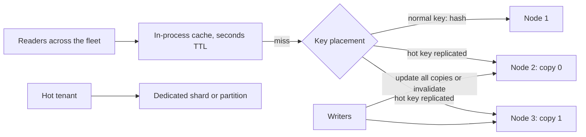

# Hot Keys

> [!abstract] In one sentence
> Partitioning spreads keys, not load: when one merchant, one celebrity or one counter attracts a large share of requests, its owner node becomes the bottleneck no matter how many nodes you add — so you detect the skew, and then either copy the key closer to readers, split it into many keys, or give it a node of its own.

> [!tip] Deeper treatment in your system-design vault
> `system-design/04 Caching and Redis/Hot Key Problem.md` — read it *after* you have written your own explanation below.

**Map:** [[Caching MOC]] → [[HLD MOC]]

## Definition

A hot key is a key (or a partition, slot, shard or row) whose access rate is far above the average, so that the single node responsible for it approaches saturation while the cluster as a whole is lightly loaded. Real access distributions are skewed — a Zipf-like curve where a small fraction of keys gets most of the traffic — and hashing distributes *keys* evenly, not *requests*. The problem is generic across partitioned systems: a Redis slot, a Memcached server, a Kafka partition, a DynamoDB partition, a database shard or a single row under contention ([[Distributed Caching]], [[Topic Partitions]], [[Sharding]]). The "celebrity problem" is its social-network form: one account with millions of followers.

## Problem solved

Hot keys are why "add nodes" stops working. A cluster with 20 nodes and one key taking 30% of all requests has one node at the single-core limit and nineteen at 5%; p99 latency is that node's queue, and if it falls over, the key's traffic moves to another node and takes that one down too. In queues, a hot partition means one consumer lags while the group idles; in databases, a hot row means lock waits serialising a whole product line (one merchant's balance, one popular SKU). Treating hot keys as a first-class design problem means the system degrades gracefully under skew instead of collapsing at the point of maximum popularity ([[Scalability]]).

## How it works

**1. Detect.** You cannot mitigate what you cannot see, and aggregates hide skew.

- Per-node and per-partition metrics: ops, CPU, latency per Redis node or slot, bytes and messages per Kafka partition, per-shard query rates. Skew shows as one series far above the rest.
- Per-key sampling: Redis `redis-cli --hotkeys` (needs an LFU eviction policy) or `OBJECT FREQ`; client-side sampling that keeps a Count-Min sketch or a small top-k of recent keys; DynamoDB's CloudWatch Contributor Insights for the most-accessed items.
- Symptoms: throttling errors on one partition (DynamoDB's per-partition throughput limits are documented at a few thousand read units and about a thousand write units), consumer lag on one partition, lock-wait time on one row ([[Optimistic and Pessimistic Locking]]).

**2. Serve reads closer to the reader — local caching.** An in-process cache ([[Multi-Level Caching]]) with a short TTL (seconds) in every pod turns a million reads per second of one key across the fleet into one read per pod per TTL against the shared cache. This is the cheapest and most common fix for read-hot keys and costs only staleness within the TTL. Caffeine in a JVM, an LRU map in Node.

**3. Replicate the key.** Store *N* copies under derived keys (`merchant:7:config#0` … `#N-1`); readers pick a random copy, writers update all copies (or invalidate all). Read load spreads across *N* nodes; write amplification and invalidation fan-out are the price ([[Cache Invalidation]]).

**4. Split the key (counter sharding).** For write-hot counters, increment one of *N* sub-keys chosen at random (`views:42#3`), and sum them on read. Writes spread over *N* nodes; reads cost *N* fetches, which can themselves be cached. Works for any commutative aggregate.

**5. Salt the partition key.** In Kafka or a sharded store, append a random or round-robin suffix to the hot entity's key so its records land on several partitions; you give up per-entity ordering for that entity, so either the consumer tolerates reordering or ordering is restored downstream by sequence number ([[Ordering Guarantees]]).

**6. Route by load, not only by hash.** Consistent hashing with bounded loads (Google and Vimeo, 2017) caps how much any node may take and spills overflow to the next node on the ring; proxies such as mcrouter can special-case known hot keys to a replicated pool.

**7. Isolate the hot tenant.** Give the celebrity or the large merchant a dedicated shard, partition or cache pool so their load cannot affect others; shuffle sharding generalises this by assigning each tenant a random small subset of nodes so that a hot tenant hurts few neighbours ([[AWS Builders Library - Shuffle Sharding]], [[Bulkheads]]).

**8. Coalesce and batch.** Many concurrent requests for the same hot key can be served by one fetch (single-flight), and many small increments by one batched update ([[Cache Stampedes]], [[Write-Back Caching]]). Discord's data services in front of their database do request coalescing for exactly this reason.

**9. Change the access pattern.** The feed design that pushes a celebrity's posts to millions of followers on write is replaced by pulling those posts at read time for high-fan-out accounts, the hybrid from *Designing Data-Intensive Applications* and Twitter's practice ([[Fan-Out]]).

```text
Read-hot key, replicated:
  write:  for i in 0..N-1: SET merchant:7:config#i value      (or DEL all N on change)
  read:   GET merchant:7:config#{rand(N)}
Write-hot counter, split:
  write:  INCR views:42#{rand(N)}
  read:   MGET views:42#0 ... views:42#N-1 -> sum, cached briefly
Kafka hot tenant, salted:
  key = "tenant-7-" + (seq % 8)     -- 8 partitions, ordering only within each salt
```

## Architecture



## Use cases

- Multi-tenant platforms where tenant sizes differ by orders of magnitude: the largest merchant's keys and partitions will be hot.
- Social and content products with popularity skew: celebrity accounts, viral posts, trending items.
- Shared configuration or reference data read on every request — the hottest keys in most backends — which belong in an in-process cache.
- High-rate counters (views, likes, rate limits for a big client) on a single key.
- Any Kafka or stream topic keyed by tenant or account, where one key's volume exceeds a partition's capacity.

## Limitations

- Every mitigation trades something: local caches add staleness, replication adds write amplification, splitting adds read cost, salting loses ordering, isolation adds operational special cases.
- Detection by sampling can miss short-lived hot keys (a flash sale) and per-key tracking at full rate is itself expensive.
- The hot set shifts; a static list of special-cased keys goes stale, so mitigations should be adaptive or applied to the key *class*, not to a hard-coded key.
- Write-hot keys with strong consistency requirements (a single account balance under contention) cannot be split or replicated freely; the fix is often in the data model or the product.
- Hot rows in a relational database are a lock-contention problem that no cache fixes; batching and queueing the writes is the usual answer.

## Trade-offs

| You gain | You sacrifice |
|---|---|
| Local caching: near-zero shared-cache load for hot reads | Staleness within the local TTL, and per-pod inconsistency |
| Key replication: read load spread over N nodes | N-fold write amplification and invalidation fan-out |
| Key splitting: write load spread over N nodes | N reads to assemble the value, and approximate consistency between parts |
| Salting and isolation: no single partition saturates | Per-entity ordering, and operational special cases for the hot tenant |

## Failure modes

- **One node saturated, cluster idle**: p99 for a popular feature spikes while dashboards show 10% average CPU. Noticed only with per-node or per-partition views; blast radius is every key sharing that node, not just the hot one.
- **Cascading node failure**: the hot node fails, consistent hashing moves its keys to the next node, which fails under the same load; the ring unravels. Noticed as sequential node failures; bounded-load routing or key replication stops the chain.
- **Hot partition lag in Kafka**: one tenant's partition backs up for hours while the consumer group is mostly idle; the tenant's events are late and nothing else is. Noticed as per-partition lag; fix by salting or isolating the tenant ([[Consumer Groups]]).
- **Lock convoy on a hot row**: thousands of transactions updating one balance row serialise on the row lock; throughput collapses to one transaction per lock hold time. Noticed as lock-wait time on one row; batch the updates or restructure the ledger.
- **Stale celebrity data**: a replicated or locally cached hot key is updated, one copy is missed, and a fraction of readers see old data indefinitely. Noticed by inconsistent responses; invalidate by pattern and bound with TTLs.

## Performance

A single Redis node handles on the order of a hundred thousand simple operations per second; a single Kafka partition tens of thousands of messages per second; a single database row a few thousand updates per second at best — each is a hard ceiling for whatever key lands on it, regardless of cluster size. Local caching gives the biggest win per unit of effort (memory-speed reads, no network); replication and splitting trade write or read amplification for a factor-of-N spread; coalescing collapses concurrent identical requests to one ([[Latency]], [[Throughput]]).

## Scalability

Skew usually grows with scale: the top tenant grows faster than the median, and viral events get bigger. A design that handles 10x by adding nodes still has the same single-node ceiling per key, so hot-key mitigations must be in place before the growth, as a property of key classes. The adaptive versions — bounded-load routing, automatic local caching of keys above a rate threshold, dynamic partition salting — scale without a human maintaining a list ([[Distributed Caching]]).

## Operational impact

Per-node, per-partition and per-shard dashboards are mandatory, with alerts on skew (max over mean) rather than on averages. Hot-key detection should run continuously in production (sampling or sketches) with the top keys visible to on-call. Isolated tenants need their own capacity planning and failover. Changes to key schemes (adding salts or replicas) are migrations with cold-start effects; plan the warm-up ([[Cache Stampedes]]). The hot set after an incident is worth recording in the postmortem.

## Alternatives

- **Over-provision every node for the hottest possible key** — simple and expensive; wins only when skew is modest and predictable ([[Performance vs Cost Trade-offs]]).
- **Rate-limit the hot tenant or key** ([[Rate Limiting]]) — protect the node by refusing excess; wins when the hot traffic is abusive or low-value.
- **Change the data model** so the hot entity is not a single key: materialise per-user views, pre-aggregate, or move the counter into a stream and compute it downstream ([[Data Modeling]]).
- **Push data to the edge** ([[CDNs]]) — for read-hot public content, let the edge absorb the popularity before it reaches any key.

## Real-world examples

- Twitter's timeline architecture, as described in *Designing Data-Intensive Applications*, handles accounts with huge follower counts differently from everyone else: their posts are merged at read time instead of being fanned out on write — the canonical celebrity-problem mitigation.
- Discord's move to ScyllaDB came with Rust "data services" that coalesce concurrent requests for the same hot partition (a busy channel) into one database query, because hot partitions had been the recurring cause of latency spikes ([[Discord - How Discord Stores Trillions of Messages]]).
- Cloudflare's rate limiting and Amazon's shuffle-sharding write-ups both treat a single heavy client as the main threat to a shared tier and isolate it structurally ([[Cloudflare - Rate Limiting at Scale]], [[AWS Builders Library - Shuffle Sharding]]).
- In a stack like yours: the largest merchants' configuration and limits are the hottest keys in Redis and their events the hottest Kafka partitions; a Caffeine or in-memory L1 with a short TTL in every pod removes the read hotspot, salting the largest merchants' partition keys (with sequence numbers for downstream ordering) removes the partition hotspot, and a hot ledger account under contention is a data-model question for the ledger design rather than a cache problem.

## Practical exercise

1. Run a three-primary Redis Cluster and a NestJS or Spring Boot service in Docker Compose, with k6 generating a Zipfian key distribution where one key gets 30% of reads.
2. Record per-node ops and latency from `INFO` on each primary; identify the saturated node and the cluster's effective capacity.
3. Add an in-process cache with a 2-second TTL for keys read more than 100 times per second (track with a small sketch); repeat and compare per-node load.
4. Replace the local cache with key replication (`#0..#3`) and random reads; measure spread and the write cost on update.
5. Create a Kafka topic with six partitions and a producer keyed by tenant where one tenant sends 50% of messages; observe per-partition lag with a slow consumer; then salt that tenant's key across partitions and observe the change — and the ordering loss.
6. Run a hot-row test on PostgreSQL (500 concurrent `UPDATE balance` on one row) and measure throughput; then batch the increments through a queue and compare.

## Related concepts

### Prerequisites
- [[Consistent Hashing]] — why keys spread but load does not
- [[Distributed Caching]] — the tier where hot keys first appear
- [[Sharding]] and [[Topic Partitions]] — the same problem in databases and queues

### Related
- [[Cache Stampedes]] — hot keys at the moment they expire
- [[Multi-Level Caching]] — the in-process layer as the main mitigation
- [[Fan-Out]] — the celebrity problem's write-side form
- [[Bulkheads]] — isolation of hot tenants
- [[Ordering Guarantees]] — what salting costs
- [[Optimistic and Pessimistic Locking]] — hot rows as lock contention

### Builds on this
- [[Rate Limiting]] — capping a hot tenant
- [[Write-Back Caching]] — batching write-hot counters
- [[Database Scaling]] — rebalancing around hot shards
- [[Capacity Planning]] — planning for skew, not averages

### Design problems where it applies
- [[Design a Social Feed]]
- [[Design a Distributed Cache]]
- [[Design a Rate Limiter]]
- [[Design a Ticket Booking System]]
- [[Design a Message Queue]]

### Projects where it can be implemented
- [[Mini-KV Store]]
- [[Rate Limiter Library]]
- [[Streaming Fraud Rules Engine]]

### Resources
- [[Discord - How Discord Stores Trillions of Messages]] — hot partitions and request coalescing
- [[Scaling Memcache at Facebook]] — replicated pools and leases for hot keys
- [[AWS Builders Library - Shuffle Sharding]] — isolating heavy tenants
- [[Cloudflare - Rate Limiting at Scale]] — heavy clients on a distributed tier

## Personal understanding

> [!question] Explain it without the source
> Write your own explanation here, from memory. Then compare it with the sections above and note what you missed.

### Mastery checklist
- [ ] I can explain it without the original resource
- [ ] I can describe the problem it solves
- [ ] I can compare it with its alternatives
- [ ] I can name its limitations and failure modes
- [ ] I can recognise when it is appropriate in a real system
- [ ] I have applied it in a system design
- [ ] I have validated my assumptions with an experiment or implementation

## Open questions

- [ ] What is the ratio between the hottest and the median Redis key, Kafka partition and database shard in a system I know, and does anyone have a dashboard showing it?
- [ ] For the largest merchant's events, is salting the partition key acceptable given downstream ordering needs, or does the consumer need sequence-number reordering?
- [ ] How would an adaptive in-process cache decide which keys are hot enough to cache locally, and what staleness would that impose on payment authorisation?
