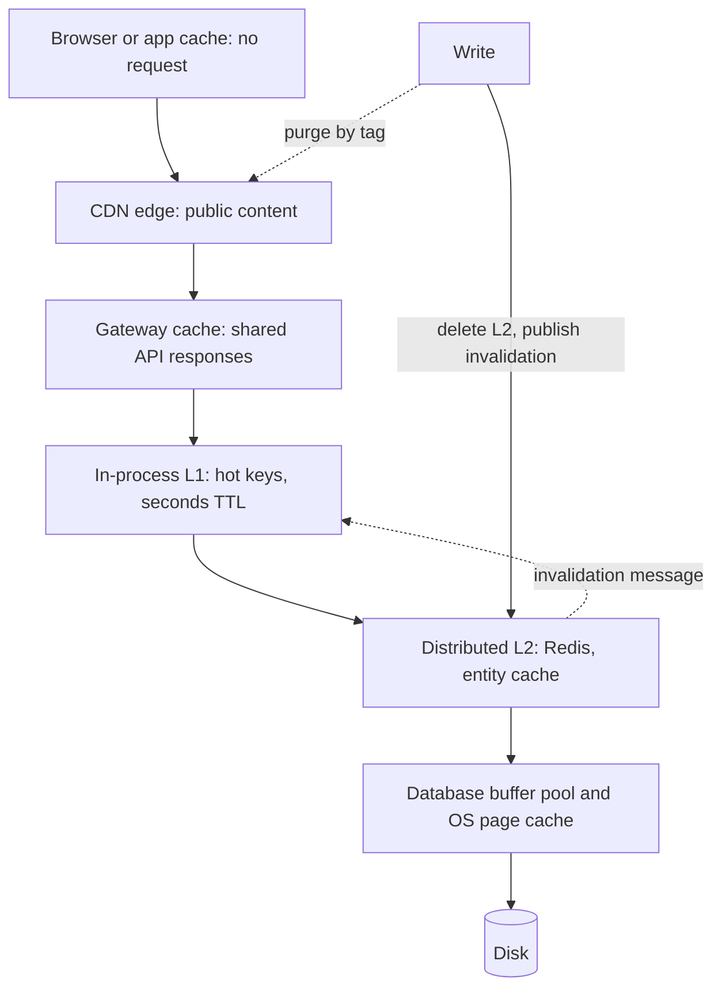

# Multi-Level Caching

> [!abstract] In one sentence
> Every request passes a ladder of caches — browser, edge, gateway, process memory, shared cache, database buffers — each one cheaper and closer than the next, and the design skill is knowing what each layer should hold, how long, and how a change at the bottom reaches the copies at the top before someone acts on them.

> [!tip] Deeper treatment in your system-design vault
> `system-design/04 Caching and Redis/Why Caching Works.md` — read it *after* you have written your own explanation below.

**Map:** [[Caching MOC]] → [[HLD MOC]]

## Definition

Multi-level (tiered) caching is the arrangement of several caches in series along the request path, ordered by proximity to the consumer: the client's own cache (browser HTTP cache, mobile app store), the edge ([[CDNs]]), a gateway or reverse proxy cache ([[Reverse Proxies]]), an in-process cache inside each service instance (the "near cache" or L1), a shared distributed cache such as [[Redis]] (L2), and finally the storage engine's own buffer pool and the operating system's page cache in front of the disk. A request is served by the first layer that has a fresh copy; each layer sees only the misses of the layers above it. The term borrows from CPU design, where L1/L2/L3 caches trade size for speed in the same way.

## Problem solved

No single cache has the right combination of speed, scope and freshness for every read. An in-process cache is the fastest thing possible but is private to one pod and cannot be invalidated from outside without help; a shared cache is consistent across the fleet but costs a network round trip per read; a CDN removes whole requests from the backend but can only hold data that is safe to share across users for a while. Hot reference data read on every request (configuration, feature flags, signing keys) does not belong in Redis — the round trip dominates — and user-specific data does not belong at the edge. Layering lets each class of data live at the level where its access pattern and staleness tolerance fit, and lets the database see only the long tail ([[Latency]], [[Hot Keys]]).

## How it works

**The ladder, with typical costs and scope (order of magnitude):**

| Layer | Hit cost | Scope | Holds |
|---|---|---|---|
| Browser / app cache | none (no request) | one user, one device | static assets, cacheable API responses via `Cache-Control`, `ETag` |
| CDN edge | ~10–50 ms from the user, no backend | region, all users | public, shareable content; `s-maxage`, surrogate keys, stale-while-revalidate |
| Gateway / reverse proxy | sub-millisecond at the backend edge | datacenter, all users | semi-static API responses, request coalescing |
| In-process (L1) | ~1 µs, no network | one pod | hot reference data, config, flags, keys, per-pod hot entities |
| Distributed (L2) | ~0.3–1 ms round trip | the fleet | entity cache, sessions, counters |
| Database buffer pool / OS page cache | ~10–100 µs inside the database | the database node | recently read pages |
| Disk | ~0.1–10 ms | | everything |

**What each layer catches.** The browser and CDN catch whole requests for content that does not vary per user, or varies only by a cacheable key (`Vary`, cache keys with a tenant id). The gateway catches identical API requests across users for a short window. The in-process layer catches the per-request hot set — the handful of keys read by nearly every request — where even a sub-millisecond Redis call is the dominant cost. The distributed layer catches the broad entity working set shared across pods. The buffer pool catches repeated page reads, which is why a database with enough memory often needs no cache for moderate workloads ([[Relational Database Internals]]).

**Coherence between layers.** A write invalidates the shared layer (delete on write, [[Cache Invalidation]]), but the in-process copies in 50 pods know nothing about it, and the CDN keeps serving until `s-maxage` expires or a purge arrives. The mechanisms, from weakest to strongest:

1. **Short L1 TTLs** (seconds): bounded per-pod staleness with no coordination; the right default for config and reference data.
2. **Invalidation broadcast**: the writer publishes the key on a channel ([[Pub-Sub]] in Redis, a Kafka topic); every pod drops its L1 copy. Fire-and-forget pub/sub can miss a message, so keep the TTL as the backstop.
3. **Server-assisted client-side caching**: Redis 6's client tracking lets the server remember which keys each connection has read (or which prefixes it is interested in) and push invalidation messages when they change, so an L1 can be kept coherent with L2 without application-level broadcasting.
4. **Versioned keys**: a change creates a new key; every layer misses on it naturally and old entries age out ([[Cache Consistency]]).
5. **CDN purge by tag**: content changes trigger a purge of every edge object tagged with the entity.

**Where the in-process layer shines and where it lies.** It shines for small, hot, slowly changing data read on every request: microsecond access, no network, no shared tier to fail, and it survives a Redis outage — the natural shield for [[Hot Keys]]. It lies in four ways: *per-pod inconsistency* (a write is visible on one pod and not on others until TTL or broadcast); *the hit-rate illusion* (each pod warms separately, so for a long-tail keyspace the per-pod hit rate is low and memory is multiplied by pod count); *memory and GC pressure* (a large heap-resident cache lengthens garbage-collection pauses in the JVM and in Node, and competes with request handling); and *invisibility* (no central metrics unless each pod exports them). The practical rule: L1 for the hot head of the distribution with seconds of TTL and a bounded size; L2 for the body; nothing for the tail.

```java
// L1 in front of L2 with a short TTL and a broadcast invalidation
LoadingCache<String, Config> l1 = Caffeine.newBuilder()
    .maximumSize(5_000).expireAfterWrite(Duration.ofSeconds(5))
    .build(key -> l2.get(key).orElseGet(() -> loadFromDbAndFill(key)));   // L2 = Redis, cache-aside

// writer: db -> delete L2 -> publish invalidation for L1s
void update(String key, Config c) {
    repo.save(c);
    redis.del("config:" + key);
    redis.publish("invalidate", "config:" + key);   // each pod: l1.invalidate(key); TTL is the backstop
}
```

## Architecture



> [!example]- Excalidraw version — the same diagram as an editable canvas
> ![[Multi-Level Caching.excalidraw]]
> [[Multi-Level Caching.excalidraw|Open in Excalidraw]] — needs the Excalidraw plugin (see [[Plugins to Install]]).


## Use cases

- Reference data read on every request — configuration, feature flags, fee tables, signing keys — belongs in an in-process cache with a short TTL and broadcast invalidation ([[Feature Flags]]).
- Public or per-tenant content with high read volume: product pages, documentation, media — the CDN and gateway layers remove it from the backend entirely.
- Hot-key protection: an L1 in front of the distributed cache keeps a celebrity key from saturating one Redis node ([[Hot Keys]]).
- Resilience: an L1 keeps the hottest data answerable during a distributed-cache outage ([[Distributed Caching]]).
- Latency budgets measured in single-digit milliseconds, where even one Redis round trip per request is too many.

## Limitations

- Each layer multiplies the number of copies and the places a stale value can hide; the staleness of the stack is the sum of the layers' windows.
- Invalidation cannot reach the client's cache; only TTL and versioned URLs work there.
- In-process caches cost memory per pod, lengthen GC pauses, and make capacity planning per pod rather than per tier.
- Hit rates per layer interact: a very effective L1 starves L2 of the hot keys that would have made its hit rate look good, and a CDN in front of a gateway makes the gateway cache mostly idle; measure the end-to-end hit rate, not each layer in isolation.
- Debugging a wrong value means asking "which of six layers served this?" — logs need cache-layer annotations.

## Trade-offs

| You gain | You sacrifice |
|---|---|
| The lowest achievable latency for the hot set through memory-speed L1 hits | Per-pod inconsistency bounded only by TTL or broadcast reliability |
| Backend load removed in tiers, from the edge inward | More copies to keep coherent and more windows of staleness to reason about |
| Resilience: an outage of one layer degrades rather than fails | Memory and GC cost per pod, and metrics scattered across layers |
| Each data class cached where its access pattern fits | A stack that is harder to reason about than one cache with one TTL |

## Failure modes

- **Per-pod stale config after a change**: a flag is flipped off, half the pods still see it on for the L1 TTL — or until restart if the TTL is missing. Noticed as inconsistent behaviour by pod; bound the TTL and broadcast.
- **Broadcast missed**: Redis pub/sub drops the invalidation during a reconnect; pods keep the old L1 value until TTL. Noticed as the occasional long staleness; the TTL backstop is non-negotiable.
- **Heap bloat and GC pauses**: an unbounded in-process cache grows into gigabytes; p99 doubles from GC. Noticed as GC time correlated with cache size; bound by size and weight, consider off-heap or a smaller L1.
- **CDN serves user A's data to user B**: a cacheable response without a correct cache key or `Vary` leaks private data at the edge. Noticed by a security incident; never cache authenticated responses at the edge without a per-user key, and prefer `private`.
- **L2 outage with no L1**: Redis down, every pod misses straight to the database. Noticed as a database overload; an L1 for the hot head is the cheap shield ([[Cache Stampedes]]).

## Performance

The latency ladder spans five orders of magnitude from an L1 hit (microseconds) to a disk read (milliseconds); moving a hot read from L2 to L1 removes a network round trip from every request that touches it, which for a key read on every request can be the single largest latency improvement available. Edge hits remove the backend entirely and the user's round trip to it. Costs: L1 memory per pod, serialisation avoided (objects stay as objects), and CPU for invalidation handling ([[Performance vs Cost Trade-offs]]).

## Scalability

Each layer scales differently: the CDN with the provider's footprint, the gateway with its instances, L1 with the pod count (memory multiplied, hit rate per pod unchanged), L2 by partitioning ([[Distributed Caching]]). At 10x pods, broadcast invalidation fans out to 10x subscribers and L1 memory is 10x in total; at 10x keyspace, the L1 should hold only the head and let L2 carry the body. Multi-region adds a stack per region with cross-region invalidation delay ([[Replication]]).

## Operational impact

Export hit rate, size and age per layer, including from inside pods, and watch the end-to-end database read rate as the ground truth. Document, per data class, which layers hold it, the TTL at each, and the invalidation mechanism. Deploys that change key formats or serialisation affect L1 (restart clears it) and L2 (needs a warm-up plan) differently. On-call needs a way to purge each layer (CDN purge, L2 delete by pattern, L1 broadcast) and should know the stack's worst-case staleness when invalidation fails.

## Alternatives

- **A single shared cache** — one TTL, one invalidation path, consistent across pods; wins when the Redis round trip fits the latency budget and simplicity matters ([[Cache-Aside]]).
- **Database with a large buffer pool and read replicas** — no application caches at all; wins for moderate loads where the working set fits in database memory ([[Read Replicas]]).
- **Precomputed, pushed data** — configuration and flags streamed to pods on change (a feature-flag SDK with a streaming connection) rather than cached and expired; wins when changes must reach every pod within seconds reliably.
- **Edge compute with its own store** — move the read entirely to the CDN layer with a replicated key-value store at the edge; wins for global, read-heavy, latency-critical lookups.

## Real-world examples

- Facebook's memcache architecture is explicitly multi-level: per-cluster memcache in front of regional pools in front of MySQL, with distinct invalidation mechanisms between levels ([[Scaling Memcache at Facebook]]).
- Netflix's EVCache and its in-process near-cache patterns, and Caffeine's documentation on using it as an L1 in front of a remote cache, describe the L1/L2 arrangement with short near-cache TTLs ([[Caffeine Cache]]).
- Redis 6 introduced server-assisted client-side caching (`CLIENT TRACKING`) precisely to keep application-side L1s coherent with the server without application-level broadcast ([[Redis]]).
- In a stack like yours: CloudFront or another CDN for static and public content, an in-process Caffeine (Java) or in-memory (NestJS) L1 for merchant configuration, fee tables and JWT verification keys with a 5–10 second TTL plus an invalidation channel, ElastiCache as the L2 entity cache, and RDS with a buffer pool sized so the long tail stays cheap — with ledger reads skipping every layer.

## Practical exercise

1. Build a NestJS or Spring Boot service in Docker Compose with PostgreSQL, Redis, nginx as a gateway cache (`proxy_cache`) and an in-process L1 (Caffeine or an LRU map) with a 5-second TTL.
2. Load a hot configuration endpoint with k6 and measure p50/p99 and backend calls per second with: no cache; L2 only; L1 + L2; gateway + L1 + L2. Record the hit rate at each layer and the database read rate.
3. Run three replicas; update the config through one; observe how long each replica serves the old value; then add Redis pub/sub invalidation and measure again, including with one replica's subscription deliberately broken.
4. Grow the L1 to a million entries with no size bound and watch GC pause time and p99; then bound it and compare.
5. Mark an authenticated response as cacheable at nginx without a per-user key and demonstrate the leak; fix it with `Cache-Control: private` and a correct cache key.
6. Stop Redis under load and compare the database read rate with and without the L1 in place.

## Related concepts

### Prerequisites
- [[Cache-Aside]] — the access pattern at each layer
- [[Latency]] — the ladder of costs that justifies the layers
- [[HTTP and HTTPS]] — `Cache-Control`, `ETag` and `Vary` for the client and edge layers

### Related
- [[Distributed Caching]] — the L2 tier
- [[CDNs]] — the edge tier
- [[Cache Consistency]] — staleness across layers
- [[Cache Invalidation]] — reaching every copy
- [[Hot Keys]] — the main reason for an L1
- [[Eviction Policies]] — bounding the L1

### Builds on this
- [[Feature Flags]] — the canonical L1 dataset with push invalidation
- [[Reverse Proxies]] — the gateway cache layer
- [[Performance vs Cost Trade-offs]] — memory per pod versus round trips saved
- [[Graceful Degradation]] — L1 as the shield during an L2 outage

### Design problems where it applies
- [[Design a Feature Flag Service]]
- [[Design a Video Streaming Service]]
- [[Design a URL Shortener]]
- [[Design Search Autocomplete]]

### Projects where it can be implemented
- [[Feature Flag Service and SDK]]
- [[LLM Gateway]]

### Resources
- [[Caffeine Cache]] — in-process caching as the L1
- [[AWS Builders Library - Caching Challenges]] — layering caches and the risks of each layer
- [[Scaling Memcache at Facebook]] — a multi-level cache hierarchy in production

## Personal understanding

> [!question] Explain it without the source
> Write your own explanation here, from memory. Then compare it with the sections above and note what you missed.

### Mastery checklist
- [ ] I can explain it without the original resource
- [ ] I can describe the problem it solves
- [ ] I can compare it with its alternatives
- [ ] I can name its limitations and failure modes
- [ ] I can recognise when it is appropriate in a real system
- [ ] I have applied it in a system design
- [ ] I have validated my assumptions with an experiment or implementation

## Open questions

- [ ] Which keys does a service I know read on every request from Redis, and what would moving them to an L1 with a 5-second TTL do to p99 and to Redis load?
- [ ] Is Redis client tracking supported by the Lettuce and ioredis versions we use, and would it replace our pub/sub invalidation?
- [ ] What is the end-to-end worst-case staleness of the full stack (CDN, gateway, L1, L2) for a fee-table change, and is that within what finance accepts?
