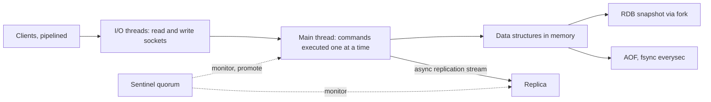

# Redis

> [!abstract] In one sentence
> Redis gives you atomic operations on rich in-memory data structures at network speed by doing one thing at a time on one thread — and the whole art of using it is knowing which of its many roles (cache, counter, lock, queue, stream) your durability and consistency needs actually allow, given asynchronous replication and persistence that is a configuration, not a guarantee.

> [!tip] Deeper treatment in your system-design vault
> `system-design/04 Caching and Redis/Redis Internals.md` — read it *after* you have written your own explanation below.

**Map:** [[Caching MOC]] → [[HLD MOC]]

## Definition

Redis is an in-memory key–value server whose values are data structures — strings, hashes, lists, sets, sorted sets, bitmaps, HyperLogLogs, geospatial indexes and streams — manipulated by commands that run **atomically on a single execution thread**. Durability is optional and configurable (RDB snapshots, an append-only file, or both); [[Replication]] is asynchronous; high availability comes from Sentinel (monitoring and failover for a primary with replicas) or Redis Cluster (data partitioned across many primaries by hash slot). Valkey is the Linux Foundation fork created in 2024 after Redis changed its licence, compatible with Redis 7.2 at the fork point and developed independently since; Redis itself later added an AGPL licence option. For the purposes of design, the model described here applies to both.

## Problem solved

Applications constantly need small pieces of shared, fast-changing state that a relational database handles badly: a counter incremented ten thousand times a second, a set of online users, a leaderboard, a lock, a rate-limit window, a session, a hot read cache. Doing these in PostgreSQL costs a disk-backed transaction each; doing them in process memory does not survive a restart or scale beyond one pod. Redis sits between: shared across the fleet, in memory, with atomic operations on exactly the structures those problems need, and a latency of a network round trip. Its single-threaded model is what makes the atomicity free — no locks, no races between `GET` and `SET` inside a command, and compound operations expressible as one Lua script.

## How it works

**Execution model.** An event loop (epoll/kqueue) accepts connections and reads commands; the main thread executes commands strictly one after another. Since Redis 6, optional I/O threads can read and write sockets in parallel, but command execution stays single-threaded, so throughput is bounded by one core — on the order of a hundred thousand simple commands per second per instance, varying with command cost, pipelining and payload. The consequences: every command is atomic; any O(N) command on a large key (`KEYS`, `SMEMBERS` on a million-member set, `DEL` of a huge hash) stalls every other client for its duration — use `SCAN`, `SSCAN`, and `UNLINK` (asynchronous free) instead. Pipelining batches many commands into one round trip and raises throughput several-fold.

**Data structures and encodings.** Small collections are stored compactly (listpacks, intsets) and converted to hash tables, skiplists or quicklists as they grow; the thresholds are configurable. Sorted sets (a hash plus a skiplist) give O(log N) ranked inserts and range queries — leaderboards, scheduling by timestamp, sliding windows. Streams are append-only logs with consumer groups ([[Redis Streams Docs]]).

**Persistence.**

- **RDB**: a point-in-time snapshot written by a forked child using copy-on-write memory; cheap to restore, loses everything since the last snapshot (`save` intervals of minutes by default).
- **AOF**: every write command appended to a log; `appendfsync everysec` (default) bounds loss to about one second, `always` fsyncs per write and costs throughput, `no` leaves it to the OS. The log is rewritten (compacted) periodically; Redis 7 uses a multi-part AOF with an RDB preamble for fast loading.
- Neither makes an acknowledged write durable against a crash in the fsync window; and neither applies to replicas' state — a failover to a replica that has not received the last writes loses them regardless of the primary's persistence.

**Replication and failover.** Replicas receive the primary's write stream asynchronously; `WAIT n timeout` blocks until *n* replicas have acknowledged receipt (not fsync; `WAITAOF` in 7.2 waits for fsync). **Sentinel** processes monitor the primary, agree by quorum that it is down, elect a leader among themselves, promote a replica, and reconfigure clients through a discovery protocol; failover takes seconds, and writes accepted by the old primary but not yet replicated are lost ([[Leader Election]], [[Split-Brain]]). `min-replicas-to-write` makes the primary refuse writes when too few replicas are in contact, shrinking the window at the cost of availability.

**Cluster.** The key space is split into 16,384 hash slots by `CRC16(key) mod 16384`; each primary owns a range of slots and has replicas; nodes gossip membership and slot ownership; clients cache the slot map and follow `MOVED` / `ASK` redirections. Multi-key commands and transactions must touch keys in the same slot — force this with hash tags: `{user:42}:profile` and `{user:42}:sessions` hash on `user:42`. Failover is per shard, by the replicas of the failed primary with a majority of primaries agreeing ([[Consistent Hashing]], [[Distributed Caching]]).

**Beyond caching.**

- **Counters and rate limits**: `INCR` with `EXPIRE`, or a sliding window in a sorted set, or a token bucket in a Lua script — atomic by construction ([[Rate Limiting]]).
- **Locks**: `SET lock:x token NX PX 30000`, released by a script that checks the token. Safe against the holder's crash (TTL), not safe across a failover that loses the key or a holder paused past its TTL — hence fencing tokens, and the Redlock debate ([[Distributed Locks]]).
- **Streams**: `XADD` to append, `XREADGROUP` for consumer groups with per-consumer pending entries, `XACK` to acknowledge, `XAUTOCLAIM` to recover from dead consumers, `MAXLEN` to trim. At-least-once delivery with replay, the Redis answer to a lightweight [[Message Queues|message queue]].
- **Pub/Sub**: fire-and-forget fan-out; a message with no subscriber at that instant is gone — fine for cache invalidation broadcasts, wrong for anything that must arrive ([[Pub-Sub]]).
- **Scripts and transactions**: `EVAL` runs a Lua script atomically; `MULTI`/`EXEC` queues commands to run atomically without rollback; `WATCH` gives optimistic concurrency.

```text
# atomic lock with a token, released only by its owner
SET lock:settlement 7f3a NX PX 30000
EVAL "if redis.call('GET', KEYS[1]) == ARGV[1] then return redis.call('DEL', KEYS[1]) end return 0" 1 lock:settlement 7f3a

# fixed-window rate limit, atomic
MULTI
INCR ratelimit:{merchant:7}:1718000000
EXPIRE ratelimit:{merchant:7}:1718000000 60 NX
EXEC

# stream consumer group
XADD payments * type captured id 42
XREADGROUP GROUP ledger worker-1 COUNT 10 BLOCK 5000 STREAMS payments >
XACK payments ledger 1718000000000-0
```

## Architecture



> [!example]- Excalidraw version — the same diagram as an editable canvas
> ![[Redis.excalidraw]]
> [[Redis.excalidraw|Open in Excalidraw]] — needs the Excalidraw plugin (see [[Plugins to Install]]).


## Use cases

- A shared read cache for hot entities with a TTL ([[Cache-Aside]]); the classic role and still the biggest.
- Shared counters, quotas and rate limits that need atomic increments across a fleet.
- Short-lived coordination: locks with TTLs, leader hints, deduplication sets for a window ([[Idempotency]]).
- Session and token state where a small loss window on failover is acceptable, or where the token is also verifiable without the store ([[JWT]]).
- Lightweight streaming and work queues through Streams, when Kafka is more than the job needs ([[Message Queues]]).
- Leaderboards, time-ordered sets, presence sets, geospatial lookups — anything a sorted set or set models directly.

## Limitations

- Memory is the dataset: cost per gigabyte is high, and an instance that outgrows its memory evicts, refuses writes or swaps, depending on configuration ([[Eviction Policies]]).
- Durability is bounded, never absolute: the AOF fsync window, snapshot intervals and asynchronous replication each can lose acknowledged writes.
- Single-threaded execution means one slow command stalls everyone; big keys and `KEYS` are outages waiting to happen.
- Cluster forbids cross-slot multi-key operations and transactions, which forces the key design to anticipate co-location.
- Pub/Sub does not persist, and a lock in Redis is not a correctness guarantee against pauses and failovers without fencing.
- No query language beyond key access patterns; secondary indexes are your own sorted sets.

## Trade-offs

| You gain | You sacrifice |
|---|---|
| Sub-millisecond atomic operations on rich structures, shared across a fleet | Durability: every persistence and replication mode has a loss window |
| A simple concurrency model with no locks to reason about | Throughput bounded by one core per instance; blocking on slow commands |
| One tool for cache, counters, locks, queues and more | The temptation to use it where a durable store or a real broker is needed |
| Horizontal scale through Cluster and hash slots | Cross-slot operations, and key design constrained by hash tags |

## Failure modes

- **Failover loses acknowledged writes**: the primary dies with writes not yet replicated; the promoted replica never had them. Noticed as vanished counters or locks after an incident; blast radius is the replication lag at failure. `min-replicas-to-write` and `WAIT` reduce it; nothing eliminates it.
- **Big-key or `KEYS` stall**: a `DEL` of a ten-million-member set or a `KEYS *` from a debugging session freezes the instance for seconds; every client times out. Noticed as a latency cliff on all commands; blast radius is everything on that instance ([[Latency]]).
- **Memory limit reached under `noeviction`**: writes fail with an OOM error; the application degrades or breaks depending on its handling. Noticed as error spikes with flat memory at the limit.
- **Fork latency on RDB or AOF rewrite**: on a large dataset the fork itself takes hundreds of milliseconds and copy-on-write doubles memory under write load; latency spikes and the host can run out of memory. Noticed as periodic p99 spikes aligned with `save` or rewrite events.
- **Split-brain under Sentinel**: a partition leaves the old primary accepting writes from clients that cannot see the new one; on healing, the old primary becomes a replica and its divergent writes are discarded ([[Split-Brain]]). Noticed as data that "was there and is gone".

## Performance

A simple command costs microseconds of server time; the round trip dominates (a few hundred microseconds within an AZ), so pipelining and `MGET`/`MSET` matter more than command choice for throughput. Expect on the order of 10⁵ simple operations per second per instance before the single core saturates, less for large values or expensive commands (sorted-set range queries, Lua scripts over many keys). Memory efficiency depends on encodings — many small hashes stored as listpacks are far cheaper than one huge hash. Persistence costs: AOF `everysec` is cheap; `always` can cut throughput by an order of magnitude on slow disks.

## Scalability

Scale reads by adding replicas (and accepting staleness on them); scale writes and memory by Cluster, which partitions by slot and needs the key scheme to keep related keys together. At 10x, the usual limits are hot keys and hot slots concentrating load on one primary ([[Hot Keys]]), the connection count (every pod connects to every shard), and the cost of memory. Valkey and recent Redis releases improve multi-core I/O, but the per-key execution model remains single-threaded, so a single hot key scales only by replication or client-side caching.

## Operational impact

Operate memory first: `maxmemory`, the eviction policy, fragmentation, big-key audits (`redis-cli --bigkeys`), and alerts well before the limit. Persistence choices need a stated loss window and a tested restore; replication lag and Sentinel or Cluster health need dashboards; `SLOWLOG` and latency monitoring catch stalls. Separate instances by data class (cache, coordination, streams) so one policy does not endanger another. Upgrades across the Redis–Valkey split need compatibility checks for client libraries and modules.

## Alternatives

- **Memcached** — a simpler multi-threaded cache with strings only; wins for pure caching at very high throughput with no need for structures or persistence ([[Distributed Caching]]).
- **In-process caches** (Caffeine, Node LRU) — no network hop at all; win for per-pod hot data and as the L1 in front of Redis ([[Multi-Level Caching]]).
- **PostgreSQL with `SKIP LOCKED`, unlogged tables or advisory locks** — durable queues, counters and locks without another system; wins when volumes are moderate and durability matters.
- **[[Kafka]] or a managed queue** for streaming and work distribution — win when retention, replay at scale and strong delivery guarantees are required.
- **etcd / ZooKeeper** for locks and leader election — win when the lock must be linearizable and survive failover ([[Consensus]]).

## Real-world examples

- Twitter's timeline cache, GitHub's job queues (Resque) and countless session stores run on Redis; the "Redis as the shared memory of the fleet" role is as old as the project.
- The Redlock debate between Martin Kleppmann and Redis's author is required reading on what a Redis lock does and does not guarantee, and why fencing tokens exist ([[Distributed Locks]]).
- Redis Streams' documentation and BullMQ (a Node.js queue built on Redis structures and Lua scripts) show the queue role done carefully, with at-least-once delivery and explicit handling of stalled jobs ([[Redis Streams Docs]], [[BullMQ]]).
- In a stack like yours: Redis is the cache beside PostgreSQL, the rate-limit and idempotency-window store, a lock for scheduler leadership (with fencing), and — in the planned move — a Redis Streams bus replacing SQS for some workflows. For each role, write down the loss window (AOF mode, replication, failover) and whether the consumer can tolerate it; for the streams role, decide trimming, consumer-group recovery with `XAUTOCLAIM` and the monitoring of pending entries before the first producer ships.

## Practical exercise

1. Run Redis (or Valkey) with one replica and three Sentinels in Docker Compose; set `appendonly yes` with `appendfsync everysec`.
2. Benchmark with `redis-benchmark` for `SET`/`GET`, with and without pipelining (`-P 16`), and record operations per second and p99.
3. Create a set with five million members and run `SMEMBERS` and `DEL` on it while a second client measures `PING` latency; repeat with `SSCAN` and `UNLINK`.
4. Write 10,000 counters in a loop and `docker kill` the primary mid-run; let Sentinel promote the replica and count how many acknowledged increments are missing. Repeat with `min-replicas-to-write 1` and `WAIT 1 100` and compare.
5. Implement a lock with `SET NX PX` and a token-checked release in a small Java or TypeScript program; pause the holder past the TTL (a sleep) and show a second holder acquiring it — then add a fencing counter and reject the stale holder's write.
6. Build a Streams consumer group with two consumers, kill one mid-batch, and recover its pending entries with `XAUTOCLAIM`; verify at-least-once delivery and the need for idempotent processing.

## Related concepts

### Prerequisites
- [[Latency]] — the memory-versus-network numbers that make Redis what it is
- [[Replication]] — asynchronous replication and its consequences
- [[Cache-Aside]] — the pattern most Redis deployments start with

### Related
- [[Eviction Policies]] — maxmemory behaviour
- [[TTL]] — expiry mechanics
- [[Distributed Locks]] — what a Redis lock guarantees and what it does not
- [[Message Queues]] — Streams as a queue
- [[Distributed Caching]] — Cluster's slot model in context
- [[Leader Election]] — Sentinel's failover

### Builds on this
- [[Rate Limiting]] — atomic counters and windows
- [[Cache Stampedes]] — locks and leases implemented in Redis
- [[Hot Keys]] — the single-threaded model under skew
- [[Pub-Sub]] — Redis Pub/Sub for invalidation broadcasts
- [[Idempotency]] — deduplication windows

### Design problems where it applies
- [[Design a Distributed Cache]]
- [[Design a Rate Limiter]]
- [[Design a Chat System]]
- [[Design a Social Feed]]
- [[Design a Distributed Job Scheduler]]

### Projects where it can be implemented
- [[Rate Limiter Library]]
- [[Presence and Chat Service]]
- [[Lock Service with Fencing Tokens]]

### Resources
- [[Redis Eviction Policies Docs]] — memory and eviction behaviour
- [[Redis Streams Docs]] — streams and consumer groups
- [[BullMQ]] — a production queue built on Redis primitives
- [[Bucket4j]] — rate limiting with a Redis backend

## Personal understanding

> [!question] Explain it without the source
> Write your own explanation here, from memory. Then compare it with the sections above and note what you missed.

### Mastery checklist
- [ ] I can explain it without the original resource
- [ ] I can describe the problem it solves
- [ ] I can compare it with its alternatives
- [ ] I can name its limitations and failure modes
- [ ] I can recognise when it is appropriate in a real system
- [ ] I have applied it in a system design
- [ ] I have validated my assumptions with an experiment or implementation

## Open questions

- [ ] For each Redis role in a system I know (cache, counters, locks, sessions), what is the measured loss window on failover with our persistence and replication settings, and is it acceptable for that role?
- [ ] What would a Redis Streams replacement for an SQS workflow need — trimming policy, consumer-group recovery, pending-entry monitoring, idempotent consumers — to match SQS's delivery guarantees?
- [ ] How do Valkey's recent multi-threading changes affect the single-core throughput ceiling, and do they change hot-key mitigation?
