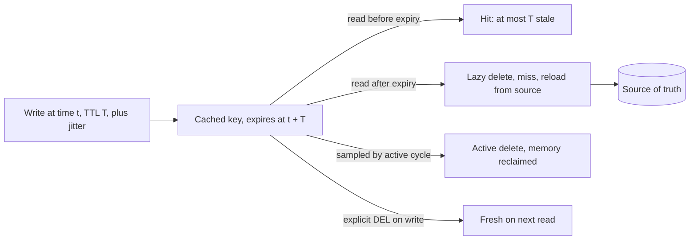

# TTL

> [!abstract] In one sentence
> A time-to-live turns "this cached value might be stale forever" into "this value is at most N seconds stale", which is the cheapest correctness guarantee a cache can offer — provided the N comes from what the reader can tolerate, the expiries are spread out so they do not all land at once, and you know how the cache actually removes expired keys.

> [!tip] Deeper treatment in your system-design vault
> `system-design/04 Caching and Redis/Cache Invalidation.md` — read it *after* you have written your own explanation below.

**Map:** [[Caching MOC]] → [[HLD MOC]]

## Definition

A time-to-live is a duration attached to a cached entry after which the entry is considered expired and will not be served; the next read misses and reloads from the source of truth. A TTL is an upper bound on staleness: a value written at time *t* with TTL *T* can be served stale until *t* + *T* at the latest. The same idea appears at every layer — [[Redis]] key expiry, HTTP `Cache-Control: max-age`, [[DNS]] record TTLs, in-process caches' `expireAfterWrite` — and it is the fallback that makes every other invalidation scheme safe: if an explicit delete is missed, the TTL still ends the staleness ([[Cache Invalidation]]).

## Problem solved

A cache without expiry serves whatever it was last told, forever. The first forgotten invalidation — a batch job, an admin tool, a second service writing the same table — leaves a stale value in place indefinitely, and nobody knows until a customer does. Explicit invalidation is precise but requires every write path to participate; event-driven invalidation requires infrastructure; both can fail. A TTL requires nothing of writers and bounds the damage of every other mechanism's failure. It also solves the memory problem for lazily populated caches: keys that stop being read disappear on their own instead of accumulating until eviction pressure ([[Eviction Policies]]).

## How it works

**Choosing the value.** Start from the reader's staleness tolerance, not from habit:

- What is the cost of a reader acting on a value that is *T* old? A product description: nothing. A price: a few seconds is fine, an hour is a complaint, a day is a dispute. A revoked permission: the TTL is the length of time a revoked user keeps access ([[Cache Consistency]]).
- How fast does the value change? A TTL far shorter than the change interval wastes reloads; one far longer is pure staleness.
- What load does the source tolerate? Reload rate ≈ hot keys ÷ TTL; halving the TTL doubles the misses.

A common structure is a short TTL as the bound plus explicit deletes for the writes you control, so that the normal case is fresh and the worst case is bounded.

**Jitter.** If 100,000 keys are loaded at startup with the same TTL, they expire in the same second and the source takes 100,000 misses at once; the same happens for keys warmed by a deploy or a cache restart. Add randomness: `ttl = base + random(0, base × 0.1)` or a random fraction between 0.8 and 1.2 of the base. Spreading expiries smooths reload load and is the single cheapest defence against [[Cache Stampedes]] of the synchronized kind.

**Expiry mechanics in Redis.** Redis stores the expiry as an absolute Unix timestamp in milliseconds (so a clock jump on the host moves expiries). Keys are removed two ways:

1. **Lazily**: when a key is accessed and found expired, it is deleted and reported as missing.
2. **Actively**: a background cycle runs about ten times a second, samples a small batch of keys that have a TTL, deletes the expired ones, and repeats while the sampled expired fraction stays high; the effort is tunable in Redis 7 with `active-expire-effort`. Expired keys that are never sampled and never accessed therefore linger briefly and count against memory until found.

Replicas do not expire keys on their own; the primary sends an explicit `DEL` when it removes a key, and replicas treat logically expired keys as missing on reads so that they do not serve stale data while waiting for the `DEL`. Memcached uses lazy expiry on access plus a background crawler that reclaims expired items.

**TTL versus explicit invalidation.** TTL alone is the right choice when writers are many or unknown, staleness tolerance is comfortably larger than the reload cost, and simplicity matters. Explicit invalidation is required when readers must not see the old value after a write (within the propagation delay). Most production caches use both: delete on the writes you own, TTL for everything else.

**Related variants.** *Negative caching*: cache "not found" with a short TTL so repeated lookups of missing keys do not hit the source. *Refresh-ahead*: reload a hot key shortly before it expires so readers never miss. *Stale-while-revalidate* (HTTP, RFC 5861): serve the expired value for a grace period while refreshing in the background. *Soft versus hard TTL*: a soft expiry triggers a background refresh, a hard one forbids serving.

```text
Redis:    SET price:sku:9 "1999" EX 300          # 5-minute TTL
          EXPIRE session:abc 1800 NX              # set only if no TTL yet (Redis 7)
          TTL price:sku:9                         # seconds remaining, -1 none, -2 missing
HTTP:     Cache-Control: max-age=60, s-maxage=600, stale-while-revalidate=30
Caffeine: expireAfterWrite(Duration.ofMinutes(5)) with refreshAfterWrite(Duration.ofMinutes(4))
Jitter:   ttl = 300 + Math.floor(Math.random() * 30)
```

## Architecture



> [!example]- Excalidraw version — the same diagram as an editable canvas
> ![[TTL.excalidraw]]
> [[TTL.excalidraw|Open in Excalidraw]] — needs the Excalidraw plugin (see [[Plugins to Install]]).


## Use cases

- Any cached value with a stated staleness tolerance: "prices may be up to 60 seconds old" translates directly into a TTL.
- Data written by many parties where explicit invalidation cannot be made complete — reference data, third-party lookups, computed aggregates.
- Session and token caches, where the TTL doubles as the security bound on how long a revoked credential stays valid ([[JWT]]).
- Rate-limit windows and counters, where expiry is the window boundary ([[Rate Limiting]]).
- Negative results and transient errors, cached briefly to protect the source from retries.

## Limitations

- A TTL is a bound, not freshness: every value may be stale for the whole TTL, and readers that need the latest must bypass the cache or use explicit invalidation.
- Short TTLs raise miss rates and source load; long TTLs raise staleness; there is no value that is right for all readers of a key.
- Expiry is approximate in practice — lazy deletion means expired keys occupy memory until touched or sampled; HTTP intermediaries may serve beyond `max-age` under some conditions.
- Synchronized expiry without jitter creates periodic miss storms.
- TTLs chosen once are rarely revisited; they outlive the requirement that set them.

## Trade-offs

| You gain | You sacrifice |
|---|---|
| Bounded staleness with no cooperation from writers | Freshness within the window; readers may see old data for up to the TTL |
| Automatic memory reclamation for idle keys | Reload traffic proportional to hot keys divided by TTL |
| A safety net under explicit and event-driven invalidation | The illusion that invalidation is solved; TTL alone is not enough for read-after-write |
| Simple to reason about and to tune per key | Periodic miss storms unless expiries are jittered |

## Failure modes

- **Synchronized expiry**: a deploy or restart warms thousands of keys at once with equal TTLs; every TTL period the source takes a spike. Noticed as a periodic sawtooth in database load; blast radius is the source and everything sharing it ([[Cache Stampedes]]).
- **TTL as the only invalidation for a critical value**: a revoked API key or a changed fee table stays in effect for the TTL. Noticed in an audit or a dispute; blast radius is every decision made on the stale value.
- **No TTL at all**: cache-aside keys set without expiry accumulate until eviction, and stale entries from forgotten write paths never clear. Noticed as memory growth and permanent staleness; the fix is a default TTL enforced in the cache client.
- **Clock jump moves expiries**: a host clock corrected forward expires everything at once; backward keeps keys longer. Noticed as a sudden miss storm or unexpected staleness ([[Clocks and Time]]).
- **Memory held by expired keys**: millions of expired keys that are never accessed and sampled slowly; memory stays high and eviction kicks in on live keys. Noticed as evictions while the logical dataset should fit.

## Performance

A TTL costs a few bytes per key and a background cycle whose cost scales with the number of keys with expiries and with the expired fraction; on a busy Redis the active cycle is a small, bounded share of the single thread's time, tunable upward if memory reclamation lags. The important performance number is the reload rate it induces: for a hot set of *K* keys and TTL *T*, expect about *K* / *T* misses per second in steady state, plus a burst at startup if expiries are synchronized ([[Throughput]]).

## Scalability

TTL-based caches scale without coordination: nothing has to notify anyone, so the mechanism works identically across one node or a hundred ([[Distributed Caching]]). At 10x keys, the active-expiry cycle and memory held by not-yet-reclaimed expired keys grow proportionally; at 10x readers, the reload rate per key is unchanged but the stampede on a single hot key's expiry is 10x larger, which is where per-key coalescing or refresh-ahead becomes necessary ([[Hot Keys]]).

## Operational impact

Make TTLs explicit configuration with owners, not literals in code; a default TTL in the cache client prevents the "no TTL" failure. Monitor hit rate, expired-key counts, memory, and the source's load pattern for periodicity. In Redis, `INFO stats` reports `expired_keys` and the active-expiry effort can be raised when memory is dominated by expired-but-unreclaimed keys. Changing a TTL in production changes source load immediately; roll it out gradually for hot keys. For HTTP and CDN caches, remember that a long `max-age` cannot be revoked from clients already holding the value.

## Alternatives

- **Explicit invalidation** (delete on write) — precise and immediate for writers you control; wins when read-after-write matters ([[Cache Invalidation]]).
- **Event-driven invalidation** from the change stream ([[Change Data Capture]]) — wins when writers are many but all go through one database.
- **Versioned keys** — the key includes a version, so a write changes the key and old entries simply go unread until evicted; wins for immutable or content-addressed data.
- **Refresh-ahead / stale-while-revalidate** — readers never pay the miss; wins for a small hot set with strict latency targets.

## Real-world examples

- Redis's `EXPIRE` documentation describes the lazy-plus-active expiry algorithm, absolute-timestamp storage and replica behaviour; it is the reference for how TTLs really behave rather than how they are imagined ([[Redis Eviction Policies Docs]]).
- HTTP caching (RFC 9111) and the `stale-while-revalidate` / `stale-if-error` extensions (RFC 5861) are TTLs with grace periods, used by every CDN to serve traffic through origin slowness.
- Amazon's Builders' Library discusses jittered TTLs and negative caching as standard practice for look-aside caches in production ([[AWS Builders Library - Caching Challenges]]).
- In a stack like yours: JWT verification keys and merchant configs cached with TTLs of minutes plus explicit deletes from the owning service; session and token-revocation entries whose TTL is a security decision made with the IAM team; rate-limit windows in Redis with `EX` set atomically alongside the counter; and a client-side default TTL so no key in Redis lives without one.

## Practical exercise

1. Start Redis in Docker and write a small Java or TypeScript program that loads 100,000 keys with `EX 60` and no jitter, then reads a random sample at 2,000 reads per second.
2. Plot misses per second over three minutes; observe the spike at the 60-second mark. Repeat with jitter of ±10% and compare.
3. Watch `INFO stats` (`expired_keys`) and `INFO memory` while keys expire without being read; raise `active-expire-effort` and observe reclamation speed.
4. Add a replica; set a key with a 5-second TTL on the primary and read it from the replica every 100 ms; confirm the replica reports it missing after expiry even before the `DEL` arrives (add latency with Toxiproxy to make the gap visible).
5. Implement refresh-ahead for ten hot keys (refresh at 80% of TTL) and measure the miss rate on those keys versus plain expiry.
6. Write down a TTL table for a service you know: key, staleness tolerance, chosen TTL, jitter, explicit invalidation yes/no.

## Related concepts

### Prerequisites
- [[Cache-Aside]] — the pattern whose entries TTLs bound
- [[Redis]] — where most TTLs in a backend live

### Related
- [[Cache Invalidation]] — TTL as one invalidation method among several
- [[Cache Stampedes]] — what synchronized expiry causes
- [[Eviction Policies]] — the other way entries leave a cache
- [[Cache Consistency]] — staleness bound as the consistency statement
- [[Clocks and Time]] — expiry depends on the host clock

### Builds on this
- [[Rate Limiting]] — windows implemented as expiring keys
- [[CDNs]] — max-age and stale-while-revalidate at the edge
- [[DNS]] — record TTLs and their effect on failover
- [[JWT]] — token lifetime as a TTL with security consequences

### Design problems where it applies
- [[Design a Rate Limiter]]
- [[Design a URL Shortener]]
- [[Design an IAM Service]]
- [[Design a Distributed Cache]]

### Projects where it can be implemented
- [[Rate Limiter Library]]
- [[LLM Gateway]]

### Resources
- [[Redis Eviction Policies Docs]] — expiry algorithm and memory behaviour
- [[AWS Builders Library - Caching Challenges]] — jitter, negative caching and TTL choice in practice
- [[Scaling Memcache at Facebook]] — TTLs as the backstop under lease-based invalidation

## Personal understanding

> [!question] Explain it without the source
> Write your own explanation here, from memory. Then compare it with the sections above and note what you missed.

### Mastery checklist
- [ ] I can explain it without the original resource
- [ ] I can describe the problem it solves
- [ ] I can compare it with its alternatives
- [ ] I can name its limitations and failure modes
- [ ] I can recognise when it is appropriate in a real system
- [ ] I have applied it in a system design
- [ ] I have validated my assumptions with an experiment or implementation

## Open questions

- [ ] For the keys cached in a service I know, what is the staleness tolerance that justified each TTL, and which TTLs were simply copied from another key?
- [ ] What is the right TTL for a token-revocation check given the IAM service's revocation latency, and is a short TTL plus a pub/sub revocation event better than either alone?
- [ ] How much Redis memory in our clusters is held by expired-but-unreclaimed keys, and would raising the active-expiry effort cost measurable latency?
