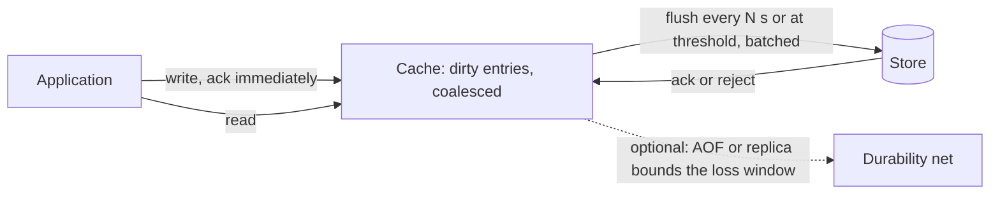

# Write-Back Caching

> [!abstract] In one sentence
> Write-back means the fast layer says "done" before the slow layer has the data, and flushes later — so a thousand increments become one store write and the write path runs at memory speed — which is wonderful until the fast layer dies with unflushed data, which is why every serious write-back design pairs it with a log, replication or an explicit acceptance of loss.

> [!tip] Deeper treatment in your system-design vault
> `system-design/04 Caching and Redis/Caching Strategies.md` — read it *after* you have written your own explanation below.

**Map:** [[Caching MOC]] → [[HLD MOC]]

## Definition

In **write-back** (write-behind) caching, a write is applied to the cache and acknowledged to the caller immediately; the cache marks the entry dirty and writes it to the backing store asynchronously — after a delay, when a batch fills, when the entry is evicted, or on an explicit flush. Multiple writes to the same key within the window are **coalesced** into a single store write, and writes to many keys are **batched** into fewer, larger operations. The caller's view is that the write is complete; the store's view lags by the flush interval. This contrasts with [[Write-Through Caching]], where the acknowledgement waits for the store, and with [[Cache-Aside]], where writes never touch the cache at all.

## Problem solved

Some write workloads cannot afford a store round trip per write, and do not need one: view counters incremented thousands of times a second, last-seen timestamps, session state, metrics, rate-limit buckets, position updates. Writing each of these through to a database would saturate it with updates whose intermediate values nobody will ever read. Write-back absorbs the write burst in memory, collapses the intermediate values, and hands the store a fraction of the writes at a rate it can sustain. The same reasoning is why the hardware and operating system layers beneath every service already work this way: CPU caches hold dirty lines, the operating system holds dirty pages, and the database holds dirty buffers, each flushing later and each with its own mechanism to make the "later" survivable.

## How it works

1. **Write.** The application updates the cache entry (set, increment, merge). The entry is marked dirty, possibly with a sequence number, and the call returns.
2. **Coalesce.** Further writes to the same key update the same dirty entry; only the latest value (or the accumulated delta, for counters) will be flushed.
3. **Flush.** A background writer flushes dirty entries to the store, triggered by a timer (every *N* seconds), a size threshold (dirty entries or bytes), eviction of a dirty entry, or shutdown. Flushes are batched (`INSERT ... ON CONFLICT DO UPDATE` with many rows, or a bulk API).
4. **Acknowledge the flush.** The entry is marked clean; if the store rejects the write, the entry stays dirty for retry, or goes to an error path.
5. **Bound the risk.** The window between acknowledgement and flush is the exposure to data loss. The mitigations are the same at every layer: a durable log written before or alongside the cache (a WAL, an append-only file), replication of the cache to another node, or a short flush interval accepted as the [[Recovery Point Objective]].

**The pattern beneath your feet.**

- **CPU caches** are write-back: a modified line sits dirty in L1/L2 and is written to memory on eviction; a coherence protocol keeps other cores from reading stale memory. Loss on power failure is total and accepted — the contract is that unflushed state is not durable.
- **Operating system page cache**: `write()` returns once the data is in the page cache; dirty pages are flushed by background threads on a timer (Linux's `vm.dirty_expire_centisecs`, 30 seconds by default) or when dirty memory exceeds thresholds; `fsync()` forces the flush. A crash loses unflushed pages, which is why databases call `fsync` on their logs.
- **Database buffer pools**: PostgreSQL and InnoDB modify pages in memory and write them back at checkpoints, minutes later; durability comes from the write-ahead log, which *is* flushed at commit. The log turns a write-back cache into a durable system: dirty pages can be lost because the log can rebuild them ([[Relational Database Internals]], [[ACID]]).
- **Application caches**: Hazelcast and Ehcache offer write-behind map stores with a write delay and coalescing; [[Redis]] is commonly used as an application-managed write-back layer (increment in Redis, flush to PostgreSQL every few seconds by a worker), with Redis's own AOF or replication limiting the loss window.

```typescript
// Write-back counter: increment in Redis, flush to PostgreSQL every 5 seconds
await redis.hincrby("views:dirty", postId, 1);                  // acknowledged at memory speed

setInterval(async () => {
  const dirty = await redis.eval(RENAME_AND_READ, 1, "views:dirty"); // atomic swap to a flush set
  const rows = Object.entries(dirty);                            // one row per key, deltas coalesced
  await db.query(
    "INSERT INTO post_views (post_id, views) VALUES ... ON CONFLICT (post_id) DO UPDATE SET views = post_views.views + EXCLUDED.views"
  );                                                             // one batch write per interval
}, 5000);
// loss window: up to 5 s of increments if Redis dies without AOF/replica; make the flush idempotent
```

## Architecture



## Use cases

- High-rate counters and aggregates: views, likes, impressions, usage metering, where only the accumulated value matters.
- Frequently overwritten state: last-seen, presence, cursor positions, session data, where intermediate values are worthless.
- Burst absorption: writes arrive far faster than the store can take them, for short periods, and a bounded delay is acceptable ([[Backpressure]]).
- Rate-limit and quota buckets kept in memory and reconciled to a store occasionally ([[Rate Limiting]]).
- Anything already behind a durable log — the database's own buffer pool is the proof that write-back with a WAL is a sound foundation.

## Limitations

- Acknowledged writes can be lost: a cache crash, eviction without flush, or a failed flush loses the window's data unless a log or replica covers it.
- Ordering between keys is not preserved at the store; cross-key invariants (debit one account, credit another) cannot ride a write-back cache.
- Reads from the store (reports, other services, replicas) see stale values until the flush; the cache is the only fresh source.
- Flush failures are awkward: the caller has already been told "done"; the only options are retry, dead-letter, or silent loss.
- Unsuitable for money, inventory, idempotency records or anything where "done" must mean durable.

## Trade-offs

| You gain | You sacrifice |
|---|---|
| Write latency at memory speed, independent of the store | Durability of acknowledged writes until the flush completes |
| Orders of magnitude fewer store writes through coalescing and batching | Store-side freshness; other readers of the store lag by the flush interval |
| Burst absorption without over-provisioning the store | Ordering across keys and the ability to enforce cross-key invariants at write time |
| Simpler hot paths for counters and state | Flush machinery to build and operate: timers, batches, retries, backpressure |

## Failure modes

- **Cache node dies with dirty data**: the last flush interval of writes is gone, and nothing failed from the caller's point of view. Noticed only by reconciliation against another source; blast radius is the window × write rate. Replication or an AOF with a short fsync interval reduces it; a WAL eliminates it.
- **Flush backlog grows**: the store slows down, dirty entries accumulate faster than they drain, memory fills, and the cache evicts dirty entries or crashes. Noticed as rising dirty count and flush latency; needs backpressure — slow or reject writes when the backlog exceeds a bound.
- **Flush rejected by the store**: a constraint violation or a schema change makes the batch fail; entries stay dirty forever or are dropped. Noticed via flush error metrics; needs per-entry retry with a dead-letter path ([[Dead-Letter Queues]]).
- **Non-idempotent flush after a crash mid-flush**: the batch was applied but not acknowledged; the retry applies the deltas twice. Noticed as inflated counters; the flush must be idempotent (absolute values, or deltas tagged with a batch id).
- **Readers on the store trust it**: a report or a downstream service reads counters from the database and makes decisions on values minutes behind. Noticed as disagreements between dashboards and the product.

## Performance

Writes complete in microseconds in-process or in sub-millisecond network time to Redis, regardless of the store; store load drops by the coalescing ratio (updates per key per interval) times the batching factor. The flush is the cost centre: large batches are efficient but lengthen the loss window and create periodic store spikes; smaller, more frequent flushes smooth the load at the cost of less coalescing. Tune the interval against the acceptable loss window and the store's sustainable write rate ([[Throughput]]).

## Scalability

Write-back scales the write path with cache capacity, and the store with the flush rate rather than the raw write rate; at 10x writes the store sees roughly the same flush volume if keys are hot (more coalescing) and 10x if keys are unique (no coalescing). Partition dirty data by key across cache nodes and flushers to scale the flush ([[Distributed Caching]]), and make sure the store can absorb a full flush burst after a flusher outage, which can be many intervals' worth of writes at once.

## Operational impact

Operate the flush: dirty entry count, oldest dirty age, flush latency and error rate, store write rate during flushes, and the loss window as an explicit number on a dashboard. Shutdown must flush (graceful termination with enough time), and deploys must not kill all flushers at once. Reconciliation against an independent source is the only way to know the mechanism is not losing data; build it from the start. On-call needs a way to force a flush and to replay a failed batch.

## Alternatives

- **[[Write-Through Caching]]** — synchronous writes, no loss window; wins when durability at acknowledgement is required and write rate is moderate.
- **A durable log in front of the store** ([[Kafka]], [[Message Queues]]) — writes are acknowledged by the log, consumers apply them to the store in batches; wins when the loss window must be zero and the batching benefit is still wanted; it is write-back with the log as the durability net.
- **Store-native batching** (bulk inserts, `COPY`, a database's own buffer pool) — wins when the store can absorb the rate with better access patterns and no extra layer.
- **Approximate data structures** (HyperLogLog, sketches in Redis) — wins when exact counts are not needed and memory is the constraint.

## Real-world examples

- PostgreSQL's buffer manager is a write-back cache over data files: dirty pages are written at checkpoints and by the background writer, and the write-ahead log, flushed at commit, is what makes the arrangement durable ([[Relational Database Internals]]).
- The Linux page cache is write-back by default; the kernel's dirty-page tuning parameters (`vm.dirty_ratio`, `vm.dirty_background_ratio`, `vm.dirty_expire_centisecs`) control the flush and are a standard knob in database and Kafka host tuning.
- Hazelcast and Ehcache ship write-behind map stores with configurable write delay, batch size and coalescing — the application-level form of the pattern, with the documented caveat that a node failure loses unwritten entries unless the map is backed up.
- In a stack like yours: per-merchant transaction counters and velocity features for fraud rules accumulated in Redis and flushed to PostgreSQL by a worker; Redis AOF with `appendfsync everysec` plus a replica bounds the loss window to about a second, and the flush is written with idempotent upserts so a worker crash cannot double-count. The ledger itself never goes near this pattern.

## Practical exercise

1. Run Redis and PostgreSQL in Docker Compose with a small NestJS or Spring Boot service that increments a per-post view counter in Redis and flushes deltas to PostgreSQL every 5 seconds using the code above.
2. Load it with k6 at 5,000 increments per second across 100 keys; measure write latency, Redis ops per second and PostgreSQL writes per second — compute the coalescing ratio.
3. `docker kill` Redis mid-run without AOF; compare the PostgreSQL totals with k6's count of acknowledged increments to measure the loss window. Enable `appendfsync everysec` and a replica, repeat, and compare.
4. Make the flush fail (drop the table's unique index or add a constraint) and observe the backlog; add retry with a dead-letter list and a backpressure rule that rejects increments when the dirty set exceeds a bound.
5. Kill the flusher between the batch write and the acknowledgement; observe double-counting, then make the flush idempotent with a batch id and verify.
6. Note the loss window, the coalescing ratio and the store write rate as the three numbers that define the design.

## Related concepts

### Prerequisites
- [[Write-Through Caching]] — the synchronous sibling to contrast with
- [[Redis]] — the usual application-level write-back layer, and its persistence options
- [[ACID]] — what durability means and how a log provides it

### Related
- [[Relational Database Internals]] — buffer pool plus WAL as the canonical write-back design
- [[Backpressure]] — bounding the dirty backlog
- [[Recovery Point Objective]] — the loss window as an explicit commitment
- [[Idempotency]] — the flush must be safe to repeat
- [[Cache-Aside]] — the pattern for data that must not take this risk

### Builds on this
- [[Rate Limiting]] — in-memory buckets reconciled to a store
- [[Time-Series Databases]] — ingestion buffers flushed in blocks
- [[Metrics]] — client-side aggregation before export is write-back
- [[Capacity Planning]] — sizing the store for flush bursts rather than raw writes

### Design problems where it applies
- [[Design a Social Feed]]
- [[Design a Metrics and Monitoring System]]
- [[Design a Rate Limiter]]
- [[Design a Real-Time Fraud Detection Pipeline]]

### Projects where it can be implemented
- [[Streaming Fraud Rules Engine]]
- [[Rate Limiter Library]]

### Resources
- [[Database Internals]] — buffer management, checkpoints and the log
- [[Redis Eviction Policies Docs]] — what happens to dirty data under memory pressure
- [[Designing Data-Intensive Applications]] — chapter 3 on storage engines and durability

## Personal understanding

> [!question] Explain it without the source
> Write your own explanation here, from memory. Then compare it with the sections above and note what you missed.

### Mastery checklist
- [ ] I can explain it without the original resource
- [ ] I can describe the problem it solves
- [ ] I can compare it with its alternatives
- [ ] I can name its limitations and failure modes
- [ ] I can recognise when it is appropriate in a real system
- [ ] I have applied it in a system design
- [ ] I have validated my assumptions with an experiment or implementation

## Open questions

- [ ] Which counters or state in a system I know are written through to the database today but would be correct and much cheaper as write-back with a one-second loss window?
- [ ] How does Redis Streams as a durable log in front of PostgreSQL compare with Redis-hash write-back for the same counters, in loss window, throughput and operational cost?
- [ ] What does a graceful shutdown of a flusher on Kubernetes need — termination grace period, preStop hook, flush-on-SIGTERM — to guarantee no loss during deploys?
