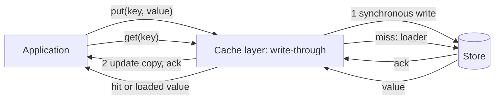

# Write-Through Caching

> [!abstract] In one sentence
> Write-through puts the cache in front of the store for writes — the write is acknowledged only after both have it — and read-through does the same for reads, so the cache is always fresh for whatever it holds and the application talks to one interface, paying for it with slower writes, wasted memory on unread keys and a cache outage that now blocks writes.

> [!tip] Deeper treatment in your system-design vault
> `system-design/04 Caching and Redis/Caching Strategies.md` — read it *after* you have written your own explanation below.

**Map:** [[Caching MOC]] → [[HLD MOC]]

## Definition

In **write-through** caching, writes go to the cache, and the cache (or a cache layer in the application) writes them to the backing store synchronously before acknowledging; the cached copy and the stored copy are updated together, so a subsequent read from the cache returns the latest write. **Read-through** is the companion for the read side: on a miss, the cache itself loads the value from the store using a configured loader and populates itself, so the application sees a single interface — `cache.get(key)` — and never talks to the store directly. The two are usually implemented together in a cache library (Caffeine's `LoadingCache`, Ehcache's `CacheLoaderWriter`, Hazelcast's `MapStore`) or in a caching proxy in front of a database (Amazon's DAX for DynamoDB). In [[Cache-Aside]] the application owns both paths; in write-through/read-through the cache layer does.

## Problem solved

Cache-aside leaves two things to the application: filling the cache on every read path and invalidating it on every write path. Forget one write path and the cache serves stale data indefinitely; the delete-on-write also guarantees a miss (and a database read) right after every update, which hurts for read-after-write flows such as "save profile, show profile". Write-through removes the invalidation problem by making the write *be* the cache update, and read-through removes the duplicated load-on-miss code by centralising it. The result is a cache that is consistent with the store for every key it holds, and application code that cannot forget to invalidate because it never invalidates.

## How it works

**Write path.**

1. The application calls `cache.put(key, value)` (or writes through a proxy).
2. The cache layer writes the value to the backing store — synchronously, in the same call.
3. If the store write succeeds, the cache updates its copy and returns; if it fails, the cache must not keep the new value (or must evict the key), or the cache and store diverge.
4. Deletes follow the same rule: remove from the store, then from the cache.

**Read path (read-through).**

1. `cache.get(key)`; on a hit, return.
2. On a miss, the cache calls its loader, which queries the store.
3. The loaded value is stored (with a [[TTL]] if configured) and returned. Good implementations coalesce concurrent loads of the same key so that one miss causes one store read ([[Cache Stampedes]]).

**What consistency you actually get.** For a single writer, the cache never holds a value older than the store, so reads after writes are fresh — read-your-writes for that key through that cache. With concurrent writers to the same key, the cache-then-store ordering of two writes can still interleave unless the cache layer serialises writes per key (most in-process caches do, by locking the entry; a distributed cache in front of a store generally does not). With multiple application instances each owning an in-process write-through cache, instance B's cache does not see instance A's write; the pattern gives per-cache consistency, not global consistency ([[Cache Consistency]], [[Multi-Level Caching]]).

**Costs built into the design.** Each write pays the store's latency plus the cache's; every written key occupies memory whether or not it will be read (cache pollution); and the cache is now on the write path, so its unavailability must be handled explicitly — bypass to the store and invalidate later, or fail the write.

```java
// Caffeine: read-through with a loader; write-through by writing the store first, then the cache
LoadingCache<String, MerchantConfig> cache = Caffeine.newBuilder()
    .maximumSize(10_000)
    .expireAfterWrite(Duration.ofMinutes(10))
    .build(id -> configRepository.findById(id));      // loader runs once per concurrent miss

void updateConfig(String id, MerchantConfig c) {
    configRepository.save(c);                            // 1. store, synchronously
    cache.put(id, c);                                    // 2. cache reflects the committed value
}
```

The same shape in a distributed setting is a caching proxy that exposes the store's API: DynamoDB Accelerator receives `PutItem`, writes to DynamoDB, then updates its own item cache; reads hit DAX and are loaded from DynamoDB on a miss.

## Architecture



> [!example]- Excalidraw version — the same diagram as an editable canvas
> ![[Write-Through Caching.excalidraw]]
> [[Write-Through Caching.excalidraw|Open in Excalidraw]] — needs the Excalidraw plugin (see [[Plugins to Install]]).


## Use cases

- Read-after-write flows through a single service: a user edits something and immediately sees it; the cache must not serve the pre-edit value.
- A small, frequently read, occasionally written dataset — configuration, feature flags, reference data — where caching every write is cheap and useful.
- A proxy-style cache in front of a managed store (DAX in front of DynamoDB) where the application should not know the cache exists.
- In-process caches with a loader, where read-through removes boilerplate and coalesces concurrent misses for free.
- Systems where the number of distinct write paths is large and a forgotten invalidation is likely — centralising in the cache layer is safer.

## Limitations

- Writes are slower: cache latency plus store latency, serially; for write-heavy workloads this dominates.
- Memory is spent on keys that are written but never read; for append-heavy data (events, logs) the cache fills with garbage.
- The cache sits on the write path: if it is unavailable, writes fail or need a bypass mode that reintroduces invalidation logic.
- Per-cache consistency only: multiple application instances with in-process write-through caches diverge; a shared distributed cache fixes that but adds a network hop on every write.
- Derived data (lists, aggregates, rendered pages) is not maintained by writing through a single key; those still need invalidation or versioning ([[Cache Invalidation]]).

## Trade-offs

| You gain | You sacrifice |
|---|---|
| Cache never older than the store for keys it holds; read-after-write through one cache | Write latency: every write waits for both cache and store |
| One interface for reads and writes; no scattered invalidation code | Memory spent on written-but-unread keys |
| Coalesced loading on miss through the read-through loader | A cache outage that affects writes, not only reads |
| Warm cache for recently written keys with no first-read miss | Global consistency across instances still needs a shared cache or invalidation |

## Failure modes

- **Store write fails after cache update**: implementation order wrong (cache first, store second); the cache holds a value the store never got; readers see a phantom update. Noticed by reconciliation; the fix is store-first or evict-on-failure.
- **Cache unavailable blocks writes**: the distributed cache tier is down and every write errors; the business stops for a component that was meant to speed up reads. Noticed as write errors correlated with cache health; needs a bypass plus later invalidation ([[Graceful Degradation]]).
- **Divergent in-process caches**: instance A writes through its cache, instance B keeps serving its stale copy for the TTL. Noticed as inconsistent responses depending on which pod answers; the fix is a shared cache or pub/sub invalidation across instances.
- **Pollution evicts the hot set**: a bulk import writes millions of keys through the cache, evicting the keys readers need; hit rate collapses for hours. Noticed as a hit-rate drop aligned with the batch ([[Eviction Policies]]).
- **Loader stampede**: a read-through implementation without per-key coalescing lets a hundred concurrent misses run a hundred loads. Noticed as database spikes on cold start.

## Performance

Reads perform like any cache: hits in microseconds in-process, sub-millisecond over the network. Writes pay the sum of cache and store latency — negligible for an in-process cache, one extra network round trip for a distributed one. The hit rate for write-through is often better for recently written keys (they are warm) and worse overall if writes dominate, because memory fills with unread data. Read-through's coalescing lowers the miss cost under concurrency, which is a real advantage over naive cache-aside.

## Scalability

Write throughput is capped by the store, exactly as without a cache, plus the cache's own write capacity; the cache does not absorb writes (that is [[Write-Back Caching]]). Read scaling follows the cache's capacity. In-process write-through caches scale with the number of instances but diverge; a distributed write-through cache scales by partitioning keys across nodes ([[Distributed Caching]]) and becomes a shared dependency on every write.

## Operational impact

Operate the cache as part of the write path: its availability now counts against write availability, so it needs the same redundancy, timeouts and bypass behaviour as the store. Monitor write latency split by cache and store, loader errors and latency, hit rate, and memory consumed by never-read keys (a sampled "age at eviction" metric reveals pollution). Debugging is simpler than cache-aside — there is one place where cache and store are written — but failures in that place affect everything.

## Alternatives

- **[[Cache-Aside]]** — the application populates on read and deletes on write; wins when writes are frequent or rarely read, and when the cache must stay off the write path.
- **[[Write-Back Caching]]** — acknowledge at the cache, flush later; wins for write-heavy, loss-tolerant data where latency and coalescing matter.
- **Write-around** — writes go to the store only, bypassing the cache; reads populate on miss; wins when written data is rarely read soon after writing.
- **Event-driven invalidation** — writes go to the store, an invalidator deletes keys from the change stream ([[Change Data Capture]]); wins when many services write the same data.

## Real-world examples

- Amazon DynamoDB Accelerator (DAX) is a write-through, read-through cache that exposes the DynamoDB API; writes are persisted to DynamoDB before the DAX item cache is updated, and misses are loaded from the table.
- Caffeine's and Guava's loading caches are the standard in-process read-through implementation on the JVM, with coalesced loading and refresh-ahead support ([[Caffeine Cache]]).
- CPU cache hierarchies implement write-through at some levels (the write is propagated to the next level immediately) and write-back at others; the vocabulary comes from hardware, where the same latency-versus-coherence trade applies.
- In a stack like yours: a Caffeine or in-memory map holding merchant configuration in each Spring Boot or NestJS pod, written through when the owning service updates a config — paired with a Redis pub/sub or Kafka event so other pods drop their copies, because per-pod write-through alone leaves the fleet inconsistent.

## Practical exercise

1. Build a small service (Spring Boot with Caffeine, or NestJS with an in-memory LRU and a loader) over PostgreSQL in Docker Compose, with `GET /config/:id` and `PUT /config/:id`.
2. Implement write-through (store first, then cache) and read-through (loader on miss); verify with a `PUT` followed immediately by a `GET` that the read is fresh and no database read occurred.
3. Load the read path with k6 and compare hit rate and p99 with the cache-aside version from the Cache-Aside note.
4. Run two instances behind nginx; `PUT` through one, `GET` through the other, and observe the stale response; add Redis pub/sub invalidation between instances and repeat.
5. Reverse the write order (cache first, then store) and make the store write fail; observe the phantom value and then fix the order.
6. Write 100,000 keys through the cache with a `maximumSize` of 10,000 and measure the hit rate of the original hot set before and after.

## Related concepts

### Prerequisites
- [[Cache-Aside]] — the baseline pattern this one replaces
- [[Latency]] — the write-path cost being added

### Related
- [[Write-Back Caching]] — the asynchronous sibling
- [[Cache Consistency]] — what "fresh" means per cache and across instances
- [[Cache Invalidation]] — still needed for derived data and cross-instance copies
- [[Eviction Policies]] — pollution versus hot-set retention
- [[Cache Stampedes]] — coalesced loading as the built-in defence

### Builds on this
- [[Multi-Level Caching]] — write-through at the in-process layer, invalidation across pods
- [[Distributed Caching]] — a shared write-through tier on the write path
- [[Feature Flags]] — the classic small, read-heavy, write-through dataset

### Design problems where it applies
- [[Design a Feature Flag Service]]
- [[Design an IAM Service]]
- [[Design a Distributed Cache]]

### Projects where it can be implemented
- [[Feature Flag Service and SDK]]
- [[LLM Gateway]]

### Resources
- [[Caffeine Cache]] — loading cache, refresh-ahead and write ordering
- [[AWS Builders Library - Caching Challenges]] — choosing between caching patterns in production
- [[Scaling Memcache at Facebook]] — why a look-aside design was chosen instead, at scale

## Personal understanding

> [!question] Explain it without the source
> Write your own explanation here, from memory. Then compare it with the sections above and note what you missed.

### Mastery checklist
- [ ] I can explain it without the original resource
- [ ] I can describe the problem it solves
- [ ] I can compare it with its alternatives
- [ ] I can name its limitations and failure modes
- [ ] I can recognise when it is appropriate in a real system
- [ ] I have applied it in a system design
- [ ] I have validated my assumptions with an experiment or implementation

## Open questions

- [ ] Which datasets in a service I know have a write rate low enough and a read-after-write expectation strong enough that write-through beats cache-aside?
- [ ] How should a write-through layer behave when the cache is down — fail the write, bypass and invalidate later, or bypass and accept staleness — and how would I test each?
- [ ] Does Hibernate's second-level cache in read-write mode behave as write-through, and what does it do across a cluster of pods?
