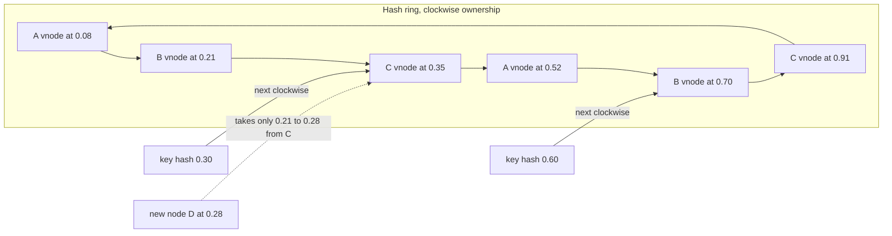

# Consistent Hashing

> [!abstract] In one sentence
> Consistent hashing maps both nodes and keys onto a ring and assigns each key to the next node clockwise, so a membership change moves only the keys in one arc — the property that lets caches, Dynamo-style stores and load balancers grow and shrink without reshuffling everything.

> [!tip] Deeper treatment in your system-design vault
> `system-design/06 Replication and Sharding/Consistent Hashing.md` — read it *after* you have written your own explanation below.

**Map:** [[Databases MOC]] → [[HLD MOC]]

## Definition

**Consistent hashing** is a scheme for assigning keys to a changing set of nodes in which the hash space is treated as a ring, each node is placed at one or more points on the ring, and a key belongs to the first node encountered walking clockwise from the key's hash. Adding or removing a node changes ownership only for keys between it and its predecessor; on average K/N keys move for K keys and N nodes. **Virtual nodes** (vnodes) place each physical node at many points so load evens out and capacity can be weighted. It is a [[Partitioning]] scheme optimised for cheap rebalancing rather than for range queries.

## Problem solved

The naive assignment `node = hash(key) mod N` is perfect until N changes. Going from N to N+1 nodes keeps only about 1/(N+1) of keys in place — nearly everything moves. For a cache that means a near-total miss storm when a node is added ([[Cache Stampedes]]); for a storage cluster it means moving most of the data over the network for every scale event; for a stateful connection gateway it means every client reconnects. Karger and colleagues introduced consistent hashing in 1997 for distributed web caching, and Amazon's Dynamo made it the default partitioning scheme for leaderless stores. The goal is minimal disruption on membership change with no central coordinator deciding placement.

## How it works

1. **The ring.** Hash node identifiers (e.g. `ip:port#i`) with a uniform hash (MurmurHash3, xxHash, SHA-1 in older systems) into a space such as 0 to 2^32 − 1 or 2^64 − 1, and treat the space as circular. Store the positions in a sorted structure.
2. **Lookup.** Hash the key into the same space; find the first node position ≥ the key's hash (binary search in a sorted array or `TreeMap.ceilingEntry`); if none, wrap to the first position. O(log V) for V points.
3. **Membership change.** Adding a node at position p takes over the arc between its predecessor and p from the node that previously owned it; removing a node hands its arc to its successor. Nothing else moves.
4. **Virtual nodes.** With one point per node, arcs are wildly uneven (the expected maximum load is O(log N / N) times the mean) and a node's removal dumps its whole arc on one successor. Giving each node V points (100–200 is common; Cassandra defaulted to 256 and moved to 16 with a smarter allocator) makes arcs small and numerous, so load evens out roughly as 1/√V and a removed node's keys spread across many successors. Weighting is free: a node with twice the capacity gets twice the points.
5. **Replication on the ring.** Store each key on its owner and the next R−1 *distinct physical* nodes clockwise (skipping other vnodes of the same physical node) — the preference list of Dynamo and Cassandra. Combine with [[Quorums]] for reads and writes.
6. **Variants.** *Bounded-load consistent hashing* (Mirrokni, Thorup, Zadimoghaddam, 2016) caps any node at (1 + ε) times the average and spills overflow to the next node — used in Google's load balancing and Vimeo's HAProxy patch. *Rendezvous (highest random weight) hashing* scores every node per key and picks the maximum; no ring, same minimal-movement property, O(N) per lookup. *Jump consistent hash* (Lamping and Veach, 2014) gives a tiny, allocation-free function for numbered buckets, ideal when nodes are only ever appended. *Maglev* (Google) builds a lookup table for very fast per-packet decisions.
7. **What is not a ring.** Redis Cluster uses 16,384 fixed hash slots (`CRC16(key) mod 16384`) explicitly assigned to nodes and moved slot by slot — the fixed-partition-count strategy, chosen for operational transparency rather than ring maths. Kafka's `hash(key) mod partitions` is plain modulo, which is why partition counts should not change for keyed topics.

```java
// Minimal ring with virtual nodes
final TreeMap<Long, String> ring = new TreeMap<>();
void addNode(String node, int vnodes) {
    for (int i = 0; i < vnodes; i++) ring.put(hash64(node + "#" + i), node);
}
String nodeFor(String key) {
    Map.Entry<Long, String> e = ring.ceilingEntry(hash64(key));
    return (e != null ? e : ring.firstEntry()).getValue();   // wrap around
}
// Removing a node: ring.values().removeIf(n -> n.equals(node)); only its arcs change owner.
```

## Architecture



## Use cases

- "Add or remove cache nodes without a miss storm" — client-side sharding of Memcached (ketama) and any [[Distributed Caching]] layer without a server-side router.
- "A leaderless store must place keys and replicas without a coordinator" — Dynamo, Cassandra, Riak, ScyllaDB ([[Design a Distributed Key-Value Store]] is this).
- "Route a client's requests to the same backend for state locality" — ring-hash and Maglev policies in Envoy, HAProxy and gRPC [[Load Balancers]] for session affinity, WebSocket gateways and per-key rate limiters.
- "Partition work across workers that scale up and down" — assigning tenants, shards or queues to consumers in a pool with minimal reshuffling.
- "Distributed rate limiting with per-key counters on a sharded store" — keys stay on the same counter node across scale events ([[Rate Limiting]]).

## Limitations

- Range queries are impossible: adjacent keys hash to unrelated positions; use range partitioning when scans by key order matter ([[Partitioning]]).
- It balances key *count*, not load: a single hot key still lands on one node ([[Hot Keys]]); bounded-load variants help with hot *nodes*, not hot keys.
- Every client must agree on the ring (same hash function, same membership view) or keys are written to one node and read from another — membership propagation ([[Gossip Protocols]], config service) becomes part of the correctness story.
- Vnodes multiply metadata and make operations such as repair, streaming and per-node backups more complex; Cassandra reduced its default for exactly this reason.
- For a fixed, rarely changing set of nodes a fixed slot table (Redis Cluster) is simpler to reason about and operate.

## Trade-offs

| You gain | You sacrifice |
|---|---|
| Membership changes that move about K/N keys instead of nearly all | Range scans and any locality between neighbouring keys |
| No central placement service; any client can compute the owner | Consistency of the ring view across clients becomes a distributed problem |
| Weighted capacity and smooth balance through virtual nodes | Metadata and operational complexity proportional to vnode count |
| Natural replica placement via the preference list | Load balance that reflects key count, not request rate |

## Failure modes

- **Ring view divergence** — clients with stale membership route the same key to different nodes → writes and reads miss each other; you notice from "data disappears then reappears" reports; blast radius is every key in the disputed arcs until views converge.
- **Hot spot on a node** with too few vnodes or a bad hash → one node at 100 % while others idle; you notice from per-node metrics not matching the fleet average; blast radius is every key on that node.
- **Cascading overload on node loss** without vnodes → the successor inherits the whole arc, overloads, and is marked dead, pushing two arcs to the next node; you notice as a domino of node failures; blast radius is the cluster ([[Retry Storms]] make it worse).
- **Hash function change or key normalisation drift** (one client lower-cases keys, another does not) → silent cache misses or split data; blast radius is a full re-warm or a data migration.
- **Replica placement collapsing onto one physical node** when vnodes of the same host are adjacent and the implementation forgets to skip them → replication factor three on one machine; you notice only when that machine dies with all copies.

## Performance

A lookup is a hash plus a binary search over N × V points — sub-microsecond for thousands of points — so the ring is never the bottleneck. Memory is N × V entries, trivial. The cost that matters is movement on membership change: with vnodes, a node addition pulls roughly 1/N of the data from many peers in parallel (fast, spread) rather than one arc from one peer (slow, concentrated). Bounded-load variants add a counter check per lookup; rendezvous hashing costs N hash evaluations per lookup, fine for tens of nodes and poor for thousands.

## Scalability

Clusters of hundreds of nodes run on the ring (Cassandra, ScyllaDB, DynamoDB internally); membership propagation, not lookup cost, is what scales badly, which is why large rings rely on gossip and bounded churn. For 10x nodes, raise vnodes per node modestly and expect rebalancing traffic to be the operational constraint. For 10x keys nothing changes. For 10x request rate on a few keys, consistent hashing does nothing — replicate the hot keys or split them at the application level.

## Operational impact

Low once the library is chosen and shared: the hazards are all about agreement — one hash function, one normalisation, one membership source — and about rebalancing throttles. Monitoring should show per-node key share and load, and membership-change events. Debugging "which node has my key" needs a tool that computes the owner from the key; build it on day one. In managed stores it is invisible except as per-partition throttling and the advice to choose partition keys well.

## Alternatives

- **Fixed slot table (Redis Cluster's 16,384 slots)** — wins when the cluster is small and operated by humans who want to see and move slots explicitly.
- **Directory-based placement** (a lookup service or coordination store maps key ranges to nodes) — wins when placement must respect policy such as tenant isolation or residency ([[Sharding]]).
- **Rendezvous hashing** — wins for small node counts and when you want per-key node ranking (for replicas) without a ring structure.
- **Plain modulo with a never-changing count** — wins when the partition count is fixed by design, as in Kafka topics, and rebalancing happens by moving whole partitions instead.

## Real-world examples

- Amazon's Dynamo paper describes the ring, virtual nodes and preference-list replication that Cassandra, Riak and ScyllaDB implement; DynamoDB uses the same ideas internally.
- The ketama library made consistent hashing standard for Memcached client sharding; Envoy's ring-hash and Maglev load-balancing policies and HAProxy's `hash-type consistent` apply it to request routing.
- Google's "Consistent Hashing with Bounded Loads" (2016) describes the bounded-load variant used in its load balancer, and Vimeo published its production use in HAProxy.
- In a stack like yours: a self-managed Memcached or Redis sidecar layer sharded client-side with a ring, an Envoy or ALB target-group policy that keeps a WebSocket client on the same gateway pod, and a Kafka consumer pool that uses the ring to assign tenants to workers so a scale-out of the pool reassigns only a fraction of them.

## Practical exercise

1. Implement the ring above in Java or TypeScript with pluggable vnode count; load 1 million keys and record the key share per node for V = 1, 10, 100, 200 across 10 nodes (min, max, standard deviation).
2. Add an eleventh node and count moved keys; compare with `hash mod N` for the same change.
3. Remove a node and measure how its keys spread across successors for V = 1 versus V = 100.
4. Add replication factor 3 with physical-node skipping and verify no key has two replicas on one host.
5. Implement bounded loads with ε = 0.25 and a skewed key distribution; measure the maximum node load before and after.
6. Stretch: put it in front of three Memcached containers and measure the miss rate during a scale-out with and without the ring.

## Related concepts

### Prerequisites
- [[Partitioning]] — the general problem of assigning keys to pieces
- [[Sharding]] — where cheap rebalancing matters most

### Related
- [[Distributed Caching]] — the original and most common application
- [[Load Balancers]] — ring-hash and Maglev policies for affinity
- [[Hot Keys]] — the problem even balance does not solve
- [[Quorums]] — the preference list is the set that quorums are taken over
- [[Gossip Protocols]] — how ring membership propagates without a coordinator

### Builds on this
- [[Rate Limiting]] — distributed counters sharded by key
- [[CDNs]] — cache routing by content hash to edge nodes
- [[Eventual Consistency]] — Dynamo-style stores assume ring placement plus quorums

### Design problems where it applies
- [[Design a Distributed Key-Value Store]]
- [[Design a Distributed Cache]]
- [[Design a Rate Limiter]]
- [[Design a Chat System]]

### Projects where it can be implemented
- [[Mini-KV Store]]
- [[Rate Limiter Library]]

### Resources
- [[Dynamo Paper]] — the ring, vnodes and preference lists in a production system
- [[System Design Interview (Alex Xu)]] — the chapter on consistent hashing with worked diagrams
- [[Designing Data-Intensive Applications]] — chapter 6 situates it among the partitioning schemes

## Personal understanding

> [!question] Explain it without the source
> Write your own explanation here, from memory. Then compare it with the sections above and note what you missed.

### Mastery checklist
- [ ] I can explain it without the original resource
- [ ] I can describe the problem it solves
- [ ] I can compare it with its alternatives
- [ ] I can name its limitations and failure modes
- [ ] I can recognise when it is appropriate in a real system
- [ ] I have applied it in a system design
- [ ] I have validated my assumptions with an experiment or implementation

## Open questions

- [ ] Where in your current stack does `hash mod N` quietly exist (Kafka partitions, a worker pool, a cache client), and what happens to it on the next scale event?
- [ ] How many vnodes would you need for ten heterogeneous nodes to keep the maximum key share within 10 % of the mean, and what does that cost in ring metadata?
- [ ] When is a fixed slot table like Redis Cluster's a better operational choice than a ring for a team of your size?
