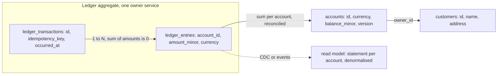

# Data Modeling

> [!abstract] In one sentence
> A data model is a bet about which queries and invariants matter: normalise so every fact has one home and updates cannot disagree, denormalise where a hot read would otherwise pay for joins, choose the partition and ownership boundaries before scale forces them, and never let money be a float or time be ambiguous.

> [!tip] Deeper treatment in your system-design vault
> `system-design/05 Relational Databases/Normalization vs Denormalization.md` — read it *after* you have written your own explanation below.

**Map:** [[Databases MOC]] → [[HLD MOC]]

## Definition

**Data modelling** is the design of the entities, attributes, relationships, keys and constraints that a system stores, and of how they are physically laid out for the queries it will run. **Normalisation** structures relational tables so that each fact is stored exactly once (no redundancy, no update anomalies); **denormalisation** deliberately duplicates or precomputes data so a read path avoids joins or aggregation. **Access-pattern-first** design, the norm for key-value and wide-column stores, starts from the list of queries and shapes each table or partition to answer one of them directly. A good model also fixes ownership (which service may write each fact) and the shard or partition key before growth makes them expensive to change.

## Problem solved

Models that start from the UI or from the ORM's defaults produce three recurring failures. Redundant data drifts: a customer's name stored in five tables is eventually five names. Hot reads pay for joins: the order page needs seven tables and times out at scale. And domain facts are mis-typed: amounts stored as floating point lose cents, timestamps without zones shift by hours after a server move, and "deleted" rows vanish from audit. Modelling for the actual queries and invariants, with explicit ownership and explicit types for money and time, prevents most of the data bugs that no later layer — cache, replica, shard — can fix. In fintech the ledger model in particular decides whether reconciliation is a query or a forensic investigation.

## How it works

1. **Normalise first (relational).** First normal form: atomic values, no repeating groups. Second: every non-key column depends on the whole key. Third (and Boyce–Codd): no column depends on another non-key column. The practical reading is "one fact, one place": the customer's address lives in `customers`, orders reference `customer_id`. Constraints — primary keys, foreign keys, `NOT NULL`, `CHECK`, unique indexes — encode invariants the engine enforces so application bugs fail loudly instead of corrupting data ([[Indexing]]).
2. **Denormalise deliberately.** When a read path is hot and its join is expensive, copy or precompute: a `balance_minor` on `accounts` that is the sum of its ledger entries; `customer_name` on `orders` as it was at order time (which is also *correct*, since the name at purchase is a historical fact). Every copy needs an owner and an update rule — synchronous in the same transaction, or asynchronous via [[Change Data Capture]] or events with a documented staleness — and ideally a reconciliation check.
3. **Access-pattern-first (NoSQL).** List every query with its predicate and sort. For DynamoDB single-table design, choose partition and sort keys so each query reads one item collection (`PK = ACCOUNT#42`, `SK = ENTRY#2026-10-19T…`), add global secondary indexes for the second and third access paths, and accept that an unplanned query means a new index or a scan. For Cassandra, one table per query, partition sized under tens of megabytes, time-bucketed keys for unbounded series ([[Partitioning]]).
4. **Ownership boundaries.** Group entities into aggregates — a transaction with its entries, an order with its lines — such that invariants hold inside an aggregate and are enforced in one [[Transactions|transaction]]; one service owns each aggregate's tables and other services read via API or events, never via the table ([[Domain-Driven Design]], [[Data Ownership and Lifecycle]]). The aggregate root's id is usually the natural shard key ([[Sharding]]).
5. **Modelling money.** Store amounts as integers in minor units (`amount_minor bigint`) or as `NUMERIC(19,4)`; never `float`/`double` (0.1 + 0.2 ≠ 0.3), and in JavaScript never a plain `number` for arithmetic — use `bigint` or a decimal library. Store the ISO 4217 currency with every amount; minor-unit exponent varies (JPY 0, KWD 3). A ledger is **double-entry and append-only**: each transaction has entries whose amounts sum to zero, entries are never updated or deleted, corrections are new entries, and balances are derived (sum) or cached with a version and a periodic reconciliation ([[Audit Logs]]).
6. **Modelling time.** Use `timestamptz` (stored in UTC) and never `timestamp without time zone`; record event time and processing time separately where they differ; keep the user's time zone as a separate attribute; use explicit `valid_from`/`valid_to` (bitemporal) for facts that change and must be reconstructed as-of a date, which regulators ask for.
7. **Keys and the rest.** Prefer time-ordered ids (bigserial, UUIDv7/ULID) over random UUIDv4 for index locality; keep natural identifiers as unique columns, not as primary keys; use enums or lookup tables for closed sets; JSONB for genuinely sparse, rarely queried attributes; soft deletes only where history is needed, with a partial index on live rows.

```sql
-- A minimal double-entry ledger model
CREATE TABLE ledger_transactions (
    id            uuid PRIMARY KEY,                  -- UUIDv7 for locality
    idempotency_key text NOT NULL UNIQUE,
    occurred_at   timestamptz NOT NULL,
    description   text NOT NULL
);
CREATE TABLE ledger_entries (
    id             bigint GENERATED ALWAYS AS IDENTITY PRIMARY KEY,
    transaction_id uuid NOT NULL REFERENCES ledger_transactions(id),
    account_id     bigint NOT NULL REFERENCES accounts(id),
    amount_minor   bigint NOT NULL,                  -- signed; entries per transaction sum to 0
    currency       char(3) NOT NULL,
    created_at     timestamptz NOT NULL DEFAULT now()
);
CREATE INDEX ON ledger_entries (account_id, created_at DESC);
-- No UPDATE or DELETE grants on ledger_entries; balance = SELECT sum(amount_minor) ... or a versioned snapshot
```

## Architecture



## Use cases

- "Every movement of money must be reconstructible and reconcilable" → append-only double-entry ledger, derived or versioned balances, no updates ([[Design a Digital Wallet and Ledger]]).
- "This page is slow because it joins seven tables" → a denormalised read model or precomputed columns with an explicit refresh rule ([[CQRS]]).
- "We are choosing DynamoDB or Cassandra" → write the access-pattern list first; the model is the query list.
- "Two services both write this table" → the model lacks an owner; fix the boundary before the data drifts.
- "Regulators ask what the record looked like on a given date" → bitemporal modelling or event history, not overwritten rows.

## Limitations

- Normalisation optimises for write correctness, not read speed; a fully normalised model with many joins is slow for hot pages and needs deliberate copies.
- Access-pattern-first models are rigid: an unplanned query is a redesign plus backfill ([[Schema Evolution]]).
- Denormalised copies need owners, update rules and reconciliation; without them they are bugs waiting for traffic.
- Modelling cannot be fully decoupled from the engine: InnoDB's clustered primary key, PostgreSQL's TOAST and JSONB behaviour, and DynamoDB's item-size and partition limits all shape what a good model is ([[Relational Database Internals]]).
- Models encode today's understanding of the domain; the cost of being wrong is a migration, so model the stable core carefully and keep volatile attributes flexible.

## Trade-offs

| You gain | You sacrifice |
|---|---|
| Normalised: one fact one place, engine-enforced invariants, cheap writes | Joins on hot reads and a model that may not match any single screen |
| Denormalised: fast reads shaped like the query | Copies to keep consistent, write amplification, reconciliation jobs |
| Access-pattern-first: predictable single-partition performance at scale | Ad-hoc queries, and a rebuild when the query list changes |
| Explicit money and time types: correctness regulators can audit | Verbosity, extra columns, and arithmetic that cannot use the language's native float |

## Failure modes

- **Floating-point money** → sums off by cents, statements that do not add up; you notice from reconciliation or a customer; blast radius is every amount ever computed through that path.
- **Timestamps without zones** → events shift by hours after a server or library change, daylight-saving duplicates or gaps; you notice from ordering anomalies in reports; blast radius is every time-based query.
- **Denormalised copy without an update rule** → stale balance or name shown with confidence; you notice from support tickets; blast radius is trust in the data and manual fixes.
- **Mutable ledger rows** → an "edit" erases history, an audit cannot explain a balance; you notice during a dispute or regulator request; blast radius is legal.
- **Unplanned access pattern on a single-table design** → a `Scan` on DynamoDB or `ALLOW FILTERING` in Cassandra that burns capacity and times out; you notice from cost and latency spikes; blast radius is the whole table's throughput ([[Hot Keys]]).

## Performance

Normalised models make writes cheap (one row per fact) and reads proportional to join depth; with proper indexes a few joins cost sub-millisecond, but wide fan-out joins on hot pages do not. Denormalised columns turn those reads into point lookups at the cost of extra writes per change. Access-pattern-first models deliver single-digit-millisecond reads by key at any scale and nothing else. Time-ordered keys keep inserts on the right edge of the index and the working set small. A derived balance via `sum()` is cheap for thousands of entries and expensive for millions, which is why ledgers snapshot balances periodically ([[Indexing]], [[Partitioning]]).

## Scalability

The model decides the scaling path: an aggregate with a clear root key shards cleanly; a model whose hot queries cross aggregates does not. At 10x data, normalised models need partitioning by time and archiving of history; at 10x reads, denormalised read models fed by CDC absorb the load without touching the write model; at 10x writes to one entity, append-only designs scale (inserts never conflict) where mutable-row designs serialise on locks ([[Optimistic and Pessimistic Locking]]). At 10x team size, ownership boundaries are what let teams change their models independently.

## Operational impact

A good model is the cheapest operational investment there is: constraints catch bugs at write time, append-only ledgers make audits queries, and clear ownership makes migrations single-team projects. The ongoing costs are reconciliation jobs for every denormalised copy, retention and archival policies for append-only tables, and migration discipline for every model change ([[Schema Evolution]]). Review data models with the same rigour as APIs: a column type or key choice is far harder to change than an endpoint.

## Alternatives

- **[[Event Sourcing]]** — wins when the history of changes *is* the domain (ledgers, audit); the current state becomes a projection and modelling shifts to events.
- **Document model with embedded aggregates** — wins when an aggregate is read and written whole and rarely queried by its internals; the aggregate is the document.
- **Schemaless JSONB column in a relational table** — wins for sparse, volatile attributes beside a stable core; indexes with GIN when queried.
- **Wide-column access-pattern models** — win for append-heavy time series by key where one query dominates ([[Time-Series Databases]]).

## Real-world examples

- Double-entry bookkeeping has been the accounting model for centuries; Square, Stripe and Modern Treasury have each published descriptions of ledger services built on append-only entries that sum to zero per transaction.
- Amazon's DynamoDB documentation and Rick Houlihan's single-table design talks are the canonical statement of access-pattern-first modelling.
- Discord's message-storage write-ups show a model chosen around one query (messages by channel, time-bucketed) and the consequences for hot partitions.
- In a stack like yours: a payments schema where amounts are `bigint` minor units with a currency column, the ledger is append-only with `REVOKE UPDATE, DELETE`, balances are cached on `accounts` with a version and reconciled nightly against `sum(amount_minor)`, KYC payloads sit in JSONB, and the statement read model is built from Kafka events — each copy with a named owner.

## Practical exercise

1. Model a wallet domain (customers, accounts, transactions, entries, holds) normalised in Docker PostgreSQL with full constraints; implement transfer, hold, capture and statement in a Spring Boot or NestJS service.
2. Store amounts as `double precision` in a parallel copy and run 100,000 random transfers in both; compare the sum of balances with the sum of entries and count the cents lost.
3. Add a cached `balance_minor` with a version; introduce a bug that skips one entry and write the reconciliation query that finds it within a minute.
4. Model the same domain as a DynamoDB single table (DynamoDB Local): write the access-pattern list, design keys and one GSI, implement statement and transfer, and then add the "all transfers above X today" query nobody planned — measure what it costs.
5. Change the schema to bitemporal entries (`valid_from`, `valid_to`) and answer "what was the balance as of last Tuesday" in both models.

## Related concepts

### Prerequisites
- [[Indexing]] — a model is only as good as the indexes that serve its queries
- [[Relational Database Internals]] — row layout, clustered keys and TOAST shape what a good model is

### Related
- [[SQL vs NoSQL]] — the store choice and the modelling style decide each other
- [[Schema Evolution]] — changing a model safely once it holds data
- [[Domain-Driven Design]] — aggregates and bounded contexts as modelling boundaries
- [[Data Ownership and Lifecycle]] — who may write each fact and for how long it is kept
- [[Partitioning]] — the partition key is part of the model
- [[Audit Logs]] — append-only modelling applied to who-did-what

### Builds on this
- [[Sharding]] — the aggregate root key becomes the shard key
- [[CQRS]] — separate read models are denormalisation made explicit
- [[Event Sourcing]] — events as the primary model, state as projection
- [[Search Indexing Pipelines]] — a denormalised copy for text and faceted search
- [[Data Warehouses]] — star schemas are denormalisation for analytics

### Design problems where it applies
- [[Design a Digital Wallet and Ledger]]
- [[Design a Chat System]]
- [[Design a Social Feed]]
- [[Design an Inventory Management System]]

### Projects where it can be implemented
- [[Double-Entry Ledger Service]]
- [[Presence and Chat Service]]

### Resources
- [[Designing Data-Intensive Applications]] — chapter 2 on data models and query languages
- [[Discord - How Discord Stores Trillions of Messages]] — a model chosen around one access pattern
- [[Martin Fowler - Event Sourcing]] — the append-only alternative to mutable state

## Personal understanding

> [!question] Explain it without the source
> Write your own explanation here, from memory. Then compare it with the sections above and note what you missed.

### Mastery checklist
- [ ] I can explain it without the original resource
- [ ] I can describe the problem it solves
- [ ] I can compare it with its alternatives
- [ ] I can name its limitations and failure modes
- [ ] I can recognise when it is appropriate in a real system
- [ ] I have applied it in a system design
- [ ] I have validated my assumptions with an experiment or implementation

## Open questions

- [ ] In the services you own, is any amount stored or computed as a float or a JavaScript number, and where would the first lost cent show up?
- [ ] Which denormalised columns exist today, who owns each, and is there a reconciliation job or only hope?
- [ ] Could a regulator's "show me this account as of a date" request be answered by a query, and if not, which modelling change would make it one?
