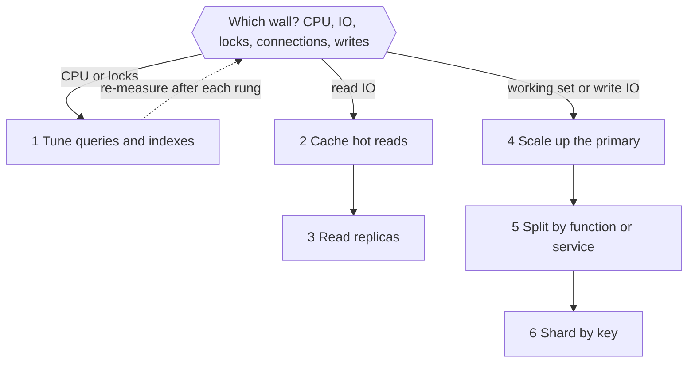

# Database Scaling

> [!abstract] In one sentence
> The scaling ladder is an ordered list of interventions from "add an index" to "shard the database", sorted by cost and irreversibility — and the engineering skill is diagnosing which wall you are actually hitting so you take the cheapest rung that removes it, not the most impressive one.

> [!tip] Deeper treatment in your system-design vault
> `system-design/05 Relational Databases/Database Scaling Patterns.md` — read it *after* you have written your own explanation below.

**Map:** [[Databases MOC]] → [[HLD MOC]]

## Definition

**Database scaling** is the set of techniques for keeping a database within its latency and throughput targets as load and data grow. The **scaling ladder** orders them: (1) tune queries and add [[Indexing|indexes]]; (2) cache hot reads ([[Cache-Aside]], [[Redis]]); (3) add [[Read Replicas]]; (4) scale up the primary ([[Horizontal vs Vertical Scaling|vertical scaling]]); (5) split by function — separate databases per domain or service; (6) [[Sharding|shard]] the remaining hot dataset. Each rung is more expensive, less reversible and more invasive to the programming model than the last, and each addresses a different bottleneck, so the ladder is both a sequence and a diagnostic checklist.

## Problem solved

Teams under pressure reach for the rung they have read about — usually sharding or a NoSQL migration — before measuring which resource is exhausted. The result is a quarter spent on a distributed-systems problem to fix something a composite index would have fixed in an afternoon, or a sharded system whose per-shard queries are still unindexed. The ladder encodes two facts: most database "scale" problems are efficiency problems (bad plans, missing indexes, N+1 queries, chatty transactions) that no hardware fixes; and the cheap rungs are reversible while the expensive ones are not. It also gives the honest counterpart: when a rung is genuinely exhausted, the next one is the right call, and pretending otherwise is just as costly.

## How it works

Climb in order, and at each rung ask *which wall am I hitting?* ([[Bottleneck Analysis]]).

1. **Tune and index.** Symptoms: CPU-bound primary, slow-query log full of sequential scans, `pg_stat_statements` dominated by a few statements, request traces showing hundreds of queries per request. Fixes: indexes matching hot predicates, rewriting non-sargable predicates, removing N+1 patterns, batching, shortening transactions ([[Query Execution and Optimization]], [[Transactions]]). Cost: hours to days. Reversible: completely. This rung typically gives the largest single improvement of any.
2. **Cache.** Symptoms: read-heavy, a small set of keys or computed results dominate, staleness of seconds is acceptable. Fixes: cache-aside in Redis with TTLs, request-level memoisation, HTTP caching. Cost: days plus the [[Cache Invalidation]] story you now own. Reversible: yes.
3. **Read replicas.** Symptoms: primary saturated by reads after caching; reports and dashboards competing with transactions; reads that cannot be cached because every user asks for different rows. Fixes: replicas with deliberate read routing and read-your-writes handling. Cost: instance cost and the staleness discipline. Reversible: yes.
4. **Scale up.** Symptoms: the working set no longer fits the buffer pool (cache hit ratio falling, I/O-bound), or write throughput is limited by CPU or fsync rate on a small instance. Fixes: larger instance class, faster storage, more memory ([[Relational Database Internals]]). Cost: linear to super-linear in money, minutes to apply. Reversible: yes, and it buys time to do the harder rungs properly. The wall: the largest instance class, usually with a brief failover to resize.
5. **Split by function.** Symptoms: several unrelated large tables or domains sharing one primary; one domain's load hurts another; team coupling on one schema. Fixes: move a bounded context's tables to its own database, with the cross-domain joins replaced by APIs or events ([[Microservices]], [[Domain-Driven Design]], [[Outbox Pattern]]). Cost: a migration project and the loss of cross-domain transactions. Reversible: painfully.
6. **Shard.** Symptoms: one table or domain alone exceeds a single primary's write or storage capacity after everything above. Fixes: shard by the key that keeps transactions local. Cost: months, permanent complexity. Reversible: no.

How to tell which wall, with the numbers to look at: **CPU-bound** → high CPU with high `blks_hit` ratio → rung 1. **I/O-bound** → low cache hit ratio, high read I/O wait → rungs 2–4. **Lock-bound** → lock waits and deadlocks in `pg_stat_activity` → rung 1 (shorter transactions, less contention), not any hardware. **Connection-bound** → `too many connections`, idle connections eating memory → a pooler (PgBouncer, RDS Proxy) before any rung ([[Connection Pooling]]). **Write-bound** → WAL fsync saturated, replication lag rising → rung 4, then 5 or 6.

```sql
-- The three numbers that pick the rung
SELECT round(100.0 * blks_hit / nullif(blks_hit + blks_read, 0), 2) AS cache_hit_pct
FROM pg_stat_database WHERE datname = current_database();          -- below ~99: I/O-bound
SELECT wait_event_type, count(*) FROM pg_stat_activity
WHERE state = 'active' GROUP BY 1;                                   -- Lock vs IO vs CPU
SELECT calls, total_exec_time, mean_exec_time, query
FROM pg_stat_statements ORDER BY total_exec_time DESC LIMIT 5;       -- who to tune first
```

## Architecture



> [!example]- Excalidraw version — the same diagram as an editable canvas
> ![[Database Scaling.excalidraw]]
> [[Database Scaling.excalidraw|Open in Excalidraw]] — needs the Excalidraw plugin (see [[Plugins to Install]]).


## Use cases

- "p99 on the checkout endpoint is rising week on week" — start at rung 1 with the plan of its top queries, not at rung 3.
- "The primary's CPU is at 80 % and reads are 95 % of traffic" — rungs 2 and 3 after confirming the reads are efficient.
- "Cache hit ratio dropped to 90 % after the data doubled" — rung 4: the working set outgrew memory.
- "Reporting queries from another team lock up our transactions" — rung 3 for the reports, rung 5 if it keeps happening.
- "One tenant's event table is 80 % of the database and still growing 3x a year" — rung 6 for that table, after archiving ([[Data Retention and Archival]]) has been tried.

## Limitations

- The ladder is a heuristic for relational OLTP workloads; firehose ingestion and analytics have different ladders ([[Time-Series Databases]], [[Data Warehouses]]).
- It assumes you can measure; without `pg_stat_statements`, slow-query logs and traces, every rung is a guess.
- Some walls are not scaling problems: a hot row that every transaction updates is a [[Data Modeling]] defect that no rung fixes ([[Hot Keys]]).
- Managed services change the shape of rungs 3 and 4 (a reader endpoint, a bigger instance class) but not their diagnostic logic.
- Rung 5 depends on domain boundaries existing in the code; splitting a database under a tangled monolith is a code project first ([[Modular Monoliths]]).

## Trade-offs

| You gain | You sacrifice |
|---|---|
| Cheap, reversible wins first and a measured reason for every expensive step | Time spent measuring before acting, which feels slow under pressure |
| A shared vocabulary for "we are I/O-bound, not CPU-bound" | The temptation to stop at scale-up forever and pay a growing instance bill |
| Deferral of sharding until it is unavoidable | Risk of climbing the last rungs in a hurry if growth outpaces the plan |
| Each rung also improves resilience (replicas, service isolation) | Each rung adds a component to operate and a staleness or consistency caveat |

## Failure modes

- **Skipping rung 1** → a sharded or replicated system whose queries are still sequential scans; you notice because the new setup is barely faster; blast radius is months of work and permanent complexity for no gain.
- **Scaling up forever** → an instance class with nowhere to go and a failover that takes minutes because the buffer pool is huge; you notice when the next resize is "the biggest one"; blast radius is a forced sharding project under deadline.
- **Caching before fixing the model** → invalidation bugs and stale balances; you notice from "the number is wrong for a few seconds" tickets; blast radius is correctness in exactly the domain where staleness is unacceptable ([[Cache Consistency]]).
- **Replicas added for a write-bound primary** → no improvement, more lag, more cost; you notice because replication lag now alarms during peaks; blast radius is budget and the delay in doing the right thing.
- **Connection exhaustion mistaken for database load** → bigger instance, same errors; you notice from `max_connections` hits with low CPU; the fix was a pooler.

## Performance

Order-of-magnitude expectations per rung, as typical figures rather than promises: an index on a scanned predicate turns milliseconds-to-seconds into sub-millisecond; a cache hit is ~100 µs versus ~1 ms for a database round trip; a replica gives linear read capacity per copy; a larger instance gives roughly proportional throughput until the working set fits memory, after which gains flatten; a functional split gives each domain its own headroom; sharding gives linear write capacity per shard for single-shard operations. Each rung's cost shows up as latency somewhere else: cache invalidation, replica lag, cross-service calls, cross-shard fan-out.

## Scalability

The ladder is a plan for 10x: rungs 1–4 commonly carry a product from thousands to tens of thousands of transactions per second on one well-run primary; rungs 5–6 carry it beyond. The question to answer in design reviews is "which rung are we on, and what is the measured signal that triggers the next one?" — with the trigger defined in metrics (cache hit ratio, p99 of top queries, replication lag, CPU at peak) and the next rung rehearsed before it is needed ([[Capacity Planning]]).

## Operational impact

Each rung adds something to run: statistics and plan monitoring; a cache with its eviction and consistency story; replicas with lag and routing; a bigger instance with a longer failover; more databases to back up and migrate; a sharding layer with its runbooks. Keep a written record of which rung each service is on and why, so the next engineer does not re-diagnose from scratch. On-call runbooks should start at rung 1 ("show me the top queries and their plans") because that is where most incidents are.

## Alternatives

- **Change the write path instead of the database** — wins when writes are bursty: buffer through [[Kafka]] or a queue and apply at a sustainable rate ([[Backpressure]]).
- **Move the workload to a fit-for-purpose store** — wins when the hot table is not relational in nature (events, time series, documents by key); a store built for that access pattern beats any rung ([[SQL vs NoSQL]]).
- **Reduce the data** — wins when growth is history, not activity: archive, aggregate, expire ([[Data Retention and Archival]]).
- **Distributed SQL from the start** (Spanner, CockroachDB, Aurora Limitless) — wins when a greenfield system is certain to exceed one node and can pay the latency and cost; rare for a new product.

## Real-world examples

- Shopify, GitHub and Basecamp have each described running very large products on sharded or vertically scaled MySQL with heavy caching, climbing the ladder over years rather than starting at the top.
- Stack Overflow's long-published architecture — a few large SQL Server instances, aggressive caching, read replicas — is the canonical "rungs 1 to 4 go a very long way" example.
- Notion's sharding posts document arriving at rung 6 only after the primary's vacuum and storage limits were reached, with explicit measurements.
- In a stack like yours: a payments schema on Aurora PostgreSQL where the real limit was a missing composite index and an N+1 in a NestJS repository (rung 1), [[Redis]] already absorbing session and limit lookups (rung 2), a reader endpoint for statements (rung 3), and sharding by account kept as a documented trigger ("when the primary's write CPU exceeds 60 % at peak after the above") rather than a plan.

## Practical exercise

1. In Docker Compose, run PostgreSQL with 512 MB `shared_buffers` and a Spring Boot or NestJS ledger API with a deliberately unindexed statements query and an N+1 in its list endpoint.
2. Load test with k6 at increasing rates until p99 passes 200 ms; record CPU, cache hit ratio, wait events and the top `pg_stat_statements` entries — then decide the rung from the data.
3. Apply rung 1 (index, batch the N+1) and repeat the test; record the new ceiling.
4. Add a Redis cache for account summaries (rung 2) and a streaming replica with read routing (rung 3); repeat and note which endpoint each rung helped.
5. Double `shared_buffers` (rung 4) and the dataset size; show the point where cache hit ratio, not CPU, becomes the limit.
6. Write a one-page capacity note: current rung, measured ceiling, the metric that triggers the next rung.

## Related concepts

### Prerequisites
- [[Bottleneck Analysis]] — the diagnostic step every rung depends on
- [[Horizontal vs Vertical Scaling]] — the general shape of rungs 4 and 6
- [[Relational Database Internals]] — why the buffer pool, WAL and vacuum are the walls you hit

### Related
- [[Indexing]] and [[Query Execution and Optimization]] — rung 1
- [[Cache-Aside]] — rung 2
- [[Read Replicas]] — rung 3
- [[Connection Pooling]] — the fix that is often mistaken for a scaling problem
- [[Capacity Planning]] — defining the triggers for the next rung

### Builds on this
- [[Sharding]] — the last rung, with its own body of technique
- [[Microservices]] — rung 5 is a database-per-service decision
- [[CQRS]] — separate read models as a structured version of rungs 2 and 3
- [[Distributed Caching]] — when the cache itself needs the same ladder

### Design problems where it applies
- [[Design a URL Shortener]]
- [[Design a Payment System]]
- [[Design a Social Feed]]
- [[Design an Inventory Management System]]

### Projects where it can be implemented
- [[Load Test and Latency Lab]]
- [[Double-Entry Ledger Service]]

### Resources
- [[Designing Data-Intensive Applications]] — chapters 5 and 6 are rungs 3 and 6 in depth
- [[System Design Primer (GitHub)]] — the scaling overview that introduces the rungs
- [[Database Internals]] — the engine mechanics behind rungs 1 and 4

## Personal understanding

> [!question] Explain it without the source
> Write your own explanation here, from memory. Then compare it with the sections above and note what you missed.

### Mastery checklist
- [ ] I can explain it without the original resource
- [ ] I can describe the problem it solves
- [ ] I can compare it with its alternatives
- [ ] I can name its limitations and failure modes
- [ ] I can recognise when it is appropriate in a real system
- [ ] I have applied it in a system design
- [ ] I have validated my assumptions with an experiment or implementation

## Open questions

- [ ] For each database you own, which rung is it on today, what is its measured ceiling, and which metric would tell you a week in advance that the next rung is needed?
- [ ] What fraction of your primary's CPU at peak is spent on its top five statements, and has anyone read their plans this quarter?
- [ ] If you had to split the payments database by function tomorrow, which cross-domain joins and transactions would break, and what replaces them?
