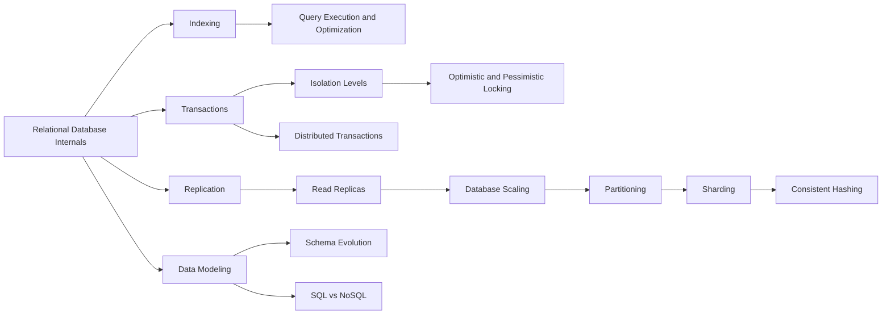

# Databases

> [!abstract] Where the state lives, what the database promises, and how it outgrows one machine.
> Internals first (pages, WAL, indexes), then the guarantees (transactions, isolation), then the scaling ladder (replicas, partitioning, sharding, consistent hashing). The ladder order matters: most teams shard years before they need to.

**Map:** [[HLD MOC]] → this · [[Start Here]] for the reading plan · [[Engineering Dashboard]] for progress

## Start with these

[[Indexing]] → [[Transactions]] → [[Isolation Levels]] → [[Replication]] → [[Read Replicas]] → [[Database Scaling]] → [[Sharding]] → [[Data Modeling]]

## How the ideas connect

*Every node is a link — click to open the note. Arrows mean "read this first".*



## Concepts

### Core — know these cold for SDE-2

- [[SQL vs NoSQL]] — A decision framework for picking a datastore from data shape, query patterns, consistency needs, scale path and operational maturity rather than from fashion
- [[Relational Database Internals]] — Pages, the buffer pool, the write-ahead log, checkpoints and MVCC are the five mechanisms that explain almost every performance and durability behaviour a relational…
- [[Indexing]] — An index is a sorted, separately maintained structure that turns a scan into a handful of page reads, paid for with extra work on every write and extra space on disk
- [[Transactions]] — A transaction groups several reads and writes into one unit that either fully commits or fully rolls back
- [[Isolation Levels]] — Isolation levels are a menu of which concurrency anomalies the database will prevent for you, from read committed through snapshot isolation to serializable, each buying…
- [[Replication]] — Replication keeps copies of the same data on several nodes for availability, durability and read scale
- [[Read Replicas]] — Read replicas scale reads by routing queries to asynchronously replicated followers
- [[Sharding]] — Sharding splits one logical dataset across independent database nodes by a shard key so writes and storage scale horizontally, at the cost of losing cross-shard joins…
- [[Consistent Hashing]] — Consistent hashing places nodes and keys on the same hash ring so that adding or removing a node remaps only the keys adjacent to it, roughly 1/N of the total, instead…
- [[Database Scaling]] — Database scaling is a ladder climbed in order, tune and index, cache, read replicas, scale up, split by function, shard, because each rung is cheaper and more reversible…
- [[Optimistic and Pessimistic Locking]] — Pessimistic locking takes a row lock before reading so conflicting writers wait, optimistic locking reads freely and rejects a write whose version changed
- [[Data Modeling]] — Data modelling is deciding what facts you store, where each fact lives once
- [[Schema Evolution]] — Schema evolution changes a live database without downtime by expanding the schema so old and new code both work, migrating data in throttled batches with dual writes

### Important — read once, revisit when a design needs it

- [[Query Execution and Optimization]] — A query becomes a tree of physical operators chosen by a cost model fed with table statistics
- [[Partitioning]] — Partitioning divides a dataset into independently managed pieces by range, hash or list so that queries touch only the relevant piece and pieces can be moved, dropped…
- [[Distributed Transactions]] — Two-phase commit makes a transaction atomic across several nodes by having a coordinator collect prepare votes before telling everyone to commit

## Where it shows up

**Design problems that lean on this category:** [[Design a Payment System]], [[Design a Digital Wallet and Ledger]], [[Design an Inventory Management System]], [[Design a Distributed Key-Value Store]], [[Design a Social Feed]], [[Design a Chat System]], [[Design a URL Shortener]], [[Design a Ticket Booking System]]

**Projects that exercise it:** [[Double-Entry Ledger Service]], [[Durable Job Scheduler]], [[Mini-KV Store]], [[Load Test and Latency Lab]], [[Presence and Chat Service]], [[Vault RAG Assistant]]

## Progress in this category

Status and confidence come from each note's properties — update them in the note, the table updates itself (native Bases, no plugin).

```base
filters:
  and:
    - file.hasTag("concept")
    - category == "Databases"
formulas:
  rank: 'if(priority == "high", 1, if(priority == "medium", 2, 3))'
properties:
  file.name:
    displayName: Concept
  formula.rank:
    displayName: "#"
views:
  - type: table
    name: Tracker
    order:
      - file.name
      - priority
      - status
      - confidence
      - last_reviewed
      - next_review
    sort:
      - property: formula.rank
        direction: ASC
      - property: file.name
        direction: ASC
    summaries:
      confidence: Average
```
