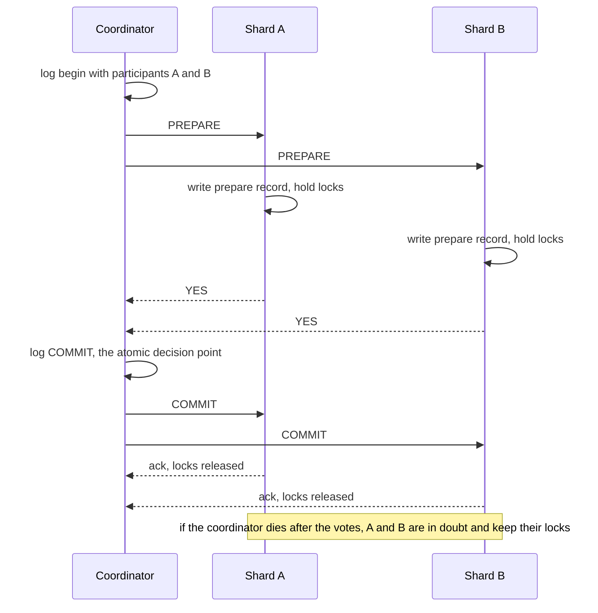

# Distributed Transactions

> [!abstract] In one sentence
> A distributed transaction buys all-or-nothing across machines with a coordinator and a prepare-then-commit handshake, and pays with blocking: once a participant has voted yes it must hold its locks until the coordinator speaks again, however long that takes — which is why the pattern is confined to places where one system owns both the coordinator and the participants.

> [!tip] Deeper treatment in your system-design vault
> `system-design/08 Distributed Systems Theory/Two-Phase Commit and Distributed Transactions.md` — read it *after* you have written your own explanation below.

**Map:** [[Databases MOC]] → [[HLD MOC]]

## Definition

A **distributed transaction** is a [[Transactions|transaction]] whose writes span more than one resource manager — two database shards, a database and a message broker, two services' databases — and that must still commit or abort as a unit. **Two-phase commit (2PC)** is the standard atomic commit protocol: a coordinator asks every participant to *prepare* (make the transaction durable but not visible, and promise to be able to commit), collects votes, and then broadcasts *commit* if all voted yes or *abort* otherwise. **XA** is the X/Open standard interface for 2PC between a transaction manager and resource managers, exposed in Java through JTA and implemented by MySQL, PostgreSQL (`PREPARE TRANSACTION`), and brokers such as ActiveMQ.

## Problem solved

Local transactions stop at the database boundary. The moment an operation touches two stores — debit in the accounts shard, credit in another; update an order and publish an event; write a file and record its metadata — a crash between the two leaves them disagreeing, and no amount of ordering fixes it (the dual-write problem that the [[Outbox Pattern]] exists for). 2PC was the 1970s answer for a world of a few databases on a reliable LAN with a transaction monitor in the middle: make both sides promise first, then commit both. It gives genuine atomicity and, with locks held through the protocol, isolation. The modern problem is that its failure behaviour — blocking — is intolerable for services that expect partial failure as a daily event, which pushed the industry towards designs that accept temporary inconsistency and repair it.

## How it works

1. **Phase 1 — prepare.** The coordinator writes "begin 2PC with participants P1..Pn" to its own durable log, then sends `PREPARE` to each. Each participant finishes the transaction's work, writes everything including a prepare record to its WAL, holds every lock, and votes `YES` — a binding promise that it *can* commit even after a crash — or `NO` if anything failed.
2. **Phase 2 — decide and commit.** If all votes are `YES`, the coordinator durably logs `COMMIT` (the moment of atomic decision) and sends `COMMIT` to every participant; each applies the commit, releases locks and acknowledges. Any `NO` or timeout during phase 1 yields a logged `ABORT` broadcast instead. The coordinator retries phase 2 messages until every participant acknowledges.
3. **Why it blocks.** A participant that voted `YES` and then loses contact with the coordinator is **in doubt**: it cannot commit (another participant may have voted `NO`) and cannot abort (the coordinator may have logged `COMMIT`). It must hold its locks and wait — minutes, hours — for the coordinator to return. If the coordinator's log is lost, the participants are stuck forever unless an operator makes a **heuristic** decision, which may break atomicity. Three-phase commit adds a pre-commit round to avoid blocking under crash failures but is unsafe under [[Network Partitions]], so it is rarely used.
4. **Costs.** Two round trips plus two durable log writes per participant and two on the coordinator before a commit is visible; lock hold times stretched over network latency; a coordinator that is itself a single point of failure unless it is replicated by [[Consensus]].
5. **Where it still lives.** Inside systems that own all the parts: Spanner runs 2PC across Paxos-replicated shards with the coordinator state itself replicated, so "coordinator crash" means a leader change, not a blocked participant; CockroachDB uses a replicated transaction record and parallel commits; Vitess and Citus offer 2PC for cross-shard writes; [[Kafka]]'s transactional producer uses a transaction coordinator and two-phase markers to make "write to several partitions plus commit offsets" atomic ([[Exactly-Once Semantics]]). In all of these the participants are homogeneous and the coordinator is highly available — the two conditions under which 2PC is reasonable.
6. **What replaces it between services.** The [[Saga Pattern]]: a sequence of local transactions, each with a compensating action, coordinated by orchestration or choreography, accepting that intermediate states are visible. The [[Outbox Pattern]] for database-plus-broker. [[Idempotency|Idempotent]] operations with retries, so "do A, then do B, retry B until it succeeds" converges without a coordinator. And reconciliation jobs that detect and repair the rare divergence — the pattern banks have used between institutions for decades.

```sql
-- PostgreSQL as an XA participant (max_prepared_transactions must be > 0)
BEGIN;
UPDATE accounts SET balance_minor = balance_minor - 5000 WHERE id = 42;
PREPARE TRANSACTION 'xfer-7f3a';        -- phase 1: durable, locks held, vote YES
-- ... coordinator collects votes from the other shard ...
COMMIT PREPARED 'xfer-7f3a';            -- phase 2 (or ROLLBACK PREPARED)
-- Operationally: SELECT * FROM pg_prepared_xacts;  -- in-doubt transactions holding locks
```

## Architecture



## Use cases

- "Cross-shard write inside one database system" — Spanner, CockroachDB, Vitess, Citus: the coordinator is replicated and participants are uniform, so 2PC is the honest tool.
- "Consume from Kafka, produce to Kafka, commit offsets, atomically" — Kafka transactions, a specialised 2PC that never leaves the broker.
- "Legacy JTA/XA integration" — a Java monolith with two XA-capable databases and an XA broker, where the transaction manager is already in place and throughput is modest.
- "Regulatory requirement for simultaneous commit across two ledgers" that cannot tolerate a visible intermediate state even for seconds — rare, and usually better met by a single ledger with both legs in one transaction ([[Data Modeling]]).
- Everything else between services: reach for sagas, outbox and idempotent retries, and name 2PC only to explain why you did not use it.

## Limitations

- Blocking: an in-doubt participant holds locks until the coordinator returns, turning one failure into an outage of every row it touched.
- Coordinator as a single point of failure and a durability requirement on its log; without replication (consensus), its loss is unrecoverable without heuristics.
- Latency: at least two network round trips and multiple fsyncs before visibility; across regions this is hundreds of milliseconds per transaction.
- Heterogeneous participants rarely implement XA well; broker and HTTP participants cannot "prepare" in any meaningful sense.
- No isolation across the protocol unless every participant holds locks for its whole duration, which is exactly the blocking problem.

## Trade-offs

| You gain | You sacrifice |
|---|---|
| True atomicity across resources without application-level compensation | Blocking on coordinator failure and locks held across network latency |
| A standard (XA/JTA) with transaction managers that already exist | Throughput: several durable writes and round trips per commit |
| Isolation of intermediate states from other transactions | Availability during partitions, by construction |
| Simplicity of application code — one commit call | Operational burden of in-doubt transactions and heuristic resolution |

## Failure modes

- **Coordinator crash after votes** → participants in doubt, rows locked; you notice from lock waits spreading and `pg_prepared_xacts` showing old entries; blast radius is every transaction touching those rows, growing until the coordinator recovers or an operator intervenes.
- **Heuristic commit on one participant, rollback on another** → atomicity broken by a human decision under pressure; you notice from reconciliation; blast radius is data integrity with no system log of the divergence beyond the operator's notes.
- **Participant timeout during prepare treated as NO, then its late YES arrives** → correct protocols abort, but buggy transaction managers have committed; blast radius is a half-applied transaction ([[Timeouts and Retries]]).
- **Throughput collapse under contention** → lock hold time now includes network round trips, so conflicting transactions queue; you notice from p99 rising with load far faster than with local transactions; blast radius is the whole hot key range.
- **Partition between coordinator and a participant** → the participant blocks and, if its locks guard a hot row, every request stalls behind it; blast radius is a whole shard from one dropped link ([[Network Partitions]]).

## Performance

A 2PC commit costs, per participant, one prepare write and fsync plus one commit write, and on the coordinator two durable log writes, plus two round trips — typically several milliseconds within a region and an order of magnitude more across regions. Lock hold time is extended by the full protocol duration, so contention effects dominate at scale: the throughput of conflicting transactions is bounded by 1 / (protocol latency) per hot key. Spanner's published figures for cross-region commits are tens of milliseconds and more; CockroachDB's parallel commits cut one round trip. Sagas trade this synchronous cost for asynchronous steps and compensation work.

## Scalability

2PC scales with participant count only within a system that has engineered for it: replicated coordinators, uniform participants, and workloads where most transactions touch one shard so 2PC is the exception. Between independent services it does not scale at all organisationally — every participant must implement prepare semantics and every team shares one blocking failure domain. At 10x services, the saga and outbox approaches are the only ones that keep teams decoupled ([[Event-Driven Architecture]]).

## Operational impact

High where used: monitor in-doubt transactions (`pg_prepared_xacts`, `XA RECOVER`), alert on their age, keep a runbook for heuristic resolution with sign-off, replicate and back up the coordinator log, and set `max_prepared_transactions` deliberately. In the saga world the burden shifts to monitoring stuck sagas and compensation failures, which is more visible and less dangerous than a locked shard. Inside managed systems (Spanner, Kafka transactions) the operator sees only latency and the occasional aborted transaction.

## Alternatives

- **[[Saga Pattern]]** — wins for multi-service workflows: local transactions plus compensations, orchestrated by a workflow engine ([[Temporal]]) or choreographed with events; intermediate states are visible by design.
- **[[Outbox Pattern]]** — wins for the database-plus-broker case, which is most of the "we need XA" requests in practice.
- **Idempotent retries plus reconciliation** — win when the second step can be retried until it succeeds and a periodic job catches the rare permanent failure; the interbank model.
- **Redesign so the invariant lives in one place** — wins most often: put both accounts' legs in one ledger database, or move money as two single-shard legs with an explicit transfer state machine.

## Real-world examples

- Google's Spanner paper describes 2PC over Paxos groups with TrueTime, the one widely cited design where distributed transactions are a first-class, scalable feature.
- The Confluent documentation on Kafka transactions and exactly-once semantics describes the transaction coordinator and the two-phase marker protocol — 2PC confined to a single system.
- Pat Helland's "Life beyond Distributed Transactions" (2007) is the classic argument for why large-scale systems avoid 2PC between independent entities, and Chris Richardson's microservices.io catalogue documents the saga alternative.
- In a stack like yours: a transfer between two accounts that happen to live on different Aurora clusters implemented as a saga — debit with an idempotency key, credit with an idempotency key, a transfer record with explicit state, compensation on failure, a reconciliation job hourly — with Kafka transactions used only inside stream-processing jobs, and XA nowhere.

## Practical exercise

1. Docker Compose with two PostgreSQL instances (`max_prepared_transactions = 10`) and a small Java program using Atomikos or Narayana (JTA) to transfer money across them with XA.
2. Measure commit latency and throughput at 50 concurrent transfers versus a single-database transaction doing the same work.
3. `kill -9` the Java coordinator between the votes and the commit decision; list `pg_prepared_xacts` on both databases, then try to update the locked rows from `psql` and observe the block; resolve with `COMMIT PREPARED` by hand.
4. Add Toxiproxy between the coordinator and one database and drop the connection after prepare; record how long locks are held.
5. Reimplement the transfer as a saga with idempotency keys and a transfer state table; kill the process at each step and verify that a reconciliation job completes or compensates every transfer.

## Related concepts

### Prerequisites
- [[Transactions]] — local atomicity is what 2PC tries to extend
- [[Network Partitions]] — the failure that decides whether a commit protocol blocks

### Related
- [[Consensus]] — how a coordinator can be made highly available
- [[Saga Pattern]] — the usual replacement between services
- [[Outbox Pattern]] — the usual replacement for database-plus-broker
- [[Idempotency]] — what makes retry-based alternatives converge
- [[Leader Election]] — choosing a new coordinator in replicated designs

### Builds on this
- [[Sharding]] — cross-shard writes are where this question becomes unavoidable
- [[Exactly-Once Semantics]] — Kafka's transactions are a 2PC variant

### Design problems where it applies
- [[Design a Payment System]]
- [[Design a Digital Wallet and Ledger]]
- [[Design a Ticket Booking System]]
- [[Design a Workflow Orchestrator]]

### Projects where it can be implemented
- [[Double-Entry Ledger Service]]
- [[Durable Job Scheduler]]

### Resources
- [[Spanner Paper]] — 2PC made scalable with replicated coordinators and TrueTime
- [[Designing Data-Intensive Applications]] — chapter 9 on atomic commit, 2PC and its blocking problem
- [[microservices.io - Saga Pattern]] — the alternative, with orchestration and choreography variants
- [[MIT 6.5840 Distributed Systems Course]] — the lectures and labs on distributed transactions

## Personal understanding

> [!question] Explain it without the source
> Write your own explanation here, from memory. Then compare it with the sections above and note what you missed.

### Mastery checklist
- [ ] I can explain it without the original resource
- [ ] I can describe the problem it solves
- [ ] I can compare it with its alternatives
- [ ] I can name its limitations and failure modes
- [ ] I can recognise when it is appropriate in a real system
- [ ] I have applied it in a system design
- [ ] I have validated my assumptions with an experiment or implementation

## Open questions

- [ ] Which flows in your payment stack currently rely on "call service A, then service B" with no saga record or reconciliation, and what is the detection time if B fails permanently?
- [ ] When you move stream processing to Redis Streams, what replaces the atomic "consume, produce, commit offset" that Kafka transactions gave you?
- [ ] For a cross-shard transfer, what is the longest acceptable window in which money is debited but not yet credited, and who signs off on that number?
