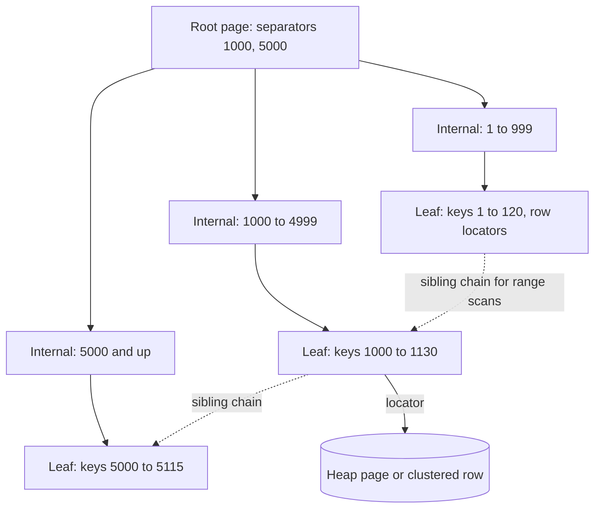

# Indexing

> [!abstract] In one sentence
> An index is a B+-tree (usually) kept in sorted order next to the table so that a lookup or range scan touches three or four pages instead of all of them — the cheapest performance win in databases and, when over-applied, the most common cause of slow writes.

> [!tip] Deeper treatment in your system-design vault
> `system-design/05 Relational Databases/Database Indexes.md` — read it *after* you have written your own explanation below.

**Map:** [[Databases MOC]] → [[HLD MOC]]

## Definition

An **index** is a data structure maintained alongside a table that maps the values of one or more columns to the locations of the rows holding them. The default and by far the most common structure is the **B+-tree**: a balanced tree whose internal pages hold separator keys and whose leaf pages hold the keys in sorted order with pointers to rows, chained left-to-right so a range scan walks the leaves sequentially. Every index speeds up some reads and slows down every write that touches the indexed columns; the craft is choosing the few indexes whose reads matter.

## Problem solved

Without an index, finding `WHERE account_id = 42` means reading every page of the table — a **sequential scan** whose cost grows linearly with table size. At a million rows on an 8 KB page layout that is tens of thousands of page reads; at a billion rows it is a job, not a query. A B+-tree with a fan-out of a few hundred keys per page is three levels deep for millions of rows and four for billions, and its top levels are almost always in the buffer pool ([[Relational Database Internals]]), so a point lookup costs one or two disk reads regardless of table size. Indexes also give the planner sorted input for free, which turns `ORDER BY … LIMIT 20` from a sort of the whole result into a short walk along the leaves.

## How it works

1. **B+-tree lookup.** Start at the root page, binary-search the separator keys, follow the child pointer, repeat until a leaf; the leaf holds the key and a row locator — a heap address (`ctid`) in PostgreSQL, the primary-key value in InnoDB. Inserts go into the correct leaf; a full leaf **splits** into two and pushes a separator up, which is why random-key inserts (UUIDv4) fragment the tree and time-ordered keys (bigserial, UUIDv7, ULID) append to the right-most leaf.
2. **Clustered versus secondary.** In InnoDB the table *is* the primary-key B+-tree: rows are stored in the leaves. A secondary index lookup therefore finds the primary key and then does a second traversal of the clustered index. In PostgreSQL every index, including the primary key, is secondary and points into the heap; a `CLUSTER` command reorders the heap once but does not keep it that way.
3. **Composite indexes and the leftmost prefix.** An index on `(tenant_id, created_at)` is sorted by `tenant_id` first and `created_at` within it. It serves `WHERE tenant_id = ?`, and `WHERE tenant_id = ? AND created_at > ?`, and `WHERE tenant_id = ? ORDER BY created_at`; it does nothing for `WHERE created_at > ?` alone. Rule of thumb: equality columns first, then the one range or sort column, because once the tree walk hits a range predicate the remaining columns are only filters.
4. **Covering indexes.** If every column the query needs is in the index, the engine never visits the table: an **index-only scan**. PostgreSQL's `INCLUDE (col)` adds payload columns to the leaves without making them part of the key; it also needs the visibility map to be current, so recently updated pages force heap visits until vacuum runs.
5. **Selectivity.** The planner uses statistics to estimate what fraction of rows a predicate selects. An index on `status` with three values is nearly useless for `status = 'ACTIVE'` when 95 % of rows are active: reading most of the table through an index is slower than scanning it, so the planner will choose a sequential scan anyway ([[Query Execution and Optimization]]). A **partial index** (`WHERE status = 'PENDING'`) fixes exactly this — small, hot, and selective.
6. **Write amplification.** Every `INSERT` writes one entry per index; every `UPDATE` that changes an indexed column does too (PostgreSQL's HOT optimisation avoids index writes only when no indexed column changes and the new version fits on the same page). Each entry is a page modification, a WAL record and later a full-page write. Five indexes on a hot table can make writes several times more expensive than the heap insert itself.
7. **Other structures.** Hash indexes for equality only; GIN for arrays, JSONB and full text ([[Inverted Indexes]]); GiST and SP-GiST for ranges and geometry; BRIN for huge append-only tables where physical order matches the column. And the **LSM-tree** family (RocksDB, Cassandra) replaces in-place B-tree updates with sorted immutable runs merged by compaction: much cheaper writes, more expensive reads, the trade the next generation of stores made.

```sql
-- Composite, partial and covering in one line each
CREATE INDEX CONCURRENTLY ix_entries_account_time
    ON ledger_entries (account_id, created_at DESC) INCLUDE (amount_minor, currency);
CREATE INDEX CONCURRENTLY ix_transfers_pending
    ON transfers (created_at) WHERE status = 'PENDING';
EXPLAIN (ANALYZE, BUFFERS)
SELECT amount_minor, currency FROM ledger_entries
WHERE account_id = 42 ORDER BY created_at DESC LIMIT 20;   -- expect Index Only Scan
```

## Architecture



> [!example]- Excalidraw version — the same diagram as an editable canvas
> ![[Indexing.excalidraw]]
> [[Indexing.excalidraw|Open in Excalidraw]] — needs the Excalidraw plugin (see [[Plugins to Install]]).


## Use cases

- "Fetch by id / by foreign key / by customer" — every lookup predicate in a hot path needs an index whose leftmost columns match it.
- "Latest N for this account" — a composite index ending in the sort column makes pagination an index walk instead of a sort.
- "Only the pending / unprocessed rows" — a partial index on the rare state keeps the structure tiny and avoids scanning the 99 % that are done ([[Outbox Pattern]] relays, job queues).
- "A unique constraint on (tenant, external_id)" — uniqueness is enforced *by* a B-tree; idempotency keys are an index you also happen to query ([[Idempotency]]).
- "Search inside JSON / arrays / text" — GIN or a dedicated [[Full-Text Search]] engine, not a B-tree on a text column.

## Limitations

- Indexes are only consulted when the predicate is **sargable**: `WHERE lower(email) = ?` or `WHERE created_at + interval '1 day' > now()` or an implicit cast on the column defeats a plain B-tree (use an expression index or rewrite the predicate).
- Low-cardinality columns, tiny tables and queries that return a large fraction of rows gain nothing and pay the write cost anyway.
- Each additional index slows writes, enlarges backups and WAL, and competes for buffer-pool space with the data it indexes.
- Secondary indexes on partitioned or sharded data are either local (scatter-gather on read) or global (asynchronously maintained), never free ([[Partitioning]], [[Sharding]]).
- Index bloat in MVCC engines means an index can be several times larger than its live content; `REINDEX CONCURRENTLY` is the cure and it is not free either.

## Trade-offs

| You gain | You sacrifice |
|---|---|
| Point lookups and range scans in a few page reads, independent of table size | One extra write, WAL record and page per index on every insert and most updates |
| Sorted access that removes sorts from pagination and merge joins | Disk and buffer-pool space, often comparable to the table itself |
| Enforced uniqueness and fast foreign-key checks | Lock and I/O cost when building or rebuilding on a live table |
| Covering indexes that skip the heap entirely | Wider leaves, lower fan-out, and visibility-map dependence in PostgreSQL |

## Failure modes

- **Missing index on a growing table** → a query that was fine at launch becomes a sequential scan that takes seconds; you notice from `pg_stat_statements` total time climbing with row count; blast radius is the connection pool filling up and every other request queuing behind it ([[Connection Pooling]]).
- **Index exists but is not used** because of a type mismatch, function call or stale statistics → `EXPLAIN` shows `Seq Scan` where you expected `Index Scan`; blast radius is one query family, discovered on the first big tenant.
- **Too many indexes on a hot write table** → insert latency and WAL volume rise linearly with the index count; replication lag follows; blast radius is write throughput for the whole table.
- **Random primary keys on InnoDB or a B-tree** → page splits everywhere, a fragmented tree twice the size it should be, cache misses on inserts; you notice from `innodb_buffer_pool` miss rates or index size growing faster than row count.
- **`CREATE INDEX` without `CONCURRENTLY` on a live table** → an exclusive lock on writes for the duration; you notice from an immediate latency cliff and lock waits; blast radius is every writer of that table ([[Schema Evolution]]).

## Performance

A B+-tree lookup is O(log N) page reads with a base in the hundreds, so three or four reads cover any realistic table, and the top levels are cached: typical cost is one random I/O or less. Range scans cost proportional to the rows returned, not the table. On the write side, assume each index roughly adds the cost of one more row write; five secondary indexes can halve or worse the insert throughput of a table. Index size is usually 10–50 % of the table per index for narrow keys. `CREATE INDEX CONCURRENTLY` takes two passes over the table and runs at roughly the speed of a sequential scan plus a sort, which on a hundreds-of-gigabyte table is hours.

## Scalability

Reads scale beautifully — a billion rows is one page deeper than a million. Writes do not: index maintenance is the first thing to saturate on a write-heavy table at 10x, which is why log-structured engines exist. At 10x data, maintenance becomes the problem: reindexing, vacuuming and backups of large indexes take hours and need scheduling. At 10x query variety, index count creeps up; the discipline is to review `pg_stat_user_indexes` for unused indexes and drop them, and to prefer composite indexes that serve several queries over one index per query.

## Operational impact

Low once in place, but the lifecycle needs care: build concurrently, verify the planner uses the new index, drop unused ones, monitor bloat, and rebuild concurrently when bloat passes a threshold. Statistics must be fresh (`ANALYZE`) for indexes to be chosen. On-call relevance is high: "add an index" is the most common fix for a sudden slow-query page, and "an index build is blocking writes" is a classic self-inflicted incident. Treat index changes as migrations with review, not ad-hoc DBA actions ([[Schema Evolution]]).

## Alternatives

- **Denormalise or precompute** — wins when the query is a fixed aggregate (a balance, a count) that would otherwise need a wide range scan; store the answer and maintain it transactionally ([[Data Modeling]]).
- **Cache the result ([[Cache-Aside]])** — wins for hot, read-mostly keys where even one index lookup per request is too much database load.
- **Partition and prune ([[Partitioning]])** — wins when queries always carry a time or tenant predicate and the data is huge; the partition key does the first level of narrowing.
- **A search engine ([[Search Engines]])** — wins for text, fuzzy, faceted or ranked queries that B-trees model badly.

## Real-world examples

- PostgreSQL's index documentation describes the six index types and `INCLUDE`; its `pg_stat_user_indexes` view is the standard tool for finding unused indexes.
- InnoDB's clustered-index design, documented by MySQL, is why every production MySQL guide insists on short, monotonically increasing primary keys.
- GitHub, Shopify and Stripe have each written about migrations whose dominant step was building an index concurrently on a very large table without blocking writes.
- In a stack like yours: the ledger-entries table with `(account_id, created_at DESC)` for statements, a partial index on unpublished outbox rows for the Kafka relay, and a unique index on `(merchant_id, idempotency_key)` enforcing exactly-once effects for payment requests — three indexes that earn their write cost, and probably several that do not.

## Practical exercise

1. In Docker PostgreSQL, create `ledger_entries(id bigserial, account_id bigint, created_at timestamptz, amount_minor bigint, currency text, status text)` and insert 10 million rows with skewed `account_id` and 98 % `status = 'POSTED'`.
2. Run the "latest 20 for an account" query with no index, with an index on `(account_id)`, then on `(account_id, created_at DESC)`, then with `INCLUDE (amount_minor, currency)`; record `EXPLAIN (ANALYZE, BUFFERS)` buffers and p99 over 1,000 runs with k6 or pgbench custom scripts.
3. Compare `status = 'PENDING'` with a full index on `status` versus a partial index; note the sizes in `pg_relation_size`.
4. Measure insert throughput with 0, 3 and 6 secondary indexes on the table.
5. Repeat step 1 with `uuid` v4 primary keys versus `bigserial` and compare index size and insert rate after 10 million rows.

## Related concepts

### Prerequisites
- [[Relational Database Internals]] — indexes are pages in the same buffer pool, written through the same WAL
- [[Latency]] — the random-I/O cost that makes a three-page lookup worth maintaining

### Related
- [[Query Execution and Optimization]] — the planner decides whether an index is worth using
- [[Partitioning]] — local versus global indexes on partitioned tables
- [[Inverted Indexes]] — the structure behind GIN and full-text search
- [[Full-Text Search]] — where B-trees stop being the right tool
- [[Schema Evolution]] — adding and rebuilding indexes safely on live tables

### Builds on this
- [[Database Scaling]] — "tune and index" is the first rung of the ladder
- [[Data Modeling]] — access-pattern-first design is really index-first design
- [[Search Engines]] — specialised indexes for ranking and text
- [[Time-Series Databases]] — storage engines built around time-ordered index structures

### Design problems where it applies
- [[Design a URL Shortener]]
- [[Design Search Autocomplete]]
- [[Design a Payment System]]
- [[Design a Logging System]]

### Projects where it can be implemented
- [[Double-Entry Ledger Service]]
- [[Durable Job Scheduler]]
- [[Vault RAG Assistant]]

### Resources
- [[PostgreSQL Indexes Docs]] — index types, partial and expression indexes, index-only scans
- [[Database Internals]] — B-tree mechanics, page splits and LSM-trees in depth
- [[Designing Data-Intensive Applications]] — chapter 3 comparing B-trees and LSM-trees
- [[pgvector]] — an index type with very different trade-offs, useful contrast

## Personal understanding

> [!question] Explain it without the source
> Write your own explanation here, from memory. Then compare it with the sections above and note what you missed.

### Mastery checklist
- [ ] I can explain it without the original resource
- [ ] I can describe the problem it solves
- [ ] I can compare it with its alternatives
- [ ] I can name its limitations and failure modes
- [ ] I can recognise when it is appropriate in a real system
- [ ] I have applied it in a system design
- [ ] I have validated my assumptions with an experiment or implementation

## Open questions

- [ ] For the hottest write table you own, what fraction of its write cost is index maintenance, and which of its indexes have zero scans in `pg_stat_user_indexes` over the last month?
- [ ] At what selectivity does the PostgreSQL planner on your instance class switch from index scan to bitmap scan to sequential scan, and does lowering `random_page_cost` for SSD move that boundary?
- [ ] When would an LSM-based store be the right choice for an append-only ledger-entries table, and what read patterns would get worse?
