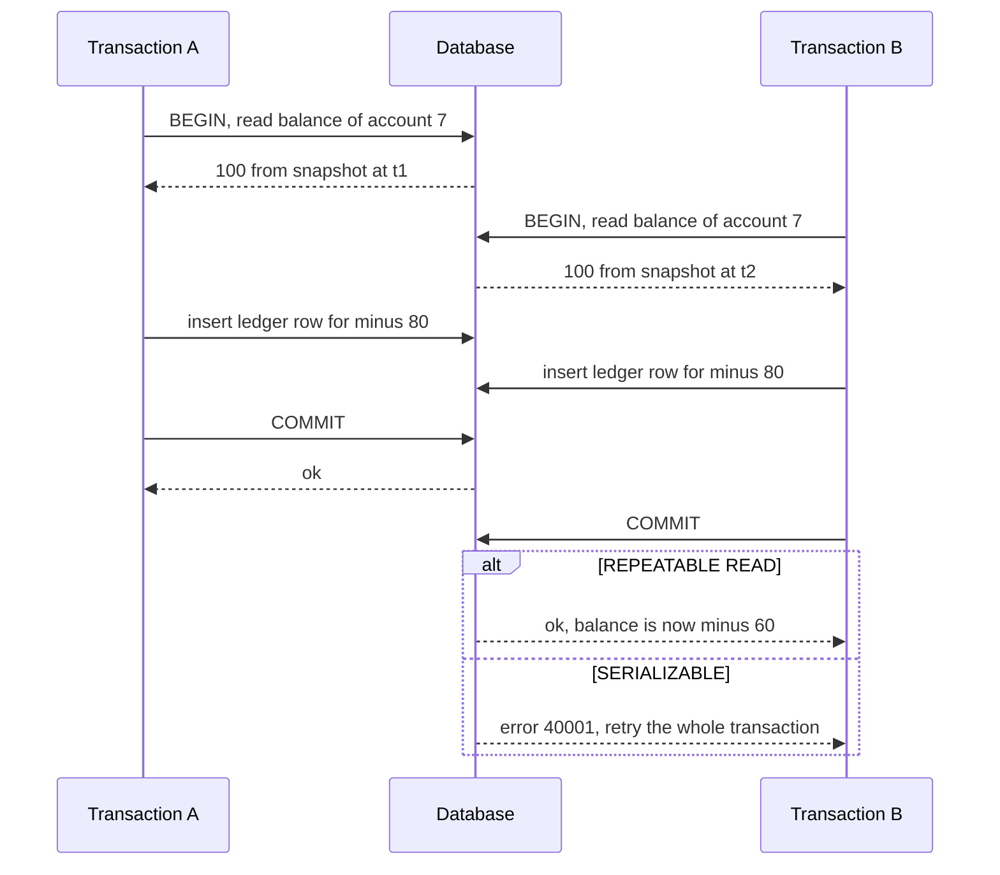

# Isolation Levels

> [!abstract] In one sentence
> An isolation level is a contract about which interleavings of concurrent transactions the engine will let you observe — and because the default in both PostgreSQL and MySQL is *not* serializable, every invariant that spans more than one row is your problem unless you raise the level or take a lock.

> [!tip] Deeper treatment in your system-design vault
> `system-design/05 Relational Databases/Transaction Isolation Levels.md` — read it *after* you have written your own explanation below.

**Map:** [[Databases MOC]] → [[HLD MOC]]

## Definition

The **isolation level** of a [[Transactions|transaction]] determines which effects of other concurrent transactions it may see and which write conflicts the engine will detect. The SQL standard names four — read uncommitted, read committed, repeatable read, serializable — in terms of three anomalies they forbid (dirty reads, non-repeatable reads, phantoms). Real engines implement them with snapshots and locks, which produces a fifth, important level the standard never named: **snapshot isolation**, where every transaction reads from a consistent snapshot taken at its start, and which is what PostgreSQL's `REPEATABLE READ` and MySQL InnoDB's `REPEATABLE READ` mostly are. Only `SERIALIZABLE` guarantees that the outcome equals *some* serial order of the transactions.

## Problem solved

True serial execution would make every multi-row invariant trivially safe and would also run one transaction at a time. Two-phase locking achieves serializability with locks but makes readers block writers and vice versa, which killed throughput for mixed workloads. Isolation levels are the compromise: the engine offers cheaper levels that prevent the common anomalies and leave the rare ones to the application. The trouble is that the rare ones — lost updates and write skew — are exactly the ones that corrupt balances, double-book seats and over-sell inventory, and they occur only under concurrency, so they pass every test and appear in production as reconciliation breaks. Knowing which level you are on and what it does *not* prevent is the difference between a correct ledger and a lucky one.

## How it works

The anomalies, in increasing subtlety:

- **Dirty read**: seeing another transaction's uncommitted write. Prevented at read committed and above everywhere; PostgreSQL does not even implement read uncommitted (it silently behaves as read committed).
- **Non-repeatable read (read skew)**: reading a row twice in one transaction and getting different values because someone committed in between. Prevented at repeatable read / snapshot isolation.
- **Phantom**: a repeated range query returns new rows. Prevented by snapshot isolation for plain reads; InnoDB also prevents it for locking reads with next-key (gap) locks.
- **Lost update**: two transactions read a value, both compute a new one, both write — one update vanishes. Snapshot isolation in PostgreSQL detects it (the second writer gets `could not serialize access due to concurrent update`, `40001`); read committed does not, and MySQL's repeatable read does not either unless you use `SELECT … FOR UPDATE` ([[Optimistic and Pessimistic Locking]]).
- **Write skew**: two transactions read overlapping data, make a decision, and write to *different* rows, so no write conflict is detected, yet the combined result violates an invariant. The classic: two doctors on call each check "is at least one other doctor on call?" and both go off call. In fintech: two transfers from the same account each read a balance of 100, each withdraws 80, each writes its own ledger row, and the derived balance is −60. Only serializable (or an explicit lock on the shared predicate) prevents it.

How the engines do it:

1. **Read committed** (PostgreSQL default, Oracle, SQL Server default): each *statement* gets a fresh snapshot; an `UPDATE` that finds its target row modified by a concurrent committed transaction re-reads the new version and re-checks the `WHERE` clause.
2. **Snapshot isolation / repeatable read**: the transaction takes one snapshot at its first statement and reads only row versions committed before it ([[Relational Database Internals|MVCC]]). PostgreSQL additionally aborts a transaction that tries to update a row changed since its snapshot (first-committer-wins). InnoDB (MySQL default) gives consistent snapshot reads but *locking* reads and writes see the latest committed data and use gap locks — a mixed model that surprises people in both directions.
3. **Serializable**: PostgreSQL uses Serializable Snapshot Isolation (SSI): snapshot isolation plus tracking of read-write dependencies between concurrent transactions (`SIReadLock` predicate locks) and aborting one transaction when a dangerous cycle could form. No blocking, some false-positive aborts, cheap enough for OLTP. MySQL implements serializable by turning every plain `SELECT` into a shared-locking read — two-phase locking, with the blocking that implies.
4. **Picking a level per use case**: read committed for high-throughput paths where each statement is self-contained; repeatable read for reports and multi-statement reads that need one consistent picture; serializable (with retry on `40001`) for invariants that span rows and cannot be expressed as a single conditional statement or a lock; `SELECT … FOR UPDATE` at read committed as the pragmatic middle for "read then decide then write on the same rows".

```sql
-- Write skew under REPEATABLE READ (PostgreSQL): both commit, invariant broken
-- Session A                                   -- Session B
BEGIN ISOLATION LEVEL REPEATABLE READ;         BEGIN ISOLATION LEVEL REPEATABLE READ;
SELECT sum(amount_minor) FROM ledger
 WHERE account_id = 7;        -- 100            SELECT sum(amount_minor) ... -- 100
INSERT INTO ledger VALUES (7, -80);            INSERT INTO ledger VALUES (7, -80);
COMMIT;                                        COMMIT;   -- balance now -60
-- Under SERIALIZABLE one of the two COMMITs fails with SQLSTATE 40001 and must be retried.
```

## Architecture



## Use cases

- "The balance / stock / seat count must never go below zero" and the check involves reading other rows — serializable, or a lock on the account row that every writer takes.
- "Read then conditionally update the same row" (status transitions, counters) — `FOR UPDATE` at read committed, or a version column.
- "Generate a statement or report that must be internally consistent" — repeatable read; the snapshot costs nothing extra.
- "Uniqueness across a group" (at most one primary card per customer, one active session per device) — either a unique partial index, which is the cheapest serializability you can buy, or serializable.
- "Maker-checker approval where the approver must see exactly what was proposed" — snapshot reads plus a version check at approval time ([[Authorization]]).

## Limitations

- Levels are per transaction, not per system: a correct serializable transaction cannot protect an invariant that another service breaks under read committed.
- Serializable requires every transaction on the path to retry on `40001`, including the ones written by the ORM you did not read; a single non-retrying caller turns aborts into user-facing errors.
- SSI predicate tracking has memory limits (`max_pred_locks_per_transaction`) and degrades to coarser locks on big scans, raising false aborts.
- MySQL and PostgreSQL disagree on what repeatable read means; code ported between them changes behaviour silently.
- Isolation says nothing about [[Read Replicas]]: a replica serves a slightly stale snapshot regardless of level, so "repeatable read on the replica" is not the same picture the primary has.

## Trade-offs

| You gain | You sacrifice |
|---|---|
| Read committed: highest concurrency, no snapshot overhead, no retries | Lost updates and write skew unless you lock explicitly |
| Snapshot isolation: consistent reads for the whole transaction, lost updates detected (PostgreSQL) | Write skew still possible; aborts on concurrent update that must be retried |
| Serializable: every invariant holds without explicit locks | Retry loops everywhere, false-positive aborts, predicate-lock memory, blocking in MySQL |
| Explicit `FOR UPDATE` at any level: targeted correctness where you need it | Lock waits, deadlock risk, and the need to lock in a consistent order |

## Failure modes

- **Write skew in production** → balances or stock counts drift negative with no error ever logged; you notice from reconciliation or customer complaints; blast radius is data integrity, discovered late.
- **Serializable rolled out without retries** → `40001` errors surface as HTTP 500s under load; you notice from error rate rising with concurrency; blast radius is every endpoint on the serializable path.
- **Snapshot too old / long snapshot** → a long repeatable-read report pins old versions, bloat grows, and in Oracle the report itself fails with "snapshot too old"; blast radius is vacuum health for the whole database ([[Transactions]]).
- **Gap-lock deadlocks in InnoDB** at repeatable read → inserts into the same range deadlock unexpectedly; you notice from `SHOW ENGINE INNODB STATUS` deadlock sections; blast radius is write latency on the affected ranges.
- **Assuming the ORM's default level** → Spring uses the database default (read committed on PostgreSQL), a developer "knows" it is repeatable read from MySQL days, and the invariant check they wrote never held; blast radius is one feature, silently.

## Performance

Snapshot isolation is nearly free in MVCC engines: the snapshot is a list of in-progress transaction ids, and reads cost the same at every level. The costs are elsewhere: aborts and retries at repeatable read and serializable (proportional to real conflict rate), predicate-lock bookkeeping under SSI (a few percent of CPU on OLTP workloads in PostgreSQL's own measurements), and in lock-based serializable (MySQL) the blocking of readers by writers, which can halve throughput on mixed workloads. Explicit `FOR UPDATE` costs a row lock and the wait time of contenders; its performance is entirely a function of contention on the same rows ([[Hot Keys]]).

## Scalability

Conflict rate, not transaction rate, is what scales badly: ten times the load on the same hot rows gives far more than ten times the aborts under serializable and more lock waits under pessimistic locking. The fix is the data model — spread contention across rows (append-only entries, per-shard counters) rather than raising the isolation level on a hot row. Across shards, isolation is not provided at all without [[Distributed Transactions]]; most sharded designs keep each invariant inside one shard so single-node isolation still applies.

## Operational impact

Make the chosen level explicit in code (annotation or connection setting) and in the pool's default, and document which invariants rely on which mechanism. Monitor serialisation-failure and deadlock rates as first-class metrics and alert when they rise with load. Give developers a two-session playground (two `psql` windows) during onboarding — most isolation bugs come from never having watched an anomaly happen. On-call: a sudden rise in `40001` after a deploy usually means a new transaction touching a hot row, not a database problem.

## Alternatives

- **Single conditional statement** (`UPDATE accounts SET balance = balance - 80 WHERE id = 7 AND balance >= 80`) — wins whenever the invariant is on one row; atomic at any level, no retries.
- **Explicit pessimistic locking** (`SELECT … FOR UPDATE` on the account row before reading its entries) — wins when contention is real and predictable; converts write skew into a queue ([[Optimistic and Pessimistic Locking]]).
- **Unique or exclusion constraints** — win for "at most one" invariants; the index does the serialisation.
- **Serialising through a single writer** (one partition per account in Kafka, one actor per aggregate) — wins when the write rate per key is high and the invariant is complex ([[Topic Partitions]], [[Event Sourcing]]).

## Real-world examples

- PostgreSQL's transaction isolation documentation is unusually honest about what each level permits, and its serializable implementation comes from Cahill, Röhm and Fekete's SSI work, adopted in version 9.1.
- The Jepsen project's consistency-model hierarchy maps these levels onto formal anomaly definitions (Adya's) and has repeatedly found databases claiming a level they do not deliver.
- MySQL's documentation on InnoDB consistent reads and locking reads explains the hybrid behaviour at repeatable read that causes most cross-engine surprises.
- In a stack like yours: a Spring Boot ledger service on RDS PostgreSQL where the available-balance check reads holds and postings across several rows; at the default read committed that check is write-skew-prone, and the honest options are `FOR UPDATE` on the account row, a serializable transaction with retry, or a single-row cached balance updated conditionally.

## Practical exercise

1. Start PostgreSQL and MySQL in Docker Compose; create the `ledger(account_id, amount_minor)` table in both.
2. In two `psql` sessions reproduce the write-skew script above at `REPEATABLE READ`; confirm both commit and the sum goes negative. Repeat at `SERIALIZABLE` and observe `40001`.
3. Repeat the lost-update case (read balance, update to computed value) at read committed, repeatable read and serializable in both engines; record which engine detects what.
4. In MySQL at repeatable read, run two concurrent inserts into the same key range with a preceding `SELECT … FOR UPDATE` on a range and trigger a gap-lock deadlock; read it in `SHOW ENGINE INNODB STATUS`.
5. Write a 50-line Java or TypeScript program that runs 200 concurrent transfers at serializable with retry on `40001` and plots abort rate against concurrency.

## Related concepts

### Prerequisites
- [[Transactions]] — the unit whose interleavings isolation levels govern
- [[ACID]] — the "I" that this note makes precise

### Related
- [[Optimistic and Pessimistic Locking]] — the tools for closing the gaps a level leaves open
- [[Consistency Models]] — the distributed-systems cousin of isolation, about replicas rather than transactions
- [[Relational Database Internals]] — MVCC snapshots and transaction ids are the implementation
- [[Read Replicas]] — why the level on the primary does not describe what a replica returns

### Builds on this
- [[Distributed Transactions]] — isolation across nodes needs a commit protocol as well
- [[Saga Pattern]] — a saga has no isolation between steps, which is its central weakness

### Design problems where it applies
- [[Design a Ticket Booking System]]
- [[Design a Digital Wallet and Ledger]]
- [[Design an Inventory Management System]]
- [[Design a Payment System]]

### Projects where it can be implemented
- [[Double-Entry Ledger Service]]
- [[Durable Job Scheduler]]

### Resources
- [[PostgreSQL Transaction Isolation Docs]] — the authoritative description of what each level allows
- [[Jepsen Consistency Models]] — the anomaly hierarchy, with the formal names
- [[Designing Data-Intensive Applications]] — chapter 7 walks through every anomaly with examples

## Personal understanding

> [!question] Explain it without the source
> Write your own explanation here, from memory. Then compare it with the sections above and note what you missed.

### Mastery checklist
- [ ] I can explain it without the original resource
- [ ] I can describe the problem it solves
- [ ] I can compare it with its alternatives
- [ ] I can name its limitations and failure modes
- [ ] I can recognise when it is appropriate in a real system
- [ ] I have applied it in a system design
- [ ] I have validated my assumptions with an experiment or implementation

## Open questions

- [ ] Which invariants in the ledger and payments services you know are enforced by a conditional statement, which by a lock, which by isolation level, and which by nothing?
- [ ] What abort rate would serializable produce on your hottest account under peak load, and is a retry budget of three attempts enough or does the design need a single-writer path?
- [ ] If a service were ported from MySQL to PostgreSQL (or the reverse), which of its transactions silently change behaviour at repeatable read?
