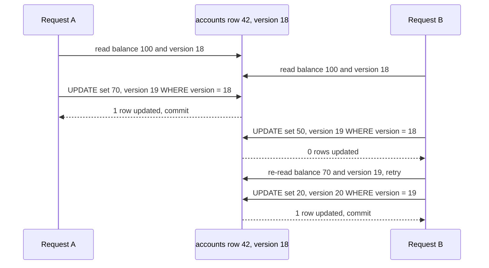

# Optimistic and Pessimistic Locking

> [!abstract] In one sentence
> Both techniques stop the lost update — two transactions reading the same balance and both writing a stale result — pessimism by making the second reader wait for a lock, optimism by letting both proceed and failing the second writer's version check; the right one depends on contention, and the money-transfer example shows both at once.

> [!tip] Deeper treatment in your system-design vault
> `system-design/05 Relational Databases/Transaction Isolation Levels.md` — read it *after* you have written your own explanation below.

**Map:** [[Databases MOC]] → [[HLD MOC]]

## Definition

**Pessimistic locking** acquires an exclusive lock on the rows a transaction intends to modify *before* reading them (`SELECT … FOR UPDATE`), so any other transaction wanting the same rows blocks until the first commits or rolls back. **Optimistic locking** (optimistic concurrency control) takes no lock: it reads the row along with a **version** (a counter or timestamp), does its work, and writes with `UPDATE … WHERE id = ? AND version = ?`, incrementing the version; if zero rows were updated someone else got there first and the transaction retries or fails. Both exist because the default [[Isolation Levels|isolation level]] of PostgreSQL and MySQL does not detect the lost update on its own.

## Problem solved

The **lost update**: transaction A reads balance 100, transaction B reads balance 100, A writes 100 − 30 = 70, B writes 100 − 50 = 50; A's debit vanished and the account is 30 richer than it should be. At read committed this is allowed. The same shape appears as two agents editing a KYC record, two workers claiming the same job, two requests decrementing the same stock count, a maker and a checker approving a payment that changed under them. Pessimistic locking serialises the readers so the second one sees the first one's write; optimistic locking lets them race and makes the loser visible so it can re-read and redo. Without either, the bug is invisible in tests, rare at low traffic, and routine at peak — and in a ledger it is money.

## How it works

**Pessimistic (`SELECT … FOR UPDATE`):**

1. Inside a [[Transactions|transaction]], `SELECT balance_minor FROM accounts WHERE id = 42 FOR UPDATE` takes a row-level exclusive lock. Other `FOR UPDATE` readers and all writers of that row wait; plain readers do not (MVCC).
2. Compute, `UPDATE`, `COMMIT` — the lock is released at commit, and the waiter wakes, re-reads the row *as now committed*, and proceeds.
3. Variants: `FOR UPDATE NOWAIT` errors immediately instead of waiting; `FOR UPDATE SKIP LOCKED` skips locked rows, which is how job queues and outbox relays let many workers pick different rows ([[Outbox Pattern]]); `FOR SHARE` for "do not let this change while I read it"; `FOR NO KEY UPDATE` when you will not touch the key so foreign-key readers are not blocked.
4. **Deadlocks**: A locks account 1 then wants 2, B locks 2 then wants 1. PostgreSQL detects the cycle after `deadlock_timeout` (1 s) and aborts one with `40P01`; InnoDB detects immediately. Prevention: lock in a global order (ascending id), or lock everything in one statement (`WHERE id IN (1, 2) ORDER BY id FOR UPDATE`). Bound waits with `lock_timeout`.

**Optimistic (version column):**

1. The row carries `version integer`. Read `balance_minor, version` with no lock.
2. Compute the new balance in the application.
3. `UPDATE accounts SET balance_minor = ?, version = version + 1 WHERE id = ? AND version = ?`. Check the affected-row count: 1 means success; 0 means a concurrent write happened — throw, roll back, re-read, retry with backoff and a cap ([[Retry Strategies]]).
4. Frameworks do this for you: JPA/Hibernate `@Version` raises `OptimisticLockException`; TypeORM `@VersionColumn` raises `OptimisticLockVersionMismatchError` when you pass the expected version. The same idea across HTTP is `ETag` plus `If-Match`, and across a key-value store it is compare-and-set (DynamoDB condition expressions, Redis `WATCH`/`MULTI`).

**The third option — an atomic conditional statement:** `UPDATE accounts SET balance_minor = balance_minor - 5000 WHERE id = 42 AND balance_minor >= 5000` and check the row count. No read-then-write gap, no lock held across application code, no version column; it covers any invariant expressible on the row itself.

**Choosing by contention.** Low contention (most rows touched by one writer at a time — user profiles, orders): optimistic; a retry is rare and cheap. High contention (one hot account, a counter, a popular SKU): pessimistic, or better, redesign so the hot row is not written per request ([[Hot Keys]]). Contention *plus* external side effects between read and write: pessimistic, because an optimistic retry would repeat the side effect — or make the side effect idempotent ([[Idempotency]]).

```sql
-- Money transfer, pessimistic: lock both rows in id order to avoid deadlock
BEGIN;
SELECT id, balance_minor FROM accounts WHERE id IN (7, 42) ORDER BY id FOR UPDATE;
UPDATE accounts SET balance_minor = balance_minor - 5000 WHERE id = 7;   -- after checking >= 5000
UPDATE accounts SET balance_minor = balance_minor + 5000 WHERE id = 42;
INSERT INTO ledger_entries VALUES (...), (...);
COMMIT;

-- Same transfer, optimistic: no locks, versions checked on write, retry on 0 rows
UPDATE accounts SET balance_minor = 95000, version = version + 1 WHERE id = 7  AND version = 18;
UPDATE accounts SET balance_minor = 15000, version = version + 1 WHERE id = 42 AND version = 3;
```

## Architecture



## Use cases

- "Read, decide, write on the same row" anywhere: balances, stock, job claims, state machines ([[Design an Inventory Management System]] and [[Design a Ticket Booking System]] are this problem at scale).
- "Many workers pulling from one table" — `FOR UPDATE SKIP LOCKED` is the standard queue-in-a-database primitive ([[Design a Distributed Job Scheduler]]).
- "A user edits a record that someone else may also be editing" — optimistic with version in the form, surfacing "this record changed, please review" instead of silently overwriting.
- "Maker-checker approval" — the checker's approval must carry the version the maker proposed; a mismatch means the request changed and must be re-reviewed ([[Authorization]]).
- "Compare-and-set in a cache or key-value store" — the same pattern outside SQL (Redis `WATCH`, DynamoDB conditional writes).

## Limitations

- Neither technique spans databases or services; cross-service coordination needs a [[Distributed Locks|distributed lock]], a [[Saga Pattern|saga]] or idempotent retries.
- Pessimistic locks held across user think-time or network calls are an outage waiting to happen; locks must live inside short transactions ([[Transactions]]).
- Optimistic retries are wasted work under high contention and can starve a slow writer indefinitely; they also repeat any side effect performed between read and write.
- Version columns protect one row; invariants across rows (write skew) need serializable isolation, a lock on a parent row, or a single-statement check ([[Isolation Levels]]).
- Lock-based designs do not scale past a hot row's lock throughput no matter the hardware — the fix is modelling, not tuning.

## Trade-offs

| You gain | You sacrifice |
|---|---|
| Pessimistic: no wasted work, conflicts become waits, simple reasoning | Lock waits, deadlocks, and throughput bounded by lock hold time on hot rows |
| Optimistic: no locks, readers and writers never wait, scales with low contention | Retry loops, wasted work under contention, and a version column on every protected table |
| Conditional single statement: no read-write gap at all | Only invariants expressible on the row being updated |
| Explicit, testable conflict handling in application code | The need to actually test it with concurrent load, which most test suites do not |

## Failure modes

- **Lost update in production** because neither technique was applied → balances drift, stock oversells; you notice from reconciliation differences or customer complaints; blast radius is integrity of the affected rows, discovered late.
- **Deadlock storm** when lock order is inconsistent → `40P01` errors spike under load; you notice from error rate rising with concurrency; blast radius is every transfer touching the contested accounts, plus retries amplifying load ([[Retry Storms]]).
- **Lock held across a slow dependency** → every writer of that row queues for the dependency's latency; you notice from lock waits correlating with a downstream's p99; blast radius spreads via the connection pool.
- **Optimistic retry without a cap** on a hot row → a thundering herd of re-reads and failed updates; you notice from CPU spent on zero-row updates; blast radius is the whole table's write capacity.
- **Version check skipped by a bulk update or a second code path** (a script, a migration, a different service) → silently bypasses the protection; blast radius is whichever rows that path touched.

## Performance

A row lock costs microseconds to take and a wait is as long as the holder's transaction. Pessimistic throughput on one row is roughly 1 / (transaction duration) — with 5 ms transactions, about 200 writes per second on that row, however large the instance. Optimistic has no wait but each conflict costs a transaction's worth of work plus a retry; at conflict rates above a few percent it loses to pessimistic. The conditional single statement is cheapest: one round trip, lock held only for the statement. Measure contention (lock waits, zero-row updates) rather than guessing; the answer changes per table.

## Scalability

Low-contention tables scale with either technique. Hot rows do not scale with either: at 10x traffic to one account, the honest options are to stop writing the balance per transaction (append entries, derive or periodically snapshot the balance), to shard the counter, or to serialise writes to that key through a single-partition stream ([[Topic Partitions]]). Across shards or services the primitives become [[Distributed Locks]] with fencing tokens or compare-and-set in the shared store, both of which carry weaker guarantees than a database row lock.

## Operational impact

Monitor lock waits, deadlock rate, `lock_timeout` errors and optimistic-conflict retries per endpoint; alert when they rise with load. Make retry-on-conflict a library behaviour with jitter and a cap, and make "no network calls inside a locked transaction" a review rule. Keep `lock_timeout` and `deadlock_timeout` set deliberately. Debugging is good on PostgreSQL (`pg_locks` joined with `pg_stat_activity` shows who waits on whom) and on InnoDB (`SHOW ENGINE INNODB STATUS` prints the last deadlock) — but only if engineers know to look there before restarting things.

## Alternatives

- **Serializable isolation with retry** — wins when the invariant spans rows and cannot be reduced to a lock on one parent row ([[Isolation Levels]]).
- **Single-writer per key** (one Kafka partition per account, an actor per aggregate) — wins at high contention: writes to a key are serialised by design, no locks and no retries ([[Event Sourcing]]).
- **Append-only entries with derived balances** — wins for ledgers: inserts never conflict, the balance is a sum or a periodically updated snapshot with its own version ([[Data Modeling]]).
- **[[Distributed Locks]]** — win only when the protected resource is outside the database; strictly weaker and more operationally fragile.

## Real-world examples

- PostgreSQL's documentation on explicit locking and MySQL's on InnoDB locking reads are the reference for `FOR UPDATE`, `SKIP LOCKED`, gap locks and deadlock detection.
- JPA/Hibernate's `@Version` and TypeORM's `@VersionColumn` implement optimistic locking in the two stacks you use; HTTP's `ETag`/`If-Match` and DynamoDB's condition expressions are the same pattern in other layers.
- Stripe's idempotency-key design combines a row lock on the idempotency key record with idempotent steps, a documented example of pessimistic locking guarding a payment flow.
- In a stack like yours: a Spring Boot ledger service that locks the two account rows in ascending id order for a transfer, uses `SKIP LOCKED` in the outbox relay and the job runner, and an optimistic version on the KYC profile that two operators may edit — with a k6 test that runs 200 concurrent transfers against two accounts in CI so the deadlock handling is exercised before production.

## Practical exercise

1. In Docker PostgreSQL create `accounts(id, balance_minor, version)` with two rows; write a transfer endpoint in NestJS or Spring Boot three ways: no protection, `FOR UPDATE` in id order, and optimistic with retry (max 5, jittered backoff).
2. Run k6 with 100 virtual users doing random transfers between the two accounts for 60 seconds; after each run, check that the sum of balances is unchanged. The unprotected version should fail the check.
3. For the pessimistic version, remove the `ORDER BY id` and count deadlocks in the log; restore it and confirm zero.
4. For the optimistic version, log the retry count distribution; raise concurrency until p99 retries exceed 3 and compare throughput with the pessimistic version at the same load.
5. Replace both with the conditional single-statement `UPDATE … WHERE balance_minor >= ?` plus an insert of ledger rows, and compare latency and throughput again.
6. Add a 300 ms `sleep` inside the locked transaction to simulate a PSP call and watch throughput collapse; move the call outside with an idempotency key.

## Related concepts

### Prerequisites
- [[Transactions]] — locks and version checks only make sense inside a transaction boundary
- [[Isolation Levels]] — why the default level leaves the lost update to you

### Related
- [[Idempotency]] — what makes optimistic retries and conditional updates safe to repeat
- [[Timeouts and Retries]] — bounding lock waits and capping retry loops
- [[Retry Strategies]] — jittered backoff for optimistic conflicts
- [[Relational Database Internals]] — row locks, MVCC and why readers do not block
- [[Hot Keys]] — the case neither technique scales

### Builds on this
- [[Distributed Locks]] — the same idea outside one database, with fencing tokens
- [[Event Sourcing]] — expected-version appends are optimistic locking on a stream
- [[Duplicate Message Processing]] — conditional writes as the dedup mechanism

### Design problems where it applies
- [[Design a Ticket Booking System]]
- [[Design a Digital Wallet and Ledger]]
- [[Design an Inventory Management System]]
- [[Design a Payment System]]

### Projects where it can be implemented
- [[Double-Entry Ledger Service]]
- [[Durable Job Scheduler]]
- [[Lock Service with Fencing Tokens]]

### Resources
- [[PostgreSQL Transaction Isolation Docs]] — explicit locking, `SKIP LOCKED` and deadlock handling
- [[Designing Data-Intensive Applications]] — chapter 7, "Preventing lost updates" and the write-skew discussion
- [[Brandur - Implementing Idempotency Keys]] — row locks around a multi-step payment flow

## Personal understanding

> [!question] Explain it without the source
> Write your own explanation here, from memory. Then compare it with the sections above and note what you missed.

### Mastery checklist
- [ ] I can explain it without the original resource
- [ ] I can describe the problem it solves
- [ ] I can compare it with its alternatives
- [ ] I can name its limitations and failure modes
- [ ] I can recognise when it is appropriate in a real system
- [ ] I have applied it in a system design
- [ ] I have validated my assumptions with an experiment or implementation

## Open questions

- [ ] Which read-then-write paths in your services have neither a lock nor a version check today, and which of them touch money?
- [ ] What is the measured lock wait and deadlock rate on your hottest account rows at peak, and would a single-writer stream per account remove it?
- [ ] For maker-checker flows, is the version the maker saw carried through to the checker's approval, or can the request change in between?
