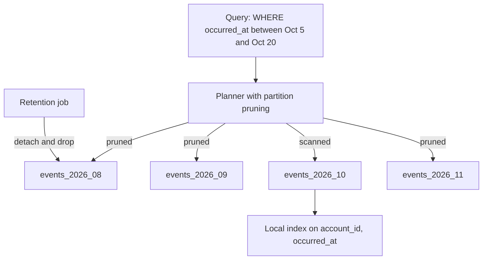

# Partitioning

> [!abstract] In one sentence
> Partitioning is the general trick of splitting data into pieces by a key — inside one node to prune scans and drop old data cheaply, across nodes to spread load — and the design questions are always the same: which key, which scheme (range, hash, list), how many pieces, and how to move them when the balance changes.

> [!tip] Deeper treatment in your system-design vault
> `system-design/06 Replication and Sharding/Rebalancing Partitions.md` — read it *after* you have written your own explanation below.

**Map:** [[Databases MOC]] → [[HLD MOC]]

## Definition

A **partition** is a subset of a dataset defined by a rule on a key: a **range** of key values, a **hash** of the key modulo a count, or an explicit **list** of values. **Table partitioning** applies the rule inside one database: a parent table is split into child tables that the planner treats as one, with each query routed to the children that can contain matching rows (**partition pruning**). **Partitioning across nodes** assigns partitions to machines, which is what [[Sharding]] and every distributed store do; **rebalancing** is moving partitions between nodes as the node count or the load changes. The same vocabulary describes Kafka [[Topic Partitions]], DynamoDB partitions and Cassandra token ranges.

## Problem solved

Large tables have problems that have nothing to do with how many rows a query returns: a ten-billion-row events table takes hours to vacuum, index or back up; deleting last year's rows is a multi-hour transaction that bloats everything; every query that cannot use an index scans the whole thing. Partitioning by time makes each of these operate on one slice: drop the January partition in a millisecond instead of deleting three hundred million rows, index only the current month, scan only the partitions a `WHERE created_at > …` can touch. Across nodes, the same mechanism is what lets a cluster grow by adding machines, provided the data can be rebalanced without moving most of it.

## How it works

1. **Range partitioning.** Partitions cover contiguous key ranges (`created_at` by month, `account_id` by band). Range scans and time-based retention are natural; the newest range is hot for inserts, which is fine inside one node and a problem across nodes.
2. **Hash partitioning.** `hash(key) mod N` spreads keys evenly; equality lookups go to one partition, range scans go to all. Across nodes, plain modulo rehashes almost every key when N changes — the problem [[Consistent Hashing]] exists to solve.
3. **List partitioning.** Explicit values per partition (`region IN ('IN', 'SG')`, `tenant_id IN (…)`): useful for data residency and tenant isolation.
4. **Pruning.** The planner compares the partition constraints with the query's predicates at plan time and, in PostgreSQL 11+, at execution time for parameters known only then; a query without a predicate on the partition key hits every partition, which is worse than an unpartitioned table because each partition has its own index to traverse ([[Query Execution and Optimization]]).
5. **Indexes on partitioned data.** Inside PostgreSQL, indexes are per partition; a unique constraint must include the partition key, and there is no global index — so "unique email across all months" cannot be enforced by a partitioned-by-month table. Across nodes the same split appears as **local (document-partitioned) secondary indexes** — each node indexes its own data, so a secondary-key query is scatter-gather — versus **global (term-partitioned) indexes**, which partition the index by the indexed value so a lookup hits one node but updates become asynchronous and cross-node (DynamoDB's GSIs).
6. **Choosing the count and rebalancing across nodes.** Three well-known strategies: *fixed number of partitions*, many more than nodes (Elasticsearch shards, Riak, Couchbase): adding a node moves whole partitions to it, and nothing is rehashed — but the count is fixed at creation and must be guessed. *Dynamic splitting* (HBase regions, MongoDB chunks): a partition that grows past a size threshold is split in two; adapts to data, suffers from a single partition at the start. *Proportional to nodes* (Cassandra's virtual nodes): each node owns a fixed number of token ranges; adding a node steals ranges from others. Rebalancing should be deliberate, not automatic on every blip — a rebalance moves gigabytes and competes with production traffic.
7. **Request routing.** Clients, a routing tier (`mongos`, Vitess) or every node (Cassandra via [[Gossip Protocols]]) must know which partition lives where; the assignment itself is usually stored in a coordination service (ZooKeeper for Kafka and HBase, etcd for CockroachDB) ([[Service Discovery]]).

```sql
-- PostgreSQL declarative partitioning by month with cheap retention
CREATE TABLE events (
    id bigint GENERATED ALWAYS AS IDENTITY,
    account_id bigint NOT NULL,
    occurred_at timestamptz NOT NULL,
    payload jsonb,
    PRIMARY KEY (id, occurred_at)            -- the partition key must be in every unique constraint
) PARTITION BY RANGE (occurred_at);
CREATE TABLE events_2026_10 PARTITION OF events
    FOR VALUES FROM ('2026-10-01') TO ('2026-11-01');
CREATE INDEX ON events_2026_10 (account_id, occurred_at DESC);
-- Retention: detach and drop a month in milliseconds instead of DELETE
ALTER TABLE events DETACH PARTITION events_2025_09 CONCURRENTLY;
DROP TABLE events_2025_09;
```

## Architecture



## Use cases

- "Keep 13 months of events and delete older ones nightly" — range partitioning by time turns deletion into `DROP TABLE` ([[Data Retention and Archival]]).
- "Every query has a time window" — audit logs, metrics, transactions by date: pruning makes the working set the recent partitions and leaves the rest cold ([[Audit Logs]], [[Time-Series Databases]]).
- "Vacuum, reindex and backup of one table dominate maintenance windows" — partitions bound the unit of maintenance.
- "Tenants need to be moved between regions or isolated" — list partitioning by tenant or region with per-partition tablespaces or nodes.
- "The cluster must grow by adding nodes without rehashing everything" — fixed partition count or virtual nodes with planned rebalancing.

## Limitations

- Partitioning only helps queries that carry the partition key; everything else gets slower because it visits every partition.
- No global unique constraints or global indexes in PostgreSQL partitioned tables; cross-partition uniqueness needs a separate table or a different design.
- Too many partitions (tens of thousands) slow planning and bloat the catalogue; too few defeat the purpose — the count needs an estimate of growth.
- Across nodes, rebalancing moves real bytes and must be throttled; "automatic rebalancing" has caused as many incidents as it has prevented.
- Choosing a time-based partition key for a cluster concentrates all writes on the newest partition — the hot-range problem ([[Hot Keys]]).

## Trade-offs

| You gain | You sacrifice |
|---|---|
| Pruned scans and smaller, hotter indexes for key-bounded queries | Slower queries that lack the partition key, and planning overhead per partition |
| Retention and maintenance as whole-partition operations | Unique constraints and indexes that must include the key, no global index |
| A unit of placement that can be moved between nodes | Rebalancing work, routing metadata and the question of who stores it |
| Isolation of tenants, regions or time ranges | Skew when the key is not evenly distributed over time or tenants |

## Failure modes

- **Query without the partition key** reaches production → it scans every partition and every per-partition index; you notice as a latency cliff after partitioning "for performance"; blast radius is that query family and the I/O it steals.
- **Missing future partition** → inserts for next month fail at midnight on the first (or land in a default partition that becomes the biggest table in the database); you notice from an insert error storm at 00:00; blast radius is every write to the table until someone creates the partition.
- **Catalogue bloat from thousands of partitions** → every query plans slowly, connections hold more memory; you notice as a slow drift in planning time; blast radius is the whole database.
- **Rebalance storm across nodes** → a node addition triggers mass data movement that saturates disks and network; you notice as cluster-wide latency during the move; blast radius is everything co-located.
- **Hot partition in a cluster** (today's range, one tenant) → one node at capacity while others idle; you notice only with per-partition metrics; blast radius is every key on that partition.

## Performance

Within a node, pruning turns a scan proportional to the whole table into one proportional to the matching partitions; partition-wise joins and aggregates can parallelise across partitions. Index maintenance and vacuum cost scale with the active partitions only. The overhead is planning: each partition is a relation the planner considers, measurable past a few hundred and painful past several thousand. Across nodes, the cost model is network: a single-partition request is one hop, a scatter-gather is N hops and the slowest wins; rebalancing throughput is bounded by what you can move without harming live traffic (commonly tens of MB/s per node, deliberately throttled).

## Scalability

Partitioning is the mechanism that lets both a single table and a cluster grow by 10x: more partitions per table, more nodes per cluster. The ceiling within a node is the catalogue and planning overhead; the ceiling across nodes is skew and rebalancing cost. Fixed partition counts should be chosen with 10x headroom (hundreds to a few thousand for a cluster expected to reach tens of nodes); dynamic splitting adapts but needs pre-splitting for a bulk initial load.

## Operational impact

Moderate within a database: a job to create future partitions ahead of time (`pg_partman` or a cron), a retention job to detach and drop, per-partition index management, and the discipline to add the partition key to every query. Across nodes: rebalancing runbooks, throttles, routing-metadata health, and per-partition metrics so hot partitions are visible. Managed stores (DynamoDB adaptive capacity, Aurora, Elastic Cloud) hide much of this but still surface the hot-partition problem as throttling.

## Alternatives

- **Archiving to cold storage** — wins when old data is rarely read and the table is large only because of history ([[Data Retention and Archival]], [[Object Storage]]).
- **A purpose-built time-series or log store** — wins when the workload is append-only time-ordered data at high volume ([[Time-Series Databases]]).
- **Sharding by tenant into separate databases** — wins when isolation matters more than uniform scaling and tenants are few and large ([[Sharding]]).
- **Just a good composite index** — wins when the table is big but the queries are selective; partitioning is not a substitute for [[Indexing]].

## Real-world examples

- PostgreSQL's declarative partitioning and the `pg_partman` extension are the standard tools for time-partitioned tables; TimescaleDB builds its hypertables on the same mechanism with automatic chunking.
- DynamoDB partitions by hash of the partition key and splits partitions as they grow, exposing per-partition throughput limits that surface as throttling on hot keys; Cassandra's virtual nodes and Kafka's fixed partition count are the other two strategies in production at scale.
- Designing Data-Intensive Applications' chapter 6 named the three rebalancing strategies above with the systems that use each.
- In a stack like yours: a transactions or audit table in Aurora PostgreSQL partitioned by month with a 13-month retention job, Kafka topics whose partition count was chosen with headroom because it cannot shrink, and DynamoDB tables where the partition key was chosen to avoid a hot tenant.

## Practical exercise

1. In Docker PostgreSQL, create an `events` table unpartitioned and the same partitioned by month; load 50 million rows over 12 months.
2. Compare `EXPLAIN (ANALYZE, BUFFERS)` for a two-week window query with and without a predicate on `occurred_at`; note the partitions scanned.
3. Time `DELETE` of the oldest month on the unpartitioned table versus `DETACH` and `DROP` on the partitioned one, and watch `n_dead_tup` afterwards.
4. Create 5,000 daily partitions and measure planning time for a point query; compare with 60 monthly partitions.
5. Simulate a cluster: 3 processes each owning 16 of 48 logical partitions; add a fourth process and count the partitions that move versus the keys that would move under `hash mod N`.

## Related concepts

### Prerequisites
- [[Indexing]] — per-partition indexes and the pruning the planner performs
- [[Relational Database Internals]] — why maintenance cost scales with table size

### Related
- [[Sharding]] — partitioning across machines with independent databases
- [[Consistent Hashing]] — the hash scheme that makes rebalancing cheap
- [[Topic Partitions]] — the same concept applied to a log
- [[Data Retention and Archival]] — dropping partitions as retention
- [[Hot Keys]] — the skew problem that any partition key can hide

### Builds on this
- [[Time-Series Databases]] — chunking by time is partitioning with automation
- [[Distributed Caching]] — a cache cluster is a partitioned key space
- [[Data Warehouses]] — partition pruning on date is the primary optimisation of columnar scans

### Design problems where it applies
- [[Design a Logging System]]
- [[Design a Metrics and Monitoring System]]
- [[Design a Distributed Key-Value Store]]
- [[Design a Message Queue]]

### Projects where it can be implemented
- [[Mini-KV Store]]
- [[Streaming Fraud Rules Engine]]

### Resources
- [[Designing Data-Intensive Applications]] — chapter 6, including the three rebalancing strategies
- [[Database Internals]] — partitioning and distributed storage mechanics
- [[Discord - How Discord Stores Trillions of Messages]] — choosing a partition key and bucket size for a hot table

## Personal understanding

> [!question] Explain it without the source
> Write your own explanation here, from memory. Then compare it with the sections above and note what you missed.

### Mastery checklist
- [ ] I can explain it without the original resource
- [ ] I can describe the problem it solves
- [ ] I can compare it with its alternatives
- [ ] I can name its limitations and failure modes
- [ ] I can recognise when it is appropriate in a real system
- [ ] I have applied it in a system design
- [ ] I have validated my assumptions with an experiment or implementation

## Open questions

- [ ] Which large tables in the services you own are deleted from by date, and what would time partitioning change about their vacuum and retention cost?
- [ ] For a Kafka topic you own, how was the partition count chosen, and what would it cost to double it given key-to-partition affinity in consumers?
- [ ] On a partitioned audit table, how would you enforce a uniqueness rule that spans partitions without a global index?
