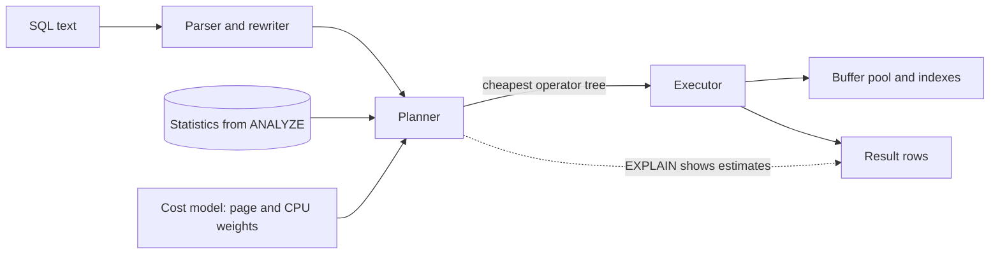

# Query Execution and Optimization

> [!abstract] In one sentence
> The planner turns declarative SQL into one of many possible operator trees by estimating the page and CPU cost of each from statistics — so a slow query is almost always a wrong estimate, a missing access path, or a plan that was right for different data.

> [!tip] Deeper treatment in your system-design vault
> `system-design/05 Relational Databases/Query Planning and EXPLAIN.md` — read it *after* you have written your own explanation below.

**Map:** [[Databases MOC]] → [[HLD MOC]]

## Definition

**Query execution** is the pipeline that takes SQL text through parsing, rewriting, planning and execution. The **planner** (optimiser) enumerates equivalent physical plans — which [[Indexing|index]] or scan to use for each table, which join algorithm and in which order — assigns each an estimated cost from the table statistics and a cost model, and hands the cheapest to the executor, which pulls rows through the operator tree. `EXPLAIN` shows the chosen plan with estimates; `EXPLAIN ANALYZE` runs it and shows the actual row counts and timings next to them.

## Problem solved

SQL says *what*, not *how*. The same three-table join can be executed as nested loops in six orders, as hash joins, or as merge joins over sorted inputs, with costs that differ by factors of thousands. Hand-choosing the order in application code (as early systems required) breaks the moment data distribution changes. A cost-based optimiser makes the choice at run time from current statistics, so an application keeps working as tables grow — until the estimates drift from reality, at which point the plan flips and a query that took 2 ms takes 20 s. Understanding the pipeline is what lets you tell "the database is slow" from "one plan went wrong".

## How it works

1. **Parse and rewrite.** The text becomes a parse tree, names are resolved against the catalogue, views are inlined, and simple rewrites apply (constant folding, subquery pull-up).
2. **Statistics.** `ANALYZE` (run by autovacuum when about 10 % of a table changes, by default) samples each table and stores per-column row counts, null fraction, distinct-value estimates, most-common values with frequencies, and a histogram of `default_statistics_target` buckets (100). Correlation between columns is *not* captured unless you create extended statistics (`CREATE STATISTICS … ON city, postcode`), which is why `WHERE city = 'Mumbai' AND postcode = '400001'` is often estimated as far rarer than it is.
3. **Cost model.** Each operator's cost is a weighted sum of page reads (`seq_page_cost = 1`, `random_page_cost = 4` by default — too high for SSDs, where 1.1 is common), tuples processed (`cpu_tuple_cost`) and operator evaluations. Costs are unitless; only their relative order matters.
4. **Access paths.** Per table the planner considers a sequential scan, an index scan (random heap visits in index order), an index-only scan (no heap visits), and a bitmap scan (collect matching heap pages from one or more indexes, then read them in physical order — the middle ground for medium selectivity).
5. **Joins.** Nested loop (cheap when the outer side is small and the inner has an index), hash join (build a hash table from the smaller input, probe with the larger; needs `work_mem`, only for equality), merge join (both inputs sorted on the key; great when an index already provides the order). Join *order* is searched exhaustively with dynamic programming up to `geqo_threshold` (12 tables) and with a genetic heuristic beyond.
6. **Execute.** The executor pulls tuples top-down through the tree (volcano model); sorts and hashes that exceed `work_mem` (default 4 MB) spill to disk, visible in `EXPLAIN ANALYZE` as `external merge Disk`.
7. **Plan caching.** Prepared statements (and every JDBC or `pg` driver parameterised query) are planned per execution for the first five runs; if a generic plan is not estimated to be worse, it is cached and reused without seeing the parameter values — the source of "fast in psql, slow from the service" when one tenant is a thousand times larger than the others (parameter sniffing; `plan_cache_mode` controls it).

```text
EXPLAIN (ANALYZE, BUFFERS)
SELECT t.id, t.amount_minor FROM transfers t
JOIN accounts a ON a.id = t.from_account_id
WHERE a.tenant_id = 7 AND t.created_at > now() - interval '1 day';

Nested Loop  (cost=0.86..412.30 rows=12 width=16) (actual time=0.05..38.21 rows=48213 loops=1)
  ->  Index Scan using ix_accounts_tenant on accounts a  (rows=40 actual rows=40)
  ->  Index Scan using ix_transfers_from_time on transfers t
        (cost=0.43..9.10 rows=1 width=24) (actual time=0.01..0.80 rows=1205 loops=40)
  Buffers: shared hit=61230 read=3012
```

The tell is `rows=12` estimated against `rows=48213` actual: the planner chose a nested loop for a dozen rows and ran it for fifty thousand. Fresh statistics or extended statistics on `(tenant_id, created_at)` would change the plan to a hash join.

## Architecture



## Use cases

- A request's p99 is dominated by one query — the first question is whether the plan is what you think it is, before anything is cached or scaled ([[Bottleneck Analysis]]).
- "Works for small tenants, times out for the biggest" — a classic skew or parameter-sniffing symptom that only plan inspection explains.
- Deciding which composite index to add: the plan tells you which predicate is applied as a filter after the index walk and which drives it.
- Reviewing ORM-generated SQL (N+1 queries, implicit casts, `SELECT *` defeating index-only scans) during code review, which is cheaper than finding it in production.
- Capacity questions such as "will this report query hurt OLTP traffic?" — `BUFFERS` and spill-to-disk in the plan answer it before you run it on production.

## Limitations

- Estimates are only as good as statistics: stale stats, correlated columns, skewed distributions and expressions the planner cannot see through all produce confident wrong plans.
- The optimiser is per statement: it cannot fix a chatty application that runs 300 tiny queries per request, which is an [[Data Modeling|application design]] problem.
- Plan hints are deliberately absent in PostgreSQL (available via the `pg_hint_plan` extension) and present but brittle in MySQL and Oracle; a hint freezes today's right answer into tomorrow's wrong one.
- Cross-shard and distributed query planning ([[Sharding]]) add network cost and partial pushdown; single-node intuition only partly transfers.
- Columnar warehouses use vectorised execution and different cost models; `EXPLAIN` there answers different questions ([[Data Warehouses]]).

## Trade-offs

| You gain | You sacrifice |
|---|---|
| Declarative queries that keep working as data grows, re-planned from live statistics | Plan instability: a statistics refresh can flip a plan overnight |
| A single explainable artefact (the plan) for every slow-query investigation | The need to learn the operator vocabulary and keep statistics honest |
| Cached generic plans that skip planning cost on hot paths | Parameter sniffing when one parameter value is wildly different from the rest |
| A cost model you can tune to your hardware | Tuning that is global, not per query, and easy to get wrong |

## Failure modes

- **Plan flip after ANALYZE or a data-growth threshold** → a query goes from milliseconds to seconds with no deploy; you notice from `pg_stat_statements` mean time jumping at one timestamp; blast radius is the pool filling and every endpoint sharing it slowing down ([[Connection Pooling]]).
- **Generic plan chosen for a skewed parameter** → fast for most tenants, catastrophic for the largest; visible only when you `EXPLAIN` with the real value or force `plan_cache_mode = force_custom_plan`; blast radius is one tenant's requests and the shared CPU they burn.
- **Sort or hash spilling to disk** because `work_mem` is small and the input large → temp-file I/O and latency; `EXPLAIN ANALYZE` shows `Disk` in the sort method; blast radius is temp-space exhaustion affecting other sessions.
- **Non-sargable predicate from an ORM** (`WHERE CAST(id AS text) = ?`, `lower(email) = ?`) → sequential scan despite the index; blast radius grows with the table until someone reads the plan.
- **Statistics never refreshed on an append-only table** because autovacuum's percentage threshold is never reached on a huge table → estimates drift for weeks; fix with per-table `autovacuum_analyze_scale_factor`.

## Performance

Planning itself usually costs tens of microseconds to a few milliseconds and grows quickly with join count, which is why prepared statements and generic plans exist. Execution cost is what the plan predicts: a point lookup is a few page hits; a hash join is linear in both inputs plus memory for the build side; a nested loop with an inner index is cheap only while the outer side is small. `BUFFERS` output (`shared hit` versus `read`) tells you whether a query is CPU-bound or I/O-bound, which is the first fork in any tuning decision. Lowering `random_page_cost` on SSD-backed instances and raising `work_mem` for sessions that run reports are the two global tunings that pay off most often.

## Scalability

At 10x data, plans that were linear become visible: the planner may switch to hash joins and bitmap scans correctly, but anything estimated wrongly becomes 10x more wrong. At 10x query rate, planning overhead and lock contention on catalogue access matter; prepared statements and plan caching are the answer. At 10x schema and team size, the discipline becomes process: `EXPLAIN` in pull requests for new queries, `pg_stat_statements` dashboards per service, and `auto_explain` logging plans of statements slower than a threshold so flips are caught with the plan attached.

## Operational impact

Moderate and mostly observability. Enable `pg_stat_statements` and `auto_explain` (with `log_min_duration`), keep `track_io_timing` on, and alert on top-N query regressions rather than on server CPU. Keep autovacuum analysing large tables aggressively. On-call runbooks should include "get the plan with real parameters, compare estimated and actual rows, check statistics age" as the first three steps. Managed services (RDS Performance Insights, Aurora) give you the top queries but not the plan; you still need `EXPLAIN` access.

## Alternatives

- **Precomputed read models ([[CQRS]], materialised views)** — win when the same heavy join or aggregate is read far more often than its inputs change.
- **Denormalisation ([[Data Modeling]])** — wins when a join is on the hot path and the duplicated column changes rarely.
- **Caching the result ([[Cache-Aside]])** — wins for hot keys with tolerable staleness; does nothing for the long tail of distinct queries.
- **Moving analytics to a warehouse** — wins when report queries contend with OLTP traffic for the buffer pool and locks.

## Real-world examples

- PostgreSQL's documentation on `EXPLAIN` and planner statistics, and the `pg_stat_statements` extension, define the vocabulary above; MySQL 8 added `EXPLAIN ANALYZE` and histograms to reach similar ground.
- The "parameter sniffing" problem is documented at length for SQL Server, where cached plans for stored procedures made it a well-known operational hazard long before PostgreSQL's generic plans.
- Stripe, GitLab and Shopify publish internal guides requiring query plans in review for schema and query changes, precisely because plan regressions are the common cause of database incidents.
- In a stack like yours: a Spring Data or TypeORM repository method that works in staging and times out for the largest merchant in production; the fix is read the plan with that merchant's id, add extended statistics or reorder a composite index, and add `auto_explain` so the next flip comes with its plan attached.

## Practical exercise

1. Load the 10-million-row ledger table from the [[Indexing]] exercise into Docker PostgreSQL with one tenant holding 40 % of rows.
2. Run a tenant-filtered join as a prepared statement from a small Java or TypeScript program ten times with a small tenant, then with the large tenant; capture plans with `auto_explain` and observe the generic plan kicking in after the fifth execution.
3. Set `plan_cache_mode = force_custom_plan` and compare p99 for both tenants.
4. Delete statistics drift artificially: insert 5 million more rows without `ANALYZE`, run the query, read estimated-versus-actual rows, then `ANALYZE` and compare.
5. Add `CREATE STATISTICS` on two correlated columns and record the change in row estimates and plan shape.
6. Lower `random_page_cost` to 1.1 and `work_mem` to 64 MB for the session and note which plans change.

## Related concepts

### Prerequisites
- [[Indexing]] — the access paths the planner chooses between
- [[Relational Database Internals]] — the page I/O that the cost model is pricing

### Related
- [[Data Modeling]] — most unfixable plans are modelling problems
- [[Bottleneck Analysis]] — the plan is the evidence that pins the bottleneck
- [[Connection Pooling]] — one slow plan fills the pool for everyone
- [[Monitoring]] — top-query dashboards are the early warning system
- [[Partitioning]] — partition pruning is a planner decision too

### Builds on this
- [[Database Scaling]] — "tune the queries" is the first rung and depends on reading plans
- [[Data Warehouses]] — columnar, vectorised execution extends the same ideas to analytics

### Design problems where it applies
- [[Design a Payment System]]
- [[Design an Inventory Management System]]
- [[Design a Logging System]]
- [[Design Search Autocomplete]]

### Projects where it can be implemented
- [[Double-Entry Ledger Service]]
- [[Load Test and Latency Lab]]

### Resources
- [[PostgreSQL Indexes Docs]] — index types and how the planner uses them
- [[Database Internals]] — query processing and the cost-based optimiser in depth
- [[Designing Data-Intensive Applications]] — chapter 2 on declarative query languages and chapter 3 on storage

## Personal understanding

> [!question] Explain it without the source
> Write your own explanation here, from memory. Then compare it with the sections above and note what you missed.

### Mastery checklist
- [ ] I can explain it without the original resource
- [ ] I can describe the problem it solves
- [ ] I can compare it with its alternatives
- [ ] I can name its limitations and failure modes
- [ ] I can recognise when it is appropriate in a real system
- [ ] I have applied it in a system design
- [ ] I have validated my assumptions with an experiment or implementation

## Open questions

- [ ] Which queries in the services you own run as generic cached plans today, and does any of them have a parameter (tenant, merchant, account) with heavy skew?
- [ ] What `random_page_cost` and `work_mem` do your managed instances actually run with, and were they ever tuned for SSD storage?
- [ ] How would you detect a plan flip automatically — by plan hash in `auto_explain` output, by `pg_stat_statements` regression, or both — and page on it before customers notice?
