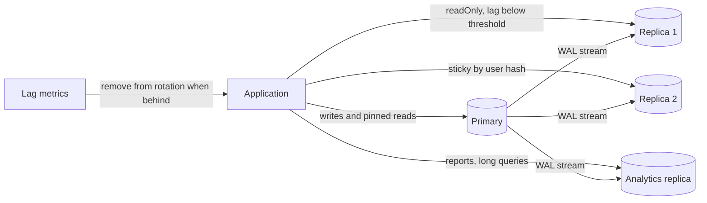

# Read Replicas

> [!abstract] In one sentence
> A read replica turns a follower into read capacity — cheap, linear and effective for read-heavy workloads — at the price of every read becoming a question about staleness: the user who just saved something must not be shown that it is missing.

> [!tip] Deeper treatment in your system-design vault
> `system-design/06 Replication and Sharding/Read Your Own Writes and Replica Lag Anomalies.md` — read it *after* you have written your own explanation below.

**Map:** [[Databases MOC]] → [[HLD MOC]]

## Definition

A **read replica** is a follower in a leader-follower [[Replication]] setup that the application deliberately queries for reads. The leader (primary) still takes every write; replicas apply the change stream asynchronously and serve `SELECT`s from their own copy. **Replica lag** is the delay between a commit on the primary and its visibility on a replica — milliseconds normally, seconds under write bursts, minutes when something is wrong. Read scaling is therefore a routing problem: which reads go where, and what the application does about the lag window.

## Problem solved

Most OLTP systems read far more than they write — ten or a hundred reads per write is common — and the primary's CPU, buffer pool and connection slots are finite and shared with writers. Caching helps for hot keys ([[Cache-Aside]]) but not for the long tail of per-user queries, reports, exports and dashboards that each touch different rows. Replicas give those reads their own hardware without touching the write path, isolate heavy analytical queries from the transactional workload, and provide a warm standby for failover as a side effect. The anomalies they introduce — a user reading their own write and not finding it, a timeline that goes backwards between two refreshes — are the cost, and they are the reason "just add a replica" is not always a fix.

## How it works

1. **Routing.** Something decides per query whether it goes to the primary or a replica. Options: application-level (Spring's `AbstractRoutingDataSource` keyed on `@Transactional(readOnly = true)`, wrapped in `LazyConnectionDataSourceProxy` so the choice is made after the annotation is seen; TypeORM's `replication: { master, slaves }` configuration, which sends plain `find`/`query` to replicas and transactions and query runners to the master); proxy-level (ProxySQL rules, pgpool-II load balancing); or endpoint-level (Aurora's reader endpoint, which balances across replicas; plain RDS replicas have individual endpoints you load-balance yourself).
2. **The lag window.** A write commits on the primary at time t; a replica reflects it at t + lag. A read in that window sees the old state. Three named anomalies: **read-your-writes** violated (the user's own change is missing), **monotonic reads** violated (two successive reads hit replicas with different lag and time appears to go backwards), **consistent prefix** violated (effects seen before causes, across replicas of different partitions).
3. **Read-your-writes strategies.** (a) *Pin after write*: route a user's reads to the primary for a fixed window (say 5–10 seconds) after they write, tracked in the session or a Redis key. (b) *Pin by data*: reads of data the user may have modified (their own profile, their own orders) always go to the primary; everyone else's go to replicas. (c) *Causal token*: after the write, capture the primary's position (`pg_current_wal_lsn()` in PostgreSQL, the GTID set in MySQL) and send it with subsequent reads; the replica serves the read only if `pg_last_wal_replay_lsn() >= token`, otherwise waits briefly or falls back to the primary (`WAIT_FOR_EXECUTED_GTID_SET` in MySQL does exactly this).
4. **Monotonic reads.** Route each user (or session) to the same replica consistently — hash the user id onto the replica set — so successive reads never see an older replica than the last.
5. **Measuring lag.** On the primary, `pg_stat_replication.replay_lag` per replica; on the replica, `now() - pg_last_xact_replay_timestamp()` (misleading when the primary is idle: no new transactions means the timestamp stops moving); RDS and Aurora publish `ReplicaLag` (Aurora typically tens of milliseconds because of its shared storage, RDS replicas typically sub-second to seconds). Export lag as a metric and make the router consult it: a replica beyond a threshold is removed from rotation.
6. **Replica query conflicts.** A long `SELECT` on a PostgreSQL replica can be cancelled when replay needs to remove rows it is still reading (`max_standby_streaming_delay`, default 30 s). `hot_standby_feedback = on` prevents the cancellation by telling the primary to keep those rows — which transfers the bloat to the primary. Choose per replica: feedback on for OLTP replicas, long delays for the analytics replica.

```typescript
// Causal token in NestJS: after a write, remember where the primary was
const [{ lsn }] = await primary.query('SELECT pg_current_wal_lsn() AS lsn');
await redis.set(`ryw:${userId}`, lsn, 'EX', 30);

// Before a replica read, check the replica has caught up to the user's last write
const token = await redis.get(`ryw:${userId}`);
const [{ ok }] = await replica.query(
  'SELECT pg_last_wal_replay_lsn() >= $1::pg_lsn AS ok', [token ?? '0/0']);
const db = ok ? replica : primary;
```

## Architecture



## Use cases

- "Reads are 10x writes and the primary's CPU is the ceiling" — the textbook case; move list, search and detail reads for other users' data to replicas.
- "Reports and exports slow down checkout" — give analytics its own replica with long standby delay and no feedback ([[Data Warehouses]] when it outgrows that).
- "Dashboards and admin tools that tolerate seconds of staleness" — route wholesale to replicas.
- "Read capacity in another region" — cross-region replicas serve local reads; writes still travel to the primary region.
- "We need a warm standby anyway" — a replica that also serves reads pays for itself.

## Limitations

- Replicas do nothing for write-bound primaries, lock contention or slow writes; they amplify a mistaken diagnosis ([[Bottleneck Analysis]], [[Database Scaling]]).
- Every read-after-write path must be found and handled; miss one and the bug reproduces only under load, in production.
- Replica reads inside a transaction that also writes are inconsistent by construction; most routing layers send the whole transaction to the primary, which quietly erases the benefit for transactional services.
- The N+1 query problem is not solved by replicas — a request doing 300 round trips is slow against any database.
- Each replica is a full copy: storage, instance cost, and the WAL bandwidth to feed it.

## Trade-offs

| You gain | You sacrifice |
|---|---|
| Near-linear read capacity without touching the write path | Staleness that leaks into every read unless routing is deliberate |
| Isolation of heavy reads from transactional traffic | Query cancellation or primary bloat, depending on the standby settings |
| A warm standby that doubles as failover target | Double or triple instance and storage cost |
| Regional read locality | Cross-region lag of hundreds of milliseconds and a harder read-your-writes story |

## Failure modes

- **Read-your-writes violation** → "I just updated my address and it still shows the old one"; you notice from support tickets and flaky end-to-end tests; blast radius is user trust and, in payments, duplicate submissions when the user retries.
- **Lag spike removes all replicas from rotation** → every read falls back to the primary at once, which was already the bottleneck; you notice from primary CPU pinned after a bulk job; blast radius is the whole service — a fallback cliff worth load-testing ([[Graceful Degradation]]).
- **Replica query cancelled by replay conflict** → sporadic "canceling statement due to conflict with recovery" errors in reports; blast radius is the batch job that did not retry.
- **Stale replica silently serving** because lag metrics were never wired to the router → users see hours-old data after a replica stalled; blast radius is every read on that replica until someone notices.
- **Routing bug sends writes to a replica** → "cannot execute INSERT in a read-only transaction"; loud, easy — but the same bug in reverse (every read to the primary) is silent and only shows as the replica fleet sitting idle.

## Performance

A replica read costs the same as a primary read when the buffer pool is warm; a freshly added replica is cold for minutes. Lag under normal conditions is milliseconds on the same network and tens of milliseconds on Aurora; it rises with write bursts, long transactions and single-threaded apply. The causal-token check adds one cheap query (or a cached comparison) per read; pin-after-write adds a Redis lookup. The real performance effect is on the primary: removing most reads frees CPU, buffer pool and connections for writes, which is often a larger latency win for the write path than for the reads themselves.

## Scalability

Adding replicas scales reads until WAL fan-out from the primary or operational overhead dominates; cascading replication (replicas feeding replicas) extends it. At 10x read load with the same write load, replicas are the right tool. At 10x write load they are irrelevant and the route is [[Sharding]]. At 10x team size the routing rules must be a library or a platform concern, not per-service code, or every team reinvents read-your-writes differently and one of them gets it wrong.

## Operational impact

Moderate. Monitor lag per replica and alert on both absolute lag and "replica removed from rotation"; keep replica count and the fallback capacity on the primary in your capacity model ([[Capacity Planning]]); configure standby settings per replica role; test the lag-spike and replica-loss scenarios. Managed services make adding a replica a click, which is precisely how teams end up with replicas before they have fixed their indexes. On-call runbooks need the "which reads went where" answer available from logs or traces ([[Distributed Tracing]] tags for the datasource chosen).

## Alternatives

- **[[Cache-Aside]] with [[Redis]]** — wins for hot keys and expensive computed reads; cheaper per read than any replica, useless for the long tail.
- **[[CQRS]] read models** — win when reads need a different shape than the write model; built from the change stream, they carry the same lag but serve each query from a purpose-built store.
- **Scale the primary up** — wins when the ceiling is a modest instance class; no staleness, no routing, until the biggest instance is not enough.
- **Fix the queries** — wins more often than any of the above; an index or a removed N+1 can give back the capacity a replica would have added ([[Query Execution and Optimization]]).

## Real-world examples

- Aurora's reader endpoint and RDS read replicas, with their published `ReplicaLag` metric, are the managed-service shape of this pattern; MySQL's `WAIT_FOR_EXECUTED_GTID_SET` is the built-in causal-token mechanism.
- GitHub has written about routing reads to MySQL replicas with a "freshness" check based on replication position, and about the incidents that preceded that discipline.
- Designing Data-Intensive Applications' treatment of read-your-writes, monotonic reads and consistent prefix reads is where most engineers first meet the three anomalies by name.
- In a stack like yours: a Spring Boot account service on Aurora PostgreSQL routing `readOnly` transactions to the reader endpoint, with a short post-write pin in Redis keyed by user for the "show my updated limits" screen, and the statements and reporting jobs on a separate replica with a long standby delay.

## Practical exercise

1. Docker Compose with a PostgreSQL primary and one streaming replica; configure a NestJS or Spring Boot service with read/write routing (TypeORM replication config or `AbstractRoutingDataSource`).
2. Add Toxiproxy between primary and replica and inject 2 seconds of latency on the replication connection; write a k6 scenario that updates a profile then immediately reads it and count read-your-writes violations.
3. Implement pin-after-write with a Redis key, then the LSN causal token; compare violation counts and added latency.
4. Run a 60-second `SELECT` on the replica during heavy updates and observe the cancellation; set `hot_standby_feedback = on` and watch `n_dead_tup` on the primary instead.
5. Simulate a lag spike beyond the threshold and watch all reads fall back to the primary; measure the primary's CPU cliff.

## Related concepts

### Prerequisites
- [[Replication]] — the mechanism that produces a replica in the first place
- [[Consistency Models]] — read-your-writes and monotonic reads are consistency models

### Related
- [[Eventual Consistency]] — the regime every replica read lives in
- [[Cache-Aside]] — the other read-scaling tool, with the same staleness question
- [[Connection Pooling]] — separate pools per datasource role
- [[Monitoring]] — lag is a metric the router must consume, not just a dashboard
- [[Bottleneck Analysis]] — confirm the primary is read-bound before adding replicas

### Builds on this
- [[Database Scaling]] — the read-replica rung of the ladder
- [[CQRS]] — purpose-built read models generalise the idea
- [[Data Warehouses]] — where the analytics replica goes when it outgrows a replica

### Design problems where it applies
- [[Design a Social Feed]]
- [[Design a URL Shortener]]
- [[Design a Payment System]]
- [[Design a Digital Wallet and Ledger]]

### Projects where it can be implemented
- [[Double-Entry Ledger Service]]
- [[Load Test and Latency Lab]]

### Resources
- [[Designing Data-Intensive Applications]] — chapter 5, "Problems with replication lag"
- [[Jepsen Consistency Models]] — formal definitions of read-your-writes and monotonic reads
- [[Database Internals]] — replication and consistency in part II

## Personal understanding

> [!question] Explain it without the source
> Write your own explanation here, from memory. Then compare it with the sections above and note what you missed.

### Mastery checklist
- [ ] I can explain it without the original resource
- [ ] I can describe the problem it solves
- [ ] I can compare it with its alternatives
- [ ] I can name its limitations and failure modes
- [ ] I can recognise when it is appropriate in a real system
- [ ] I have applied it in a system design
- [ ] I have validated my assumptions with an experiment or implementation

## Open questions

- [ ] Which endpoints in the services you own read data the same user wrote in the previous request, and how is each of them routed today?
- [ ] What is the p99 replica lag on your Aurora or RDS fleet during the daily batch window, and does the router react to it or just the dashboard?
- [ ] If every replica were removed from rotation at peak, would the primary survive the fallback, and has that ever been tested?
