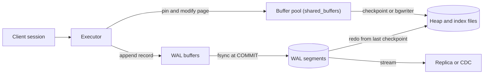

# Relational Database Internals

> [!abstract] In one sentence
> A relational database is a cache of fixed-size pages in front of heap files, made durable by an append-only write-ahead log and made concurrent by keeping multiple row versions — once you can picture those four moving parts, slow queries, bloat, replication lag and "why did my commit take 8 ms" all have obvious causes.

> [!tip] Deeper treatment in your system-design vault
> `system-design/05 Relational Databases/How Databases Store Data.md` — read it *after* you have written your own explanation below.

**Map:** [[Databases MOC]] → [[HLD MOC]]

## Definition

A relational engine such as PostgreSQL or MySQL/InnoDB stores every table as a set of fixed-size **pages** (8 KB in PostgreSQL, 16 KB in InnoDB) held in **heap files** on disk. Reads and writes never touch disk pages directly: they go through the **buffer pool**, an in-memory cache of pages. Every change is first appended to the **write-ahead log (WAL)**, which is flushed to disk before a commit is acknowledged, while the modified pages are written back lazily by **checkpoints**. Concurrency comes from **multi-version concurrency control (MVCC)**: writers create new row versions instead of overwriting, so readers never block writers. These mechanisms are what make [[ACID]] a property the engine can actually deliver.

## Problem solved

The engine has to reconcile three facts that pull in different directions: disks are slow at random access and fast at sequential writes; memory is fast but volatile; and many clients want to read and write the same rows at once. Writing every change straight into its data page would mean a random 8 KB write per row change and a torn page on power loss. Keeping everything in memory would lose committed data on a crash. Locking every row a reader touches would serialise the workload.

The WAL converts random page writes into one sequential append per transaction and gives crash recovery a replay script. The buffer pool amortises page I/O across thousands of operations. MVCC lets a long report and a stream of updates coexist. In a stack like yours — a ledger or payments service on RDS or Aurora PostgreSQL — the difference between a commit that costs one sequential fsync and one that costs a dozen random writes is the difference between 5,000 and 500 transactions per second on the same instance.

## How it works

1. **Pages and heap files.** A table is a sequence of pages; each page has a header, an array of item pointers and the tuples themselves, packed from the end. A row is addressed by `(page number, item offset)`; in PostgreSQL that is the `ctid`. Values larger than roughly 2 KB are moved out of line into a TOAST table and replaced with a pointer, so a wide JSONB column costs an extra lookup. InnoDB differs in one big way: the table *is* its primary-key B+-tree (index-organised), so rows live in primary-key order and every secondary index stores primary-key values rather than physical addresses ([[Indexing]]).
2. **Buffer pool.** `shared_buffers` (PostgreSQL, default a tiny 128 MB, usually set to about a quarter of RAM) or `innodb_buffer_pool_size` (typically 70–80 % of RAM on a dedicated host) caches pages. A page miss costs a read from the OS page cache or the disk — an SSD random read is of the order of 100 µs versus about 100 ns for memory, three orders of magnitude. Replacement is clock-sweep in PostgreSQL and a midpoint-insertion LRU in InnoDB so a full-table scan does not evict the hot set. Modified pages are **dirty** and stay in memory until flushed.
3. **Write-ahead log.** Before a dirty page may be written, the WAL record describing the change must be on disk (the "write-ahead" rule). At `COMMIT`, the engine appends a commit record and calls `fsync` on the WAL segment; only then does it reply. Many concurrent commits share one fsync (group commit), which is why throughput per fsync rises with concurrency. Each record carries a log sequence number (LSN); pages store the LSN of their last change, which is how recovery knows what to redo. `synchronous_commit = off` lets the commit return before the fsync, risking at most about three times `wal_writer_delay` (around 600 ms at defaults) of acknowledged transactions on a crash — never acceptable for money, often fine for metrics.
4. **Checkpoints.** Periodically (`checkpoint_timeout`, default 5 minutes, or when `max_wal_size` is reached) the checkpointer writes all dirty pages to the heap files and records the checkpoint LSN. Recovery after a crash replays WAL from the last checkpoint. PostgreSQL also writes a **full page image** the first time a page is touched after a checkpoint (`full_page_writes`) to survive torn writes — the reason WAL volume spikes right after each checkpoint and why spreading checkpoints (`checkpoint_completion_target = 0.9`) matters.
5. **MVCC.** PostgreSQL stamps every tuple with the transaction id that created it (`xmin`) and the one that deleted or replaced it (`xmax`). An `UPDATE` is an insert of a new version plus setting `xmax` on the old one; a snapshot decides which versions each transaction can see ([[Isolation Levels]]). Dead versions are reclaimed later by `VACUUM`. InnoDB keeps the latest version in place and reconstructs older versions from an **undo log**, purged in the background. Same guarantee, opposite bloat profile: PostgreSQL bloats tables and indexes, InnoDB bloats the undo space.
6. **A write, end to end.** Parse and plan → pin the target page in the buffer pool → write the WAL record into `wal_buffers` → modify the page in memory and mark it dirty → at commit, flush WAL to disk → reply to the client → much later, the checkpointer or background writer flushes the page. The client's latency is dominated by step five, which is one sequential write.

```sql
-- See the machinery from the outside
SHOW shared_buffers;                       -- buffer pool size
SELECT * FROM pg_stat_bgwriter;            -- checkpoints_timed vs checkpoints_req, buffers_checkpoint
SELECT pg_current_wal_lsn();               -- how far the WAL has advanced
SELECT relname, n_dead_tup, n_live_tup     -- MVCC garbage waiting for vacuum
FROM pg_stat_user_tables ORDER BY n_dead_tup DESC LIMIT 5;
```

## Architecture



> [!example]- Excalidraw version — the same diagram as an editable canvas
> ![[Relational Database Internals.excalidraw]]
> [[Relational Database Internals.excalidraw|Open in Excalidraw]] — needs the Excalidraw plugin (see [[Plugins to Install]]).


## Use cases

- "Why is the database slow?" — almost every performance question routes through these parts: a working set larger than the buffer pool (I/O-bound), fsync latency on commit (write-bound), dead tuples (bloat), or checkpoint storms (latency spikes every N minutes).
- Sizing an instance: the honest heuristic is "hot working set fits in the buffer pool", which you can only reason about if you know what the pool is ([[Capacity Planning]]).
- Deciding whether a store can carry your durability requirement: synchronous WAL flush is what makes a committed transfer survive a power failure ([[Recovery Point Objective]]).
- Designing anything that reads the log — [[Change Data Capture]], logical [[Replication]], point-in-time recovery ([[Backups and Restoration]]) — because they are all consumers of the WAL.
- Choosing a primary key type: random UUIDv4 keys on an InnoDB table or a PostgreSQL B-tree cause page splits across the whole index; time-ordered keys append to the right-hand edge.

## Limitations

- The architecture assumes a single node owns the files: scaling writes beyond one machine needs [[Sharding]] or a different engine, not a bigger buffer pool.
- B-tree-plus-heap storage is read-optimised; sustained firehose writes (telemetry, click streams) are better served by log-structured storage ([[Time-Series Databases]], wide-column stores).
- MVCC garbage is real work: a PostgreSQL table with heavy updates and no vacuum headroom degrades quietly, and a long-running transaction can stop vacuum from reclaiming anything cluster-wide.
- Durability is only as good as the storage's honesty about `fsync`; consumer SSDs and some virtualised disks have lied, and the database cannot tell.
- Managed services (RDS, Aurora) hide some of the knobs; Aurora in particular replaces the heap-and-WAL layout with a log-structured distributed storage layer, so some intuitions (checkpoints, full-page writes) do not transfer.

## Trade-offs

| You gain | You sacrifice |
|---|---|
| Commit cost of one sequential WAL fsync instead of many random page writes | WAL volume to ship, archive and replay; recovery time grows with the checkpoint interval |
| Readers that never block writers thanks to MVCC | Vacuum or purge work, table and index bloat, transaction-id housekeeping |
| A buffer pool that turns most reads into memory reads | Memory dedicated to the database; cold starts and scans that pollute the cache |
| Crash recovery that is a mechanical replay of the log | Checkpoint I/O bursts and full-page-write amplification right after each checkpoint |

## Failure modes

- **Working set outgrows the buffer pool** → cache hit ratio in `pg_stat_database` drops below the high nineties, disk reads climb, p99 latency jumps by orders of magnitude while CPU looks idle; blast radius is every query on that instance.
- **Checkpoint storm** → periodic latency spikes aligned with `checkpoint_timeout`, visible as `checkpoints_req` rising and write I/O saturating; blast radius is all writers for the duration of the flush.
- **Long-lived transaction pins the xmin horizon** → `n_dead_tup` grows across unrelated tables, vacuum reports "dead rows not yet removable", indexes bloat, queries slow for days after the transaction ends; blast radius is the whole database, caused by one idle session ([[Transactions]]).
- **fsync latency on the WAL volume** → every commit waits; you notice commit latency tracking disk write latency exactly; blast radius is write throughput for the whole instance, and a burst of retries from clients makes it worse ([[Retry Storms]]).
- **Transaction-id wraparound** (PostgreSQL) → autovacuum cannot keep up, the database refuses writes to protect itself; you notice from "database is not accepting commands to avoid wraparound" — rare, catastrophic, and fully preventable with monitoring of `age(datfrozenxid)`.

## Performance

Latency of a point read is a few microseconds for a buffer-pool hit and 100 µs to a few milliseconds for a miss, depending on the storage. Commit latency is the WAL fsync — commonly in the 0.5–5 ms range on cloud block storage — and throughput per node is bounded by how many commits each fsync can carry. Write amplification is the hidden cost: one logical row change produces a WAL record, a dirty heap page, one dirty page per affected index, and later a full-page image. Memory is the main lever (buffer pool), then WAL device latency, then vacuum keeping the heap compact so pages carry live rows instead of dead ones.

## Scalability

Vertically, this design scales to multi-terabyte tables and tens of thousands of transactions per second on a single large node, as long as the hot set fits in memory and the WAL device keeps up. Reads scale further by shipping the WAL to [[Read Replicas]]. At 10x write volume, the ceilings appear in order: fsync throughput, vacuum keeping pace with dead tuples, and finally a single node's CPU and memory — which is where the [[Database Scaling]] ladder ends in sharding. Team-scale matters too: understanding these internals is what lets a team diagnose a slow database instead of resizing it.

## Operational impact

You own the knobs: buffer pool size, checkpoint spacing, WAL retention, autovacuum thresholds per table, and the timeouts that stop one session from pinning the xmin horizon. Monitoring that actually predicts trouble: cache hit ratio, dead tuples and vacuum age, checkpoint frequency, WAL generation rate and replication lag. Debugging is approachable because every symptom maps to a mechanism (`EXPLAIN (ANALYZE, BUFFERS)` shows exactly how many pages came from cache versus disk). Upgrades are routine with managed services, but major versions change the on-disk format and need a dump-restore or logical replication path ([[Schema Evolution]] is easier than engine migration).

## Alternatives

- **Log-structured merge trees (RocksDB, Cassandra, LevelDB)** — win for write-heavy, append-mostly workloads; trade read amplification and compaction I/O for cheap sequential writes.
- **In-memory stores with periodic snapshots ([[Redis]])** — win when the working set must be sub-millisecond and durability can be relaxed to "last few seconds".
- **Aurora-style log-is-the-database storage** — wins when you want PostgreSQL semantics with storage-level replication across availability zones; the WAL is still the contract, the heap is virtual.
- **Columnar engines ([[Data Warehouses]])** — win for scans over a few columns of billions of rows; terrible for point updates, which is the opposite trade.

## Real-world examples

- PostgreSQL's documentation on WAL configuration and the `pg_stat_bgwriter` view is the canonical description of the checkpoint and full-page-write behaviour above; InnoDB's documented redo log, doublewrite buffer and undo tablespaces are the MySQL equivalents.
- Amazon Aurora's published design replaces checkpoints and full-page writes with a storage layer that applies the log itself, which is why Aurora's write path sends only WAL records to storage.
- Uber's 2016 engineering post on moving from PostgreSQL to MySQL is essentially an argument about these internals: heap-plus-secondary-index write amplification versus InnoDB's clustered layout.
- In a stack like yours: a ledger service on RDS PostgreSQL where commit latency is the fsync to EBS, where an analyst's forgotten open transaction can stall vacuum for the payments schema, and where Debezium reads the same WAL to feed Kafka — three teams depending on one log.

## Practical exercise

1. Run PostgreSQL in Docker with `shared_buffers = 128MB` and load a 2 GB table with `pgbench -i -s 150`.
2. Run `pgbench -S` (read-only) and watch `pg_stat_database` `blks_hit` versus `blks_read`; then restart with `shared_buffers = 2GB`, repeat, and compare p99 latency and hit ratio.
3. Run `pgbench` with writes for ten minutes and plot latency; correlate the spikes with `checkpoints_timed` in `pg_stat_bgwriter`, then set `checkpoint_completion_target` and `max_wal_size` higher and repeat.
4. Flip `synchronous_commit` to `off` and measure the throughput change; then `kill -9` the container mid-run and count how many acknowledged transactions are missing on restart.
5. Open a `BEGIN;` session and leave it idle, run an update-heavy benchmark, and watch `n_dead_tup` grow while `VACUUM VERBOSE` reports rows it cannot remove.

## Related concepts

### Prerequisites
- [[Latency]] — the memory-versus-disk gap is the whole reason for the buffer pool
- [[Throughput]] — commits per second are bounded by fsync rate, which this note explains

### Related
- [[ACID]] — the guarantees these mechanisms exist to deliver
- [[Indexing]] — B-trees live in the same pages and the same buffer pool
- [[Isolation Levels]] — snapshots are how MVCC versions are chosen
- [[Backups and Restoration]] — WAL archiving is what makes point-in-time recovery possible
- [[Connection Pooling]] — each PostgreSQL connection is a process with its own memory, which is why pools matter
- [[Capacity Planning]] — sizing memory to the working set

### Builds on this
- [[Query Execution and Optimization]] — the planner's cost model is a model of page I/O
- [[Transactions]] — commit, rollback and locks are implemented on top of the WAL and MVCC
- [[Replication]] — followers are WAL consumers
- [[Change Data Capture]] — Debezium decodes the same log
- [[Database Scaling]] — each rung of the ladder relieves one of these components

### Design problems where it applies
- [[Design a Payment System]]
- [[Design a Digital Wallet and Ledger]]
- [[Design a Message Queue]]
- [[Design a Distributed Key-Value Store]]

### Projects where it can be implemented
- [[Double-Entry Ledger Service]]
- [[Durable Job Scheduler]]
- [[Mini-KV Store]]

### Resources
- [[Database Internals]] — part I is exactly this note in book form
- [[Designing Data-Intensive Applications]] — chapter 3 on storage engines, B-trees versus LSM-trees
- [[Latency Numbers Every Programmer Should Know]] — the memory, SSD and disk figures the buffer pool argument rests on

## Personal understanding

> [!question] Explain it without the source
> Write your own explanation here, from memory. Then compare it with the sections above and note what you missed.

### Mastery checklist
- [ ] I can explain it without the original resource
- [ ] I can describe the problem it solves
- [ ] I can compare it with its alternatives
- [ ] I can name its limitations and failure modes
- [ ] I can recognise when it is appropriate in a real system
- [ ] I have applied it in a system design
- [ ] I have validated my assumptions with an experiment or implementation

## Open questions

- [ ] On the RDS and Aurora instance classes you use, what is the measured WAL fsync latency, and how many commits per second does group commit let a single instance sustain before it flattens?
- [ ] Which tables in a ledger schema have update patterns that defeat HOT updates (an indexed column changes), and what does that cost in index bloat per day?
- [ ] How does Aurora's log-structured storage change the checkpoint and full-page-write reasoning above, and which of the PostgreSQL metrics stop being meaningful there?
