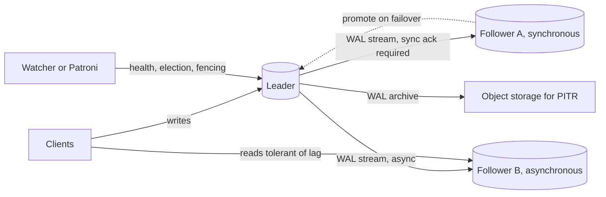

# Replication

> [!abstract] In one sentence
> Replication copies a stream of changes from one node to others so the data survives a node loss and can be read in more places — and every design is a position on one trade: acknowledge the write before the copy exists (fast, can lose data) or after (slow, can stall), with leader-follower, multi-leader and leaderless being three answers to "who may accept a write".

> [!tip] Deeper treatment in your system-design vault
> `system-design/06 Replication and Sharding/Replication.md` — read it *after* you have written your own explanation below.

**Map:** [[Databases MOC]] → [[HLD MOC]]

## Definition

**Replication** is maintaining copies of the same data on multiple nodes connected by a network. In **leader-follower** (single-leader, primary-replica) replication one node accepts all writes and ships its change log to followers. In **multi-leader** replication several nodes accept writes and exchange changes, resolving conflicts. In **leaderless** replication (Dynamo-style) any node accepts writes and reads, and clients or coordinators use [[Quorums]] to reach agreement. Orthogonally, replication is **synchronous** (the leader waits for a follower's acknowledgement before confirming the commit), **asynchronous** (it does not), or **semi-synchronous** (it waits for at least one of several). The scheme defines what you can lose on failure and what a read can return.

## Problem solved

A single node is a single point of failure and a single point of read capacity. Backups restore to a point hours old; a replica is seconds or milliseconds old and can take over. Replication also puts data near users in other regions and offloads reads from the primary ([[Read Replicas]]). The hard part was never copying bytes — it is agreeing on what the data *is* when nodes disagree: a leader that crashed after acknowledging a write no follower received, two leaders that accepted conflicting updates, a follower promoted while the old leader is still alive ([[Split-Brain]]). Each replication scheme is a specific answer to those questions, and the differences are what decide whether a bank transfer can disappear during a failover.

## How it works

1. **What is shipped.** Statement-based replication replays SQL (fragile: `now()`, sequences); write-ahead-log shipping sends the physical byte changes (PostgreSQL streaming replication; replicas must run the same major version); logical (row-based) replication sends row images (MySQL row-format binlog, PostgreSQL logical replication via publications and subscriptions; version-independent and filterable, also what [[Change Data Capture]] consumes).
2. **Leader-follower, asynchronous.** Leader commits locally, acknowledges the client, and streams the log; followers apply it after a lag of milliseconds to seconds. Failover promotes a follower, and any committed-but-unshipped transactions are lost — a non-zero [[Recovery Point Objective]]. The old leader must be fenced so it cannot keep accepting writes.
3. **Leader-follower, synchronous.** The leader waits for the follower to acknowledge before confirming. PostgreSQL's `synchronous_commit` has grades: `remote_write` (follower received, not fsynced), `on` (follower fsynced), `remote_apply` (follower applied, so reads there see the write). `synchronous_standby_names = 'ANY 1 (r1, r2)'` makes it quorum-style semi-synchronous: one of two must confirm, so a single slow follower cannot stall writes. MySQL's semi-synchronous plugin and RDS Multi-AZ are the same idea; Aurora moves it into storage — six copies across three zones, four must acknowledge a write.
4. **Replication lag.** Measured on the leader (`pg_stat_replication` shows `write_lag`, `flush_lag`, `replay_lag` per follower) and on the follower (`now() - pg_last_xact_replay_timestamp()`); MySQL's `Seconds_Behind_Source`; RDS exposes `ReplicaLag`. Lag grows when the leader's write rate exceeds the follower's single-threaded apply rate, during long transactions, or when a follower's disk is slower.
5. **Failover.** Detect the leader is dead ([[Failure Detection]]) — carefully, because a slow leader looks dead; choose a new leader ([[Leader Election]], Patroni with etcd/Consensus, RDS automated failover); repoint clients (DNS, proxy, virtual IP); fence the old leader (STONITH, token in storage, `pg_rewind` on return). Automated failover is typically a minute or so on managed services, and the dangerous part is step one.
6. **Multi-leader.** Each region has a leader; leaders replicate to each other asynchronously. Writes are fast locally and conflicts are inevitable: last-writer-wins (loses data silently), per-field merge, CRDTs, or application-level resolution. Reasonable for collaborative editing and offline clients; a bad fit for anything with an invariant across rows.
7. **Leaderless.** A write is sent to N replicas and succeeds when W acknowledge; a read queries R and takes the newest version; `W + R > N` gives overlap. Missed writes are repaired by read repair and anti-entropy (Merkle trees); temporarily unavailable replicas receive hinted handoff. Availability during partitions, at the cost of [[Eventual Consistency]] and version conflicts (vector clocks or LWW).
8. **The log is the pattern.** [[Kafka]]'s partition leader with in-sync replicas and `acks=all` / `min.insync.replicas` is leader-follower replication with a configurable synchronous quorum; etcd and ZooKeeper replicate via [[Consensus]] (Raft, Zab). Once you see the log, every system looks the same.

```sql
-- PostgreSQL leader: who is following and how far behind
SELECT application_name, state, sync_state,
       write_lag, flush_lag, replay_lag,
       pg_wal_lsn_diff(pg_current_wal_lsn(), replay_lsn) AS replay_bytes_behind
FROM pg_stat_replication;
-- Make one of two followers synchronous, quorum style
ALTER SYSTEM SET synchronous_standby_names = 'ANY 1 (replica_a, replica_b)';
```

## Architecture



> [!example]- Excalidraw version — the same diagram as an editable canvas
> ![[Replication.excalidraw]]
> [[Replication.excalidraw|Open in Excalidraw]] — needs the Excalidraw plugin (see [[Plugins to Install]]).


## Use cases

- "No single node failure may lose committed data" → synchronous or quorum replication to another availability zone; the write latency cost is the price of a zero RPO.
- "Reads outnumber writes ten to one and are tolerant of a few hundred milliseconds of staleness" → asynchronous followers as [[Read Replicas]].
- "Failover must complete inside the error budget" → an automated election with fencing, tested regularly, not a runbook executed by a human at 3 a.m. ([[Disaster Recovery]]).
- "Users on three continents must write locally" → multi-leader or leaderless with conflict handling designed up front, and invariants kept out of the replicated set.
- "A cache, search index or warehouse must follow the database" → logical replication or CDC off the same log.

## Limitations

- Replication multiplies hardware and storage cost per copy and does nothing for write throughput — every leader still processes every write ([[Sharding]] is the write-scaling tool).
- Asynchronous replication cannot promise durability across failover; synchronous replication cannot promise availability when the follower is slow or partitioned — you choose which to lose ([[CAP Theorem]], [[PACELC]]).
- Followers replay serially in many engines, so a leader with many cores can outrun a follower's apply thread under write bursts.
- Multi-leader conflict resolution is an application design problem that no database solves for you.
- Physical replication ties replicas to the same engine version and architecture; logical replication is flexible but does not carry DDL and sequences automatically.

## Trade-offs

| You gain | You sacrifice |
|---|---|
| Survival of node and zone loss with seconds of failover instead of hours of restore | A second (or sixth) copy of every byte and every write's cost |
| Read capacity near users and off the leader | Staleness that the application must reason about explicitly |
| Synchronous mode: zero data loss on failover | Write latency bounded by the slowest required follower, and stalls when it is gone |
| Asynchronous mode: leader latency unaffected by followers | Lost writes on failover; a promoted follower may be behind by a burst |

## Failure modes

- **Failover with data loss** on an asynchronous follower → the new leader is missing the last transactions; you notice when a customer's transfer "disappears" or the old leader returns with divergent history; blast radius is every write in the lag window — for money this is unacceptable without synchronous replication.
- **Split-brain** — two leaders accepting writes because fencing failed → divergent data that must be merged by hand; you notice from clients seeing different results depending on which endpoint they hit; blast radius is the whole dataset ([[Split-Brain]]).
- **Lag runaway** → followers fall minutes behind during a bulk load or long transaction; reads from them are stale and failover would lose minutes; you notice from `replay_lag` alarms; blast radius is every read routed to replicas and your RPO.
- **Synchronous follower down** → the leader blocks every commit waiting for an acknowledgement that never comes; you notice as total write unavailability; blast radius is the whole service, which is why quorum-style `ANY 1` of several is the sane setting.
- **Replication slot holding WAL** (PostgreSQL logical replication consumer stopped) → WAL accumulates on the leader until the disk fills; you notice from disk alarms, not replication alarms; blast radius is the primary's availability.

## Performance

Asynchronous replication adds no latency to the leader's commit and consumes network bandwidth equal to the WAL rate (often tens of MB/s on busy OLTP). Synchronous replication adds one network round trip plus the follower's fsync to every commit — typically a few milliseconds within a region, tens to hundreds across regions, which is why cross-region synchronous replication is rare. Follower apply throughput is the bottleneck under bursts; parallel apply (MySQL multi-threaded replica, PostgreSQL logical parallel apply in newer versions) helps. Reads on followers are as fast as on the leader if their buffer pools are warm — a freshly promoted follower is cold and slow for minutes.

## Scalability

Reads scale roughly linearly with followers until the leader's outbound WAL bandwidth or the operational cost of many copies dominates (fan-out via cascading replicas helps). Writes do not scale with replication at all. At 10x data, initial synchronisation of a new follower (base backup) becomes hours and must be planned; at 10x write rate, lag becomes the limiting factor and designs move towards sharding each shard with its own small replica set, which is what every distributed database does internally.

## Operational impact

High and mostly about failover. You need monitoring of lag per follower, slot and WAL retention, sync-state changes, and election events; regular failover drills ([[Disaster Recovery]]); clear fencing; and application behaviour defined for the stale-read and reconnect cases ([[Client State and Reconnection]]). Managed services (RDS Multi-AZ, Aurora) absorb most of this, which is a large part of their value; self-managed PostgreSQL with Patroni on Kubernetes is doable but a real operational commitment. Upgrades across major versions use logical replication to a new cluster followed by a cutover.

## Alternatives

- **Backups and point-in-time recovery only** — win for small systems where hours of downtime and minutes of data loss are acceptable; far cheaper ([[Backups and Restoration]]).
- **Consensus-replicated state machines (etcd, ZooKeeper, Raft-based stores)** — win when you need strong consistency on small, critical data (locks, config, leader election) rather than throughput.
- **Storage-level replication (Aurora, EBS multi-attach, SAN mirroring)** — wins by making the database unaware; the trade is vendor coupling and less control over semantics.
- **Sharded single-leader groups (CockroachDB, Spanner, Vitess)** — win when you need both write scale and replication; each shard is a small Raft or Paxos group ([[Consensus]]).

## Real-world examples

- PostgreSQL's streaming and logical replication and MySQL's binlog replication are the documented reference implementations of leader-follower; Aurora's quorum storage and Kafka's ISR mechanism are the same idea in different clothing.
- Amazon's Dynamo paper defined the leaderless design that Cassandra and Riak implement, including hinted handoff and read repair.
- GitHub's 2018 incident write-up describes a cross-datacentre failover of MySQL that promoted a replica missing seconds of writes, and the hours of reconciliation that followed — the canonical asynchronous-failover cautionary tale.
- In a stack like yours: RDS or Aurora PostgreSQL with a synchronous standby in a second availability zone for the ledger (zero RPO), asynchronous read replicas for statements and dashboards, and Debezium reading the same WAL into MSK — one log, three consumers, three different lag budgets.

## Practical exercise

1. Docker Compose with a PostgreSQL leader and two followers (streaming replication); set one as synchronous with `synchronous_standby_names`.
2. Run `pgbench` writes and plot `write_lag`, `flush_lag` and `replay_lag` for both followers; then run a single 200 MB transaction and watch the lag spike.
3. Stop the synchronous follower and observe commits block; switch to `ANY 1 (a, b)` and repeat.
4. Kill the leader with `kill -9` during writes, promote the asynchronous follower, and count the acknowledged transactions it never received; repeat with the synchronous one.
5. Bring the old leader back without fencing, write to both, and diff the two histories — then fix it with `pg_rewind`.
6. Stretch: replace the manual steps with Patroni and etcd and measure failover time end-to-end from a k6 client.

## Related concepts

### Prerequisites
- [[Relational Database Internals]] — the WAL is what gets replicated
- [[Availability]] — the property replication buys

### Related
- [[Read Replicas]] — using followers for read scale, and the anomalies that follow
- [[Leader Election]] — choosing the new leader safely
- [[Quorums]] — the arithmetic of leaderless and semi-synchronous schemes
- [[Eventual Consistency]] — the model asynchronous replication delivers
- [[Failure Detection]] — deciding the leader is really gone
- [[Network Partitions]] — the condition under which every scheme shows its true colours

### Builds on this
- [[Consistency Models]] — the vocabulary for what a replica read may return only matters once copies exist
- [[Disaster Recovery]] — cross-region replicas are the DR strategy for databases
- [[Database Scaling]] — the read-replica rung
- [[Kafka]] — partition replication is leader-follower with a quorum
- [[Split-Brain]] — the failure replication designs must prevent

### Design problems where it applies
- [[Design a Distributed Key-Value Store]]
- [[Design a Message Queue]]
- [[Design a Payment System]]
- [[Design a Distributed Cache]]

### Projects where it can be implemented
- [[Mini-KV Store]]
- [[Chaos Lab]]

### Resources
- [[Designing Data-Intensive Applications]] — chapter 5 is the definitive tour of all three schemes
- [[Raft Paper]] — replication by consensus, the strongly consistent alternative
- [[Database Internals]] — part II on replication and consistency
- [[Kafka Design Documentation]] — ISR replication as a worked example of synchronous quorums

## Personal understanding

> [!question] Explain it without the source
> Write your own explanation here, from memory. Then compare it with the sections above and note what you missed.

### Mastery checklist
- [ ] I can explain it without the original resource
- [ ] I can describe the problem it solves
- [ ] I can compare it with its alternatives
- [ ] I can name its limitations and failure modes
- [ ] I can recognise when it is appropriate in a real system
- [ ] I have applied it in a system design
- [ ] I have validated my assumptions with an experiment or implementation

## Open questions

- [ ] For the databases behind your payment flows, is the standby synchronous, and what is the measured RPO if the primary's zone disappears right now?
- [ ] How are clients fenced from the old primary during an RDS or Patroni failover, and what does a NestJS or Spring service observe during the switch — errors, hangs, or stale reads?
- [ ] At what write rate does a single-threaded follower apply fall behind the primary on your instance class, and does that bound your bulk-load jobs?
