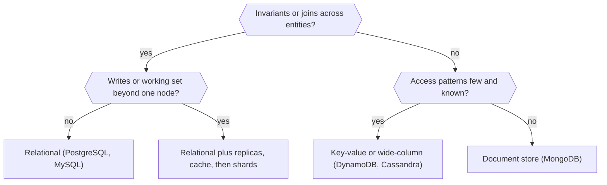

# SQL vs NoSQL

> [!abstract] In one sentence
> "SQL vs NoSQL" is not a technology choice but a choice about which guarantees you want the database to enforce for you (joins, constraints, multi-row [[Transactions]]) versus which you are willing to enforce in application code in exchange for a simpler scale-out path and a data model shaped like your access patterns.

> [!tip] Deeper treatment in your system-design vault
> `system-design/07 NoSQL and Storage Engines/Choosing a Database.md` — read it *after* you have written your own explanation below.

**Map:** [[Databases MOC]] → [[HLD MOC]]

## Definition

A **relational (SQL) database** stores data as normalised tables with a fixed schema, enforces constraints and foreign keys, supports ad-hoc joins, and gives [[ACID]] transactions across rows and tables on a single node. **NoSQL** is an umbrella for stores that give up some of that in exchange for a different model: key-value (Redis, DynamoDB), document (MongoDB), wide-column (Cassandra, HBase, ScyllaDB), graph (Neo4j), and specialised engines such as [[Time-Series Databases]] and [[Search Engines]]. The useful distinction is not the query language but **what the store guarantees and what it makes cheap**: relational stores make correctness and flexible querying cheap; NoSQL stores make a known access pattern cheap at a scale where a single relational node runs out.

## Problem solved

Before the NoSQL wave, every team hit the same wall: a relational database on one machine, [[Horizontal vs Vertical Scaling|scaled vertically]] until the biggest box was not big enough, then sharded by hand with all the joins and constraints broken anyway. Dynamo-style and Bigtable-style systems were built for workloads — shopping carts, user profiles, message histories — where the access pattern was known in advance, the value of a cross-row join was near zero, and availability during partitions mattered more than strict [[Consistency Models|consistency]]. Document stores solved a different pain: schemas that changed weekly and nested data that mapped badly onto normalised tables. Choosing badly in either direction hurts: a relational database forced into a Cassandra-sized write load, or a document store forced to run a ledger with invariants that span documents.

## How it works

The decision is a sequence of questions, in this order, because the earlier ones dominate:

1. **Data shape and invariants.** Do correctness rules span rows or entities ("a transfer debits one account and credits another", "a seat cannot be sold twice")? If yes, you want [[Transactions]], constraints and [[Isolation Levels]] enforced by the store. Relational wins; most NoSQL stores give single-document or single-partition atomicity only (MongoDB has multi-document transactions since 4.0, DynamoDB has `TransactWriteItems` with up to 100 items, but both are bolted on and have sharper edges).
2. **Query patterns.** List every query you will run in the first year. If the list is short, known, and each query is "fetch by key, maybe a range on one dimension", a key-value or wide-column store models it directly with one partition per query ([[Data Modeling|access-pattern-first design]]). If the list is long, unknown, or analytical, you need secondary [[Indexing|indexes]], joins and a planner ([[Query Execution and Optimization]]) — relational, or a relational-plus-warehouse split.
3. **Consistency needs.** Read-your-writes and linearizable updates on a balance point to a single-leader relational store. Tolerating [[Eventual Consistency]] for a feed, a cache, or a profile opens the door to leaderless stores that stay writable during a [[Network Partitions|partition]] ([[CAP Theorem]], [[PACELC]]).
4. **Scale path.** Estimate the write rate, the working set and the growth ([[Back-of-the-Envelope Estimation]]). A single well-tuned PostgreSQL node handles tens of thousands of simple transactions per second and a few terabytes; with [[Read Replicas]] and caching it goes much further. Only when writes or the hot working set cannot fit one box do you need native [[Sharding]] — which Cassandra, DynamoDB and MongoDB give you for free and PostgreSQL gives you only via Citus-like extensions or application-level shards ([[Database Scaling]]).
5. **Operational maturity.** Who runs it? A managed service (RDS, Aurora, DynamoDB, Atlas) changes the answer: DynamoDB with no servers to patch may beat a self-managed Cassandra ring even when Cassandra fits the model better. Count backup, restore, upgrade, failover and on-call experience as first-class inputs.

A compact rule: **start relational unless question 2 or 4 forces you out**; when it does, choose the NoSQL category whose native model matches the dominant query, and keep anything with cross-entity invariants (money, inventory, identity) relational.

```text
Category       Native unit        Great at                       Weak at
key-value      key -> blob        point reads/writes, caching    any query that is not by key
document       JSON document      nested aggregates, schema drift cross-document invariants, joins
wide-column    partition + rows   time-ordered writes at scale   ad-hoc queries, transactions
graph          nodes + edges      multi-hop traversal            bulk analytics, sharding
relational     normalised tables  constraints, joins, ad-hoc SQL horizontal write scaling
```

## Architecture



## Use cases

- "Balances must never go negative and every movement must be reconcilable" → relational with [[ACID]] transactions, regardless of scale ambitions.
- "Every request is: fetch this user's session / cart / profile by id" → key-value or document store, often with [[Redis]] in front or instead.
- "Append millions of events per minute, read them back by device and time range" → wide-column or a [[Time-Series Databases|time-series database]].
- "The product team changes the shape of this object every sprint and it is never queried by its internals" → document store, or a relational table with a JSONB column.
- "Multi-region active-active with writes accepted everywhere" → leaderless or multi-leader NoSQL ([[Replication]]), accepting conflict resolution as a feature you must design.

## Limitations

- The dichotomy hides more than it reveals: PostgreSQL with JSONB covers most "document" needs, and distributed SQL (Spanner, CockroachDB, Aurora) covers much of "scale-out" — the framework is about guarantees and patterns, not product categories.
- NoSQL pushes integrity into application code: every service that writes must know the denormalisation rules, and bugs corrupt data silently rather than failing a constraint.
- Access-pattern-first models are rigid: a new query that was not planned often means a new table or index and a backfill ([[Schema Evolution]] is harder, not easier, when the schema is implicit).
- Polyglot persistence multiplies operational surface: two stores means two backup strategies, two failure modes and two on-call runbooks ([[Operational Simplicity]]).
- Relational stores are not automatically consistent across services: once data is split by service, cross-service invariants need the [[Saga Pattern]] or the [[Outbox Pattern]] either way.

## Trade-offs

| You gain | You sacrifice |
|---|---|
| Relational: constraints, joins and transactions enforced by the engine | A harder horizontal write-scaling story; schema changes need migration discipline |
| NoSQL: a native scale-out path and a model shaped like the hot query | Ad-hoc queries, cross-entity atomicity and a planner that saves you from yourself |
| Managed NoSQL: near-zero operations and elastic capacity | Vendor lock-in, per-request pricing surprises, and limits (item size, partition throughput) |
| Polyglot persistence: the right engine per workload | Two or more systems to keep consistent, secure, backed up and understood |

## Failure modes

- **Relational store asked to absorb firehose writes** → WAL and lock contention, replication lag climbing; you notice as p99 write latency rising with load; blast radius is the whole service because everything shares the one primary.
- **Hot partition in a key-value or wide-column store** (one tenant, one celebrity, one timestamp bucket) → throttling or timeouts on that key while the cluster looks idle ([[Hot Keys]]); blast radius is every request touching that key.
- **Denormalised copies drift** because one writer forgot a rule → inconsistent reads surface as customer tickets weeks later; blast radius is data integrity with no error ever logged.
- **Unplanned query on an access-pattern store** → full scans (`Scan` on DynamoDB, `ALLOW FILTERING` in Cassandra) that burn capacity and time out; you notice as cost spikes and latency cliffs.
- **Eventually consistent read after write** in a flow that assumed strong consistency → "I just saved this and it is gone" bugs that reproduce only under load ([[Read Replicas]]).

## Performance

Point reads by key are fast everywhere (sub-millisecond in-memory, single-digit milliseconds from SSD-backed stores); the difference shows up in the second query. Relational engines pay planning and locking overhead but can answer unanticipated queries with an index; wide-column stores pay nothing per write beyond an append to a log-structured tree, which is why they sustain far higher write throughput per node, but any read that is not by partition key is a cluster-wide scatter. Document stores sit in between: fast whole-aggregate reads, write amplification when a large document is rewritten for a small change.

## Scalability

At 10x reads: relational scales with [[Read Replicas]] and caching; NoSQL scales by adding nodes. At 10x writes: relational hits the single-primary ceiling and must shard, which is the hard rung ([[Sharding]], [[Consistent Hashing]]); leaderless and wide-column stores were designed for this and rebalance automatically. At 10x data: relational stores manage multi-terabyte tables but maintenance (vacuum, index rebuilds, backups) gets slow; partitioned NoSQL spreads the housekeeping too. At 10x team size: an explicit schema and constraints become a coordination mechanism — this is where relational quietly wins.

## Operational impact

Relational stores have decades of tooling: backups, point-in-time recovery, logical replication, EXPLAIN, mature ORMs, and every engineer can read the schema. NoSQL clusters trade that for cluster operations (token ranges, repairs, compactions) unless managed. Debugging data problems in a relational store is a query; in a denormalised store it is a program. Capacity planning differs too: relational scaling is step-wise (bigger instance, more replicas), NoSQL is incremental but needs rebalancing windows ([[Partitioning]]).

## Alternatives

- **Relational with JSONB and extensions** — wins when you want document flexibility for a few columns but keep constraints and joins for the rest.
- **Distributed SQL (Spanner, CockroachDB, YugabyteDB, Aurora)** — wins when you need relational semantics and a managed scale-out path, and can pay in write latency and cost.
- **Relational primary plus purpose-built sidecars** ([[Redis]] for hot keys, a [[Search Engines|search engine]] for text, a [[Data Warehouses|warehouse]] for analytics) fed by [[Change Data Capture]] — wins for most product systems: one source of truth, specialised read models.
- **[[Event Sourcing]] with projections** — wins when the audit trail is the product and read models are many; costs a different mental model.

## Real-world examples

- Discord moved message storage from MongoDB to Cassandra (2017) and then to ScyllaDB (2023) because the dominant query — messages by channel and time — maps to a wide-column partition and the write volume outgrew a single-node model.
- Uber published why it moved its core datastore from PostgreSQL to a MySQL-backed schemaless layer (2016); the reasons were replication and index-update mechanics, not "NoSQL beats SQL" — a reminder that engine internals matter more than category.
- Stripe runs its core data on MongoDB and has written at length about online migrations against it, while enforcing ledger invariants in its application and reconciliation layers — proof that the trade-off can be made deliberately, at a cost.
- In a stack like yours: a payments or ledger service on PostgreSQL (RDS or Aurora) for invariants and reconciliation, [[Redis]] for sessions and hot reads, and MongoDB or DynamoDB for flexible, key-addressed documents such as KYC payloads or notification preferences — with Kafka or [[Change Data Capture]] keeping search and analytics copies fresh.

## Practical exercise

1. Model a small wallet domain — accounts, transfers, ledger entries — twice: normalised in PostgreSQL and as a single-table design in DynamoDB Local (both via Docker Compose).
2. Implement three operations in a small Spring Boot or NestJS service: transfer between two accounts, "last 20 entries for an account", and "all transfers above X today".
3. Load it with k6 at 200 and 2,000 requests per second; record p50/p99 per operation and per store.
4. Inject a bug that skips one side of the double entry and observe how each store reports it (constraint violation vs silent drift); write the reconciliation query for each.
5. Add the fourth query nobody planned ("transfers by counterparty bank") and measure how much work each model needs to support it.

## Related concepts

### Prerequisites
- [[ACID]] — the guarantees relational stores enforce and NoSQL stores relax
- [[Data Modeling]] — the decision is really about how you model the access patterns
- [[Consistency Models]] — what "consistent" means before you compare stores

### Related
- [[Transactions]] and [[Isolation Levels]] — the multi-row correctness that relational engines give for free
- [[BASE]] — the posture most NoSQL stores take
- [[Eventual Consistency]] — the price of leaderless availability
- [[Time-Series Databases]] and [[Search Engines]] — the specialised categories worth their own engine
- [[Redis]] — the key-value store most likely already in your stack

### Builds on this
- [[Database Scaling]] — the ladder you climb once the relational choice is made
- [[Sharding]] — the rung where NoSQL's native scale-out matters
- [[Schema Evolution]] — changing a schema, explicit or implicit, without downtime
- [[CQRS]] — different stores for the write model and the read models

### Design problems where it applies
- [[Design a Payment System]]
- [[Design a Digital Wallet and Ledger]]
- [[Design a Chat System]]
- [[Design a Social Feed]]
- [[Design a Distributed Key-Value Store]]

### Projects where it can be implemented
- [[Double-Entry Ledger Service]]
- [[Mini-KV Store]]
- [[Presence and Chat Service]]

### Resources
- [[Designing Data-Intensive Applications]] — chapters 2 and 3 on data models and storage engines
- [[Discord - How Discord Stores Trillions of Messages]] — a decision driven by one access pattern
- [[Dynamo Paper]] — the design rationale behind the key-value side of the argument
- [[Database Internals]] — storage-engine mechanics that explain the categories

## Personal understanding

> [!question] Explain it without the source
> Write your own explanation here, from memory. Then compare it with the sections above and note what you missed.

### Mastery checklist
- [ ] I can explain it without the original resource
- [ ] I can describe the problem it solves
- [ ] I can compare it with its alternatives
- [ ] I can name its limitations and failure modes
- [ ] I can recognise when it is appropriate in a real system
- [ ] I have applied it in a system design
- [ ] I have validated my assumptions with an experiment or implementation

## Open questions

- [ ] At what measured write rate and working-set size does a single PostgreSQL primary on the instance classes you use actually run out, and which resource goes first?
- [ ] For a document store holding KYC payloads, which invariants currently live only in application code, and what reconciliation would detect a violation?
- [ ] Does a JSONB column in PostgreSQL remove the need for a separate document store in the services you own, and what does it cost in index size and update amplification?
