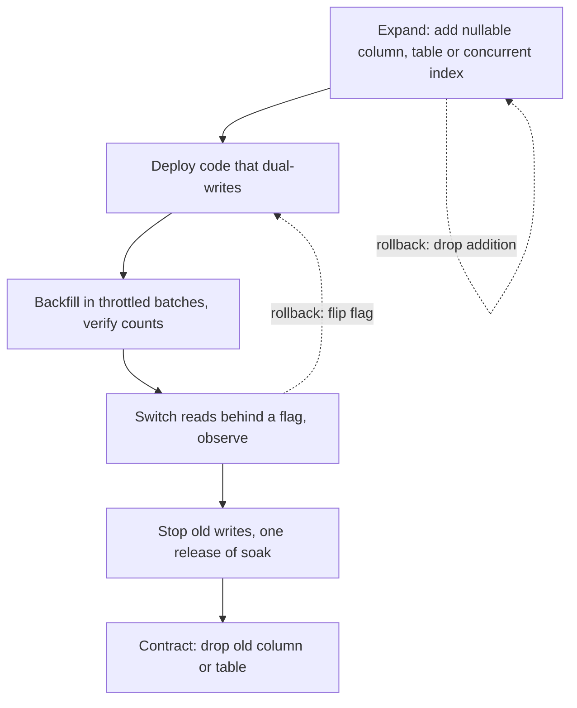

# Schema Evolution

> [!abstract] In one sentence
> Because a rolling deploy means two versions of your code run against one database at the same time, every schema change must be split into steps that are each compatible with both versions — expand, migrate, contract — and each step must respect how the engine locks the table while it works.

> [!tip] Deeper treatment in your system-design vault
> `system-design/13 Observability/Deployment Strategies.md` — read it *after* you have written your own explanation below.

**Map:** [[Databases MOC]] → [[HLD MOC]]

## Definition

**Schema evolution** is changing the structure of a database — columns, types, constraints, indexes, tables — while it continues to serve traffic. The **expand–migrate–contract** pattern (also expand/contract, parallel change) splits any change into an additive step that keeps the old shape working, a data-migration step that fills the new shape (backfill plus dual writes), and a removal step once nothing reads the old shape. **Zero-downtime migration** adds the engine-level discipline: knowing which DDL statements take which locks for how long, and sequencing them so no statement blocks traffic for longer than a timeout.

## Problem solved

Two things break naive migrations. First, deployment is not atomic: during a rolling update on Kubernetes, pods running version N and N+1 coexist for minutes, and a change that drops or renames a column breaks whichever version does not expect it; a rollback of the code after a destructive migration is impossible. Second, DDL locks: `ALTER TABLE` in PostgreSQL takes an `ACCESS EXCLUSIVE` lock that waits behind any running query on the table and, while waiting, blocks every new query — a one-line migration behind a thirty-second report becomes a thirty-second outage of the whole service. In a stack like yours, with payment tables that cannot pause and Flyway or TypeORM migrations running at deploy time, both failure modes are one careless migration away.

## How it works

1. **Expand.** Add the new structure without touching the old: a new nullable column, a new table, a new index built concurrently. Old code ignores it; new code can start writing it. Deploy this before any code depends on it.
2. **Migrate.** Deploy code that **dual-writes** old and new shapes (or writes new and derives old), then **backfill** existing rows in batches — thousands of rows per statement, short transactions, sleeps between batches, throttled by replication lag — never one `UPDATE table SET new = old` over a hundred million rows. Verify with counts and checksums. Then switch **reads** to the new shape behind a flag ([[Feature Flags]]), watch, and keep the dual write until you are sure.
3. **Contract.** Stop writing the old shape, wait until no deployed version reads it, then drop it — ideally one release later, so a rollback of the previous release still works. Renames are therefore never a single step: add new, migrate, drop old.
4. **Locking rules (PostgreSQL).** `ADD COLUMN` with a constant default is metadata-only since version 11 (instant); adding `NOT NULL` to an existing column scans the table under `ACCESS EXCLUSIVE` unless a valid `CHECK (col IS NOT NULL)` constraint already exists (then it is instant in 12+); `ALTER COLUMN TYPE` rewrites the table except for binary-compatible changes (`varchar(50)` to `varchar(100)`, `varchar` to `text`); `CREATE INDEX` blocks writes — use `CONCURRENTLY`, which cannot run inside a transaction and leaves an `INVALID` index if interrupted; foreign keys and checks go on as `NOT VALID` (brief lock) then `VALIDATE CONSTRAINT` (weak lock, full scan). Always set `lock_timeout` (a couple of seconds) on the migration session and retry, so a blocked `ALTER` fails fast instead of queueing the service behind it.
5. **Locking rules (MySQL).** InnoDB online DDL: `ALGORITHM=INSTANT` for adding columns (8.0.12+), `INPLACE` for many index and column operations with concurrent DML, `COPY` as the slow fallback; brief metadata locks at the start and end can still queue behind long transactions. Large tables at scale use gh-ost or `pt-online-schema-change`, which copy to a shadow table and swap.
6. **Tooling and discipline.** Versioned, forward-only migrations in the repository (Flyway, Liquibase, TypeORM or Prisma migrations), applied before the new code rolls out, each small and idempotent where possible; a linter or review checklist for dangerous statements; `EXPLAIN`-level attention for backfills ([[Query Execution and Optimization]]); and a dry run against a production-sized copy to measure duration and lock behaviour.
7. **Rollback paths.** Expand steps roll back by dropping what was added; migrate steps roll back by flipping the read flag; contract steps do not roll back — which is why they come last and late. Application code must tolerate both shapes for the overlap, which is a [[Backward Compatibility]] contract between code and schema, the same discipline as [[Event Schema Evolution]] for messages.

```sql
-- Split a single "amount numeric" into integer minor units + currency, without downtime
-- 1 Expand (instant): nullable columns, no default needed
ALTER TABLE payments ADD COLUMN amount_minor bigint, ADD COLUMN currency char(3);
-- 2 Migrate: deploy dual-writing code, then backfill in batches
UPDATE payments SET amount_minor = round(amount * 100)::bigint, currency = 'INR'
WHERE id BETWEEN 1 AND 5000 AND amount_minor IS NULL;      -- loop over id ranges, sleep between
-- then constrain without a long lock
ALTER TABLE payments ADD CONSTRAINT payments_amount_minor_nn CHECK (amount_minor IS NOT NULL) NOT VALID;
ALTER TABLE payments VALIDATE CONSTRAINT payments_amount_minor_nn;
-- 3 Contract (a release later, after reads and writes moved): 
ALTER TABLE payments DROP COLUMN amount;
```

## Architecture



## Use cases

- "Rename a column / change a type / split a column" on any table that takes traffic — always expand–migrate–contract, never a single `ALTER`.
- "Add an index to a large production table" — `CONCURRENTLY`, with `lock_timeout`, outside the deploy's transaction.
- "Move a table to another service's database" — the same pattern with the new service as the dual-write target ([[Strangler Pattern]]).
- "Backfill a new column for a hundred million rows" — batches, throttled by replication lag, resumable from a checkpoint.
- "Reshard or change the partition key" — expand to the new layout, dual-write, backfill, cut over ([[Sharding]]).

## Limitations

- The pattern multiplies steps and releases: a rename becomes three deploys over days or weeks, which teams under pressure are tempted to skip.
- Dual writes are a mini dual-write problem of their own: a crash between the two writes leaves rows inconsistent until the backfill or a reconciliation pass fixes them.
- Some changes have no instant path on some engines (type changes that rewrite, primary-key changes) and need a shadow-table copy or a maintenance window.
- Backfills compete with production for I/O and generate WAL that replicas must apply; throttling slows them to hours or days.
- Managed-service constraints (Aurora, RDS) and ORM migration tools can hide lock behaviour; the engine's rules still apply.

## Trade-offs

| You gain | You sacrifice |
|---|---|
| Schema changes with no downtime and a rollback path at every step but the last | Several releases per change and code that tolerates two shapes for a while |
| Lock-aware DDL that never queues the service behind a migration | The need to know each engine's lock table and to test on production-sized data |
| Backfills that are resumable and invisible to users | Throughput: batches with sleeps take hours where one statement would take minutes |
| A migration history in version control, reviewable and reproducible | Discipline: forward-only migrations, no manual DDL, no "quick fix" in production |

## Failure modes

- **Lock queue outage** — an `ALTER TABLE` waits behind a long query and every new query waits behind the `ALTER` → the service freezes for the duration; you notice as a sudden latency cliff exactly at deploy time; blast radius is every endpoint touching that table ([[Transactions]]).
- **Destructive migration before code has moved** (drop or rename in one step) → version N pods crash on missing column during the rolling deploy; you notice from a 500 storm that a code rollback cannot fix; blast radius is the whole service until the column is restored.
- **Full-table backfill in one transaction** → hours of lock holding, WAL explosion, replication lag in minutes, vacuum debt for days; blast radius is the primary and every replica ([[Replication]]).
- **Dual-write gap** → rows with the old shape filled and the new one null after the backfill finished; you notice from null-constraint failures when contracting; blast radius is the rows written in the gap, fixed by re-running the backfill with a watermark.
- **Interrupted `CREATE INDEX CONCURRENTLY`** → an `INVALID` index that costs writes and serves no reads; you notice from `pg_index.indisvalid = false`; blast radius is write amplification until it is dropped and rebuilt.

## Performance

Metadata-only DDL (adding a nullable or constant-default column in PostgreSQL 11+, `INSTANT` in MySQL 8) takes milliseconds regardless of table size. Concurrent index builds run at scan-plus-sort speed, hours for very large tables, with modest I/O impact. Batched backfills are bounded by the throttle you choose; a common target is to keep replication lag under a second and primary I/O under a set ceiling, which on a billion-row table means days. Table rewrites (type changes) double the storage temporarily and run under exclusive locks — the thing to design around rather than to run.

## Scalability

At 10x data, every step scales except the ones that touch every row: backfills and rewrites become multi-day projects with checkpoints and resumption, and shadow-table tools become mandatory for MySQL. At 10x services sharing a schema (which should not happen — [[Data Ownership and Lifecycle]]), the overlap window stretches because every consumer must move. At 10x team size, migration safety must be automated: linting of dangerous DDL in CI, mandatory `lock_timeout`, and a migration runner that refuses non-concurrent index builds.

## Operational impact

High discipline, low drama when done right. Migrations run as a separate step before rollout (a Kubernetes job or an init container with leader election so only one runs), with timeouts, logging of lock waits, and a documented rollback per step. Monitor long-running migrations, replication lag during backfills and invalid indexes afterwards. Rehearse on a production-sized restore ([[Backups and Restoration]]) for anything touching a large table. Keep a changelog of schema versions per environment; drift between environments is a classic source of "works in staging".

## Alternatives

- **Maintenance window** — wins for small systems or genuinely offline products where an hour of downtime costs less than three releases of ceremony.
- **Shadow-table tools (gh-ost, pt-online-schema-change)** — win on MySQL for changes that are not `INSTANT` or `INPLACE`; they do expand–migrate–contract for you at the table level.
- **Schemaless or JSONB attributes for volatile fields** — win when the attribute set changes weekly and is rarely queried; evolution becomes a code concern ([[Data Modeling]]).
- **New table plus [[Change Data Capture]] into it** — wins when the dual write is better done by the database log than by application code, especially across services.

## Real-world examples

- Stripe's "Online migrations at scale" describes the four-phase approach (dual-write, change reads, change writes, remove old) used to migrate core data models without downtime.
- GitHub built gh-ost to run MySQL schema changes on very large tables without the trigger overhead of earlier tools; its design notes are a tour of why online DDL is hard.
- PostgreSQL's `ALTER TABLE` documentation and its release notes for versions 11 and 12 define which operations are instant and which rewrite or scan — the reference for the lock rules above.
- In a stack like yours: a Flyway migration on a payments table that adds `amount_minor` and `currency` as nullable columns, a NestJS or Spring release that dual-writes behind a flag, a batched backfill job on EKS that throttles on Aurora `ReplicaLag`, a release that reads the new columns, and a drop one sprint later — with `lock_timeout = '2s'` and a retry loop on every DDL statement.

## Practical exercise

1. Docker PostgreSQL with a 20-million-row `payments` table and a small Spring Boot or NestJS service under constant k6 load; add a streaming replica to observe lag.
2. Run `ALTER TABLE payments ADD COLUMN amount_minor bigint NOT NULL DEFAULT 0` while a 60-second `SELECT` holds the table; watch every request freeze; repeat with `lock_timeout = '2s'` and observe the fast failure.
3. Execute the three-phase split from the SQL above: measure the duration and lag impact of a single-statement backfill versus batches of 5,000 rows with 50 ms sleeps.
4. Build an index with and without `CONCURRENTLY` under load; kill the concurrent build halfway and find the invalid index in `pg_index`.
5. Deploy a version that drops the old column while an old pod is still running; record the error, then redo it as a contract step one release later.
6. Stretch: repeat step 2 on MySQL 8 and compare `INSTANT`, `INPLACE` and `COPY` behaviour.

## Related concepts

### Prerequisites
- [[Data Modeling]] — what is being evolved, and why some changes are structural
- [[Relational Database Internals]] — why DDL locks and table rewrites cost what they cost
- [[Deployment and Rollback Strategies]] — the rolling deploy that makes two versions coexist

### Related
- [[Versioning and Migrations]] — the application-side half of the same change
- [[Backward Compatibility]] — the contract that lets code and schema version independently
- [[Event Schema Evolution]] — the same expand–contract discipline for messages
- [[Feature Flags]] — switching reads and writes between shapes safely
- [[Indexing]] — concurrent index builds and the invalid-index trap

### Builds on this
- [[Strangler Pattern]] — moving data between systems is a long-running migration
- [[Sharding]] — resharding is schema evolution of data location
- [[Incremental Delivery]] — each migration step is a small, reversible release

### Design problems where it applies
- [[Design a Payment System]]
- [[Design a Digital Wallet and Ledger]]
- [[Design an IAM Service]]
- [[Design an Inventory Management System]]

### Projects where it can be implemented
- [[Double-Entry Ledger Service]]
- [[Durable Job Scheduler]]

### Resources
- [[Stripe - Online Migrations at Scale]] — the four-phase migration playbook from a payments company
- [[Designing Data-Intensive Applications]] — chapter 4 on schema evolution and compatibility
- [[Stripe - API Versioning]] — the API-side counterpart of keeping two shapes alive

## Personal understanding

> [!question] Explain it without the source
> Write your own explanation here, from memory. Then compare it with the sections above and note what you missed.

### Mastery checklist
- [ ] I can explain it without the original resource
- [ ] I can describe the problem it solves
- [ ] I can compare it with its alternatives
- [ ] I can name its limitations and failure modes
- [ ] I can recognise when it is appropriate in a real system
- [ ] I have applied it in a system design
- [ ] I have validated my assumptions with an experiment or implementation

## Open questions

- [ ] Does your migration runner set `lock_timeout` and retry, and when did a migration last block production traffic for longer than a second?
- [ ] For the largest table you own, how long would a concurrent index build and a full backfill take on your instance class, and has anyone measured it on a restore?
- [ ] Which migrations in your repository's history were destructive in a single step, and would a code rollback have worked at the time?
