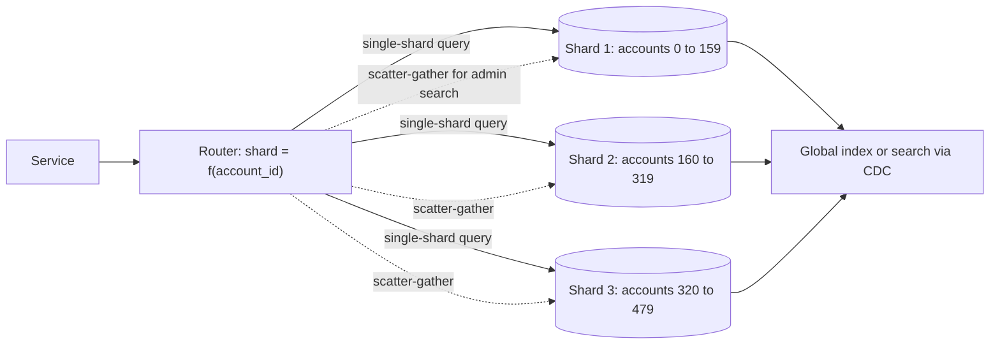

# Sharding

> [!abstract] In one sentence
> Sharding is the decision to run N databases instead of one, each owning the rows for a slice of the key space — the only way past a single node's write and storage ceiling, and the step that permanently converts every cross-shard query, transaction and migration into a distributed-systems problem.

> [!tip] Deeper treatment in your system-design vault
> `system-design/06 Replication and Sharding/Sharding.md` — read it *after* you have written your own explanation below.

**Map:** [[Databases MOC]] → [[HLD MOC]]

## Definition

**Sharding** (horizontal partitioning across machines) divides a table's rows among multiple independent database instances — **shards** — according to a **shard key** derived from each row. Every shard holds the full schema for its subset of rows and handles reads and writes for them alone. A routing layer (library, proxy or the database's own router) maps a key to a shard. Unlike [[Replication]], which copies the same data to many nodes, sharding puts *different* data on each node; unlike [[Partitioning]] within one node, the partitions do not share a buffer pool, a transaction manager or a query planner.

## Problem solved

A single primary has a ceiling: one machine's CPU for writes, one WAL device, one buffer pool, one disk. Replicas scale reads but every write still lands on the leader ([[Read Replicas]]). Scaling up reaches the largest instance class and then stops. Sharding removes the ceiling by making N primaries, each with 1/N of the write load and data — the price being that the database no longer sees the whole dataset. It is the last rung of the [[Database Scaling]] ladder because every earlier rung (indexes, cache, replicas, bigger box, split by service) keeps the single-database programming model, and sharding does not.

## How it works

1. **Choose the shard key.** It must be present on every hot query (otherwise every query fans out to all shards), have high cardinality and even distribution (otherwise one shard is hot), be immutable (moving a row between shards is a distributed transaction), and keep rows that are transacted together on the same shard. For a ledger, `account_id` or `tenant_id` keeps an account's entries, holds and balance together; a transfer between two accounts on different shards is then the cross-shard case you must design for.
2. **Map key to shard.** *Hash*: `shard = hash(key) mod N` or, better, [[Consistent Hashing]] or a fixed set of many logical shards mapped to fewer physical nodes (Notion's 480 logical → 32 physical, Instagram's thousands of PostgreSQL schemas) so resharding moves whole logical shards instead of rehashing. *Range*: contiguous key ranges per shard; preserves range scans and locality, invites hot ranges (today's timestamps all land on one shard). *Directory*: a lookup table from key (or tenant) to shard; most flexible, one more service on the critical path.
3. **Route.** Application-level (a library computes the shard from the key and picks the datasource), middleware (Vitess's VTGate, Citus coordinator, ShardingSphere, MongoDB's `mongos`), or native (Cassandra, DynamoDB, CockroachDB distribute transparently — with their own data-model constraints).
4. **Cross-shard reads.** Scatter-gather: send the query to every shard, merge, sort and paginate in the router. Latency is the slowest shard ([[Fan-Out]], tail latency), cost is N times the work. Design the model so hot paths are single-shard and scatter-gather is reserved for admin and analytics, or maintain a global secondary index asynchronously (DynamoDB GSIs, a search index fed by CDC).
5. **Cross-shard writes.** No local transaction covers two shards. Options: [[Distributed Transactions]] (2PC, which Vitess and Spanner implement internally and which is slow and blocking), the [[Saga Pattern]] with compensations, or modelling so the invariant lives on one shard (move money as two single-shard legs with an idempotent transfer record and reconciliation — the inter-bank model).
6. **Unique IDs.** Auto-increment per shard collides; use [[Distributed ID Generation]] (UUIDv7, Snowflake-style ids, or per-shard ranges with the shard id embedded).
7. **Resharding.** Adding shards means moving data without downtime: dual-write to old and new shard, backfill in batches, verify counts and checksums, flip reads, flip writes, drop the old copy — the [[Schema Evolution|expand–migrate–contract]] pattern applied to location. Pre-splitting into many logical shards makes this a move of whole units rather than a rehash of every row.

```java
// Application-level routing with many logical shards over few physical databases
int logical = Math.floorMod(Hashing.murmur3_32().hashLong(accountId).asInt(), 480);
DataSource ds = physicalFor(logical);                 // 480 logical -> 8 physical today, 16 tomorrow
// Every hot query carries account_id so it resolves to exactly one shard:
//   SELECT ... FROM ledger_entries WHERE account_id = ? ORDER BY created_at DESC LIMIT 20
// Cross-shard: transfer between accounts on different shards = two local legs + a saga record.
```

## Architecture



## Use cases

- "Writes per second exceed what one primary can fsync, or data exceeds what one instance can hold with the hot set in memory" — and the earlier rungs are exhausted, measured, not assumed.
- "Tenants must be isolated for noisy-neighbour, compliance or data-residency reasons" — tenant-keyed shards (or one database per large tenant) give isolation as well as scale ([[Bulkheads]]).
- "A single hot table dominates everything" (messages, events, ledger entries) while the rest of the schema is small — shard that table or that service, not the whole system.
- "Regional data must stay in region" — geography as the shard key, with a directory.
- "Our managed NoSQL store already shards" — DynamoDB and Cassandra make you choose a partition key up front; the same reasoning applies even though you never see the shards.

## Limitations

- Joins, aggregates, uniqueness constraints and foreign keys stop working across shards; the application or a middleware re-implements them, usually worse.
- The shard key is nearly impossible to change later; a wrong choice is a full re-migration.
- Operational surface multiplies: N databases to back up, upgrade, migrate, monitor and fail over, and schema changes must roll across all of them in a compatible order.
- Hot shards (a celebrity, a huge tenant, a time-based range) defeat the even-split assumption and need splitting or special-casing ([[Hot Keys]]).
- Sharding a relational database by hand is a multi-quarter project; the managed alternatives (Vitess, Citus, Aurora Limitless, distributed SQL) move the complexity, they do not remove it.

## Trade-offs

| You gain | You sacrifice |
|---|---|
| Write throughput and storage that grow by adding nodes | Cross-shard transactions and joins, and the single-database mental model |
| Smaller indexes and working sets per node, so each shard stays fast | A routing layer on every query and a shard key on every hot path |
| Fault and tenant isolation: one shard's failure or load does not take the rest down | N times the operational work and a resharding project every time growth outruns the plan |
| Freedom from the largest-instance ceiling | Global uniqueness, global ordering and global reporting become separate systems |

## Failure modes

- **Hot shard** — one tenant or key range receives most traffic → that shard's latency and CPU climb while the fleet averages look healthy; you notice only with per-shard metrics; blast radius is every tenant co-located on that shard.
- **Cross-shard transaction half-applied** — a transfer's debit committed on shard A, the credit failed on shard B, and no saga or reconciliation exists → money in flight forever; you notice from reconciliation differences; blast radius is customer balances ([[Saga Pattern]]).
- **Routing table drift** during resharding — some instances route a key to the old shard, some to the new → writes split across two copies; you notice from missing rows that "exist" on the other shard; blast radius is every key in the moving range.
- **Schema migration applied to some shards** → requests succeed or fail depending on which shard a user lands on; you notice from error rates correlated with key ranges; blast radius is partial, confusing, and long-lived if nobody tracks per-shard schema versions.
- **Scatter-gather on the hot path** sneaks in (a search box, a "recent activity" feed without a shard key) → every request touches every shard, latency is the slowest shard, and adding shards makes it *worse*; blast radius is the whole fleet's capacity.

## Performance

Single-shard queries perform like a small database: smaller indexes, warmer caches, less lock contention than the monolithic equivalent. Routing adds microseconds in-process or a network hop through a proxy. Scatter-gather costs N queries and waits for the slowest; p99 degrades with shard count unless the router hedges or the fan-out is kept off the hot path ([[The Tail at Scale]] is the reference). Cross-shard writes via 2PC cost several round trips and hold locks across them; via sagas they cost asynchronous steps and visible intermediate states. Resharding is bounded by the backfill rate you can sustain without hurting the live shards.

## Scalability

Capacity scales linearly with shard count for single-shard workloads, which is the point. The limits are elsewhere: scatter-gather work grows with N, hot shards do not split themselves, and operational effort grows with N unless automated. Many logical shards over few physical nodes gives headroom for growth of 10x without rehashing. At 100x, teams typically move to a system that shards natively (Vitess, CockroachDB, DynamoDB) rather than maintaining a hand-built router and resharding tooling.

## Operational impact

High. Every runbook — backup, restore, failover, upgrade, migration, index build, capacity change — now runs N times with coordination; per-shard dashboards and alerts are mandatory; schema version per shard must be tracked; resharding needs tooling, rehearsal and verification. Debugging a customer issue starts with "which shard?". Middleware such as Vitess absorbs much of this but is itself a system to operate. The honest guidance is to delay sharding as long as the earlier rungs hold, and when you do shard, shard the one table or service that needs it.

## Alternatives

- **Scale up and tune** — wins far longer than people expect; a well-indexed PostgreSQL on a large instance with the hot set in memory serves tens of thousands of transactions per second ([[Database Scaling]]).
- **Split by function / service** — wins when the load is spread over several large tables owned by different domains; each service gets its own database, no cross-shard logic inside any of them ([[Microservices]]).
- **Natively distributed stores** (DynamoDB, Cassandra, CockroachDB, Spanner) — win when you need sharding on day one and can accept their data-model constraints or cost.
- **Archive and tier** — wins when the data, not the write rate, is the problem: move cold rows out and the hot database shrinks ([[Data Retention and Archival]]).

## Real-world examples

- Instagram's 2012 write-up on sharding PostgreSQL into thousands of logical shards (schemas) across a few physical servers, with ids embedding the shard, remains the clearest description of the logical-over-physical approach.
- Notion's 2021 and 2023 posts describe sharding its PostgreSQL monolith by workspace into 480 logical shards over 32 physical instances, and later resharding — including dual writes, backfill and verification.
- Vitess (born at YouTube, used by Slack and GitHub among others) and Citus are the two widely used middleware answers for MySQL and PostgreSQL respectively.
- In a stack like yours: a ledger sharded by `account_id` across several Aurora clusters with 480 logical shards, a Kafka topic partitioned by the same key so each consumer owns whole shards, transfers between shards executed as two idempotent legs with a transfer record and a nightly reconciliation — and a strong preference not to do any of this until the single cluster is measurably out of road.

## Practical exercise

1. Docker Compose with three PostgreSQL instances; implement a routing layer in a Spring Boot or NestJS service with 48 logical shards hashed by `account_id` mapped onto the three databases.
2. Load 3 million ledger entries; benchmark "latest 20 entries for an account" (single-shard) versus "all entries above 1,000,000 minor units today" (scatter-gather) with k6; compare p50/p99 and watch how the fan-out query scales as you add a fourth instance.
3. Implement a cross-shard transfer as two local legs plus a transfer record; kill the service between legs and write the reconciliation job that finds and completes it.
4. Reshard: move 16 logical shards to the new fourth instance with dual-write, batched backfill and checksum verification, under load, and measure error rate during the cut-over.
5. Make one account receive 50 % of the traffic and observe per-shard metrics versus fleet averages.

## Related concepts

### Prerequisites
- [[Partitioning]] — the general idea; sharding is partitioning across nodes
- [[Data Modeling]] — the shard key is a modelling decision before it is an infrastructure one
- [[Replication]] — each shard is itself a replicated group
- [[Database Scaling]] — the ladder whose last rung this is; climb the cheaper rungs first

### Related
- [[Consistent Hashing]] — one way to map keys to shards with cheap rebalancing
- [[Distributed Transactions]] — what a cross-shard write needs if it must be atomic
- [[Hot Keys]] — the hot-shard problem by another name
- [[Distributed ID Generation]] — unique ids without a single sequence
- [[Schema Evolution]] — migrations that must roll across N databases

### Builds on this
- [[Topic Partitions]] — Kafka's partitions are a sharded log keyed the same way
- [[Distributed Caching]] — a cache cluster is sharded by the same mechanisms

### Design problems where it applies
- [[Design a Distributed Key-Value Store]]
- [[Design a Chat System]]
- [[Design a Social Feed]]
- [[Design a Payment System]]
- [[Design a URL Shortener]]

### Projects where it can be implemented
- [[Mini-KV Store]]
- [[Double-Entry Ledger Service]]

### Resources
- [[Designing Data-Intensive Applications]] — chapter 6 on partitioning, rebalancing and request routing
- [[Discord - How Discord Stores Trillions of Messages]] — choosing a partition key for a hot, time-ordered table
- [[Database Internals]] — distributed storage and partitioning in part II

## Personal understanding

> [!question] Explain it without the source
> Write your own explanation here, from memory. Then compare it with the sections above and note what you missed.

### Mastery checklist
- [ ] I can explain it without the original resource
- [ ] I can describe the problem it solves
- [ ] I can compare it with its alternatives
- [ ] I can name its limitations and failure modes
- [ ] I can recognise when it is appropriate in a real system
- [ ] I have applied it in a system design
- [ ] I have validated my assumptions with an experiment or implementation

## Open questions

- [ ] For the ledger or payments tables you know, which queries would be single-shard under `account_id` and which would fan out, and could the fan-out ones move to a CDC-fed search index?
- [ ] What is the measured write ceiling of your current primary (transactions per second at the fsync limit), and how many years of growth does that buy before sharding is forced?
- [ ] If a transfer between two shards fails after the first leg, what would the reconciliation job detect it with, and how long would money be invisible?
