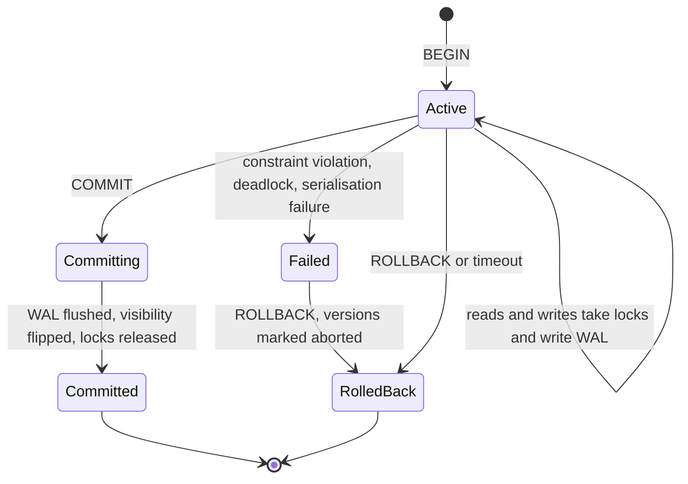

# Transactions

> [!abstract] In one sentence
> A transaction lets you make several changes as if they were one — committed together or not at all, invisible to others until commit — which is the only reason "debit one account and credit another" can be correct under concurrency and crashes, provided you keep it short, retry it on the right errors, and never hold it open across a network call.

> [!tip] Deeper treatment in your system-design vault
> `system-design/05 Relational Databases/ACID Transactions.md` — read it *after* you have written your own explanation below.

**Map:** [[Databases MOC]] → [[HLD MOC]]

## Definition

A **transaction** is a sequence of statements between `BEGIN` and `COMMIT` (or `ROLLBACK`) that the database executes as one unit of work with the [[ACID]] properties: all of its writes become durable together or none do (atomicity), constraints hold at the end (consistency), concurrent transactions do not see each other's intermediate state to the degree the [[Isolation Levels|isolation level]] specifies, and once committed the changes survive crashes (durability). The engine implements this with the write-ahead log for atomicity and durability, MVCC snapshots for isolation, and row locks that are held until the transaction ends ([[Relational Database Internals]]).

## Problem solved

Before transactional engines, every multi-step update had to handle its own partial failure: a transfer that debited one account and crashed before crediting the other left money missing, and the application had to detect and repair it. Concurrency made it worse — two clerks reading the same balance and both subtracting from it produced a lost update. Transactions move both problems into the engine: the application writes the happy path and the database guarantees that a crash, a constraint violation or a conflicting writer leaves the data as if the transaction never started. In a stack like yours, this is the mechanism that makes a double-entry posting — two or more ledger rows, a balance update, an outbox row — atomic, which no amount of careful application code can achieve on its own.

## How it works

1. **Begin.** The session gets a transaction id and, at `REPEATABLE READ` or above, a snapshot; at `READ COMMITTED` each statement takes its own snapshot.
2. **Writes.** Each `INSERT`/`UPDATE`/`DELETE` writes a WAL record and a new row version stamped with the transaction id, and takes a row-level write lock that other writers of the same row will wait on. Readers never wait on writers (MVCC). Uniqueness and foreign-key checks run per statement (or at commit if the constraint is `DEFERRABLE INITIALLY DEFERRED`).
3. **Commit.** The commit record is appended and the WAL is flushed to disk; the transaction id is marked committed, which flips the visibility of all its row versions at once; locks are released. The latency of commit is the WAL fsync.
4. **Rollback.** Nothing is undone physically in PostgreSQL — the versions are simply marked aborted and become garbage for vacuum; InnoDB applies the undo log. Both are fast.
5. **Savepoints.** `SAVEPOINT s; … ROLLBACK TO s;` roll back part of a transaction, which is how frameworks implement nested transactions and how you can retry one statement without abandoning the whole unit.
6. **Scope in services.** Spring's `@Transactional` wraps a method in a proxy: begin before, commit after, rollback on an unchecked exception (checked exceptions do *not* roll back unless `rollbackFor` says so), and self-invocation bypasses the proxy entirely. NestJS with TypeORM uses `dataSource.transaction(async (manager) => { … })` or an explicit `QueryRunner`; forgetting to use the transactional `manager` for one repository call silently runs it outside the transaction. In both stacks the rule is the same: the transaction boundary should wrap only database work.
7. **Retrying safely.** Two error classes are *meant* to be retried: serialisation failures (`40001`) under `REPEATABLE READ`/`SERIALIZABLE` and deadlocks (`40P01`). Retry the whole transaction, not the failing statement, with a small cap and jitter ([[Retry Strategies]]). Everything the transaction does must be safe to redo, which is easy if it only touches the database and hard if it also sent an email — the reason side effects belong in an [[Outbox Pattern|outbox]] row inside the transaction and not in the method body.

```java
@Transactional(isolation = Isolation.REPEATABLE_READ)
@Retryable(retryFor = {CannotSerializeTransactionException.class, DeadlockLoserDataAccessException.class},
           maxAttempts = 3, backoff = @Backoff(delay = 20, multiplier = 2, random = true))
public void transfer(long from, long to, long amountMinor, UUID idempotencyKey) {
    if (transfers.existsByIdempotencyKey(idempotencyKey)) return;        // safe to re-run
    accounts.debit(from, amountMinor);                                     // UPDATE ... WHERE balance >= ?
    accounts.credit(to, amountMinor);
    ledger.post(from, to, amountMinor);                                    // two entries, sum = 0
    outbox.save(new TransferCompleted(idempotencyKey, from, to, amountMinor));
}   // commit here: all rows or none; the Kafka publish happens later from the outbox
```

Set `statement_timeout`, `lock_timeout` and `idle_in_transaction_session_timeout` at the role or pool level so a stuck client cannot hold locks and the xmin horizon for hours.

## Architecture



> [!example]- Excalidraw version — the same diagram as an editable canvas
> ![[Transactions.excalidraw]]
> [[Transactions.excalidraw|Open in Excalidraw]] — needs the Excalidraw plugin (see [[Plugins to Install]]).


## Use cases

- "Both of these must happen or neither" inside one database — transfers, order plus order lines, state change plus outbox row.
- "Invariants across rows" — a balance that must not go negative, a seat that cannot be sold twice; the check and the write must be in one transaction with the right lock or isolation ([[Optimistic and Pessimistic Locking]]).
- "Enforce exactly-once effects for a retried request" — an idempotency-key row inserted in the same transaction as the effect ([[Idempotency]]).
- "Make a multi-table migration step atomic" — DDL in PostgreSQL is transactional, so a migration can be all-or-nothing ([[Schema Evolution]]).
- "Read a consistent picture of several tables" — a report under `REPEATABLE READ` sees one snapshot rather than a moving target.

## Limitations

- A transaction is local to one database: once data spans services or shards, you need [[Distributed Transactions]], the [[Saga Pattern]] or idempotent retries — atomicity does not stretch over a network for free.
- Long transactions are poison: they hold locks, block vacuum from cleaning dead tuples cluster-wide, inflate replication conflicts and multiply the chance of deadlocks.
- Isolation below `SERIALIZABLE` permits anomalies (lost updates, write skew) that the transaction boundary alone does not prevent ([[Isolation Levels]]).
- External side effects (HTTP calls, queue publishes, emails) are not rolled back, and a retry repeats them.
- Transactions on stores without multi-row atomicity (older MongoDB, DynamoDB beyond `TransactWriteItems` limits, Redis beyond `MULTI`/Lua) are weaker than the word suggests.

## Trade-offs

| You gain | You sacrifice |
|---|---|
| All-or-nothing multi-row changes with no application-level repair code | Locks held until commit, so throughput falls as transactions lengthen |
| Crash safety from the WAL for every committed unit | Commit latency equal to a WAL fsync on every unit, however small |
| Concurrency anomalies prevented by the engine at the chosen isolation level | Serialisation failures and deadlocks that the application must detect and retry |
| A clean boundary for idempotency and outbox rows | Discipline about scope: no network calls, no user think-time inside the boundary |

## Failure modes

- **Transaction held open across an HTTP call or queue publish** → locks held for the remote call's latency; you notice from lock waits spiking whenever a downstream slows; blast radius is every writer of those rows and, via the pool, every request ([[Timeouts and Retries]]).
- **Idle-in-transaction session** (client crashed mid-transaction, or an ORM opened one lazily) → locks never released, vacuum stalls; you notice from `pg_stat_activity` showing `idle in transaction` for minutes; blast radius grows with time until the session is killed.
- **Deadlock** between two transactions locking the same rows in opposite order → one is aborted after `deadlock_timeout` (1 s) with `40P01`; you notice from deadlock counts in logs; blast radius is latency plus retries, and if nobody retries, failed transfers.
- **Rollback that did not happen** (checked exception swallowed in Spring, repository call outside the TypeORM manager) → partial writes committed; you notice weeks later as reconciliation differences; blast radius is data integrity.
- **Retry without idempotency** after a commit whose acknowledgement was lost → the transfer is applied twice; blast radius is money, which is why idempotency keys live inside the transaction ([[Duplicate Message Processing]]).

## Performance

Commit cost is one WAL fsync, typically 0.5–5 ms on cloud block storage, shared across concurrent commits by group commit, so throughput scales with concurrency until the WAL device saturates. Per-statement overhead inside a transaction is small; what hurts is lock wait time, which is a function of transaction length times contention on the same rows. Batching many small writes into one transaction raises throughput by an order of magnitude because the fsync is paid once — but lengthens lock hold time, so batches of hundreds, not millions. Row-level locks and MVCC versions cost memory and vacuum work proportional to write volume.

## Scalability

Within one node, transactional throughput scales to tens of thousands per second if transactions are short and touch few rows; it collapses when many transactions contend for the same few rows (one hot account, one counter row), which no hardware fixes — the answer is to redesign the hot row ([[Hot Keys]], sharded counters, append-only entries with a derived balance). Across nodes, transactions do not scale at all without a coordination protocol, which is why systems shard by aggregate so that each transaction stays on one shard ([[Sharding]]).

## Operational impact

Set session timeouts at the pool and role level, monitor `idle in transaction` counts, lock waits, deadlock rate and the age of the oldest transaction (xmin horizon). Make retry-on-`40001`/`40P01` a library concern, not something every developer remembers. Keep transaction boundaries visible in code review: a `@Transactional` method that calls an HTTP client is a defect. Debugging is good — the database can tell you exactly who holds which lock (`pg_locks` joined to `pg_stat_activity`) — but only if someone looks before killing the session.

## Alternatives

- **Single-statement atomicity** (`UPDATE … WHERE balance >= ?` with a row count check) — wins when one conditional statement expresses the invariant; no explicit transaction, no retries.
- **[[Saga Pattern]]** — wins when the steps span services; compensations replace rollback, at the cost of intermediate states being visible.
- **[[Event Sourcing]]** — wins when the append of one event is the only write per command; atomicity is trivial because there is one row.
- **[[Distributed Locks]] plus idempotent steps** — wins for coordination across processes where the data store offers no transactions; weaker guarantees and more moving parts.

## Real-world examples

- PostgreSQL and InnoDB document their transaction semantics, error codes for retryable failures and timeout settings; the `40001`/`40P01` retry rule comes straight from those docs.
- Stripe's idempotency design wraps each API request's state changes in a transaction keyed by the idempotency key, so that retries after a lost response are no-ops.
- Brandur Leach's "Implementing Stripe-like idempotency keys" walks through transaction boundaries around external calls, which is exactly the no-network-inside-the-transaction rule applied to a payment flow.
- In a stack like yours: a NestJS payments service where one `dataSource.transaction` posts ledger entries, updates the account balance with a conditional `UPDATE`, inserts the idempotency row and the outbox event, and nothing else — the PSP call happens before, with its own idempotency key, and the Kafka publish happens after, from the outbox.

## Practical exercise

1. In Docker PostgreSQL, create `accounts(id, balance_minor, version)` and `transfers(idempotency_key unique, …)`, seed two accounts.
2. Write a transfer in Spring Boot or NestJS as one transaction; run it with k6 at 200 concurrent virtual users transferring between the same two accounts and count deadlocks (`40P01`) in the log; then add lock ordering by ascending account id and rerun.
3. Add a 2-second `sleep` inside the transaction (simulating an HTTP call) and watch `pg_locks` and p99 under load; move the sleep outside and compare.
4. Kill the client between `COMMIT` and its response; retry with the same idempotency key and verify the balance moved once.
5. Run a report with `REPEATABLE READ` that takes 60 seconds while the load runs; observe `n_dead_tup` and vacuum's "not yet removable" rows, then set `idle_in_transaction_session_timeout` and see it enforced.

## Related concepts

### Prerequisites
- [[Relational Database Internals]] — WAL, MVCC and locks are how a transaction's promises are kept

### Related
- [[Isolation Levels]] — what "isolated" actually means at each setting
- [[Optimistic and Pessimistic Locking]] — how to make concurrent transactions on the same rows correct
- [[Idempotency]] — the key row that makes a retried transaction a no-op
- [[Connection Pooling]] — a transaction pins a connection for its whole life
- [[Timeouts and Retries]] — statement, lock and idle timeouts bound the damage

### Builds on this
- [[ACID]] — the four properties are named for what a transaction guarantees
- [[Distributed Transactions]] — stretching atomicity across nodes
- [[Outbox Pattern]] — using the local transaction to make publishing reliable
- [[Saga Pattern]] — what replaces a transaction when it cannot span services

### Design problems where it applies
- [[Design a Payment System]]
- [[Design a Digital Wallet and Ledger]]
- [[Design a Ticket Booking System]]
- [[Design an Inventory Management System]]

### Projects where it can be implemented
- [[Double-Entry Ledger Service]]
- [[Durable Job Scheduler]]

### Resources
- [[PostgreSQL Transaction Isolation Docs]] — semantics, error codes and the retry contract
- [[Designing Data-Intensive Applications]] — chapter 7 on transactions and their weak forms
- [[Brandur - Implementing Idempotency Keys]] — transaction boundaries around external calls, step by step

## Personal understanding

> [!question] Explain it without the source
> Write your own explanation here, from memory. Then compare it with the sections above and note what you missed.

### Mastery checklist
- [ ] I can explain it without the original resource
- [ ] I can describe the problem it solves
- [ ] I can compare it with its alternatives
- [ ] I can name its limitations and failure modes
- [ ] I can recognise when it is appropriate in a real system
- [ ] I have applied it in a system design
- [ ] I have validated my assumptions with an experiment or implementation

## Open questions

- [ ] In the services you own, which `@Transactional` or `dataSource.transaction` blocks currently contain an HTTP, Kafka or Redis call, and what is the lock hold time when that dependency is slow?
- [ ] Does your retry layer distinguish `40001` and `40P01` from other errors, and is every transaction it retries actually idempotent?
- [ ] What is the longest-running transaction on your primary in a typical week, who owns it, and what did it do to vacuum?
