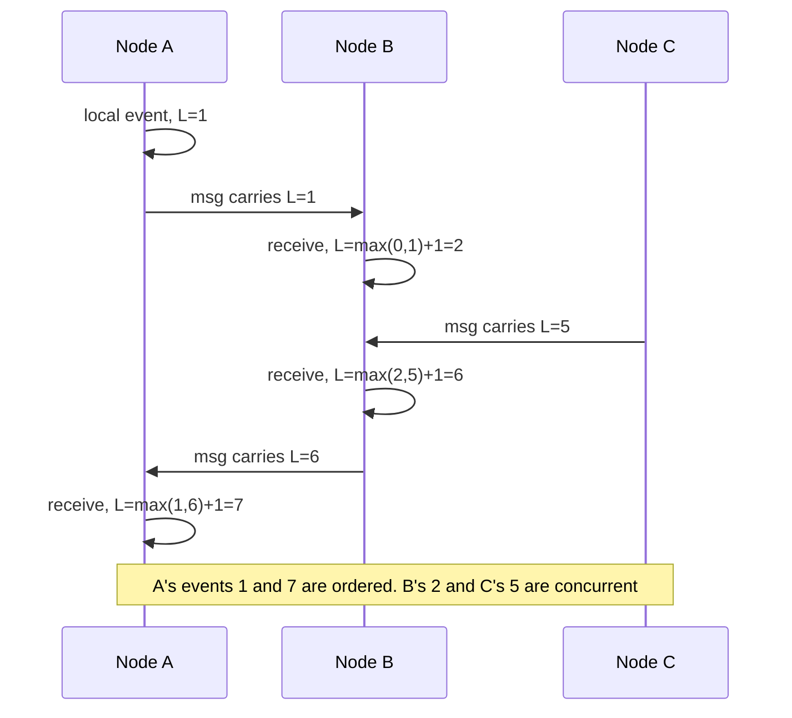

# Clocks and Time

> [!abstract] In one sentence
> No two machines agree on what time it is, and any one machine's clock can jump, so "which event happened first?" across a distributed system must be answered with logical clocks, version numbers or a single ordering authority — and wall-clock time is reserved for timestamps humans read and for leases with a generous safety margin.

> [!tip] Deeper treatment in your system-design vault
> `system-design/08 Distributed Systems Theory/Logical Clocks and Ordering.md` — read it *after* you have written your own explanation below.

**Map:** [[Distributed Systems MOC]] → [[HLD MOC]]

## Definition

A **wall clock** (time-of-day clock) reports calendar time and is synchronised to external sources via NTP or PTP; it can be stepped backwards or forwards and differs between machines by an amount called **skew**, which changes over time as oscillators **drift**. A **monotonic clock** only moves forward and is good for measuring durations on one machine, but its value is meaningless on another machine. A **logical clock** does not measure time at all: it assigns events numbers such that if one event could have caused another, the cause has the smaller number. Lamport clocks give a total order consistent with causality; **vector clocks** additionally let you detect that two events were concurrent; **hybrid logical clocks** (HLC) combine a wall-clock component with a logical counter so timestamps are both roughly physical and causally consistent.

## Problem solved

Developers reach for `System.currentTimeMillis()` or `Date.now()` to order events, expire leases, detect "newest" records and compute timeouts, and all four fail across machines. Two services each stamp a write with their local time; the one with the clock 200 ms ahead wins last-writer-wins even though it wrote first, and the later update is silently discarded — a classic data-loss bug in Cassandra-style stores and in any "updated_at wins" merge. A lease holder computes `expiry − now()` on its own clock while the lock service computes it on another; a step of a few seconds (an NTP correction, a VM migration, a leap second handled badly) makes one side think the lease is valid while the other has given it away ([[Distributed Locks]]). A job scheduler keyed on wall time runs a job twice or never when the clock jumps. Measuring elapsed time with a wall clock produces negative durations when NTP steps the clock backwards.

The underlying issue is physical: clock synchronisation is itself a distributed protocol over a network with variable delay, so the best a machine can know is "the true time is within some uncertainty interval of my clock", and ordinary deployments do not even track the interval.

## How it works

1. **Physical clocks and their errors.** A quartz oscillator drifts on the order of tens of parts per million — tens of milliseconds per day — unless corrected. NTP corrects by *slewing* (adjusting the rate) for small errors and *stepping* (jumping) for large ones; typical accuracy is milliseconds inside a well-run data centre and tens of milliseconds over the internet, with no hard bound. Cloud providers run time services (AWS Time Sync, Google's leap-smeared NTP) that are better than public NTP but still unbounded. Linux exposes `CLOCK_REALTIME` (wall) and `CLOCK_MONOTONIC` (duration); Java's `System.nanoTime()` and Node's `process.hrtime.bigint()` or `performance.now()` are monotonic, `currentTimeMillis()` and `Date.now()` are not.
2. **Rule one: durations from monotonic clocks, never wall clocks.** Timeouts, retries, lease validity remaining, rate-limit windows and latency measurements all use the monotonic clock. A wall clock can jump backwards; a timeout computed from it can wait forever or fire instantly.
3. **Lamport clocks.** Each process keeps a counter `L`. On every local event `L += 1`; every message carries the sender's `L`; on receipt `L = max(L, received) + 1`. If event `a` happened-before `b` (same process earlier, or send-before-receive, or transitively) then `L(a) < L(b)`. The converse does not hold: a smaller number does not imply causation. Ties are broken by process id to get a total order, which is enough for many replicated-state-machine designs.
4. **Vector clocks.** Each process keeps a vector `V[1..n]`, incrementing its own slot on local events and merging element-wise maximum on receipt. `V(a) < V(b)` (every component less or equal and at least one strictly less) means `a` causally precedes `b`; if neither dominates, the events are **concurrent** — exactly the information a replicated store needs to keep both versions for a merge instead of silently dropping one. Dynamo and Riak used vector clocks (or dotted version vectors); the cost is O(n) metadata per value and pruning rules for long-lived keys.
5. **Hybrid logical clocks.** HLC timestamps are `(physical_ms, logical_counter)`: take the maximum of local wall time and the highest timestamp seen, bump the counter when the physical part would not advance. They stay within bounded distance of wall time (useful for TTLs and humans) while preserving causality (useful for ordering). CockroachDB and YugabyteDB use HLCs; Spanner instead uses **TrueTime**, a GPS-and-atomic-clock service that returns an interval `[earliest, latest]` and makes a transaction *wait out the uncertainty* (commit-wait) before acknowledging, which is how it gets external consistency from physical time.
6. **The practical rule.** Never order events from different machines by their wall-clock timestamps; use a per-key version (a sequence number assigned by the key's single owner), a Lamport or vector clock, or a monotonic id from one source ([[Distributed ID Generation]]). When wall time is unavoidable (leases, TTLs), use it only with a safety margin several times larger than plausible skew and compare it on one authority's clock (the database's `now()`, not the client's).

```java
// Wrong: durations from a wall clock can go negative or jump
long start = System.currentTimeMillis();
// Right: monotonic for durations, wall clock only for display/storage
long t0 = System.nanoTime();
doWork();
long elapsedMs = (System.nanoTime() - t0) / 1_000_000;
Instant recordedAt = Instant.now();   // fine as a human-readable stamp, never as an ordering key
```

## Architecture



> [!example]- Excalidraw version — the same diagram as an editable canvas
> ![[Clocks and Time.excalidraw]]
> [[Clocks and Time.excalidraw|Open in Excalidraw]] — needs the Excalidraw plugin (see [[Plugins to Install]]).


## Use cases

- Any merge rule phrased as "the newest value wins" across replicas or services — the requirement is really "define newest without trusting wall clocks" ([[Eventual Consistency]]).
- Leases, locks and leadership with time-bounded validity: "holder may act for 15 s" needs a clock authority and a margin ([[Leader Election]], [[Distributed Locks]]).
- Audit and ledger timelines where regulators want ordering: use a per-ledger sequence number as the ordering key and wall time as an annotation ([[Audit Logs]]).
- Roughly time-sortable identifiers (Snowflake, UUIDv7, ULID) where the requirement is "sortable by creation time" but correctness must not depend on exact ordering ([[Distributed ID Generation]]).
- Collaborative editing and multi-master replication where concurrent edits must be detected rather than overwritten — vector clocks or CRDT metadata.

## Limitations

- Logical clocks give *causal* order only; they say nothing about real time, so "expire after 10 minutes" cannot be built on a Lamport clock.
- Vector clocks grow with the number of writers and need pruning; in systems with many short-lived clients they are replaced with per-replica version vectors or server-assigned versions.
- HLCs and TrueTime still depend on bounded physical skew: an HLC accepts a maximum clock offset (CockroachDB's default is 500 ms) and refuses to operate beyond it; TrueTime needs dedicated hardware.
- Wall-clock timestamps are still needed for humans, for TTL-style expiry and for external systems, so you end up carrying both a wall time and a version, and must remember which is which.

## Trade-offs

| You gain | You sacrifice |
|---|---|
| Ordering that is correct regardless of clock skew (Lamport, vector, HLC) | Extra metadata on every event or value, and merge logic to interpret it |
| Durations that are immune to clock steps (monotonic clocks) | A value you cannot compare across machines or persist meaningfully |
| Bounded-uncertainty physical ordering (TrueTime, commit-wait) | Specialised time infrastructure and a latency floor equal to the uncertainty |
| Simple leases built on wall time with a safety margin | Longer failover (the margin) and a dependence on sane NTP everywhere |

## Failure modes

- **Last-writer-wins data loss** — replica A's clock is ahead; its older write beats B's newer one on merge. Noticed as users reporting "my change disappeared" with no error anywhere; blast radius is every key written concurrently from two places, and it is invisible until someone diffs the data.
- **Lease overlap after a clock step** — NTP steps a node's clock back 3 s; its lease computation says it has 3 s more than it does; two holders act at once. Noticed as fencing rejections or duplicate side effects ([[Split-Brain]]).
- **Timeouts that never fire or fire instantly** — timeouts computed from wall time during a step; threads hang or every call fails for a few seconds. Noticed as a sudden error spike or hung requests at exactly the time of an NTP correction or leap second.
- **Double-run or skipped scheduled jobs** — a cron-like scheduler compares `now()` across instances; a jump replays or skips a slot. Noticed as duplicate batch outputs; radius is whatever the job does twice.
- **Certificate and token validation failures** — [[JWT]] `exp`/`nbf` and TLS validity are checked against wall clocks; a node several minutes off rejects valid tokens or accepts expired ones ([[Authentication]]).

## Performance

Lamport clocks cost one integer per message; vector clocks cost one integer per writer per value and a merge on every read, which matters at high fan-in. HLCs are two 64-bit fields and a comparison. The expensive mechanism is commit-wait: Spanner waits out the clock uncertainty (a few milliseconds with TrueTime hardware) before acknowledging a commit, which places a floor under write latency; the same idea with ordinary NTP would require waiting hundreds of milliseconds, which is why HLC-based systems accept a weaker guarantee instead. Reading the monotonic clock is a vDSO call costing tens of nanoseconds; it is never the bottleneck.

## Scalability

Lamport and HLC clocks scale to any number of nodes because they carry a constant amount of state. Vector clocks do not: with thousands of writers they become larger than the data, and the usual fix is to assign versions at a small number of coordinators (per-key owners or replicas) instead of at every client. Clock synchronisation infrastructure scales by hierarchy (stratum servers, per-host daemons); the issue at scale is not throughput but the tail — in a fleet of 10,000 hosts, some host is always badly skewed, so the design must survive the worst clock, not the median.

## Operational impact

Monitor NTP offset and drift on every host and alert on offsets above the margin your leases assume; alert on clock steps as events. Prefer providers' time services over public NTP pools inside a cloud. Make leap-second policy explicit (smearing versus stepping) across the fleet, because mixed policies create a one-second skew for a day. In logs, record both a wall timestamp and a request-scoped sequence or trace id so engineers can reconstruct order without trusting timestamps across services ([[Distributed Tracing]]). Debugging ordering bugs is mostly about having the version metadata in the first place; add it before you need it.

## Alternatives

- **A single ordering authority** — route all writes for a key through one owner (a partition leader) that assigns a sequence number; wins whenever a key has a natural home, and is how Kafka partitions, PostgreSQL WAL positions and most primary-replica systems avoid clocks entirely ([[Ordering Guarantees]]).
- **Server-assigned versions (optimistic concurrency)** — the database increments a `version` column and rejects stale writers; wins for single-database services ([[Optimistic and Pessimistic Locking]]).
- **CRDTs** — data types whose merge is commutative and associative so order does not matter; wins for counters, sets and collaborative text where concurrent updates are the normal case.
- **Trusting the wall clock with a wide margin** — acceptable for TTL expiry of caches and sessions where being a few seconds wrong is harmless ([[TTL]]).

## Real-world examples

- Google **Spanner** builds external consistency on TrueTime's bounded uncertainty and commit-wait; its paper is the canonical description of using physical time safely ([[Spanner Paper]]).
- **CockroachDB** uses hybrid logical clocks with a configurable maximum offset and will refuse to serve if a node's clock drifts beyond it, treating bad clocks as a correctness hazard rather than a nuisance.
- **Amazon Dynamo** used vector clocks to detect concurrent writes to a key and returned multiple versions to the client for reconciliation ([[Dynamo Paper]]).
- In a stack like yours: a ledger service on EKS should order entries by a per-account sequence assigned in the database transaction, store `created_at` only for display, measure timeouts with `System.nanoTime()` or `process.hrtime`, and validate JWT expiry with a small clock-skew allowance — the four places where the wall clock would otherwise creep into correctness.

## Practical exercise

1. Write a small TypeScript or Java program that runs three "nodes" as processes exchanging messages over local sockets; each node stamps events with wall time and with a Lamport clock.
2. Skew one node's reported wall time by +500 ms (add an offset in code rather than touching the OS clock) and order all events by wall time; find at least one pair where the wall-clock order contradicts the message order, then show the Lamport order is consistent.
3. Add vector clocks and have two nodes write the same key concurrently; print whether the versions are ordered or concurrent, and implement a merge that keeps both siblings.
4. Implement a lease: node A holds a 2 s lease renewed every 500 ms using wall time; inject a −1.5 s "step" in A's clock and observe A believing it still holds the lease after B has acquired it; fix with a monotonic clock plus a margin.
5. Measure: how large a skew is needed before last-writer-wins loses a write at your message rate, and how the HLC variant behaves under the same skew.

## Related concepts

### Prerequisites
- [[Consistency Models]] — ordering guarantees are what clocks are supposed to provide
- [[Network Partitions]] — variable and unbounded delay is why clocks cannot be perfectly synchronised

### Related
- [[Eventual Consistency]] — last-writer-wins is where bad clocks lose data
- [[Ordering Guarantees]] — per-partition sequence numbers as the clock-free alternative
- [[Consensus]] — terms and log indexes are logical clocks in disguise
- [[Failure Detection]] — timeouts measured on monotonic clocks
- [[Leader Election]] — leases depend on wall time with a margin

### Builds on this
- [[Distributed ID Generation]] — Snowflake, UUIDv7 and ULID embed wall time and inherit its problems
- [[Distributed Locks]] — lock TTLs and fencing tokens are the lease argument applied to mutual exclusion
- [[Distributed Transactions]] — Spanner-style commit timestamps and commit-wait
- [[Eventual Consistency]] — conflict resolution needs causality metadata, not timestamps

### Design problems where it applies
- [[Design a Distributed ID Generator]]
- [[Design a Collaborative Document Editor]]
- [[Design a Distributed Key-Value Store]]
- [[Design a Distributed Job Scheduler]]

### Projects where it can be implemented
- [[Mini-KV Store]]
- [[Durable Job Scheduler]]

### Resources
- [[Kleppmann Distributed Systems Lecture Notes]] — the clearest derivation of Lamport and vector clocks
- [[Spanner Paper]] — TrueTime and commit-wait
- [[Dynamo Paper]] — vector clocks in a production store
- [[Understanding Distributed Systems]] — the chapter on time and order

## Personal understanding

> [!question] Explain it without the source
> Write your own explanation here, from memory. Then compare it with the sections above and note what you missed.

### Mastery checklist
- [ ] I can explain it without the original resource
- [ ] I can describe the problem it solves
- [ ] I can compare it with its alternatives
- [ ] I can name its limitations and failure modes
- [ ] I can recognise when it is appropriate in a real system
- [ ] I have applied it in a system design
- [ ] I have validated my assumptions with an experiment or implementation

## Open questions

- [ ] What clock offset do the EKS nodes in a typical cluster actually have against the provider's time service, and how does that compare with the lease margins in the Kubernetes leader-election defaults?
- [ ] Where in a NestJS or Spring Boot service does wall-clock time leak into correctness today (JWT validation, rate-limit windows, scheduled jobs, `updated_at` comparisons), and which of those should move to a monotonic clock or a server-assigned version?
- [ ] How do Redis Streams ids (`<ms>-<seq>`) behave when the Redis server's clock steps backwards, and what does that mean for consumers that treat ids as time?
