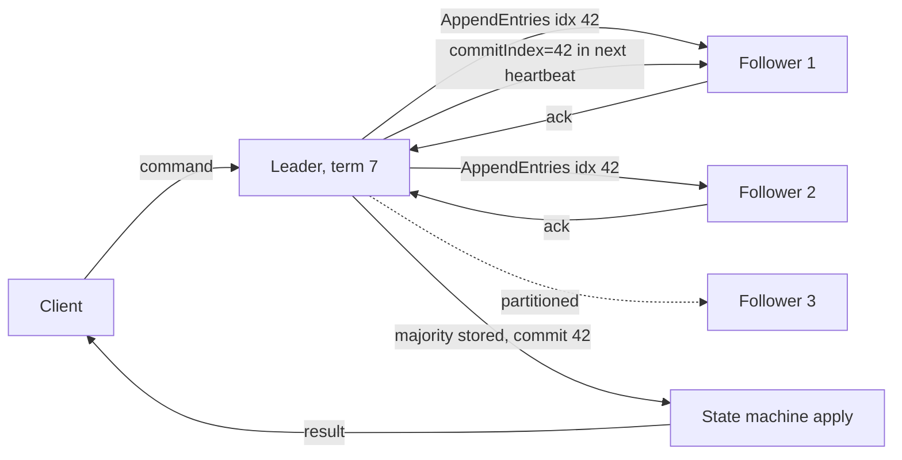

# Consensus

> [!abstract] In one sentence
> Consensus is the protocol family (Paxos, Raft, Zab) by which a majority of nodes agree on each entry of a shared log so that every node applies the same operations in the same order, giving you a replicated state machine that survives minority failure — the foundation under leader election, distributed locks, configuration stores and strongly consistent databases.

> [!tip] Deeper treatment in your system-design vault
> `system-design/08 Distributed Systems Theory/Consensus and Raft.md` — read it *after* you have written your own explanation below.

**Map:** [[Distributed Systems MOC]] → [[HLD MOC]]

## Definition

**Consensus** is the problem of getting a set of processes to agree on a single value (or, in practice, a single ordered sequence of values) such that: every non-faulty process eventually decides (**termination**), no two processes decide differently (**agreement**), and the decided value was proposed by some process (**validity**). The FLP result shows no deterministic protocol can guarantee termination in a fully asynchronous system with even one crash, so practical protocols guarantee safety always and liveness only when the network is well-behaved for long enough. **Raft**, **Multi-Paxos** and **Zab** solve the repeated version — agreeing on a log — by electing a leader that orders proposals and committing each entry once a [[Quorums|majority]] has stored it; applying the committed log to a deterministic state machine on every node yields a **replicated state machine** with linearizable semantics.

## Problem solved

Replicating state across machines without consensus forces a choice between two bad options. Single-leader replication needs someone to decide who the leader is and when to replace it; done by hand it is slow, done by timeouts alone it produces two leaders ([[Split-Brain]]). Leaderless replication with quorums keeps data available but gives no single order of operations, so anything that needs "exactly one winner" — a unique username, a lock, a configuration version, an inventory decrement — cannot be expressed safely ([[Eventual Consistency]]). Consensus provides the missing primitive: a totally ordered, durable log that a majority agrees on, from which you can derive uniqueness, locks, leases, membership and atomic configuration changes.

The historical pain was real: before ZooKeeper (2008) and etcd (2013), every large system hand-rolled its own coordination, and the hand-rolled versions failed under partitions in ways that took years to find. The practical lesson for a stack like yours is that consensus is something you *rely on* — in etcd behind Kubernetes, in ZooKeeper or KRaft behind Kafka, in the Raft groups inside CockroachDB or TiKV — and almost never something you implement in application code.

## How it works

Raft is the easiest to re-derive at a whiteboard; it decomposes the problem into three parts.

1. **Leader election.** Time is divided into numbered **terms**. Every node starts as a follower. If a follower hears nothing from a leader within a randomised election timeout (150–300 ms in the paper; etcd defaults to 1 s with 100 ms heartbeats), it increments its term, votes for itself and requests votes. A node grants at most one vote per term and only to a candidate whose log is at least as up to date as its own. A majority of votes makes a leader for that term; randomised timeouts make split votes rare ([[Leader Election]]).
2. **Log replication.** Clients send commands to the leader, which appends them to its log and sends `AppendEntries` to all followers. Each entry carries its term and index. A follower accepts an entry only if its log matches the leader's at the preceding index and term (the **log matching** check); mismatches are resolved by the leader walking backwards and overwriting the follower's divergent suffix. Once a majority has stored an entry, the leader marks it **committed**, applies it to its state machine, responds to the client and tells followers the new commit index in the next heartbeat.
3. **Safety.** Because a candidate needs a majority and an entry is committed only on a majority, any elected leader's log contains every committed entry (the two majorities overlap and the "at least as up to date" vote rule prefers the longer, higher-term log). A leader never overwrites its own entries, and a new leader commits entries from earlier terms only indirectly, by committing one of its own. Together these give: committed entries are never lost, and all nodes apply the same entries in the same order.
4. **Reads.** A linearizable read must not be served by a stale leader. Either the leader confirms it is still leader by a heartbeat round to a majority before answering (**read index**), or it relies on a **leader lease** bounded by clock assumptions ([[Clocks and Time]]). Reading from a follower without this gives stale data.
5. **Membership changes and snapshots.** Adding or removing voters is itself a log entry, applied through joint consensus or one server at a time so two disjoint majorities never exist. Logs are truncated by snapshotting the state machine; a far-behind follower receives a snapshot instead of thousands of entries.
6. **Paxos and Zab, briefly.** Paxos solves single-value agreement with proposers, acceptors and ballot numbers; Multi-Paxos amortises the prepare phase under a stable leader and is equivalent in guarantees to Raft but harder to describe. Zab (ZooKeeper) is a primary-backup atomic broadcast with epochs; the practical properties are the same: majority commit, a single order, a leader with a monotonically increasing epoch.

```text
Raft AppendEntries (leader -> follower), simplified:
  term=7, leaderId=n2, prevLogIndex=41, prevLogTerm=6,
  entries=[{index:42, term:7, cmd:"SET lock/x = n5 lease=12"}], leaderCommit=41
Follower: reject unless log[41].term == 6; else append 42, truncate anything after it
Leader: when a majority acks index 42 -> commit 42 -> apply -> reply to client
```

## Architecture



> [!example]- Excalidraw version — the same diagram as an editable canvas
> ![[Consensus.excalidraw]]
> [[Consensus.excalidraw|Open in Excalidraw]] — needs the Excalidraw plugin (see [[Plugins to Install]]).


## Use cases

- "Exactly one of these must be true/chosen/active cluster-wide" — unique names, lock ownership, leader identity, the current configuration version ([[Distributed Locks]], [[Service Discovery]]).
- Metadata and coordination for a larger system: which node owns which shard, which brokers are alive, what the schema version is — small, hot, must-be-right data (etcd for Kubernetes, KRaft for Kafka).
- Strongly consistent replicated storage where each shard is a Raft group and writes are linearizable (CockroachDB, TiKV, YugabyteDB) ([[Replication]]).
- Replicated logs and queues that must not lose or reorder acknowledged entries (Kafka's KRaft controller quorum; Kafka's own ISR replication is a related but distinct mechanism).
- Atomic commit across shards layered on top of per-shard consensus ([[Distributed Transactions]]).

## Limitations

- Every committed operation costs a round trip to a majority, and all writes go through one leader: throughput is bounded by the leader's network and disk, and latency by the median-ish replica, not the fastest.
- A consensus group tolerates only a minority of failures; with three nodes, two failures mean total unavailability for writes *and* linearizable reads, even though one healthy node holds all the data.
- Liveness depends on timing assumptions; under heavy load or GC pauses the leader loses leadership and the group spends time in elections rather than serving.
- It coordinates small state well and large state badly: putting gigabytes of application data through a single Raft group is a mistake; sharding into many groups is the standard (and operationally heavy) remedy.
- Implementing it correctly is notoriously hard — the subtle bugs are in membership changes, log compaction and reads, not in the core — which is why the answer is almost always a library (etcd's raft, Ratis) or a service.

## Trade-offs

| You gain | You sacrifice |
|---|---|
| A single agreed order of operations that survives minority failure | One leader as the write path and a majority round trip per commit |
| Linearizable reads and writes on the replicated state | Availability when a majority is unreachable, even if data is intact |
| Automatic, safe leader failover with a fencing term built in | Election downtime and sensitivity to timeouts, pauses and jitter |
| A foundation for locks, leases, membership and configuration | An extra stateful cluster to run, upgrade and back up |

## Failure modes

- **Leader thrash** — election timeout close to GC pause length or network jitter; leadership changes every few seconds and clients see timeouts during each vacancy. Noticed as `leader_changes_seen_total` climbing with no node failures; blast radius is every client of the group.
- **Quorum loss** — a majority of voters down or partitioned; the group refuses writes and linearizable reads. Noticed as a hard error cliff; radius is everything coordinated through the group — for etcd that is the entire Kubernetes control plane's ability to change state ([[Network Partitions]]).
- **Slow disk, slow consensus** — fsync latency on one voter inflates commit latency for everyone because commit waits for a majority's durable write. Noticed as p99 commit latency tracking one node's disk; etcd's documentation treats disk latency as the primary tuning concern.
- **Stale read from a deposed leader** — reads served without a read-index check during a partition return old data. Noticed only by consistency checkers like Jepsen or by application-level anomalies ([[Jepsen]]).
- **Unbounded log growth** — snapshots disabled or failing; disk fills, new members cannot catch up. Noticed as disk alerts and `snapshot` errors; radius is the group's availability when the disk fills.

## Performance

A commit costs one round trip from leader to a majority plus a durable write (fsync) on each; within a region that is on the order of a few milliseconds, dominated by disk. Throughput comes from batching many entries per `AppendEntries` and pipelining; etcd's documented benchmarks show tens of thousands of writes per second on a three-node cluster with fast SSDs, with the leader's disk and network as the ceiling. Reads with read-index cost a heartbeat round (sub-millisecond intra-region); lease-based reads cost nothing but assume bounded clock drift. Memory holds the state machine and the uncompacted log; etcd's backend quota defaults to 2 GB (8 GB is the documented recommended maximum), and it stops accepting writes when the quota is exceeded.

## Scalability

Consensus groups scale by *multiplying*, not *growing*: five voters tolerate two failures but commit slower than three, and nine is rarely sensible. Systems like CockroachDB and TiKV run thousands of small Raft groups (one per key range) across the same machines, each with its own leader, so aggregate throughput scales with nodes while each group stays small. Learner or non-voting members add read capacity without affecting quorum size. At 10x load on a single coordination group, the fix is to move data out of it (keep only metadata in etcd) rather than to tune it.

## Operational impact

Running a consensus cluster is a specialist job even with managed offerings: dedicated fast disks, an odd member count spread across failure domains, careful membership changes (one at a time, never replacing a majority at once), regular snapshots and backups, and version upgrades done rolling. Monitor leader changes, proposal commit latency, fsync latency, applied-versus-committed index lag, and database size. The on-call rule: a consensus cluster that lost quorum is restored from a snapshot or by a documented disaster procedure, never by hand-editing state. Most teams should consume consensus through a managed service or through Kubernetes' etcd and keep their own application data elsewhere.

## Alternatives

- **Single primary with a lock-service lease** — a database primary plus Patroni or a similar manager using etcd/ZooKeeper only for the leader key; wins when you need one strongly consistent database rather than a replicated state machine ([[Leader Election]]).
- **Quorum replication without a leader (Dynamo-style)** — availability and tunable consistency without a total order; wins when operations are commutative or last-writer-wins is acceptable ([[Quorums]], [[Eventual Consistency]]).
- **A single relational database as the coordinator** — `SELECT … FOR UPDATE` rows for locks and leader records; wins for small teams whose scale fits one Postgres and who already run it well ([[Optimistic and Pessimistic Locking]]).
- **Avoiding agreement altogether** — idempotent, commutative operations and per-key ownership so no global decision is needed; wins whenever the domain allows it ([[Coordination vs Availability]]).

## Real-world examples

- **etcd** (Raft) stores all Kubernetes cluster state; every `kubectl apply` is a consensus commit, and Kubernetes leader election for controllers is built on etcd's compare-and-swap.
- **Apache Kafka's KRaft** mode replaced ZooKeeper with a Raft-based controller quorum that holds topic and partition metadata, removing the second system Kafka used to depend on ([[Kafka]]).
- **CockroachDB and TiKV** run a Raft group per range of keys, with transactions layered over them, demonstrating consensus as the replication layer of a database rather than just a coordination service.
- In a stack like yours: Kubernetes (etcd), Kafka (ZooKeeper or KRaft) and any Patroni-managed PostgreSQL already depend on a consensus cluster; the design question is which *application* decisions should be routed through one — leader keys, schema-migration locks, shard ownership — and which should be solved with idempotency and a database row instead.

## Practical exercise

1. Run a three-member etcd cluster with Docker Compose and a client (etcdctl, jetcd or the Node `etcd3` package) that performs a compare-and-swap write in a loop, printing the revision of each success.
2. Stop one member (`docker stop`) and confirm writes continue; stop a second and confirm writes fail with a quorum error while reads with `--consistency=s` (serializable, local) may still succeed on the survivor — then restart and watch the log catch up.
3. Add 300 ms of latency on one member's port with [[Toxiproxy]] and measure the change in write latency; then add it to two members and explain the result in terms of majority commit.
4. Pause the leader with `docker pause` for 2 s and observe an election in the logs; record the vacancy duration against the configured election timeout.
5. Stretch: implement the Raft leader-election and log-replication rules yourself in Go or TypeScript following the paper's Figure 2, run three instances, and test them with randomised message drops; compare your line count with the paper's claims about understandability.

## Related concepts

### Prerequisites
- [[Quorums]] — majority overlap is the entire safety argument
- [[Network Partitions]] — the failures the protocol must tolerate without a wrong decision
- [[Replication]] — consensus is replication with an agreed order
- [[Consistency Models]] — linearizability is what the replicated state machine provides

### Related
- [[Leader Election]] — Raft's first phase, and the usual reason to deploy consensus at all
- [[Failure Detection]] — election timeouts are a detector; its false positives cause elections
- [[Clocks and Time]] — terms and indexes replace clocks; leader leases reintroduce them
- [[CAP Theorem]] — consensus chooses consistency over availability during a partition
- [[Fault Tolerance]] — surviving minority failure with no data loss

### Builds on this
- [[Leader Election]] — most production elections run on a consensus store
- [[Distributed Locks]] — etcd and ZooKeeper locks are entries in a consensus log
- [[Distributed Transactions]] — cross-shard commits built on per-shard consensus
- [[Service Discovery]] — registries backed by Consul, etcd or ZooKeeper
- [[Kafka]] — the KRaft controller quorum holds cluster metadata

### Design problems where it applies
- [[Design a Distributed Key-Value Store]]
- [[Design a Distributed Job Scheduler]]
- [[Design a Message Queue]]
- [[Design a Feature Flag Service]]

### Projects where it can be implemented
- [[Lock Service with Fencing Tokens]]
- [[Mini-KV Store]]

### Resources
- [[Raft Paper]] — read Figure 2 until you can reproduce it
- [[etcd Raft Library]] — the production implementation behind Kubernetes
- [[MIT 6.5840 Distributed Systems Course]] — the Raft labs are the best way to actually learn it
- [[Designing Data-Intensive Applications]] — chapter 9 on consensus and total order broadcast

## Personal understanding

> [!question] Explain it without the source
> Write your own explanation here, from memory. Then compare it with the sections above and note what you missed.

### Mastery checklist
- [ ] I can explain it without the original resource
- [ ] I can describe the problem it solves
- [ ] I can compare it with its alternatives
- [ ] I can name its limitations and failure modes
- [ ] I can recognise when it is appropriate in a real system
- [ ] I have applied it in a system design
- [ ] I have validated my assumptions with an experiment or implementation

## Open questions

- [ ] How exactly does Kafka's ISR-based partition replication differ from Raft in its guarantees, and what does KRaft use Raft for versus what it still handles with the ISR mechanism?
- [ ] When etcd behind an EKS control plane loses quorum, what does the data plane keep doing (existing pods, Services, existing routes) and what stops (scheduling, scaling, leader renewals)?
- [ ] For a migration lock or a "run once per deploy" job, what is the cost-benefit of a Kubernetes `Lease` (etcd-backed) versus a PostgreSQL advisory lock, given the failure modes of each?
