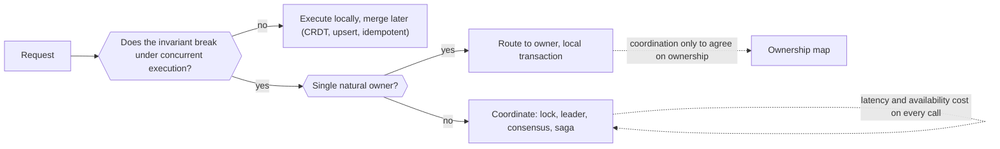

# Coordination vs Availability

> [!abstract] In one sentence
> Coordination — making nodes agree before acting — is what gives you invariants like "at most one" and "never below zero", and it is also what makes a system slow (a round trip to agree) and unavailable (no agreement without the other parties), so the central design question is not "consistent or available" but "which operations genuinely need coordination, and how do I structure the rest to need none".

> [!tip] Deeper treatment in your system-design vault
> `system-design/08 Distributed Systems Theory/PACELC.md` — read it *after* you have written your own explanation below.

**Map:** [[Distributed Systems MOC]] → [[HLD MOC]]

## Definition

**Coordination** is any mechanism that requires two or more nodes to communicate and agree before an operation completes: acquiring a [[Distributed Locks|lock]], consulting a [[Leader Election|leader]], committing through [[Consensus]] or a [[Quorums|quorum]], running a [[Distributed Transactions|distributed transaction]]. **Availability** here means the operation can complete using only the node that received it, regardless of what else is reachable. The two are in direct tension: each coordination point adds at least one network round trip to the operation's latency, and makes the operation impossible when the coordinating parties are unreachable or slow. **Coordination avoidance** is the discipline of identifying which application invariants actually require agreement (the research result is that only some do — those that are not preserved under concurrent, independent execution) and designing the data model and operations so the rest execute locally and merge later.

## Problem solved

Teams reach for coordination by default because it is the familiar model: a transaction, a lock, a single master. The cost is invisible at small scale and dominant later: p99 latency bounded below by a cross-AZ or cross-region round trip; throughput capped by a single leader; an outage of the coordination store (etcd, ZooKeeper, the primary database) taking down every operation that touched it, including ones that did not need it. [[CAP Theorem]] frames this as a binary during partitions; [[PACELC]] adds that even without a partition, coordination trades latency for consistency on every request. The practical failure is over-coordination: a global lock around "update user profile", a distributed transaction to write an order and its event, a leader that every worker must ask before processing a job. Each is a point where a 30 s pause or a dead node halts work that could have proceeded locally, and none is needed for correctness. The opposite failure — under-coordination — is quieter and worse: a counter that goes negative, a seat sold twice, two accounts with the same username, because an invariant that needed agreement was left to [[Eventual Consistency|eventual]] merge.

In a stack like yours — a ledger that must never double-spend next to a notification system that may send a duplicate — both failures are available, and the design task is to put the coordination exactly where the money is and nowhere else.

## How it works

1. **Classify each invariant.** Ask: if two nodes executed this operation concurrently without talking, could the invariant break? "Balance never negative" — yes, two debits can both see a positive balance. "Username unique" — yes. "Every order gets a confirmation email" — no, two sends are a duplicate, not a violation (and duplicates are handled by [[Idempotency]]). "Total likes equals sum of likes" — no, increments commute. Invariants in the first group need coordination; those in the second do not.
2. **Shrink the coordination scope.** Coordination costs scale with the number of parties and the breadth of the lock. Replace a global lock with a per-key lock; replace a cluster-wide leader with a leader per shard; replace a distributed transaction across services with a local transaction in the one service that owns the invariant ([[Sharding]], [[Domain-Driven Design]]).
3. **Give each invariant a single home.** The cheapest coordination is none: if all operations on an account go to one owner (one partition, one replica, one process), the invariant is enforced by local ordering — a database transaction or a single-threaded actor — with no distributed agreement. Routing by key ([[Consistent Hashing]], [[Topic Partitions]]) turns a distributed problem into many local ones. Coordination is then needed only to agree on the *mapping* (who owns what), which changes rarely and can be cached.
4. **Make non-invariant operations commutative and idempotent.** Design operations so they can execute in any order and any number of times: increments with unique ids (apply once per id), set-adds, upserts of versioned snapshots, CRDTs for counters and sets ([[Eventual Consistency]]). Such operations can be accepted locally and propagated asynchronously, and conflicts resolve by merge rather than by refusal.
5. **Decompose transactions into steps with compensation.** A cross-service "transfer" that would need a distributed transaction becomes a [[Saga Pattern|saga]]: each step is a local transaction (coordinated within one service), steps are linked by durable messages ([[Outbox Pattern]]), and failures are compensated. The global invariant becomes "eventually consistent, with a bounded window of visible intermediate states" — acceptable for most business processes, not for an atomic balance check.
6. **Reserve, then confirm.** Where an invariant needs agreement but the slow path is rare, coordinate once up front to obtain a local allowance: reserve stock, allocate an id range, take a lease on a shard, obtain a rate-limit token bucket. Subsequent operations are local until the allowance runs out. This moves coordination off the per-operation path onto a periodic one ([[Distributed ID Generation]] ranges, [[Rate Limiting]] with local buckets).
7. **Decide the failure behaviour explicitly.** For the operations that still coordinate: when the coordinator is unreachable, do they fail (CP) or proceed with a local decision and reconcile (AP)? Write it down per operation; "the lock service is down" should never be a surprise.

```text
Invariant audit for an account service (example):
  debit(account, amount)         needs coordination: single owner per account, local tx
  credit(account, amount)        commutative: apply once per entry id, no lock
  rename(account, display_name)  last-writer-wins with version: no coordination
  reserve_username(name)         global uniqueness: one authority (unique index on one DB)
  send_statement(account)        idempotent by period: no coordination, dedup by key
```

## Architecture



## Use cases

- Multi-region or multi-AZ designs where the requirement is "writes succeed locally with regional latency": find the invariants, home them per region or per key, make the rest mergeable ([[Design a Distributed Key-Value Store]]).
- Inventory, ticketing and wallets: coordinate the decrement (single owner per SKU, seat or account), leave everything else — views, notifications, analytics — uncoordinated ([[Design an Inventory Management System]], [[Design a Ticket Booking System]]).
- Removing a global singleton or lock that has become a throughput ceiling or an availability risk: partition the work by key instead ([[Leader Election]] alternatives).
- Splitting a monolith: each service owns the invariants it can enforce locally; cross-service invariants become sagas or are redrawn so one service owns them ([[Microservices]], [[Saga Pattern]]).
- Any system where "the lock service / the leader / the primary is down" has caused an outage of features that did not need it.

## Limitations

- Some invariants are irreducibly global: uniqueness across all tenants, a global ordering, a total that must be exact at every instant. These need coordination and the design should accept its cost rather than approximate it.
- Coordination-free designs push complexity into merge rules, compensations and reconciliation jobs; the cost is moved, not removed, and it is paid by every reader of the data ([[Eventual Consistency]]).
- Ownership-based designs depend on a correct, available ownership map and on fencing when ownership moves; a stale owner is a split-brain ([[Split-Brain]]).
- Product semantics may not tolerate the visible intermediate states of a saga ("the money left my account but has not arrived") without careful UX.
- The invariant audit must be redone when requirements change; a field that was last-writer-wins can become an invariant overnight ("display name must be unique").

## Trade-offs

| You gain | You sacrifice |
|---|---|
| Local latency and availability for every operation that does not need agreement | Mergeable data models, idempotent operations and reconciliation as permanent design work |
| Coordination cost concentrated on the few operations that need it | An explicit, maintained inventory of invariants and owners |
| Throughput that scales with partitions instead of being capped by one coordinator | Fencing, ownership maps and rebalancing when ownership moves |
| Outages of coordination stores confined to the operations that use them | Compensation paths and visible intermediate states for decomposed transactions |

## Failure modes

- **Over-coordination outage** — a global lock, leader or transaction coordinator becomes unreachable and every operation stops, including reads and idempotent writes that needed nothing. You notice as a total outage caused by a small component; blast radius is everything behind the coordination point.
- **Under-coordination invariant breach** — a decrement executed on two replicas during a partition; stock goes negative, a seat is sold twice. Noticed by reconciliation or a customer; radius is every key written concurrently during the window ([[Network Partitions]]).
- **Hot owner** — per-key ownership concentrates a popular key's traffic on one node (a celebrity account, a flash-sale SKU); local coordination is cheap but the node is the ceiling. Noticed as one shard's latency diverging from the rest ([[Hot Keys]]).
- **Stale ownership** — the mapping moved but an old owner kept serving; two owners for a key accept conflicting writes. Noticed as fencing rejections (if fenced) or divergence (if not) ([[Split-Brain]]).
- **Compensation that fails** — a saga's reversing step cannot run (the downstream is down, the state has moved on); the global invariant is violated until a human intervenes. Noticed by saga timeout alerts and reconciliation reports; radius is the in-flight sagas ([[Saga Pattern]]).

## Performance

A coordinated operation costs at least one round trip to the coordinating parties: intra-AZ about a millisecond, cross-AZ 1–2 ms, cross-region tens to hundreds of milliseconds, plus the coordinator's own processing and any queueing behind other coordinated operations. A locally executed operation costs the local write (sub-millisecond to a few milliseconds) and background propagation. Throughput of a coordination point is bounded by `1 / (hold time + round trips)` for locks and by the leader's capacity for single-leader schemes; partitioned ownership multiplies that bound by the number of partitions. Reserve-then-confirm amortises one coordination over many local operations, turning a per-call cost into a periodic one.

## Scalability

Coordination is the component that does not scale horizontally: adding nodes to a consensus group slows it, adding waiters to a lock lengthens the queue, adding callers to a leader saturates it. Systems scale by *reducing the fraction of operations that coordinate* and by *partitioning the coordination* so each partition's coordination is independent. At 10x, re-run the invariant audit: operations that coordinated "to be safe" become the bottleneck, and hot keys that were fine become ownership problems to be split (sharded counters, sub-partitioning a SKU's stock across reservations).

## Operational impact

Document every coordination point in the system — the store it depends on, the operations behind it, the behaviour when it is unavailable — because that list is the outage map. Monitor coordination latency and queueing separately from application latency so a slowing etcd or lock service is visible before it is a cliff. Reconciliation jobs are the safety net for the uncoordinated paths and must have their own alerts (divergence detected, saga stuck). Deploys that move ownership (resharding, leader changes) need fencing verified in staging. On-call needs to know which outages are "the coordinator is down" versus "we are inconsistent", because the responses differ.

## Alternatives

- **Coordinate everything through one strongly consistent database** — a single PostgreSQL with transactions, row locks and unique constraints; wins decisively for systems that fit in one database, which is most systems, and should be abandoned only when scale or geography forces it ([[Transactions]]).
- **Consensus-replicated state for everything** — Spanner-style global transactions with bounded-latency coordination; wins when invariants are many and global and the organisation can afford the infrastructure ([[Spanner Paper]]).
- **Fully eventually consistent (AP everywhere)** — accept conflicts universally with merge rules; wins for collaboration, presence and telemetry products with no hard invariants ([[BASE]]).
- **Asynchronous workflow for all cross-service effects** — never coordinate synchronously between services; every multi-step business process is a saga or workflow with explicit states; wins in event-driven architectures with mature tooling ([[Event-Driven Architecture]]).

## Real-world examples

- **Amazon Dynamo** was built on the premise that the shopping cart has no invariant worth a coordination round trip, and that a merged cart beats a refused add; its design is coordination avoidance applied to one well-chosen workload ([[Dynamo Paper]]).
- **Kafka** coordinates only on partition assignment and controller decisions and never on message writes within a partition, which is why its throughput scales with partitions while its metadata path stays small and consensus-backed ([[Kafka]]).
- **Google Spanner** took the opposite bet — coordinate globally but make coordination fast with TrueTime — and both designs are rational for their invariants; the lesson is that the choice is per invariant, not per company.
- In a stack like yours: a wallet service whose debits are routed by account id to a single PostgreSQL shard and executed in a local transaction, whose credits are applied once per entry id, and whose statements and notifications are idempotent consumers of events, coordinates exactly once per debit and nowhere else — and keeps working for everything except new debits when a shard is unavailable.

## Practical exercise

1. Take a small service (a wallet with `debit`, `credit`, `rename`, `reserve_username`) in Java or TypeScript backed by PostgreSQL, and write the invariant audit table above for it, with your own classification.
2. Implement version A with a Redis global lock around every operation; load-test with k6 at 500 requests per second mixed traffic and record p50/p99 and throughput, then kill Redis mid-test and record which operations fail.
3. Implement version B: route debits by account to one of two PostgreSQL instances (a tiny ownership map), apply credits with `INSERT … ON CONFLICT DO NOTHING` on an entry id, make `rename` a versioned upsert, keep a single unique index for usernames on one instance; repeat the load test and the failure injection (kill one instance) and record which operations keep working.
4. Add a reconciliation job that recomputes balances from entries and flags divergence; run both versions under a 30 s partition with [[Toxiproxy]] and compare invariant breaches and availability.
5. Measure: coordination latency per operation type, the fraction of operations that touched a coordination point in each version, and the blast radius of each injected failure.

## Related concepts

### Prerequisites
- [[CAP Theorem]] — the partition-time version of the trade-off
- [[PACELC]] — the everyday latency version of the same trade-off
- [[Leader Election]] — the most common coordination point you will choose
- [[Eventual Consistency]] — what coordination-free operations get instead of agreement

### Related
- [[Distributed Locks]] — a coordination point with an availability cost per call
- [[Consensus]] — the strongest and most expensive form of coordination
- [[Quorums]] — tunable coordination per operation
- [[Idempotency]] — the property that lets effects be applied without agreement on order
- [[Sharding]] — partitioned ownership as coordination made local
- [[Distributed Transactions]] — the coordination most worth designing away

### Builds on this
- [[Saga Pattern]] — decomposing a global transaction into locally coordinated steps
- [[Event-Driven Architecture]] — asynchronous propagation as the alternative to synchronous agreement
- [[CQRS]] — write models with invariants, read models without coordination

### Design problems where it applies
- [[Design a Digital Wallet and Ledger]]
- [[Design an Inventory Management System]]
- [[Design a Ticket Booking System]]
- [[Design a Collaborative Document Editor]]
- [[Design a Distributed Key-Value Store]]

### Projects where it can be implemented
- [[Mini-KV Store]]
- [[Double-Entry Ledger Service]]

### Resources
- [[PACELC Paper]] — the framing of coordination cost outside partitions
- [[Designing Data-Intensive Applications]] — chapter 12 on designing around invariants and coordination
- [[Dynamo Paper]] — coordination avoidance in a production design

## Personal understanding

> [!question] Explain it without the source
> Write your own explanation here, from memory. Then compare it with the sections above and note what you missed.

### Mastery checklist
- [ ] I can explain it without the original resource
- [ ] I can describe the problem it solves
- [ ] I can compare it with its alternatives
- [ ] I can name its limitations and failure modes
- [ ] I can recognise when it is appropriate in a real system
- [ ] I have applied it in a system design
- [ ] I have validated my assumptions with an experiment or implementation

## Open questions

- [ ] For a payments platform, which invariants are genuinely global (uniqueness of an external reference, a per-merchant daily limit across regions) versus per-account, and what does that imply for sharding keys and region homing?
- [ ] Where does a typical service of mine coordinate without needing to — a Redis lock around an idempotent job, a leader for work that could be partitioned, a synchronous call that could be a saga — and what is the measured latency and availability cost of each?
- [ ] How do reservation-style allowances (pre-allocated limits, reserved stock) change the auditing and reconciliation requirements in a regulated ledger compared with coordinating on every operation?
