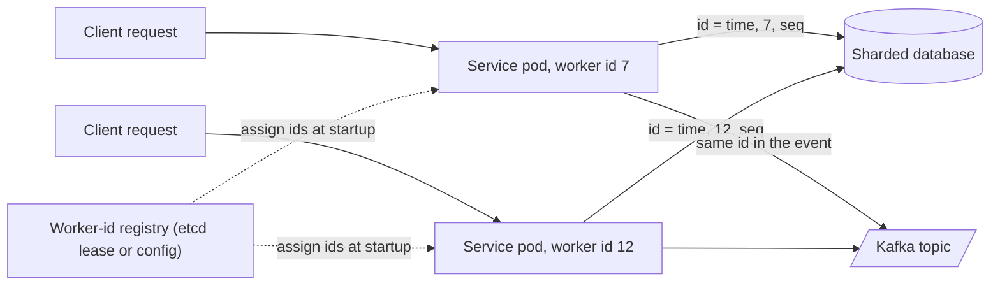

# Distributed ID Generation

> [!abstract] In one sentence
> Distributed ID generation produces identifiers that are unique across every node without asking a central authority on the hot path, by partitioning the id space (time bits plus node bits plus a sequence, as in Snowflake) or by making collisions astronomically unlikely (128 random bits, as in UUIDv4) — and the choice decides whether your ids sort by time, how big they are, and what happens when a clock goes backwards.

> [!tip] Deeper treatment in your system-design vault
> `system-design/15 Interview Playbook/Design a Distributed ID Generator.md` — read it *after* you have written your own explanation below.

**Map:** [[Distributed Systems MOC]] → [[HLD MOC]]

## Definition

A **distributed ID generator** assigns identifiers to new entities (orders, messages, events, ledger entries) such that two generators on different machines never produce the same id, without a synchronous call to a shared counter. The main families: **random ids** (UUIDv4: 122 random bits), **time-ordered composite ids** (Twitter's Snowflake: 41 bits of milliseconds, 10 bits of worker id, 12 bits of sequence in a 64-bit integer; UUIDv7 and ULID: 48 bits of milliseconds followed by random bits in 128 bits), **pre-allocated ranges** (each node leases a block of ids from a database or ticket server and hands them out locally), and **per-shard sequences** (a database sequence or auto-increment whose values embed the shard). The properties that distinguish them are uniqueness guarantee, **sortability** (k-ordered by creation time), size, and dependence on clocks or on a coordinator.

## Problem solved

A single database `AUTO_INCREMENT` or `SERIAL` is the simplest unique id, and it stops working the moment there are two databases (shards, regions, services) or when ids must be known before the row exists (idempotency keys sent by clients, ids embedded in events before the commit, ids generated offline on a mobile client). Routing every id request to one counter reintroduces a single point of failure and a network round trip per insert, which at tens of thousands of inserts per second is both a bottleneck and an availability risk ([[Coordination vs Availability]]). Random UUIDs solve uniqueness but create a second problem: inserted as a primary key in a B-tree, random keys land on random pages, so every insert touches a cold page, the index fragments, and write throughput and cache efficiency degrade — well documented for MySQL InnoDB clustered indexes and visible in PostgreSQL as index bloat ([[Indexing]], [[Relational Database Internals]]). Time-ordered ids exist to get uniqueness without coordination *and* keep inserts append-mostly.

For a stack like yours — orders, payments and ledger entries created across many pods, with events emitted through an outbox and idempotency keys arriving from clients — the id scheme decides whether events can be sorted by id, whether the ledger's primary key index stays compact, and whether a client can safely retry a create.

## How it works

1. **UUIDv4 (random).** 128 bits, of which 122 are random. Collision probability follows the birthday bound: roughly `n² / 2^123`; generating a billion ids per second for a century gives a collision probability on the order of 10⁻⁶, so collisions are not a practical concern given a good CSPRNG. No clock, no coordinator, no sortability, 36-character text form, poor B-tree locality.
2. **Snowflake (time + node + sequence).** A 64-bit integer: 1 unused sign bit, 41 bits of milliseconds since a custom epoch (about 69 years), 10 bits of worker id (1,024 workers), 12 bits of sequence (4,096 ids per worker per millisecond). Ids from one worker are strictly increasing; across workers they are ordered by millisecond and only roughly within it (k-ordered). The two hard parts are **worker-id assignment** (static configuration, ZooKeeper or etcd lease at startup, a database row — a duplicate worker id silently breaks uniqueness) and **clock regression**: if the wall clock steps backwards, the generator must refuse, wait, or borrow from the sequence until time catches up ([[Clocks and Time]]).
3. **UUIDv7 and ULID (time + randomness).** 48 bits of Unix milliseconds followed by random bits (UUIDv7, RFC 9562, with optional sub-millisecond or counter bits for monotonicity within a process; ULID uses 80 random bits and a 26-character Crockford base32 text form). No worker id to assign — uniqueness comes from randomness within each millisecond — and ids sort by time across all generators to millisecond precision. 128 bits rather than 64, and the standard UUID type in every database and language.
4. **Ticket servers and ranges.** Flickr's approach: a MySQL table with `REPLACE INTO` on a single row, two servers configured with odd and even `auto_increment_increment` for redundancy. The modern variant leases **ranges**: each node asks a coordinator for `[n, n+1000)` and allocates locally, going back only when exhausted; ids are unique, 64-bit and roughly increasing, and the coordinator is off the hot path but still needed to refill ([[Leader Election]] for the coordinator's own availability).
5. **Per-shard sequences.** Instagram's scheme: a PostgreSQL function per logical shard composing 41 bits of milliseconds, 13 bits of shard id and 10 bits of a per-shard sequence, generated inside the insert transaction so no separate service exists. Ids embed their shard, which is convenient for routing and awkward for resharding ([[Sharding]]).
6. **Choosing.** Need 64-bit ids and have a way to assign worker ids reliably: Snowflake. Need no infrastructure and standard types, can afford 128 bits: UUIDv7. Need ids that are unguessable (exposed in URLs, tokens): UUIDv4 or a random component plus an internal sortable id. Need strict global ordering: none of these — use a single-writer sequence per partition ([[Ordering Guarantees]]).

```text
Snowflake layout (64 bits):
  0 | 41 bits timestamp (ms since custom epoch) | 10 bits worker id | 12 bits sequence
Generation:
  now = currentTimeMillis()
  if now < lastTs: clock went backwards -> refuse or wait (do not generate)
  if now == lastTs: seq = (seq + 1) & 0xFFF; if seq == 0: spin until next ms
  else: seq = 0
  id = ((now - EPOCH) << 22) | (workerId << 12) | seq
```

## Architecture



## Use cases

- "Ids must be generated before the write" — idempotency keys, events written to an outbox in the same transaction as the entity, offline-first clients ([[Outbox Pattern]], [[Idempotency]]).
- "Inserts across shards or regions must not collide" — any sharded table or multi-region write path ([[Sharding]]).
- "Sort by creation time without a separate timestamp index" or "paginate by id" — k-ordered ids make `WHERE id > ?` cursors work ([[Design a Social Feed]], [[Design a Chat System]]).
- "Insert throughput is limited by index maintenance" — moving from UUIDv4 primary keys to UUIDv7 or Snowflake restores append-mostly B-tree behaviour.
- "Short, opaque identifiers for URLs" — a short id derived from a 64-bit counter or Snowflake id, base62-encoded ([[Design a URL Shortener]]).

## Limitations

- Time-based ids leak information: creation time, and for Snowflake the worker id and the approximate rate of creation. Do not expose them where that matters; pair with a random public id.
- Sortability is approximate: within a millisecond, ordering across generators is arbitrary, and across machines it is only as good as clock synchronisation. Ids are not a substitute for a per-partition sequence when exact order is required.
- Snowflake's 41-bit timestamp and 10-bit worker id are fixed budgets: a custom epoch runs out after about 69 years, and a fleet with more than 1,024 concurrent generators needs a different layout or careful worker-id reuse.
- 128-bit ids double the key size of every index that references them, which compounds in a wide schema with many foreign keys.
- Clock regression and leap-second handling must be designed in; a generator that trusts the clock will eventually emit a duplicate.

## Trade-offs

| You gain | You sacrifice |
|---|---|
| Unique ids with no coordination round trip on the hot path | Dependence on correct clocks (time-based) or on a worker-id registry (Snowflake) |
| Time-ordered ids that keep B-tree inserts append-mostly and enable id cursors | Information leakage about creation time and generator identity |
| Compact 64-bit ids (Snowflake, ranges) | Fixed bit budgets that must be planned for epoch and fleet size |
| Zero-infrastructure uniqueness (UUIDv4, UUIDv7) | 128-bit keys and, for v4, poor index locality |

## Failure modes

- **Duplicate worker id** — two pods start with the same Snowflake worker id (a copy-pasted config, a lease that expired and was reassigned while the old pod kept running); they emit colliding ids within the same millisecond. You notice as primary-key violations or, worse, as overwritten events keyed by id; blast radius is every id from both workers until one restarts. The registry needs a lease and the generator must stop when it cannot renew ([[Leader Election]]).
- **Clock stepped backwards** — NTP correction or VM migration; a naive generator reuses timestamps and sequences and produces duplicates. Noticed as sporadic duplicate-key errors clustered at one time; radius depends on the step size and the rate.
- **Sequence exhaustion within a millisecond** — a burst exceeds 4,096 ids per worker per millisecond; a generator that does not wait for the next millisecond wraps and duplicates. Noticed as duplicates under peak load only.
- **Range coordinator unavailable** — nodes exhaust their leased ranges and block on refill; inserts stall across the fleet. Noticed as a latency cliff correlated with the coordinator's outage; mitigated by refilling early and leasing larger ranges.
- **Random id index degradation** — UUIDv4 primary keys at high insert rates: index bloat, cache misses, write amplification growing over months. Noticed as slowly rising insert latency and index size far above the table's growth; radius is every table keyed that way ([[Indexing]]).

## Performance

In-process generation costs nanoseconds: a Snowflake id is a few integer operations and a clock read; a UUIDv7 is a clock read plus a CSPRNG call (a few hundred nanoseconds); a UUIDv4 is the CSPRNG alone. Throughput per worker is 4,096 ids per millisecond for Snowflake — about 4 million per second — and effectively unbounded for UUIDv7 within a process (uniqueness comes from randomness, though strict monotonicity within a process needs a counter). The database side is where ids cost: a 16-byte key versus 8 bytes in every index and foreign key, and random versus sequential insert patterns, which can be the difference between inserts that hit the buffer pool and inserts that hit disk.

## Scalability

Id generation itself scales linearly with nodes because nothing is shared at generation time. The constraints are structural: Snowflake's worker-id space caps concurrent generators at 1,024 per layout (expandable by trading timestamp or sequence bits, or by running a generator per Kubernetes node rather than per pod); UUIDv7 has no such cap. Range-based schemes scale by range size — larger ranges mean fewer coordinator calls but gaps when nodes die with unused ids. At 10x insert volume the question shifts from generation to storage: ids must stay sortable so partitioning by id range remains possible, and the index footprint of 128-bit keys becomes a cost line ([[Database Scaling]]).

## Operational impact

Low for UUIDv7 (nothing to run; monitor clock sanity). Moderate for Snowflake: a worker-id assignment mechanism with lease semantics, alerts on clock regression events and on sequence-wait occurrences, and a documented procedure for the custom epoch. Ranges and ticket servers add a small stateful service to operate and back up, with its own availability requirement. Whatever the scheme, verify uniqueness in the database (primary key or unique index) so a generator bug surfaces as an error rather than as silent data corruption, and log the generator's identity with each id-related failure.

## Alternatives

- **Database sequences on a single primary** — `BIGSERIAL` or `GENERATED ALWAYS AS IDENTITY`; wins for single-database services, which is most services most of the time; move off it only when sharding or pre-generation forces you to.
- **Content-derived ids (hashes)** — the id is a hash of the content (as in content-addressable storage and deduplication); wins when identical content should be identical ids ([[Design File Storage]]).
- **Composite natural keys** — `(tenant_id, local_sequence)` with a per-tenant counter in the tenant's shard; wins when a strict per-tenant order is required and tenants are the sharding key.
- **Client-generated UUIDs with server validation** — the client creates the id and the server enforces uniqueness; wins for offline-first and for idempotent create APIs where the id doubles as the idempotency key ([[Designing APIs and Contracts]]).

## Real-world examples

- **Twitter's Snowflake** (2010) was created when Twitter moved tweets off a single MySQL and needed 64-bit, roughly time-sortable ids from many machines; its layout is the one most libraries copy.
- **Instagram** published its per-shard PostgreSQL function scheme (41 bits of time, 13 bits of shard id, 10 bits of sequence) as a way to get Snowflake-like ids without a separate service.
- **UUIDv7** was standardised in RFC 9562 (2024) precisely because UUIDv4 primary keys were hurting database performance at scale, and PostgreSQL 18 ships `uuidv7()` natively; ULID had filled the same gap since 2016.
- In a stack like yours: generating a UUIDv7 in the service for each order and ledger entry, using it both as the primary key and as the event id in the outbox row, gives idempotent retries, a compact-ish B-tree and time-sortable events with no new infrastructure; Snowflake becomes worth its registry only if 64-bit ids are a hard requirement.

## Practical exercise

1. Write a Snowflake generator in Java or TypeScript (bit layout above) with configurable worker id; run it in four processes and generate 10 million ids, then verify uniqueness and k-ordering by sorting and checking adjacent timestamps.
2. Simulate a clock step: inject an offset that moves the clock back 2 s mid-run with no guard and count duplicates; then add the "refuse or wait" rule and show zero duplicates.
3. Start two processes with the same worker id and show the collisions; then implement worker-id leasing via etcd or a PostgreSQL row with `lease_until` and confirm the second process refuses to start.
4. In PostgreSQL, create three tables keyed by `BIGSERIAL`, `uuid` from `gen_random_uuid()` (v4), and UUIDv7; insert 5 million rows into each with the same payload and compare insert time, index size (`pg_relation_size` of the primary-key index) and buffer-cache hit ratio.
5. Measure generation throughput per process for each scheme and the per-row index overhead of 16-byte versus 8-byte keys.

## Related concepts

### Prerequisites
- [[Clocks and Time]] — time-based ids inherit every clock problem
- [[Sharding]] — the reason a single sequence stops being enough
- [[Indexing]] — why id ordering affects write throughput and index size

### Related
- [[Idempotency]] — client-generated ids double as idempotency keys
- [[Data Modeling]] — key choice is a schema decision with long-term cost
- [[Ordering Guarantees]] — what k-ordered ids do and do not promise
- [[Leader Election]] — worker-id registries and ticket servers need it
- [[Back-of-the-Envelope Estimation]] — bit budgets are a capacity calculation

### Builds on this
- [[Idempotency]] — idempotency-key schemes assume unique client-side ids
- [[Outbox Pattern]] — the outbox row's id is generated before the commit
- [[Event Schemas]] — event ids and correlation ids are generated this way

### Design problems where it applies
- [[Design a Distributed ID Generator]]
- [[Design a URL Shortener]]
- [[Design a Chat System]]
- [[Design a Payment System]]

### Projects where it can be implemented
- [[Double-Entry Ledger Service]]
- [[Webhook Relay]]
- [[Presence and Chat Service]]

### Resources
- [[System Design Interview (Alex Xu)]] — the unique-id-generator chapter and its layout walkthrough
- [[Fly.io Gossip Glomers Challenges]] — the unique-id challenge under partitions
- [[Designing Data-Intensive Applications]] — ordering, timestamps and why wall clocks are not sequence numbers

## Personal understanding

> [!question] Explain it without the source
> Write your own explanation here, from memory. Then compare it with the sections above and note what you missed.

### Mastery checklist
- [ ] I can explain it without the original resource
- [ ] I can describe the problem it solves
- [ ] I can compare it with its alternatives
- [ ] I can name its limitations and failure modes
- [ ] I can recognise when it is appropriate in a real system
- [ ] I have applied it in a system design
- [ ] I have validated my assumptions with an experiment or implementation

## Open questions

- [ ] For a ledger table in PostgreSQL growing by millions of rows a day, what is the measured difference in index size and insert latency between UUIDv4, UUIDv7 and `BIGINT` Snowflake keys after a month of data?
- [ ] If worker ids are assigned per pod via a Kubernetes-aware registry, what happens during a rolling deploy when old and new pods overlap, and how many ids does the layout need to reserve?
- [ ] Which ids in a payment flow must be unguessable (exposed to customers or partners) and which only need uniqueness, and should those be two different ids on the same row?
