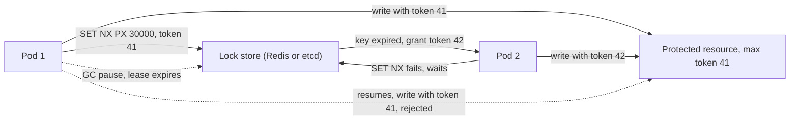

# Distributed Locks

> [!abstract] In one sentence
> A distributed lock gives one process at a time the right to act on something across machines by holding a time-limited key in Redis, ZooKeeper, etcd or a database — but since the holder can be paused or partitioned past the key's expiry, the lock alone is an efficiency optimisation, and correctness needs a fencing token checked by the resource or an idempotent operation.

> [!tip] Deeper treatment in your system-design vault
> `system-design/04 Caching and Redis/Distributed Locking.md` — read it *after* you have written your own explanation below.

**Map:** [[Distributed Systems MOC]] → [[HLD MOC]]

## Definition

A **distributed lock** is a mutual-exclusion primitive whose state lives in a shared service rather than in one process's memory: a process acquires it by atomically creating a key (or row, or znode) that does not yet exist, holds it while working, and releases it by deleting the key. Because the holder can crash, the lock carries a **TTL** or **lease**; because the holder can also be alive but stalled, a lease can expire while the holder still believes it holds the lock. A **fencing token** — a number that increases with every acquisition — is returned with the lock and attached to every action so the protected resource can reject actions from stale holders. Kleppmann's framing is the useful one: locks for **efficiency** (avoid doing work twice) tolerate occasional double-holders; locks for **correctness** (never corrupt state) do not, and need fencing.

## Problem solved

Many operations are safe only if one process at a time performs them: regenerating an expensive cache entry so a hundred pods do not all hit the database at once ([[Cache Stampedes]]), running a scheduled job across replicas, applying a migration, mutating a shared file in object storage, or processing all events for one account in order. Within one process a mutex solves this; across pods on Kubernetes there is no shared memory. Before distributed locks, teams either ran a single instance (a point of failure that blocks rolling deploys) or accepted duplicate work and its side effects. The lock gives the single-instance guarantee back without the single instance — but the history of the Redlock debate (2016) showed that a lock in a store with TTLs does *not* give the mutual-exclusion guarantee people assume, and that misunderstanding has produced double payouts and corrupted files.

In a stack like yours, Redis is already everywhere, so `SET NX PX` locks are the obvious tool and the obvious trap: they are perfect for stampede protection and job deduplication, and dangerous as the only guard on a ledger write.

## How it works

1. **Acquire atomically.** Redis: `SET lock:order:42 <random-token> NX PX 30000` — create only if absent, with a 30 s expiry, storing a random value that identifies this holder. A database: `INSERT INTO locks (name, holder, lease_until)` with a unique constraint, or `UPDATE … WHERE lease_until < now()` using the database's clock ([[Leader Election]] shows the SQL). etcd: `txn` that creates the key only if its create-revision is 0, attached to a lease. ZooKeeper: an ephemeral sequential znode under `/locks/x`, lowest sequence holds the lock.
2. **Hold with a bounded lease and renew if needed.** The TTL is the crash recovery mechanism: if the holder dies, the lock frees itself after the TTL. Long-running holders renew (a "watchdog" thread extending `PX` while working), which is convenient and dangerous: a renewing holder that is *paused* cannot renew, and its lease expires anyway.
3. **Release only your own lock.** A holder that was paused may wake after expiry and try to delete a lock now held by someone else. Compare the stored random token before deleting, atomically, in a Lua script. Deleting unconditionally is the second most common lock bug.
4. **Fence the protected resource.** The acquisition returns a monotonically increasing token (ZooKeeper's zxid or sequence, etcd's revision, a database sequence incremented on each grant; Redis `SET NX` does not return one, so add an `INCR` counter under the same lock name). Every write to the resource carries the token and the resource rejects tokens lower than the highest it has seen. Without this step, a paused holder can corrupt state regardless of TTL tuning ([[Split-Brain]]).
5. **Redlock and why it is contested.** Redlock acquires the same key on N independent Redis masters (typically 5), succeeds if a majority were acquired within less than the TTL, and treats the remaining validity as `TTL − elapsed − drift`. The critique is that it still relies on timing assumptions (no process pause, bounded clock drift across masters) that a correctness lock cannot make, and it offers no fencing token; the response is that it is adequate for efficiency locks, which is also true of a single Redis instance. The honest rule: Redlock does not change which category of lock you can safely build.
6. **Lock-free alternatives for the common cases.** For "do not process the same job twice", a unique constraint on `(job_id, run_date)` or `FOR UPDATE SKIP LOCKED` on the job row does the job with the database's own locking ([[Optimistic and Pessimistic Locking]]). For "one at a time per account", route by key so all events for an account go to one partition and one consumer ([[Topic Partitions]]).

```lua
-- Redis: release only if we still hold it (atomic compare-and-delete)
if redis.call("GET", KEYS[1]) == ARGV[1] then
  return redis.call("DEL", KEYS[1])
else
  return 0
end
```

## Architecture



> [!example]- Excalidraw version — the same diagram as an editable canvas
> ![[Distributed Locks.excalidraw]]
> [[Distributed Locks.excalidraw|Open in Excalidraw]] — needs the Excalidraw plugin (see [[Plugins to Install]]).


## Use cases

- "Only one worker should rebuild this cache entry / run this report / send this digest at a time" — an efficiency lock, where an occasional duplicate costs CPU, not correctness ([[Cache Stampedes]]).
- "This scheduled job must run once per period across N replicas" — lock plus a durable record of the run (a unique row) so the record, not the lock, provides the guarantee ([[Design a Distributed Job Scheduler]]).
- Serialising mutations to an external resource that cannot be made transactional (a file in S3, a partner API with no idempotency) — needs fencing or the external side's version check (S3 conditional writes with `If-Match` on ETag are a fencing token).
- Coordinating a one-off operation such as a schema migration at deploy time — a short-lived lock with a human-visible holder.
- Rate-limited or sequential access to a shared quota where the ordering of operations matters.

## Limitations

- A lock with a TTL cannot guarantee mutual exclusion; it guarantees that, absent pauses and partitions, exclusion *usually* holds. Only the resource's own check (token, version, unique constraint) guarantees correctness.
- The lock store is a dependency on the hot path: a Redis failover or an etcd quorum loss blocks every locked operation ([[Coordination vs Availability]]).
- Redis locks on a single instance are lost on primary failover with asynchronous replication: the replica may not have the key, and two holders result; Redis Cluster does not change this.
- Long-held locks serialise throughput: one lock per account is fine, one global lock for "all transfers" is a ceiling of one operation at a time plus a round trip.
- Locks hide design problems. If you need a lock to process messages in order, the fix is usually partitioning by key, not locking ([[Ordering Guarantees]]).

## Trade-offs

| You gain | You sacrifice |
|---|---|
| Single-instance semantics across a replicated service without a single instance | A hot-path dependency on the lock store and its failover behaviour |
| Crash recovery for free via TTL expiry | A pause-versus-expiry window in which two holders can exist |
| A simple mental model (acquire, work, release) | Correctness that still depends on fencing or idempotency in the resource |
| Cheap stampede and duplicate-work protection with Redis | Serialisation of everything under the same lock name |

## Failure modes

- **Pause past expiry** — the holder stalls (GC, I/O, CPU throttling, debugger), the key expires, another holder proceeds, the first resumes and writes. You notice as fencing rejections (if fenced) or as duplicated or interleaved effects (if not); blast radius is whatever the resource lets a stale writer do ([[Split-Brain]]).
- **Lock lost on failover** — Redis primary dies after granting the lock but before replicating the key; the new primary grants it again. Noticed only as a duplicate; radius is every lock granted in the replication-lag window.
- **Deleting someone else's lock** — unconditional `DEL` on release after a pause; the next holder's lock vanishes and a third holder enters. Noticed as three-way overlaps that make no sense in the logs; fixed by compare-and-delete.
- **Lock store outage** — Redis or etcd unreachable; every locked path blocks or fails. Noticed as a cliff in throughput with the lock client's timeout as the latency; radius is every feature sharing the store. Decide fail-open (do the work, risk duplicates) versus fail-closed (refuse) per use.
- **Orphaned lock with no TTL** — a "safer" lock without expiry, holder crashes, lock held forever until a human deletes it. Noticed as a stuck job and a 3 a.m. page; radius is one lock name, but it recurs.

## Performance

A Redis lock costs one round trip to acquire (sub-millisecond in the same AZ, typically under 1 ms), one to release, and one per renewal; etcd and ZooKeeper cost a consensus round (a few milliseconds) per acquisition because the grant is replicated to a majority. Contention cost is the real number: with `k` waiters polling every 50 ms, the store sees `20k` requests per second per lock name; blocking acquisition via a watch (etcd, ZooKeeper) or a pub/sub notification (Redisson does this) avoids the polling. Fencing checks add a compare in the resource (one indexed read or a `WHERE` predicate). Throughput under a lock is bounded by `1 / (hold time + two round trips)` — about 100 operations per second for a 10 ms hold on Redis — which is why lock granularity (per account, per key) matters more than lock-store speed.

## Scalability

Locks scale by narrowing their name: a lock per aggregate (order, account, file) spreads contention across keys, and a Redis or etcd store handles millions of distinct lock names comfortably. What does not scale is a coarse lock protecting a popular resource — it is a serialisation point whose throughput is fixed regardless of fleet size. At 10x load, re-examine each lock: can the work be partitioned by key to a single owner ([[Consistent Hashing]], [[Topic Partitions]]), made idempotent so concurrent execution is harmless, or pushed into the database's own row locks? Many systems at scale have zero distributed locks for exactly this reason.

## Operational impact

Expose metrics per lock name: acquisition latency, wait time, hold time, failures to acquire, and — most important — fencing rejections, which should be zero in steady state and non-zero only during pauses and failovers. Store a human-readable holder identity and acquisition time in the lock value so an on-call engineer can see who holds a stuck lock. Decide and document the behaviour when the lock store is down. Review TTLs against actual p99 hold times (a 30 s TTL on a job that sometimes takes 2 minutes is a split-brain generator), and include a `SIGSTOP`-the-holder test in resilience drills ([[Chaos Lab]]).

## Alternatives

- **Database locks and constraints** — `SELECT … FOR UPDATE`, advisory locks (`pg_advisory_xact_lock`), unique indexes; wins whenever the protected state is already in that database, because the lock and the write share a transaction and no fencing is needed ([[Optimistic and Pessimistic Locking]], [[Transactions]]).
- **Partitioned ownership** — route all work for a key to one consumer or one leader so exclusion is structural; wins for ordered event processing and per-entity state machines ([[Consumer Groups]]).
- **Idempotent operations with dedup keys** — allow concurrent execution and make duplicates harmless; wins when the work is cheap and the side effect can be keyed ([[Idempotency]], [[Duplicate Message Processing]]).
- **Leader election for long-lived exclusivity** — when the "lock" is held for hours (a singleton service role), use an election with proper fencing instead of a renewed short lock ([[Leader Election]]).

## Real-world examples

- **ZooKeeper's recipes** define the lock recipe with ephemeral sequential nodes and "watch the predecessor", and the zxid provides a fencing token; HBase and early Kafka used it for master and controller exclusivity.
- **etcd** ships `concurrency.Mutex` built on leases and the key's create revision, which is the fencing token; Kubernetes operators use the same primitives through `Lease` objects.
- **Redis** documents `SET NX PX` single-instance locks and Redlock; the published exchange between Martin Kleppmann and Redis's author in 2016 is the clearest statement of the efficiency-versus-correctness distinction and is worth reading in full.
- In a stack like yours: a Redis lock (via Redisson in Spring Boot or `redlock`/`ioredis` in NestJS) is the right tool for stampede protection and job deduplication; for a ledger posting or a payout, the guard must be a unique constraint or version check in PostgreSQL, with the Redis lock at most reducing contention in front of it.

## Practical exercise

1. Run Redis with Docker Compose and write two instances of a small worker (Java with Lettuce, or TypeScript with ioredis) that acquire `lock:demo` with `SET NX PX 5000`, then append `instance, counter, token` to a PostgreSQL table every 500 ms for 10 s, then release with the Lua compare-and-delete.
2. Pause instance 1 with `docker pause` for 8 s while it holds the lock; observe instance 2 acquiring, then instance 1 resuming and writing — count the interleaved rows.
3. Add a fencing token: `INCR lock:demo:token` on each acquisition, and make the insert `… WHERE token >= (SELECT max(token) FROM rows)`; repeat the pause and confirm instance 1's writes are rejected.
4. Replace the Lua release with a plain `DEL` and run the pause again; show instance 1 deleting instance 2's lock and a third instance entering.
5. Measure: acquisition latency distribution, maximum throughput under the lock at hold times of 1 ms, 10 ms and 100 ms, and behaviour when Redis is killed mid-hold (decide fail-open or fail-closed and implement it).

## Related concepts

### Prerequisites
- [[Optimistic and Pessimistic Locking]] — the single-database version, and the first alternative to try
- [[Redis]] — the usual lock store and its replication caveats
- [[Clocks and Time]] — TTLs and leases are durations measured on untrusted clocks
- [[Failure Detection]] — expiry is a timeout, with a timeout's false positives

### Related
- [[Split-Brain]] — two holders is split-brain at the granularity of a lock
- [[Consensus]] — etcd and ZooKeeper locks are consensus-replicated entries
- [[Idempotency]] — the fallback that makes double-holding harmless
- [[Quorums]] — what Redlock borrows and what it does not get from it
- [[Transactions]] — a lock and the protected write in one transaction needs no fencing

### Builds on this
- [[Leader Election]] — a long-held lock with the same fencing requirement
- [[Cache Stampedes]] — single-flight regeneration is an efficiency lock
- [[Coordination vs Availability]] — every lock is a coordination point with an availability cost

### Design problems where it applies
- [[Design a Distributed Job Scheduler]]
- [[Design a Ticket Booking System]]
- [[Design an Inventory Management System]]
- [[Design a Payment System]]

### Projects where it can be implemented
- [[Lock Service with Fencing Tokens]]
- [[Durable Job Scheduler]]
- [[Double-Entry Ledger Service]]

### Resources
- [[Designing Data-Intensive Applications]] — chapter 8, "The leader and the lock" and fencing tokens
- [[Understanding Distributed Systems]] — leases and the limits of time-based exclusivity
- [[Kleppmann Distributed Systems Lecture Notes]] — the mutual-exclusion and safety arguments

## Personal understanding

> [!question] Explain it without the source
> Write your own explanation here, from memory. Then compare it with the sections above and note what you missed.

### Mastery checklist
- [ ] I can explain it without the original resource
- [ ] I can describe the problem it solves
- [ ] I can compare it with its alternatives
- [ ] I can name its limitations and failure modes
- [ ] I can recognise when it is appropriate in a real system
- [ ] I have applied it in a system design
- [ ] I have validated my assumptions with an experiment or implementation

## Open questions

- [ ] Which of the locks in a typical service of mine are efficiency locks and which are correctness locks, and for the correctness ones, what in PostgreSQL (unique constraint, version column, advisory lock) actually provides the guarantee?
- [ ] How does Redisson's watchdog renewal behave during a JVM safepoint pause longer than the lock TTL, and what does the client report when it resumes?
- [ ] With Redis Streams consumer groups, does per-partition ownership via `XREADGROUP` plus `XAUTOCLAIM` remove the need for explicit locks on per-account processing, and what is the equivalent of a fencing token there?
