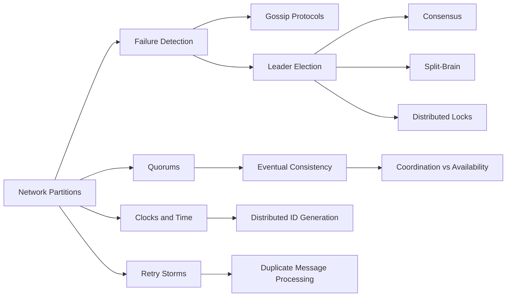

# Distributed Systems

> [!abstract] The rules of the game once there is more than one machine.
> Short, dense, and mostly vocabulary at SDE-2 level: partitions, clocks, quorums, leader election, locks, and the two practical ideas you will use every week — idempotent duplicate handling and retry-storm prevention.

**Map:** [[HLD MOC]] → this · [[Start Here]] for the reading plan · [[Engineering Dashboard]] for progress

## Start with these

[[Network Partitions]] → [[Eventual Consistency]] → [[Quorums]] → [[Leader Election]] → [[Distributed Locks]] → [[Retry Storms]] → [[Duplicate Message Processing]]

## How the ideas connect

*Every node is a link — click to open the note. Arrows mean "read this first".*



## Concepts

### Core — know these cold for SDE-2

- [[Leader Election]] — Pick exactly one node to coordinate for a bounded lease, via a quorum or a lock service
- [[Distributed Locks]] — A distributed lock is a lease on a name held in a shared store
- [[Eventual Consistency]] — Eventual consistency promises only that replicas converge once writes stop
- [[Distributed ID Generation]] — Generate unique identifiers on many nodes without a coordination round trip by combining time, a node id and a sequence (Snowflake, UUIDv7, ULID) or by using enough…
- [[Quorums]] — A quorum is any set of replicas large enough that two such sets must overlap
- [[Network Partitions]] — A partition is a network fault that leaves nodes alive but unable to reach each other
- [[Retry Storms]] — A retry storm is the feedback loop in which retries from clients and intermediate layers multiply load on an already struggling dependency, converting a brief slowdown…
- [[Duplicate Message Processing]] — Duplicates are unavoidable wherever a sender cannot tell whether its message arrived

### Important — read once, revisit when a design needs it

- [[Consensus]] — Consensus lets a group of unreliable nodes agree on one sequence of decisions despite crashes and partitions
- [[Failure Detection]] — A failure detector turns silence into a decision by timing out heartbeats
- [[Clocks and Time]] — Wall clocks on different machines disagree and jump, so ordering across machines must come from logical clocks, versioning or a single arbiter, while wall time is kept…
- [[Split-Brain]] — Split-brain is two nodes both acting as the single authority at once, caused by a partition or a pause outliving a lease
- [[Coordination vs Availability]] — Every point where nodes must agree before acting — a lock, a leader, a transaction, a quorum — costs latency on every operation and availability whenever the agreeing…

### Vocabulary — skim, link, move on

- [[Gossip Protocols]] — Gossip spreads membership and state by having each node periodically exchange what it knows with a few random peers, reaching every node in logarithmic rounds with no…

### Also part of this area

Replication is a database note and also a distributed-systems idea: [[Replication]]

## Where it shows up

**Design problems that lean on this category:** [[Design a Distributed Key-Value Store]], [[Design a Distributed Job Scheduler]], [[Design a Distributed Cache]], [[Design a Payment System]], [[Design a Message Queue]], [[Design an Inventory Management System]], [[Design a Chat System]], [[Design a Collaborative Document Editor]]

**Projects that exercise it:** [[Mini-KV Store]], [[Chaos Lab]], [[Durable Job Scheduler]], [[Lock Service with Fencing Tokens]], [[Double-Entry Ledger Service]], [[Webhook Relay]]

## Progress in this category

Status and confidence come from each note's properties — update them in the note, the table updates itself (native Bases, no plugin).

```base
filters:
  and:
    - file.hasTag("concept")
    - category == "Distributed Systems"
formulas:
  rank: 'if(priority == "high", 1, if(priority == "medium", 2, 3))'
properties:
  file.name:
    displayName: Concept
  formula.rank:
    displayName: "#"
views:
  - type: table
    name: Tracker
    order:
      - file.name
      - priority
      - status
      - confidence
      - last_reviewed
      - next_review
    sort:
      - property: formula.rank
        direction: ASC
      - property: file.name
        direction: ASC
    summaries:
      confidence: Average
```
