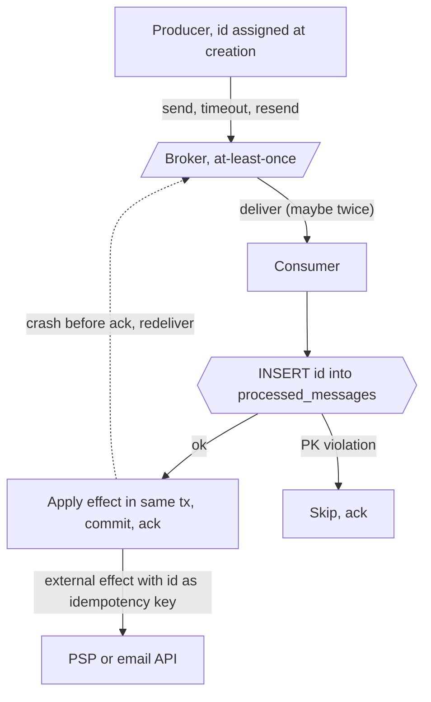

# Duplicate Message Processing

> [!abstract] In one sentence
> Under at-least-once delivery and timeouts, every message will eventually arrive twice, so the consumer — not the broker — must make the second arrival harmless by recording that a message id was processed in the same transaction as its effect, or by making the effect itself idempotent; "exactly-once" is a property you build at the consumer, never one you receive.

> [!tip] Deeper treatment in your system-design vault
> `system-design/08 Distributed Systems Theory/Idempotency.md` — read it *after* you have written your own explanation below.

**Map:** [[Distributed Systems MOC]] → [[HLD MOC]]

## Definition

**Duplicate message processing** is the consumer-side problem of receiving the same logical message more than once and ensuring its effects occur exactly once. Duplicates arise from any ambiguity about delivery: a producer retries after a timeout though the broker had stored the message; a broker redelivers because the consumer's acknowledgement was lost or came late; a consumer crashes after applying the effect but before committing its offset; an [[Outbox Pattern|outbox relay]] republishes after a crash. **Deduplication** means detecting a repeat by a stable **message id** (or idempotency key) and skipping it; **idempotent processing** means the handler's effect is the same whether applied once or many times, so no detection is needed. The two are combined in practice: a dedup record is written atomically with the effect, so detection and effect cannot disagree.

## Problem solved

Networks give senders no reliable way to learn whether a message was delivered: the request can be lost, or processed with its acknowledgement lost, and the sender sees the same timeout either way ([[Timeouts and Retries]], [[Network Partitions]]). The only two consistent choices are to not retry (and lose messages — [[At-Most-Once Delivery]]) or to retry (and duplicate — [[At-Least-Once Delivery]]). Every system that must not lose messages therefore produces duplicates, and every consumer that is not designed for them does something twice: credits an account twice, sends a customer two emails, creates two shipments, posts two ledger entries, emits two downstream events that fan out into four. In a payments domain the duplicate is not a cosmetic bug; it is money moved twice and a reconciliation break. The folklore solution — "we use Kafka's exactly-once" — does not cover effects outside Kafka (databases, emails, partner APIs), which is where the effects usually are ([[Exactly-Once Semantics]]).

In a stack like yours, with a history of RabbitMQ, Kafka, SQS (standard queues explicitly deliver at least once) and a planned move to Redis Streams (where a message stays pending until `XACK` and is redelivered via `XAUTOCLAIM`), the duplicate rate differs by broker but is never zero, and the consumer design is what makes the migration safe.

## How it works

1. **A stable id on every message.** The producer assigns the id when the message is *created*, not when it is sent, so retries carry the same id. An outbox row id, a UUIDv7 generated in the transaction, or a business key (`payment_id + attempt`) all work; a broker-assigned offset does not survive republication ([[Distributed ID Generation]]).
2. **Dedup record and effect in one transaction.** The consumer inserts the id into a `processed_messages` table (primary key on the id) in the same database transaction that applies the effect. A duplicate hits the unique constraint and the transaction rolls back, leaving the first effect intact; a crash between effect and commit rolls back both. This is the one pattern that is correct under every interleaving, and it requires the effect to be in a transactional store.
3. **Effects outside the transaction.** Emails, webhooks, payment captures and downstream events cannot be rolled back. Make them idempotent at the receiver (pass the message id as the receiver's idempotency key — PSPs and most mature APIs support one), or convert them into a transactional effect by writing them to an outbox and letting the relay deliver with the id ([[Outbox Pattern]], [[Idempotency]]).
4. **Naturally idempotent operations.** `SET status = 'SHIPPED'`, `INSERT … ON CONFLICT DO NOTHING`, "upsert this snapshot", "ensure this resource exists" are safe to repeat with no dedup record. `balance = balance + 10` is not; it must be rewritten as "apply ledger entry with id X" where the entry's id is unique.
5. **Dedup windows and stores.** A dedup table grows forever unless pruned; keep ids for longer than the maximum redelivery horizon (broker retention plus relay replay plus DLQ reprocessing — often days, not minutes) and partition or TTL the table. Redis `SET id 1 NX EX <window>` is a cheap dedup store for effects that are not transactional, but it is not atomic with the effect: the consumer can mark then crash before acting (message lost) or act then crash before marking (duplicate); choose the order that matches the failure you prefer, or use the database.
6. **Ordering and duplicates interact.** A duplicate of an *old* message arriving after newer ones must not regress state; version checks (`WHERE version = expected`) or per-key sequence numbers make stale duplicates no-ops, not overwrites ([[Ordering Guarantees]], [[Optimistic and Pessimistic Locking]]).

```sql
BEGIN;
INSERT INTO processed_messages (message_id, consumer, processed_at)
VALUES ('6f1c…', 'ledger-poster', now());          -- PK violation => duplicate, ROLLBACK
INSERT INTO ledger_entries (id, account_id, amount, source_message_id)
VALUES ('e9a0…', 42, 1999, '6f1c…');
COMMIT;                                              -- offset/ack only after commit
```

## Architecture



> [!example]- Excalidraw version — the same diagram as an editable canvas
> ![[Duplicate Message Processing.excalidraw]]
> [[Duplicate Message Processing.excalidraw|Open in Excalidraw]] — needs the Excalidraw plugin (see [[Plugins to Install]]).


## Use cases

- Any consumer of an at-least-once source: Kafka, SQS standard, RabbitMQ with acks, Redis Streams consumer groups, webhooks received from partners ([[Message Queues]], [[Design a Webhook Delivery System]]).
- Financial effects: posting ledger entries, capturing or refunding payments, issuing payouts — the requirement "no double posting" is a dedup requirement ([[Design a Payment System]], [[Design a Digital Wallet and Ledger]]).
- Notifications and outbound communication where a duplicate is customer-visible ([[Design a Notification System]]).
- Job execution where a scheduler may enqueue the same run twice (lease expiry, retry) — the run id is the dedup key ([[Design a Distributed Job Scheduler]]).
- Replays: reprocessing a topic from an earlier offset after a bug fix is a deliberate flood of duplicates; a consumer built for duplicates makes replay a routine operation instead of a risk.

## Limitations

- Dedup by id needs the id to be stable end to end; a producer that regenerates ids on retry, or an intermediary that re-wraps messages with new ids, defeats it.
- The transactional pattern needs a transactional store that the effect also lives in; polyglot effects (database plus Elasticsearch plus a partner call) need per-target idempotency.
- Dedup stores have a window; a duplicate older than the window gets through. Retention must exceed the worst-case redelivery path, including DLQ reprocessing weeks later.
- Idempotency is per *message*, not per *business intent*: two genuinely different messages that both say "charge £10" are not duplicates, and dedup will not save you from a producer bug that creates two intents.
- Redis-based dedup is probabilistic under failover (asynchronous replication can lose the marker) and must be treated as an optimisation in front of a transactional check for anything that matters.

## Trade-offs

| You gain | You sacrifice |
|---|---|
| Safety to retry, redeliver and replay freely | A dedup table or store with retention, growth and cleanup |
| Consumer correctness independent of broker guarantees | A message id discipline across every producer and every hop |
| One pattern that covers crashes at every point (effect-then-ack) | One extra indexed insert per message and transactional coupling of effect and marker |
| Migrations between brokers without re-auditing every handler | Per-target idempotency for effects that cannot share the transaction |

## Failure modes

- **Effect applied, ack lost, redelivered, applied again** — the baseline duplicate; without a dedup record you notice as double entries, double emails, reconciliation breaks; blast radius is every non-idempotent effect in the handler.
- **Marker written, effect lost** — Redis `SET NX` before the effect, consumer crashes; the redelivery is skipped as a duplicate and the message is effectively dropped. Noticed as missing effects with no error; this is [[At-Most-Once Delivery]] by accident.
- **Dedup window too short** — a DLQ message reprocessed after the TTL expired is applied again. Noticed weeks later as a duplicate with a very old timestamp; radius is every late replay.
- **Id changes in transit** — a gateway or relay assigns fresh ids; the consumer sees distinct messages. Noticed as duplicates that "cannot happen" because dedup exists; radius depends on the relay's retry rate.
- **Downstream fan-out of a duplicate** — a consumer that is deduplicated for its own writes still emits its outbound event twice; the next hop now has the problem. Noticed two services away; fixed by generating the outbound event id deterministically from the inbound id ([[Fan-Out]]).

## Performance

The transactional pattern costs one indexed insert per message into a table whose primary key is the message id — microseconds of CPU and one extra page write, which at tens of thousands of messages per second is noticeable but small compared with the business write it protects. The table's index should be on a time-ordered id so inserts stay append-mostly ([[Indexing]]). Redis dedup costs one round trip (sub-millisecond). Idempotent-by-design handlers cost nothing extra. Retention cleanup (deleting ids older than the window) should run in batches or use partition drops to avoid vacuum pressure ([[Data Retention and Archival]]).

## Scalability

Dedup state scales with message volume times retention: 10,000 messages per second kept for 7 days is about 6 billion rows — a partitioned table with daily partitions dropped on expiry, or a per-consumer, per-partition store, rather than one global table. Partitioned consumers (Kafka, Redis Streams) can keep dedup state keyed by partition so it shards with the work. At 10x, idempotent-by-design handlers become more attractive than dedup tables precisely because they carry no state, and per-key sequence numbers (reject anything not strictly newer) replace per-message markers for ordered streams.

## Operational impact

Measure the duplicate rate (dedup hits per consumer) and alert on step changes: a jump reveals a broker, relay or timeout misconfiguration before it reveals itself as a bug. Make replay a documented operation with the dedup guarantee as its precondition. Keep the dedup table's retention and the broker's retention in the same runbook so one is not shortened without the other. For external effects, log the idempotency key sent to each partner so support can prove to a PSP that two calls were one intent. Debugging a suspected duplicate starts with the message id's history across hops, which requires the id to be in every log line ([[Logging]], [[Distributed Tracing]]).

## Alternatives

- **Broker-level exactly-once (Kafka transactions, SQS FIFO with deduplication ids)** — removes duplicates *within* the broker's domain (Kafka-to-Kafka processing, SQS enqueue within a 5-minute window); wins for stream-processing topologies, and does nothing for effects in a database or a partner API ([[Exactly-Once Semantics]]).
- **At-most-once delivery** — no retries, accept loss; wins for telemetry and metrics where a lost sample is cheaper than a duplicate ([[At-Most-Once Delivery]]).
- **Single-writer sequencing** — route every message for a key to one consumer that keeps the last applied sequence number and ignores anything not newer; wins for ordered per-entity streams and needs no per-message table ([[Ordering Guarantees]]).
- **Saga-level compensation** — detect the duplicate's effect after the fact and reverse it; wins only when prevention is impossible (legacy receivers) and the compensation is itself safe ([[Saga Pattern]]).

## Real-world examples

- **Stripe's idempotency keys** make `POST` requests safe to retry by storing the first response per key for 24 hours and replaying it — the API-side version of this pattern, and the reason a retried charge does not double-bill ([[Stripe - Idempotency]]).
- **Amazon SQS** documents standard queues as at-least-once with occasional duplicates, and FIFO queues' deduplication id as a five-minute window — a published dedup window with exactly the limitation described above.
- **Kafka's idempotent producer** uses a producer id and sequence number per partition so the broker discards retried batches, which removes producer-side duplicates but not consumer-side ones; the Confluent exactly-once write-up is explicit about that boundary ([[Confluent - Exactly-Once Semantics in Kafka]]).
- In a stack like yours: a ledger consumer on SQS or Kafka that inserts `processed_messages` and `ledger_entries` in one PostgreSQL transaction, acks only after commit, and forwards the message id as the PSP's idempotency key is correct under every broker you have used and the one you are moving to; the design survives the migration because it never relied on the broker.

## Practical exercise

1. In Docker Compose run PostgreSQL and a broker (Kafka, Redpanda, or Redis for Streams), with a producer that sends `credit(account, amount, message_id)` messages and a consumer that applies `UPDATE accounts SET balance = balance + amount` and then acks.
2. Make the consumer crash (`process.exit` or `System.exit`) after the update and before the ack on 5% of messages; run 10,000 messages and compare the final balances with the expected sum — measure the overshoot.
3. Add the `processed_messages` insert inside the same transaction and ack after commit; rerun and show the balances exactly correct, and count dedup hits.
4. Replace the transactional marker with a Redis `SET NX` before the effect; crash between the two and show a *lost* credit; then move the marker after the effect and show a duplicate again — document why neither order is safe.
5. Replay the topic from offset 0 (or re-deliver the whole stream) and confirm zero change to balances; then shorten the dedup retention to 1 minute, wait, replay, and observe the duplicates return.

## Related concepts

### Prerequisites
- [[At-Least-Once Delivery]] — the guarantee that produces the duplicates
- [[Idempotency]] — the property the consumer must have
- [[Timeouts and Retries]] — why a sender cannot know whether to resend
- [[Delivery Semantics]] — the three choices and why only one keeps messages

### Related
- [[Outbox Pattern]] — a producer-side source of duplicates that depends on this note
- [[Retry Strategies]] — every retry is a potential duplicate
- [[Dead-Letter Queues]] — reprocessed DLQ messages are late duplicates
- [[Consumer Groups]] — rebalances redeliver uncommitted messages
- [[Optimistic and Pessimistic Locking]] — version checks make stale duplicates no-ops
- [[Redis]] — a fast but non-transactional dedup store

### Builds on this
- [[Exactly-Once Semantics]] — what "exactly-once" means once consumer dedup is understood
- [[Saga Pattern]] — every saga step must tolerate redelivery of its command
- [[Event-Driven Architecture]] — consumers that tolerate duplicates are the precondition for replay and loose coupling

### Design problems where it applies
- [[Design a Payment System]]
- [[Design a Webhook Delivery System]]
- [[Design a Notification System]]
- [[Design a Digital Wallet and Ledger]]
- [[Design a Distributed Job Scheduler]]

### Projects where it can be implemented
- [[Webhook Relay]]
- [[Double-Entry Ledger Service]]
- [[Durable Job Scheduler]]

### Resources
- [[Stripe - Idempotency]] — the API-side pattern and its 24-hour window
- [[AWS Builders Library - Idempotent APIs]] — designing effects to be safely repeatable
- [[Brandur - Implementing Idempotency Keys]] — the transactional implementation walkthrough
- [[Confluent - Exactly-Once Semantics in Kafka]] — the precise boundary of broker-level guarantees

## Personal understanding

> [!question] Explain it without the source
> Write your own explanation here, from memory. Then compare it with the sections above and note what you missed.

### Mastery checklist
- [ ] I can explain it without the original resource
- [ ] I can describe the problem it solves
- [ ] I can compare it with its alternatives
- [ ] I can name its limitations and failure modes
- [ ] I can recognise when it is appropriate in a real system
- [ ] I have applied it in a system design
- [ ] I have validated my assumptions with an experiment or implementation

## Open questions

- [ ] For each consumer in a payments flow, which effects are in the same PostgreSQL transaction as a dedup marker, which rely on a partner's idempotency key, and which are currently unprotected?
- [ ] What is the actual maximum redelivery horizon across SQS retention, DLQ reprocessing and a Kafka replay in a typical setup, and is any dedup retention shorter than it?
- [ ] With Redis Streams, how do `XPENDING` idle time, `XAUTOCLAIM` and consumer crashes combine to produce duplicates, and does `XACK`-after-commit give the same guarantee as Kafka's commit-after-transaction?
