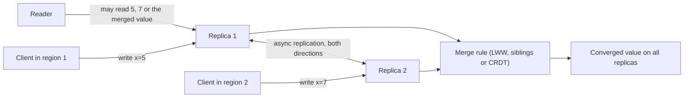

# Eventual Consistency

> [!abstract] In one sentence
> Eventual consistency is the weakest useful guarantee a replicated system can make — if writes stop, all replicas will eventually hold the same value — and it buys availability and low latency across replicas and regions at the price of stale reads, concurrent-write conflicts, and a merge rule that is your responsibility, not the database's.

> [!tip] Deeper treatment in your system-design vault
> `system-design/08 Distributed Systems Theory/Consistency Models.md` — read it *after* you have written your own explanation below.

**Map:** [[Distributed Systems MOC]] → [[HLD MOC]]

## Definition

A replicated system is **eventually consistent** if, once no new updates are made to an item, all reads of that item will eventually return the same last-updated value. It is a *liveness* guarantee about convergence with no bound on *when*, and it says nothing about what reads return before convergence: a client may read a stale value, read a new value and then an older one, or see its own write disappear and reappear. Stronger variants add session guarantees — **read-your-writes**, **monotonic reads**, **monotonic writes**, **writes-follow-reads** — and **causal consistency** adds that causally related writes are seen in order everywhere. Within the [[Consistency Models]] hierarchy, eventual consistency sits at the bottom; linearizability sits at the top.

## Problem solved

Strong consistency across replicas requires coordination on every write — a leader, a quorum, a lock — and coordination costs latency (a round trip to a majority, or across regions) and availability (no quorum, no writes) ([[Coordination vs Availability]]). For many workloads that cost is wrong: a shopping cart in Dynamo must accept adds during a partition because a lost sale costs more than a merged cart; a social feed can show a like a second late; a DNS record can propagate over minutes; a product-catalogue cache can be stale for a bit. Eventual consistency names the guarantee that remains when you remove coordination from the write path, and forces the design to answer the question coordination was answering for you: what happens when two replicas accept conflicting writes?

In a stack like yours, eventual consistency is already present whether chosen or not: [[Read Replicas]] lag the primary, Redis caches lag the database ([[Cache Consistency]]), Kafka consumers project state seconds after the fact, and multi-region reads hit the local copy. The design skill is knowing which reads tolerate it and which (balances, holds, idempotency checks) do not.

## How it works

1. **Where staleness comes from.** Asynchronous replication: the primary acknowledges before replicas apply ([[Replication]]). Multi-leader or leaderless writes: different replicas accept different writes and exchange them later ([[Quorums]] with `R + W ≤ N` or sloppy quorums). Caches and derived views: materialised asynchronously from the source. Each has a lag, and the lag is what a stale read observes.
2. **How replicas converge.** Anti-entropy mechanisms push every write to every replica eventually: replication logs, read repair, Merkle-tree comparison, gossip ([[Gossip Protocols]]). Convergence requires that every replica, given the same set of writes, ends at the same value regardless of the order received — which means a deterministic **merge rule**.
3. **Merge rule: last-writer-wins (LWW).** Each write carries a timestamp; the highest wins. Simple, and the most common source of silent data loss: concurrent writes to the same key lose all but one, and with wall-clock timestamps the "winner" is whoever had the fastest clock ([[Clocks and Time]]). Acceptable for data where any single latest value is fine (a user's last-seen time, a profile field) and wrong for anything accumulated (counters, carts, balances).
4. **Merge rule: keep siblings, let the application merge.** Detect concurrency with vector clocks or version vectors, store both versions, and return them to the reader to reconcile (Dynamo's cart merge: union of items, which resurrects deleted items unless deletions are tracked). Correct but pushes complexity to every reader.
5. **Merge rule: CRDTs.** Data types whose operations commute and whose merge is a join: a grow-only counter (per-replica counts summed), a PN-counter (increments and decrements), observed-remove sets (adds and removes tagged with unique ids), sequence CRDTs for text. Replicas converge by construction, with no coordination and no lost updates, at the cost of metadata and a restricted set of operations ("decrement, but never below zero" is not expressible without coordination).
6. **Session guarantees.** Route a user's reads to the replica that took their write, or carry the write's version with the session and have replicas wait until they have caught up to it (PostgreSQL's `pg_last_wal_replay_lsn` compared with the write's LSN; DynamoDB's strongly consistent read flag; Cassandra's `LOCAL_QUORUM` after `LOCAL_QUORUM`). These turn "eventually" into "consistent from this user's point of view".

```text
Concurrent writes to cart:42 on two replicas, then merge:
  Replica A: {apple, pear}      version {A:2, B:1}
  Replica B: {apple, milk}      version {A:1, B:2}
  Versions are concurrent (neither dominates)
  LWW   -> one of them, the other is lost
  OR-Set -> {apple, pear, milk}  (both adds kept, removes tracked by tag)
```

## Architecture



> [!example]- Excalidraw version — the same diagram as an editable canvas
> ![[Eventual Consistency.excalidraw]]
> [[Eventual Consistency.excalidraw|Open in Excalidraw]] — needs the Excalidraw plugin (see [[Plugins to Install]]).


## Use cases

- Requirements with "available in every region", "works offline" or "must accept writes during a partition" — availability is being ranked above consistency ([[CAP Theorem]], [[PACELC]]).
- High read fan-out with tolerance for staleness: feeds, timelines, product catalogues, search indexes, dashboards ([[Design a Social Feed]], [[Search Indexing Pipelines]]).
- Naturally mergeable data: counters, sets, presence, collaborative documents, telemetry — CRDT territory ([[Design a Collaborative Document Editor]]).
- Derived data built from events: read models, caches, projections — eventually consistent with the write side by construction ([[CQRS]], [[Event-Driven Architecture]]).
- Cross-service state in a microservice landscape, where each service owns its data and others hold eventually consistent copies ([[Microservices]]).

## Limitations

- No bound on staleness: "eventually" can be seconds under load or hours during a replication outage, and the application cannot tell unless it measures lag.
- Invariants spanning multiple keys or requiring "at most / at least" (no overselling, no negative balance, unique usernames) cannot be enforced without coordination; eventual consistency does not do uniqueness.
- LWW silently loses concurrent updates; sibling resolution pushes complexity to clients; CRDTs restrict operations and add metadata. There is no free merge rule.
- Users notice: reading your own write and seeing it missing is a bug report, not an abstract anomaly. Session guarantees are usually required even when eventual consistency is chosen.
- Debugging is harder because the same read returns different answers depending on which replica, when.

## Trade-offs

| You gain | You sacrifice |
|---|---|
| Writes acknowledged locally with no cross-replica round trip | Reads that may be stale, and no bound on how stale |
| Availability during partitions and replica failures | Enforceable invariants across keys (uniqueness, non-negative counts) |
| Horizontal read scaling across replicas and regions | A merge rule you must design, test and explain to product owners |
| Simpler, more decoupled services (each owns a copy) | Session guarantees that must be added back deliberately |

## Failure modes

- **Lost update via LWW** — two services update the same document; the slower clock loses. You notice when a user's change vanishes without an error; blast radius is every concurrently written key, and it is invisible until someone compares histories ([[Clocks and Time]]).
- **Read-your-writes violation** — a user posts, refreshes, sees nothing (the read hit a lagging replica), posts again, now sees two. Noticed as duplicate user actions and support tickets; radius is any flow that reads after writing without routing or version pinning ([[Read Replicas]]).
- **Replication lag blow-up** — a replica falls minutes behind under load or after an outage; "eventual" becomes "much later" and stale reads become wrong decisions (an inventory check against a stale count oversells). Noticed by lag metrics, if they exist; radius grows with lag.
- **Resurrected deletes** — a delete on one replica merges with an older add from another and the item comes back; the classic Dynamo cart anomaly. Noticed as "I removed this, why is it back"; fixed by tombstones with their own retention problems.
- **Divergence that never converges** — a non-deterministic merge (dependent on arrival order) leaves replicas permanently different. Noticed by consistency checkers or by region-dependent behaviour; radius is every affected key until a manual repair.

## Performance

The point of eventual consistency is performance: a local write completes in the local replica's latency (sub-millisecond to a few milliseconds) rather than a cross-region round trip (tens to hundreds of milliseconds), and reads are served by the nearest copy. Background convergence consumes bandwidth proportional to the write rate times the replica count, plus anti-entropy scans. CRDT metadata can dominate small values (a per-replica entry in every counter), and sibling storage multiplies space for hot, contended keys. Lag — not throughput — is the metric to watch: replication delay per replica, consumer lag per projection.

## Scalability

Eventual consistency is the scaling strategy for reads and for geography. Replicas can be added without touching the write path; regions can serve locally. At 10x the writers, contention on hot keys produces more concurrent writes, more siblings and more merge work, which is why hot-key designs shard counters (per-replica or per-shard partial counts summed on read). The merge rule must stay deterministic and cheap as the number of writers grows; vector clocks that grow with writer count are replaced with server-side version vectors or server-assigned ownership ([[Hot Keys]]).

## Operational impact

Measure and alert on lag everywhere eventual consistency is relied upon: replica apply delay, cache age, consumer lag, projection freshness. Document per endpoint whether it reads the source or a copy, because the on-call engineer needs that to interpret "the user sees the wrong balance". Have a repair path: a way to re-replicate or rebuild a derived copy from the source of truth, and a reconciliation job that detects divergence ([[Design a Digital Wallet and Ledger]] treats reconciliation as a feature). Product owners need to be told, in plain terms, which screens can show stale data and for how long.

## Alternatives

- **Linearizable operations via consensus or single-leader synchronous replication** — every read sees the latest write; wins for balances, inventory holds, uniqueness and anything with an invariant ([[Consensus]], [[Transactions]]).
- **Causal consistency** — order preserved for related writes, concurrency allowed for unrelated ones; wins for social and collaborative applications where "reply appears before the post" is unacceptable but global order is unnecessary.
- **Tunable per-operation consistency** — strong reads where they matter, eventual elsewhere, from the same store ([[Quorums]]); wins when a single system must serve both kinds of access.
- **Single-region, single-writer with read replicas and read-your-writes routing** — the pragmatic default for most services: strong on the primary, eventual on replicas, with session routing for the user's own data ([[Read Replicas]]).

## Real-world examples

- **Amazon's Dynamo** chose eventual consistency with vector clocks and client-side merge for the shopping cart, and its paper is the origin of most of the vocabulary here ([[Dynamo Paper]]).
- **DNS** is the most widely deployed eventually consistent system: changes propagate as caches expire, bounded by TTLs, and everybody designs around it ([[DNS]]).
- **Riak and Redis Enterprise's active-active mode** ship CRDTs (counters, sets, maps) so that geo-distributed writes converge without application merge logic; Cassandra uses LWW on cell timestamps and documents the clock-skew caveat.
- In a stack like yours: a balance displayed from a Redis cache or a read replica is eventually consistent and fine; a balance *checked* before authorising a transfer must be read from the primary inside the transaction, and an idempotency check must never consult a lagging replica — the same data, two consistency requirements.

## Practical exercise

1. Run PostgreSQL with a streaming replica in Docker Compose and a small service with two endpoints: `POST /notes` writing to the primary and `GET /notes` reading from the replica.
2. Add [[Toxiproxy]] on the replication connection with 2 s of latency; write then immediately read and observe the missing note; measure replica lag with `pg_last_wal_replay_lsn()` against the primary's LSN.
3. Implement read-your-writes: return the write's LSN to the client, have `GET` wait until the replica has replayed at least that LSN (or fall back to the primary after 500 ms); confirm the anomaly disappears.
4. Build a two-replica in-memory key-value pair in TypeScript or Java with asynchronous exchange of writes; implement LWW with wall-clock timestamps, skew one node by 1 s, and demonstrate a lost update; then implement a grow-only set and a PN-counter and show convergence under the same skew.
5. Measure: write latency with and without waiting for the replica, read staleness distribution under load, and the metadata overhead of the CRDT per replica.

## Related concepts

### Prerequisites
- [[Consistency Models]] — where eventual sits in the hierarchy and what the stronger models add
- [[Replication]] — asynchronous replication is where the lag comes from
- [[Network Partitions]] — the situation in which eventual consistency keeps you available

### Related
- [[CAP Theorem]] — the availability side of the trade
- [[PACELC]] — the latency side of the same trade when there is no partition
- [[Quorums]] — tunable consistency and sloppy quorums
- [[Clocks and Time]] — why LWW on wall clocks loses data
- [[Cache Consistency]] — caches are eventually consistent copies with TTL-bounded staleness
- [[Read Replicas]] — the everyday source of stale reads in a relational stack

### Builds on this
- [[BASE]] — the acronym that names this design philosophy
- [[Coordination vs Availability]] — the general principle of which this is the storage instance
- [[Gossip Protocols]] — eventually consistent dissemination of membership and state
- [[CQRS]] — read models are eventually consistent projections
- [[Event-Driven Architecture]] — cross-service state is eventually consistent by design

### Design problems where it applies
- [[Design a Social Feed]]
- [[Design a Distributed Key-Value Store]]
- [[Design an Inventory Management System]]
- [[Design a Collaborative Document Editor]]
- [[Design a Distributed Cache]]

### Projects where it can be implemented
- [[Mini-KV Store]]
- [[Live Ops Dashboard]]

### Resources
- [[Dynamo Paper]] — the origin of practical eventual consistency with client-side merge
- [[Jepsen Consistency Models]] — the precise map of models and anomalies
- [[Designing Data-Intensive Applications]] — chapter 5 on replication lag and chapter 9 on consistency guarantees
- [[Fly.io Gossip Glomers Challenges]] — build a grow-only counter and feel convergence under partitions

## Personal understanding

> [!question] Explain it without the source
> Write your own explanation here, from memory. Then compare it with the sections above and note what you missed.

### Mastery checklist
- [ ] I can explain it without the original resource
- [ ] I can describe the problem it solves
- [ ] I can compare it with its alternatives
- [ ] I can name its limitations and failure modes
- [ ] I can recognise when it is appropriate in a real system
- [ ] I have applied it in a system design
- [ ] I have validated my assumptions with an experiment or implementation

## Open questions

- [ ] For each read in a typical payments flow (balance display, limit check, idempotency lookup, transaction history), which may come from a replica or cache and what is the maximum staleness that would be safe?
- [ ] How do Aurora read replicas and RDS read replicas differ in lag behaviour and in the mechanisms available for read-your-writes routing?
- [ ] Where would a CRDT genuinely simplify something in a fintech stack (rate-limit counters, feature usage counters, presence) versus where its inability to enforce "never below zero" rules it out?
