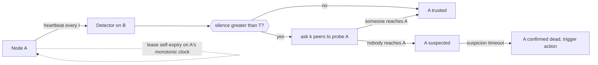

# Failure Detection

> [!abstract] In one sentence
> Failure detection is how a system decides that a node is dead when all it can observe is that the node has gone quiet, and since quiet also means slow, overloaded or partitioned, the design problem is choosing how long to wait and making sure that being wrong is survivable.

> [!tip] Deeper treatment in your system-design vault
> `system-design/03 Traffic Management/Health Checks and Service Discovery.md` — read it *after* you have written your own explanation below.

**Map:** [[Distributed Systems MOC]] → [[HLD MOC]]

## Definition

A **failure detector** is a component that gives each node an opinion about whether other nodes are alive, derived from the arrival or non-arrival of messages — usually periodic **heartbeats** — within a time window. In an asynchronous network no detector can be both perfectly **accurate** (never suspects a live node) and perfectly **complete** (eventually suspects every dead node); practical detectors are complete and only *eventually* accurate, meaning they will sometimes suspect a node that is merely slow. The detector's output is therefore a **suspicion**, with a confidence that grows as silence lengthens, and the system around it must be designed so that acting on a false suspicion is safe.

## Problem solved

Every distributed mechanism that reacts to failure — promoting a replica, reassigning a partition, redistributing work, evicting a member, draining a pod — needs a trigger, and the only available trigger is a timeout. Before thinking about it explicitly, teams set a timeout by habit (30 s because the HTTP client defaulted to it, 1 s because it felt responsive) and got both failure types: too long, and a dead primary leaves the system unwritable for half a minute while every caller's pool fills with hung requests; too short, and a GC pause or a burst of packet loss triggers a failover of a healthy database, which then triggers another, and the cluster spends the afternoon flapping. The special case that hurts most is **gray failure**: a node that answers heartbeats but fails real work (a disk that is slow but not dead, a NIC dropping 5% of packets), which naive detectors never catch because they measure the wrong signal.

In a stack like yours — Kafka consumers heartbeating to a group coordinator, Redis Sentinel deciding a primary is down, Kubernetes deciding a pod is unready, a service deciding its partner API is unreachable — there are a dozen independent detectors with a dozen independently chosen timeouts, and an incident usually involves two of them disagreeing.

## How it works

1. **Heartbeats and timeouts.** Node A sends a heartbeat every interval `I` (or B pings A). B marks A suspected if no heartbeat arrives within timeout `T`. The ratio matters: `T` must be several multiples of `I` to tolerate a lost heartbeat and jitter. Detection time is roughly `T`; false-positive rate rises as `T` approaches typical pause or delay times. Kafka consumers use `heartbeat.interval.ms` (default 3 s) against `session.timeout.ms` (default 45 s in recent clients); Redis Sentinel uses `down-after-milliseconds`; Raft uses a heartbeat interval with an election timeout about ten times larger (etcd defaults 100 ms and 1,000 ms).
2. **Phi accrual detectors.** Instead of a fixed `T`, keep a sliding window of recent inter-arrival times and model their distribution. Output a continuous suspicion level `phi = −log10(P(heartbeat still arrives given the current silence))`: phi of 1 means a 10% chance the node is alive, phi of 8 means 1 in 10^8. The caller picks a threshold per use (evict at 8, stop routing at 5). This adapts to the actual network: a jittery link pushes the threshold out automatically. Cassandra's gossip failure detector and Akka's remoting use it; Cassandra's `phi_convict_threshold` defaults to 8.
3. **Indirect probing (SWIM).** Rather than trusting one observer, a node that misses a ping asks `k` other members to ping the target on its behalf; only if all indirect probes fail is the target marked **suspected**, and a suspicion is disseminated with a timeout before becoming **confirmed**. This separates "I cannot reach it" from "nobody can reach it", which is exactly the distinction a partial partition breaks ([[Gossip Protocols]], [[Network Partitions]]).
4. **Leases as a cooperative detector.** The monitored node participates: it holds a lease it must renew, and it promises to stop acting when it cannot. Detection then has two sides — the observers stop trusting the node after `T`, and the node stops trusting itself after `T − margin` on its own monotonic clock ([[Clocks and Time]]). This is what makes failover of a leader safe rather than merely fast ([[Leader Election]]).
5. **Measuring the right signal.** A heartbeat that says "process is running" does not say "process can serve". Better detectors use the real workload as the signal: Kubernetes readiness probes call an endpoint that checks the service can actually do its job; Envoy's outlier detection ejects a host after consecutive 5xx responses from real traffic; a Raft follower's "I am alive" is implicit in acknowledging log entries. Passive detection from real traffic catches gray failures that active pings miss ([[Health Checks]], [[Circuit Breakers]]).
6. **Act safely on suspicion.** Because any suspicion may be wrong, the action it triggers must be reversible or fenced: route around the node (reversible), elect a new leader with a higher term and fence the old one (safe), but never "delete its data" or "assume its writes never happened" on suspicion alone.

```yaml
# Kafka consumer: heartbeats every 3 s, considered dead after 45 s of silence (defaults shown)
heartbeat.interval.ms: 3000
session.timeout.ms: 45000
# Separate from the processing-liveness check: a consumer that heartbeats but never polls
max.poll.interval.ms: 300000
```

## Architecture



## Use cases

- Any requirement with "automatic failover", "self-healing", "rebalance when a worker dies" or "detect unavailable instances" — the first design question is the detector and its timeout ([[Replication]], [[Consumer Groups]]).
- Membership for a cluster of peers (cache nodes, chat gateways, workers) where there is no central authority: SWIM-style detection plus gossip ([[Gossip Protocols]]).
- Presence features ("user is online") are failure detection applied to clients, with the same slow-versus-dead ambiguity and the same need for grace periods ([[Client State and Reconnection]]).
- Load balancers and service meshes deciding where to send traffic: active probes plus passive outlier detection ([[Load Balancers]], [[Service Discovery]]).

## Limitations

- No detector is simultaneously fast and accurate on a real network; the tuning is a choice of which failure you prefer, not a way to avoid both.
- Active heartbeats consume bandwidth and attention at scale: all-to-all heartbeating is O(n²) and the reason gossip-style protocols exist.
- Detectors measure reachability from one vantage point; during partial partitions, different observers reach different conclusions, and a protocol that lets any observer act unilaterally produces split-brain ([[Split-Brain]]).
- Phi accrual needs a history of arrivals to model; it behaves poorly immediately after startup or after a long idle period.
- A detector cannot make an unsafe action safe; it only decides *when* to act. Safety comes from fencing, quorums and idempotency, which are separate work.

## Trade-offs

| You gain | You sacrifice |
|---|---|
| Automatic reaction to failures without a human noticing | A false-positive rate that rises as you shorten the timeout |
| Adaptive thresholds (phi accrual) that follow real network behaviour | Less predictable detection time and a model that needs warm-up |
| Indirect probing that distinguishes "I cannot reach it" from "it is down" | More messages per suspicion and a longer confirmation delay |
| Passive detection from real traffic that catches gray failure | Noisy signals under low traffic, and a dependency on error classification |

## Failure modes

- **False positive under GC or I/O pause** — a healthy primary pauses 10 s, is declared dead, a replica is promoted, the old primary resumes. You notice as a failover event with no preceding crash, followed by fencing errors or split-brain; blast radius is every write during the overlap ([[Split-Brain]]).
- **Flapping** — timeout close to the normal jitter; nodes bounce between trusted and suspected, each flip triggering a rebalance (Kafka consumer group rebalances every minute, Cassandra marking nodes up and down). Noticed as a sawtooth of membership-change events and throughput collapsing while rebalances run.
- **Missed gray failure** — the node answers TCP pings and HTTP 200 on `/health` while real requests time out. Noticed only from client-side latency and error metrics; the detector keeps routing traffic to the sick node for as long as nobody looks ([[Health Checks]]).
- **Correlated false positives** — a network blip makes every node suspect every other node at once; everyone starts an election or a rebalance simultaneously. Noticed as a cluster-wide membership storm; radius is the whole cluster for the duration of the storm.
- **Detector dependency outage** — the thing doing the detecting (ZooKeeper, the Kubernetes API server, Sentinel) is itself unreachable, so either nothing fails over (stale membership) or everything does (every node unable to renew). Noticed as a wave of "lost session" errors across unrelated services.

## Performance

Heartbeat cost is `n × (1/I)` messages per second for a centrally monitored group and `n²/I` for all-to-all; at 1,000 nodes and a 1 s interval the latter is a million messages per second, which is why large clusters use gossip (each node contacts a few peers per round). Detection latency is bounded below by the timeout: a 45 s Kafka session timeout means a crashed consumer's partitions are reassigned no sooner than 45 s (plus the rebalance), while a 1 s Raft election timeout fails over in about a second. Phi accrual adds a small per-heartbeat computation (a running mean and variance) and a window of a few hundred samples per monitored peer.

## Scalability

At 10x the nodes, three things change: all-to-all heartbeating becomes unaffordable (move to gossip or hierarchical monitoring), the probability that *some* node is falsely suspected at any moment approaches one (so actions on suspicion must be cheap and reversible), and partial partitions become common (so single-observer verdicts must be replaced by indirect probing or quorum agreement). Centralised detectors like a Kafka group coordinator or Kubernetes node controller scale by sharding the monitored set across coordinators and by making the heartbeat cheap (a tiny message, no database write per beat).

## Operational impact

The timeouts are the configuration that matters most and is reviewed least. Document each detector in the system (consumer session timeout, Sentinel `down-after-milliseconds`, readiness probe period and failure threshold, Raft election timeout, HTTP client timeouts) with its reasoning, and alert on *membership change rate*, not just on membership. Keep GC pause and container throttling metrics next to failover events; most "mysterious failovers" are pauses. Chaos exercises should include pauses (`SIGSTOP`, CPU throttling) and not just kills, because kills are the easy case ([[Chaos Lab]]).

## Alternatives

- **Human-triggered failover** — the detector pages a person who decides; wins for low-change systems where a wrong automatic failover costs more than 15 minutes of downtime, and it is the right default for a primary database until the automation has been drilled.
- **Lease-based self-fencing only** — nodes stop acting when they cannot renew, and nobody actively detects anything; wins for singleton jobs where a vacancy of one lease is acceptable and no promotion is needed ([[Leader Election]]).
- **Passive outlier detection from real traffic** — eject on observed errors and latency, no active pings; wins for stateless services behind a proxy where the cost of a wrong ejection is a brief traffic shift ([[Circuit Breakers]]).
- **Consensus-backed membership** — membership changes go through a Raft log so every node agrees on who is in; wins when membership decisions must be consistent (sharded ownership), at the cost of coordination ([[Consensus]]).

## Real-world examples

- **Cassandra** combines gossip with a phi accrual detector; operators tune `phi_convict_threshold` upward on cloud networks with higher jitter to avoid flapping.
- **HashiCorp Consul and Serf** implement SWIM with the Lifeguard extensions, using indirect probes and a suspicion timeout scaled by cluster size so that one slow node does not get wrongly evicted.
- **Kafka** uses two separate liveness signals for a consumer — session heartbeats and `max.poll.interval.ms` — precisely because "the thread is alive" and "the consumer is making progress" are different failures.
- In a stack like yours: a Kubernetes readiness probe with `periodSeconds: 10` and `failureThreshold: 3` takes about 30 s to pull a sick pod from the Service, while an Envoy or ALB outlier policy based on real 5xx responses reacts in seconds; the first is the detector, the second is the one that protects users.

## Practical exercise

1. In Docker Compose run two small services, A and B, where A sends a heartbeat to B every 500 ms and B marks A dead after a configurable timeout; log every state change with a timestamp.
2. Inject pauses on A with `docker pause` (equivalent to `SIGSTOP`) of 1 s, 3 s and 10 s and record which timeouts (1 s, 2 s, 5 s) produce false positives.
3. Add Toxiproxy between them with 200 ms of latency and 20% jitter; count false positives per minute for each fixed timeout, then implement a phi accrual detector (sliding window of 100 intervals, threshold 8) and compare.
4. Add a third node C and implement an indirect probe: when B suspects A, it asks C to ping A before confirming; partition only the B–A link and verify that A is not evicted.
5. Measure detection time versus false-positive rate for each strategy and plot the curve; note where your production Kafka and readiness-probe settings would sit on it.

## Related concepts

### Prerequisites
- [[Timeouts and Retries]] — a failure detector is a timeout with a policy attached
- [[Network Partitions]] — the reason silence is ambiguous
- [[Clocks and Time]] — timeouts and leases must be measured on monotonic clocks

### Related
- [[Health Checks]] — the application-level detector that load balancers and Kubernetes use
- [[Split-Brain]] — what a false positive does to a leader
- [[Gossip Protocols]] — how membership and suspicion spread without a central monitor
- [[Circuit Breakers]] — passive failure detection on the client side
- [[Consensus]] — election timeouts are a failure detector feeding a safe protocol

### Builds on this
- [[Leader Election]] — triggered by the detector, so it inherits its false positives
- [[Health Checks]] — liveness and readiness probes are failure detection with Kubernetes semantics
- [[Gossip Protocols]] — SWIM-style membership is a distributed failure detector
- [[Consumer Groups]] — missed heartbeats trigger partition rebalancing
- [[Service Discovery]] — registries deregister instances based on detector verdicts

### Design problems where it applies
- [[Design a Distributed Key-Value Store]]
- [[Design a Chat System]]
- [[Design a Distributed Job Scheduler]]
- [[Design a Message Queue]]

### Projects where it can be implemented
- [[Chaos Lab]]
- [[Presence and Chat Service]]
- [[Mini-KV Store]]

### Resources
- [[Understanding Distributed Systems]] — the chapter on failure detection and leases
- [[Toxiproxy]] — inject latency and jitter to see false positives yourself
- [[Dynamo Paper]] — membership and failure detection in a gossip-based store
- [[Designing Data-Intensive Applications]] — chapter 8 on process pauses and why "dead" is a guess

## Personal understanding

> [!question] Explain it without the source
> Write your own explanation here, from memory. Then compare it with the sections above and note what you missed.

### Mastery checklist
- [ ] I can explain it without the original resource
- [ ] I can describe the problem it solves
- [ ] I can compare it with its alternatives
- [ ] I can name its limitations and failure modes
- [ ] I can recognise when it is appropriate in a real system
- [ ] I have applied it in a system design
- [ ] I have validated my assumptions with an experiment or implementation

## Open questions

- [ ] What are the actual GC pause and CPU-throttling distributions of a JVM service on EKS under its current resource limits, and how do they compare with the Kafka session timeout and the readiness probe window?
- [ ] How does Redis Sentinel's quorum-based `ODOWN` decision interact with a partial partition where only some sentinels can reach the primary, and what does that imply for sentinel placement across AZs?
- [ ] For a planned move to Redis Streams consumer groups, which signal detects a dead consumer (`XPENDING` idle time, `XAUTOCLAIM`), and what timeout would be safe given the handler's p99 processing time?
