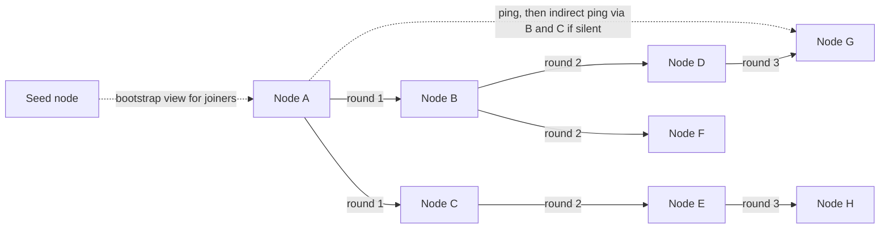

# Gossip Protocols

> [!abstract] In one sentence
> A gossip (epidemic) protocol disseminates information the way rumours spread — every node periodically tells a few random peers what it knows and merges what it hears back — which reaches every node in O(log N) rounds with constant per-node load and no coordinator, making it the standard way large clusters learn who is alive and who owns what.

> [!tip] Deeper treatment in your system-design vault
> `system-design/07 NoSQL and Storage Engines/The Dynamo Paper.md` — read it *after* you have written your own explanation below.

**Map:** [[Distributed Systems MOC]] → [[HLD MOC]]

## Definition

A **gossip protocol** is a peer-to-peer dissemination mechanism in which each node, on a fixed period, picks one or a few random peers and exchanges state with them; each exchange merges the two views, and over successive rounds the information reaches every node. Variants are **push** (send what you have), **pull** (ask what the peer has), and **push–pull** (both, converging fastest). The state gossiped is typically small and versioned: cluster membership and health, per-node metadata (tokens on a hash ring, load, schema version), and digests that allow **anti-entropy** repair of larger data. **SWIM** (Scalable Weakly-consistent Infection-style Membership) is the widely used protocol that combines gossip dissemination with randomised, indirect-probe [[Failure Detection]], so that both "who is in the cluster" and "who is dead" propagate without a central monitor.

## Problem solved

A cluster of a few hundred or thousand nodes needs every member to know the membership (to route requests, place replicas and rebalance) and to learn quickly when a member fails. Two obvious designs fail at scale. A **central registry** (one node or a consensus group that everyone heartbeats to and reads from) is a bottleneck and a single point of failure, and a thundering herd when it restarts. **All-to-all heartbeating** costs O(N²) messages per period — a million messages per second for a thousand nodes at one beat per second — and still leaves every node to form its own, possibly contradictory, view. Gossip replaces both with constant per-node work (a few messages per period regardless of N), robustness to any node failing (there is no special node), and convergence time that grows only logarithmically with cluster size. The price is that at any instant different nodes may hold slightly different views, so gossip suits information that tolerates brief inconsistency — membership, health, ring ownership, configuration versions — and not decisions that require agreement ([[Consensus]]).

## How it works

1. **The round.** Every `T` (Cassandra: 1 s; Serf: 200 ms probe interval, 1 s gossip interval by default) a node selects `k` random peers (fan-out, usually 1–3) and sends them a **digest**: for each node it knows, the node id and the version (generation and heartbeat counter) of its state. The peer replies with any state that is newer than the digest and requests any state where the digest is newer; a final message completes the exchange (Cassandra's three-step `SYN`, `ACK`, `ACK2`). Both sides end with the element-wise maximum by version.
2. **Convergence.** With push–pull and fan-out `k`, the fraction of nodes that have a piece of information roughly multiplies each round while it is rare, then the uninformed fraction shrinks exponentially; the expected rounds to reach everyone is O(log N) — about 10–15 rounds for 1,000 nodes, so a 1 s interval converges in seconds. Random peer selection is what makes this robust: no fixed tree to break.
3. **Versioning.** Each node's own state carries a `(generation, version)` pair: generation increases on restart, version on every change, so a restarted node's fresh state beats stale copies and an older rumour can never overwrite a newer one. Deleted entries need **tombstones** that persist long enough to outrun the last copy of the live entry.
4. **SWIM failure detection.** Each period, a node pings one random member. No ack within the timeout: ask `k` other members to ping it indirectly. All fail: mark it **suspect** and gossip the suspicion. The suspect node, if alive, sees its own suspicion in gossip and refutes it with a higher incarnation number; otherwise after a suspicion timeout it is declared **dead** and gossiped as such. Membership updates piggyback on the ping and ack messages, so dissemination costs no extra traffic. HashiCorp's Lifeguard extensions scale the suspicion timeout by cluster size and by how many independent confirmations arrive, which cut false positives substantially.
5. **Seeds and joining.** A new node contacts a configured set of **seed** nodes to receive an initial membership view, after which it is a normal participant. Seeds are not special in the protocol, only in bootstrap; losing all seeds prevents new joins but does not affect the running cluster.
6. **Anti-entropy of larger data.** Gossip itself carries small state; for repairing replicated data it carries Merkle-tree hashes so two replicas can find divergent ranges cheaply and then exchange only those ([[Eventual Consistency]], [[Quorums]]).

```text
Node A's view before/after one push-pull round with B:
  A knows: {A:(gen 5, v 112), B:(gen 2, v 40), C:(gen 1, v 9)}
  B knows: {A:(gen 5, v 110), B:(gen 2, v 44), D:(gen 3, v 2)}
  A -> B digest; B replies with B:v44, D:v2 and asks for A:v112, C:v9
  After:  both hold {A:112, B:44, C:9, D:2}  (max per node id)
```

## Architecture



> [!example]- Excalidraw version — the same diagram as an editable canvas
> ![[Gossip Protocols.excalidraw]]
> [[Gossip Protocols.excalidraw|Open in Excalidraw]] — needs the Excalidraw plugin (see [[Plugins to Install]]).


## Use cases

- Cluster membership and liveness for a peer-to-peer data store or cache with hundreds of nodes and no central coordinator ([[Design a Distributed Key-Value Store]], [[Design a Distributed Cache]]).
- Distributing small, slowly changing metadata to every node: hash-ring token ownership, schema or configuration versions, per-node load for routing hints ([[Consistent Hashing]]).
- [[Service Discovery]] without a consensus store on the request path (Consul's LAN gossip keeps the agent view; the Raft servers keep the catalogue).
- Presence-style "who is online" in a fleet of chat gateways where brief inconsistency is harmless ([[Design a Chat System]]).
- Any requirement of the form "every node must learn X within seconds without a hot central component".

## Limitations

- Eventual only: at any moment nodes disagree, and the protocol gives no bound you can promise to users; decisions that must be unanimous or exclusive need [[Consensus]].
- Convergence slows and messages grow when the state per node is large or changes rapidly; gossip is for digests and metadata, not for replicating data volume.
- Partitions produce two clusters that each believe the other side is dead; on heal, state must merge, and without careful versioning and tombstones, deleted or stale entries resurrect ([[Network Partitions]]).
- Random peer selection means a node may go unusually long without being contacted; tail convergence can be several times the average.
- Debugging is harder than with a central registry: there is no single place to look for "the current membership".

## Trade-offs

| You gain | You sacrifice |
|---|---|
| Constant per-node load and O(log N) convergence regardless of cluster size | Eventual, probabilistic agreement instead of a single authoritative view |
| No coordinator to fail, overload or restart | Harder debugging and the need for tombstones, generations and version rules |
| Failure detection whose false-positive rate falls with indirect probing | Detection latency of a few periods plus a suspicion timeout |
| Membership and metadata that survive any subset of node failures | Background network chatter that must be sized and monitored |

## Failure modes

- **Split cluster after a partition** — both sides mark the other dead and continue; on heal, two views merge and conflicting state (two owners for a token range) must be resolved. You notice as duplicate ownership or rejected writes after the network recovers; blast radius is every key whose ownership was reassigned on either side ([[Split-Brain]]).
- **Resurrected state** — a tombstone expired before the last stale copy was overwritten; a removed node reappears in membership, or a deleted configuration entry returns. Noticed as "ghost" members and routing to nodes that no longer exist; mitigated by tombstone retention longer than the maximum expected partition.
- **Gossip storm** — rapidly changing state (flapping nodes, a metadata field updated every second) makes every digest large and every round expensive; CPU and bandwidth climb with N × change rate. Noticed as rising gossip-message sizes and latency on the gossip thread; Cassandra exposes a dedicated gossip stage for this reason.
- **False death under load** — the gossip thread starves on an overloaded node, its heartbeat stops advancing, peers convict it, and traffic is moved away, which can be the right outcome or a cascade. Noticed as "node down" events correlated with CPU saturation rather than crashes ([[Failure Detection]]).
- **Seed misconfiguration** — a new node lists seeds that are gone; it forms a cluster of one. Noticed as a node that is "up" but invisible to everyone else; the classic mistake when seeds are hard-coded IPs on Kubernetes.

## Performance

Per node, cost per round is `k` exchanges of a digest sized by the number of known nodes (tens of bytes per entry), so bandwidth is O(k × N) bytes per period per node — about 100 KB per second for 1,000 nodes at 1 s with `k = 3`, which is negligible on a data-centre link. Convergence latency is `T × O(log N)`: a few seconds for thousands of nodes at a 1 s period. SWIM detection latency is the probe period plus indirect-probe round trips plus the suspicion timeout — typically a few seconds in Serf and Consul defaults. Memory is one small state record per known node. The protocol is almost never a resource bottleneck; its cost is the staleness window.

## Scalability

Gossip is chosen *because* it scales: per-node load does not grow with N and convergence grows only logarithmically. The practical limits are the size of the per-node digest (every node tracks every other node, so memory and digest size are O(N)) and the frequency of membership change, which at very large scale becomes continuous. Clusters above a few thousand nodes typically shard the gossip domain (per datacentre gossip with a few bridge nodes) or move membership to a consensus-backed registry with gossip only for fast liveness. At 10x nodes, re-check suspicion timeouts (Lifeguard scales them automatically) and tombstone retention.

## Operational impact

Monitor the metrics the protocol exposes: membership change rate, suspicion and false-death counts, gossip round latency and message size, and the number of nodes each node considers down (disagreement across nodes is the diagnostic signal). Seeds must be managed as stable addresses (a Kubernetes headless Service or a DNS name) rather than IPs. Runbooks need a procedure for partition heal and for removing a dead node explicitly so its tombstone propagates. Upgrades that change the gossip message format must be backward compatible for the duration of a rolling upgrade.

## Alternatives

- **Consensus-backed registry (etcd, ZooKeeper, Consul servers)** — a single authoritative membership view with strong consistency; wins for small clusters or when membership decisions must be unanimous, at the cost of a coordination round and a cluster to run ([[Consensus]]).
- **Central heartbeat service** — nodes heartbeat to a load-balanced registry that stores liveness; wins for stateless fleets where the registry's own availability is already managed (Eureka-style [[Service Discovery]]).
- **Orchestrator-provided membership** — Kubernetes endpoints and readiness as the source of truth; wins when the platform already tracks liveness and the cluster only needs to subscribe ([[Health Checks]]).
- **Static configuration** — a fixed node list; wins for small, stable clusters where change is a deploy.

## Real-world examples

- **Apache Cassandra** gossips membership, tokens, schema versions and load once per second to up to three peers with a phi accrual failure detector reading the gossiped heartbeats.
- **HashiCorp Consul and Serf** implement SWIM with Lifeguard; Consul uses gossip for agent membership and health within a datacentre and Raft among its servers for the catalogue — a clean split of "eventual" and "agreed".
- **Redis Cluster** runs a gossip-based cluster bus where nodes exchange `PING`/`PONG` carrying a subset of their view; a node is marked `PFAIL` by one node and `FAIL` once a majority of primaries agree, with `cluster-node-timeout` (default 15 s) governing detection ([[Distributed Caching]]).
- In a stack like yours: Redis Cluster, if adopted, is already a gossip system whose node timeout and failover behaviour you must understand; a self-built fleet of WebSocket gateways needing "which gateway holds this user" could use a memberlist/SWIM library for liveness and a Redis or database mapping for the authoritative routing table.

## Practical exercise

1. Write a small Go program using HashiCorp's `memberlist` (or a TypeScript equivalent you build: UDP ping, indirect ping, push–pull state) and run 10 instances in Docker Compose with one seed.
2. Attach a user-defined key–value state to each node (a version and a value) and log the time from a change on one node to its arrival on all others; repeat for 10, 20 and 40 nodes and plot convergence time against N.
3. Kill one node and record the time until all others mark it dead; then pause a node with `docker pause` for 3 s and check whether indirect probing prevents a false death.
4. Partition the cluster into 6 and 4 nodes with [[Toxiproxy]] or network policies; observe each side's membership view, heal, and inspect how the views merge (and whether anything resurrects).
5. Measure gossip bandwidth per node at each cluster size and compare with an all-to-all heartbeat design computed on paper.

## Related concepts

### Prerequisites
- [[Failure Detection]] — SWIM is gossip plus a randomised, indirect-probe detector
- [[Eventual Consistency]] — gossiped state converges rather than agrees
- [[Network Partitions]] — the event that splits a gossip view in two

### Related
- [[Consistent Hashing]] — ring ownership is the classic gossiped metadata
- [[Service Discovery]] — Consul's gossip layer versus its Raft layer
- [[Clocks and Time]] — generations and versions as logical clocks per node
- [[Leader Election]] — what gossip avoids needing for membership
- [[Quorums]] — anti-entropy repairs the replicas that quorums leave divergent

### Builds on this
- [[Service Discovery]] — agent-level membership and health in gossip-based registries
- [[Distributed Caching]] — Redis Cluster's cluster bus is a gossip protocol

### Design problems where it applies
- [[Design a Distributed Key-Value Store]]
- [[Design a Distributed Cache]]
- [[Design a Chat System]]

### Projects where it can be implemented
- [[Mini-KV Store]]
- [[Chaos Lab]]

### Resources
- [[Dynamo Paper]] — gossip-based membership and failure detection in a production store
- [[Fly.io Gossip Glomers Challenges]] — implement broadcast with gossip under partitions
- [[Designing Data-Intensive Applications]] — the surrounding context on leaderless replication and anti-entropy

## Personal understanding

> [!question] Explain it without the source
> Write your own explanation here, from memory. Then compare it with the sections above and note what you missed.

### Mastery checklist
- [ ] I can explain it without the original resource
- [ ] I can describe the problem it solves
- [ ] I can compare it with its alternatives
- [ ] I can name its limitations and failure modes
- [ ] I can recognise when it is appropriate in a real system
- [ ] I have applied it in a system design
- [ ] I have validated my assumptions with an experiment or implementation

## Open questions

- [ ] In Redis Cluster, what sequence of gossip and voting turns a `PFAIL` into a `FAIL` and then into a replica promotion, and how does `cluster-node-timeout` interact with a 10 s GC-like pause on a primary?
- [ ] For a fleet of WebSocket gateways on Kubernetes, is a SWIM library worth running when the platform's endpoints and readiness already provide membership, and what does gossip add beyond faster liveness?
- [ ] How long must a tombstone live to be safe given the longest partition a cluster has actually experienced, and how do Cassandra's `gc_grace_seconds` defaults reflect that reasoning?
