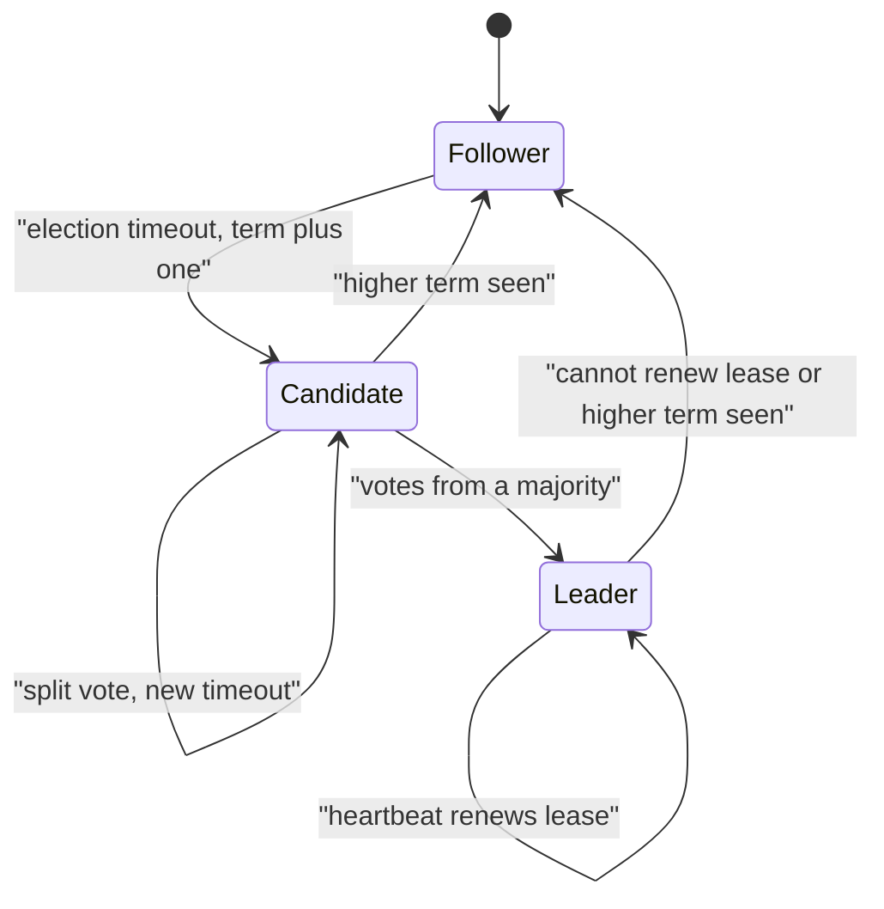

# Leader Election

> [!abstract] In one sentence
> Leader election lets a group of nodes agree that one of them is in charge for a while, which turns a hard distributed problem (who may write, who runs the cron, who owns the partition) into a simple local one — at the price of a lease that can expire while the old leader still believes it holds it.

> [!tip] Deeper treatment in your system-design vault
> `system-design/06 Replication and Sharding/Failover.md` — read it *after* you have written your own explanation below.

**Map:** [[Distributed Systems MOC]] → [[HLD MOC]]

## Definition

**Leader election** is the protocol by which a set of nodes chooses a single node to hold a role (primary replica, controller, scheduler, lock holder) for a bounded period, and by which the others learn who it is and when that leadership has ended. A correct election guarantees *at most one* leader per term (safety) and that *some* leader is eventually chosen when enough nodes are alive and connected (liveness). The leader's authority is always time-bounded by a **lease** or **term**, because the rest of the system can only ever detect failure by timeout ([[Failure Detection]]).

## Problem solved

Many jobs are trivial if exactly one process does them and dangerous if two do: applying writes to a primary, assigning partitions to consumers, running a scheduled settlement job, renewing a certificate, compacting a log. Before explicit election, teams either ran a single instance (a single point of failure that also blocks rolling deploys), or used ad-hoc "first pod to start wins" logic that silently ran twice after a restart or a network blip. In a stack like yours — several replicas of a service on Kubernetes, each equally able to run the nightly reconciliation — the question "which replica runs it?" needs a real answer, not luck.

## How it works

There are three practical families, ranked by how much they rely on an external system:

1. **Consensus-based election** (Raft, used by etcd, Consul, CockroachDB, Kafka's KRaft controllers). Nodes are followers; if a follower hears no heartbeat within a randomised election timeout it increments its **term**, becomes a candidate and requests votes. A node votes once per term and only for a candidate whose log is at least as up to date as its own. A majority of votes wins, and because two majorities always overlap, two leaders cannot exist in the same term ([[Quorums]], [[Consensus]]). The term number is the fencing token.
2. **Lock-service election** (ZooKeeper, etcd leases, Kubernetes `Lease` objects). Each candidate tries to create an ephemeral or leased key. ZooKeeper uses ephemeral sequential znodes: the lowest sequence number is the leader and each node watches only its predecessor (avoiding a herd of watchers). etcd's `concurrency.Election` campaigns with a lease; if the holder stops renewing, the key expires and the next revision wins. The Kubernetes client libraries do the same with a `Lease` object: a holder renews within `renewDeadline`, others may acquire after `leaseDuration` (kube-controller-manager defaults: 15 s lease, 10 s renew deadline, 2 s retry).
3. **Database-row election.** A `leader` row with `holder` and `lease_until`; candidates run a compare-and-set that succeeds only if the lease has expired or they already hold it. The one rule that makes this work: compare against the **database's** clock, never the candidates' ([[Clocks and Time]]).

```sql
UPDATE leader
SET holder = 'pod-7', lease_until = now() + interval '15 seconds', epoch = epoch + 1
WHERE name = 'settlement-job'
  AND (lease_until < now() OR holder = 'pod-7')
RETURNING epoch;   -- rowcount 1 means you lead; epoch is your fencing token
```

In all three the leader must keep renewing before the lease ends, and must **stop acting** the moment it fails to renew — it cannot know whether its lease has been granted to someone else. Anything it writes should carry the term or epoch so the resource can reject stale leaders ([[Distributed Locks]]).

## Architecture



## Use cases

- "Exactly one instance must run this job / own this partition / write to this store" in a service that has more than one replica — schedulers, outbox relays, compaction, cache warmers.
- Primary selection during failover in single-leader [[Replication]] (PostgreSQL with Patroni, MongoDB replica sets, Redis Sentinel).
- A coordinator role in a stateless fleet: Kafka's group coordinator and controller, Kubernetes controllers, Flink job managers.
- Any requirement that says "singleton" or "active-passive" — read it as "needs election plus fencing".

## Limitations

- The leader is a throughput ceiling and a single point of latency; if the work can be partitioned, prefer sharded ownership over one global leader ([[Coordination vs Availability]]).
- Election takes time (election timeout plus a vote round), during which the role is vacant; with lock services the vacancy is at least the lease duration.
- A lease says nothing about the leader's *health* — a leader that is alive but slow still holds the role (gray failure).
- Database-row election couples the role to the database's availability and puts a hot row in the write path.
- Without a fencing token, an election only reduces the chance of two actors, it does not eliminate it.

## Trade-offs

| You gain | You sacrifice |
|---|---|
| One coordinator, so the job logic stays simple and sequential | A bottleneck and a role vacancy of at least one timeout on every failover |
| Automatic failover without human intervention | Timeout tuning: short leases detect failure fast but flap under GC pauses and network jitter |
| A monotonic term you can use as a fencing token | A dependency on a quorum system (etcd, ZooKeeper) or a database row to arbitrate |
| Clear ownership in logs and metrics ("pod-7 led epoch 41") | The temptation to let the leader hold unbounded state that is lost on failover |

## Failure modes

- **Two leaders after a pause** — the old leader stalls (GC, VM freeze, slow disk), its lease expires, a new leader is elected, then the old one resumes and keeps acting. You notice as duplicate side effects (two settlement runs, two emails) or as writes rejected by a fencing check. Blast radius: whatever the role mutates ([[Split-Brain]]).
- **Election storm** — leases too short relative to network jitter; leadership flips every few seconds, each flip pausing the work. Seen as sawtooth `leader_changes_total` and repeated "lost lease" logs.
- **Arbitrator outage** — etcd or ZooKeeper loses quorum, so nobody can renew; a well-behaved leader steps down and the role is vacant cluster-wide. Blast radius: every service that elects through the same cluster.
- **Leader with amnesia** — leadership moved but in-memory state (cursors, timers) did not; the new leader restarts the job from a stale checkpoint. Keep leader state in durable storage keyed by epoch.
- **Zombie leader on a partitioned node** — the leader is on the minority side of a [[Network Partitions|partition]]; it must step down when it cannot reach a quorum within its lease, otherwise it serves stale reads or accepts writes it can never replicate.

## Performance

Steady state costs one heartbeat per leader per interval (typically every tenth to a third of the lease) — negligible. Failover cost is the detection time: with a 15 s lease and 10 s renew deadline you should expect roughly 15–30 s of vacancy; Raft clusters with 150–300 ms election timeouts fail over in under a second. Linearisable reads through a leader need the leader to confirm it still leads (a heartbeat round or a lease check), adding one RTT to a majority unless leader leases are used.

## Scalability

A single leader does not scale the work, it scales the *decision*. At 10x load you either make the leader a pure coordinator that hands out partitions to workers (Kafka's controller model) or run one election per shard so leadership itself is partitioned. Election traffic grows with the number of candidates watching the key; ZooKeeper's "watch your predecessor" pattern exists precisely so a 1,000-node fleet does not wake everyone on each change.

## Operational impact

You must run and monitor the arbitrator (etcd/ZooKeeper quorum, or the database), expose `is_leader` and `leader_epoch` as metrics, and alert on vacancy duration and churn. Deploys need care: rolling restarts cause a leadership change per restart of the leader; a `preStop` that releases the lease early shrinks the vacancy. Debugging "why did it run twice?" is far easier when every side effect logs the epoch it was performed under.

## Alternatives

- **Sharded ownership without a global leader** — assign each key range to an owner by [[Consistent Hashing]]; wins when work is partitionable and you want no single bottleneck.
- **Idempotent, duplicate-tolerant workers** — let several instances race and make the operation safe to repeat ([[Idempotency]]); wins when the work is cheap and conflicts are harmless.
- **A single instance with fast restart** — Kubernetes Deployment with one replica and `Recreate` strategy; wins for low-stakes batch jobs where 30–60 s of downtime is fine.
- **Database queue with `FOR UPDATE SKIP LOCKED`** — no leader at all, workers claim rows; wins for job processing where each unit of work is independent.

## Real-world examples

- **Kafka** elects a controller (via ZooKeeper historically, via a KRaft quorum now) which in turn assigns a leader per partition from the in-sync replica set; every partition leader change bumps a leader epoch that replicas and clients use to reject stale data.
- **Kubernetes** control-plane components (kube-controller-manager, kube-scheduler) run several replicas and elect through a `Lease` object in `kube-system`; the same library is used by operators such as cert-manager.
- **Patroni** runs PostgreSQL failover by holding a leader key in etcd or Consul with a TTL and demoting the primary if the key cannot be renewed.
- In a stack like yours: a NestJS or Spring Boot service with three replicas on EKS that must run a single outbox relay or reconciliation loop can elect through a Kubernetes `Lease`, a PostgreSQL row with `lease_until`, or Redis — and each option is only safe if the relay tags its writes with the epoch it won.

## Practical exercise

1. Run etcd with Docker Compose and write a small Go, Java (jetcd) or TypeScript (etcd3) program that campaigns for an election with a 5-second lease, prints `leader=<id> rev=<revision>` and appends a line per second to a shared file including the revision.
2. Start three instances. Kill the leader with `kill -9` and measure how long until another prints `leader`.
3. Simulate a pause: send `SIGSTOP` to the leader for 8 seconds, then `SIGCONT`. Observe that it keeps writing after resuming while another instance also writes — two leaders.
4. Fix it: make the writer refuse any line whose revision is lower than the highest seen (a fencing check), and make the leader stop writing when its keep-alive channel closes.
5. Measure: vacancy time versus lease length (2 s, 5 s, 15 s), and the number of leadership changes when you add 100 ms of network jitter with Toxiproxy.

## Related concepts

### Prerequisites
- [[Failure Detection]] — an election is triggered by a timeout, so every property of the election inherits the detector's false positives
- [[Quorums]] — the overlap argument that makes "at most one leader per term" true
- [[Network Partitions]] — the scenario an election must survive, not just crashes

### Related
- [[Consensus]] — Raft's election is one half of the protocol; the log is the other
- [[Distributed Locks]] — a leader is a long-held lock, with the same fencing requirement
- [[Split-Brain]] — the failure mode an election exists to prevent and can still cause
- [[Clocks and Time]] — leases are durations measured on different machines
- [[Replication]] — single-leader replication needs a way to promote a new primary

### Builds on this
- [[Kafka]] — controller and partition leader election, leader epochs
- [[Consumer Groups]] — the group coordinator is an elected role that assigns partitions
- [[Disaster Recovery]] — regional failover is election with humans and DNS in the loop
- [[Coordination vs Availability]] — a leader is the most common coordination point you will choose

### Design problems where it applies
- [[Design a Distributed Job Scheduler]]
- [[Design a Message Queue]]
- [[Design a Distributed Key-Value Store]]
- [[Design a Distributed Cache]]

### Projects where it can be implemented
- [[Durable Job Scheduler]]
- [[Lock Service with Fencing Tokens]]
- [[Mini-KV Store]]

### Resources
- [[Raft Paper]] — section 5.2 is the cleanest description of a safe election
- [[etcd Raft Library]] — production election code you can read
- [[Understanding Distributed Systems]] — the chapter on leader election and leases
- [[Designing Data-Intensive Applications]] — chapter 8 on leases, pauses and fencing tokens

## Personal understanding

> [!question] Explain it without the source
> Write your own explanation here, from memory. Then compare it with the sections above and note what you missed.

### Mastery checklist
- [ ] I can explain it without the original resource
- [ ] I can describe the problem it solves
- [ ] I can compare it with its alternatives
- [ ] I can name its limitations and failure modes
- [ ] I can recognise when it is appropriate in a real system
- [ ] I have applied it in a system design
- [ ] I have validated my assumptions with an experiment or implementation

## Open questions

- [ ] For a Kubernetes `Lease`-based election, what is the realistic worst-case window of two active leaders given API-server latency and the default 15 s / 10 s / 2 s timings, and how do I measure it?
- [ ] When the elected role writes to Redis or SQS rather than a database, which of those targets can actually enforce a fencing token, and what do I do when the target cannot?
- [ ] How does Patroni decide between a slow-but-alive primary and a failed one, and what does that imply for lease length on a database with long checkpoints?
