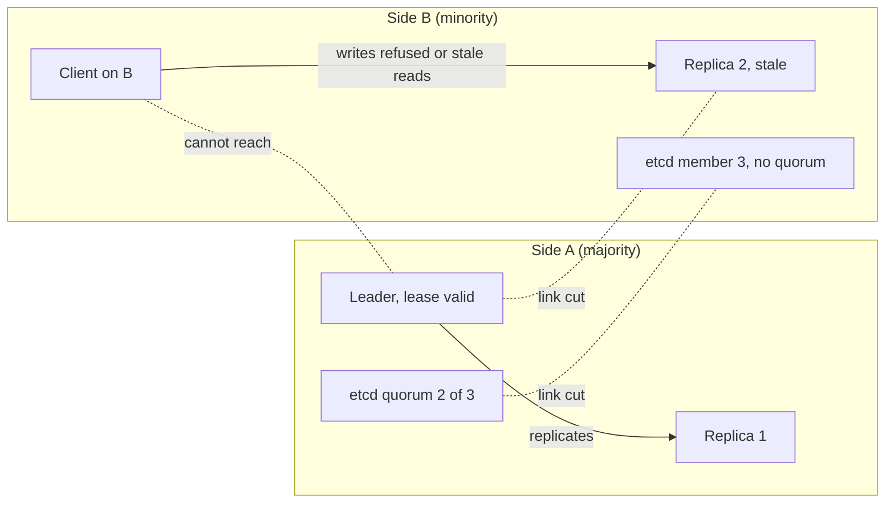

# Network Partitions

> [!abstract] In one sentence
> A network partition is the failure where machines keep running but some messages between them stop arriving, and designing for it means deciding in advance what each side may do while it is cut off — because you do not get to choose whether partitions happen, only how your system behaves during one.

> [!tip] Deeper treatment in your system-design vault
> `system-design/02 Networking/Network Partitions and Timeouts.md` — read it *after* you have written your own explanation below.

**Map:** [[Distributed Systems MOC]] → [[HLD MOC]]

## Definition

A **network partition** is a communication failure in which some subset of nodes cannot exchange messages with another subset for a period of time, while the nodes themselves keep executing. It covers the clean textbook split (two halves that cannot talk) and the far more common messy variants: a **partial partition** where A reaches B and B reaches C but A cannot reach C; **asymmetric reachability** where A's packets reach B but B's replies never return; and a **slow partition** where links deliver only a trickle of packets or deliver them seconds late. From the point of view of any single node, a partition is indistinguishable from a crash of the peer or an overloaded peer — all it observes is that replies stop arriving within its timeout ([[Failure Detection]]).

## Problem solved

Partitions are not a problem a technique solves; they are a fact that every technique must survive. What "designing for partitions" solves is the much worse alternative: systems whose correctness silently assumed the network works. A replication scheme that assumed the primary could always reach its replicas lost committed writes when it could not. A lock holder that assumed "I still hold the lock because nobody told me otherwise" kept writing after the lock service had given the lock to someone else ([[Distributed Locks]]). A service that assumed "no response means the request failed" retried a payment that had actually succeeded on the other side of a one-way link ([[Duplicate Message Processing]]). Two primaries that could not see each other each accepted writes and later could not be merged ([[Split-Brain]]).

In a stack like yours — pods on EKS talking across availability zones to RDS, Redis, Kafka and partner APIs over the public internet — partitions show up as a NAT gateway saturating, an AZ losing inter-zone connectivity for minutes, a security-group change blocking one direction of traffic, a node's network interface dropping packets under memory pressure, or a Kubernetes network plugin losing routes during an upgrade. None of these crash the processes involved, and all of them produce exactly the ambiguous silence described above.

## How it works

The mechanics worth re-deriving are not how partitions happen but what they do to each kind of component, because that determines the decision each component must make.

1. **What a node can know.** A node that sends a request and gets no reply within `T` learns only that *at least one* of the following is true: the peer is dead, the peer is slow, the request was lost, or the reply was lost. It cannot distinguish them. Any protocol that behaves differently in these cases is relying on luck. The honest design tool is the **timeout plus a rule for the ambiguous case** ([[Timeouts and Retries]]).
2. **What a partition does to replication.** With a single leader ([[Replication]]), the side holding the leader can keep accepting writes but cannot replicate them to the cut-off replicas; the other side can serve stale reads or, if it elects a new leader, diverge. With synchronous replication the leader must stall writes until a quorum of replicas is reachable, which is the mechanism by which the system trades availability for consistency ([[CAP Theorem]]). The rule: writes are durable only on the side that can assemble a [[Quorums|quorum]].
3. **What a partition does to leaders and locks.** A leader or lock holder cut off from the arbitrator (etcd, ZooKeeper, a database row) will have its lease expire while it is still running. If the holder does not stop acting when it fails to renew, two holders exist. The remedy is a lease that the holder honours locally (stop when `now > lease_until − safety_margin`) and a **fencing token** that lets the protected resource reject the stale holder's writes ([[Leader Election]], [[Split-Brain]]).
4. **What a partition does to clients.** Clients on the minority side see errors or latency. A client that retries blindly amplifies load on whatever is still reachable; a client that fails fast and degrades keeps the reachable half healthy ([[Retry Storms]], [[Graceful Degradation]]). Idempotency keys make the ambiguous retry safe ([[Idempotency]]).
5. **The decision per component.** For every stateful component, write down what it does when it cannot reach its peers: *refuse writes* (CP behaviour — a Raft group without a quorum, a PostgreSQL synchronous primary without its standby), *accept writes and reconcile later* (AP behaviour — Dynamo-style stores with hinted handoff, a CRDT counter), or *keep serving reads of possibly stale data* while refusing writes. "Hang forever" is the default you get by not deciding, and it is the worst option because it consumes threads and connection pools on every caller ([[Connection Pooling]]).

A partition is also a test you can run. The minimum experiment is a firewall rule:

```bash
# On node B, drop everything from node A for 30 s, then restore (asymmetric partition)
sudo iptables -A INPUT -s 10.0.1.12 -j DROP
sleep 30
sudo iptables -D INPUT -s 10.0.1.12 -j DROP
# Toxiproxy equivalent: add a "timeout" toxic with timeout=0 to the proxied link
```

## Architecture



> [!example]- Excalidraw version — the same diagram as an editable canvas
> ![[Network Partitions.excalidraw]]
> [[Network Partitions.excalidraw|Open in Excalidraw]] — needs the Excalidraw plugin (see [[Plugins to Install]]).


## Use cases

- Any requirement that says "across availability zones", "across regions", or "survives loss of a data centre" — the links between those places *will* fail, and the design must state the behaviour on each side.
- Any component that holds a lease, lock or leadership: the requirement "only one instance may run X" is really "only one instance may run X even during a partition".
- Replicated storage where the requirement distinguishes "must not lose acknowledged writes" (needs quorum writes) from "must stay writable in every region" (needs conflict resolution, [[Eventual Consistency]]).
- Payment and ledger flows where a timed-out call to a partner is the normal case, not the exception: the requirement "no double charge" is a partition requirement ([[Idempotency]]).
- Chaos and resilience testing requirements ("the service must degrade gracefully when dependency Y is unreachable") are partition drills by another name.

## Limitations

- "Partition tolerance" cannot be bought with a library; it is a property of how every stateful decision is made, so it does not retrofit cleanly into a system that assumed a reliable network.
- Designing every component for partitions costs latency (quorum round trips) or complexity (conflict resolution); for a single-region service with one database, the pragmatic answer is often "the database refuses writes, callers fail fast" rather than multi-master anything.
- Partial and asymmetric partitions defeat simple reasoning: a node may be reachable by the health checker but not by its peers, so health checks say "up" while replication is broken ([[Health Checks]]).
- Tests with clean splits miss the dangerous cases; real incidents are slow links and one-way drops, which look like latency rather than failure.

## Trade-offs

| You gain | You sacrifice |
|---|---|
| Explicit, tested behaviour on each side of a split instead of undefined behaviour | Design effort for every stateful component, and latency for quorum-based decisions |
| Availability on the side that still has a quorum (or everywhere, if you accept conflicts) | Either availability on the minority side (CP) or consistency during the split (AP) |
| Safe leases and fencing that survive one-way links and pauses | Role vacancy while leases expire; stale holders must stop working mid-task |
| Failing fast, which keeps the reachable half of the system healthy | Users on the cut-off side see errors immediately rather than slow success |

## Failure modes

- **Split-brain writes** — a partition isolates the primary from its arbitrator, a new primary is promoted, the old one keeps accepting writes. You notice as diverging replicas or replication errors on heal; blast radius is every write accepted on the losing side, which may have to be discarded ([[Split-Brain]]).
- **Lost acknowledged writes** — asynchronous replication, the primary on the minority side acknowledges writes it can never replicate, then is fenced off. Noticed as "the order I created is gone" after failover; radius is the replication lag's worth of writes ([[Recovery Point Objective]]).
- **Thread and pool exhaustion** — calls into the partitioned side have no timeout or a long one; every worker thread ends up waiting; the service becomes unresponsive for *all* requests including those that never needed the cut-off dependency. Noticed as rising in-flight counts and saturated pools with low CPU; radius is the whole service ([[Bulkheads]]).
- **Retry amplification on heal** — when the link returns, every queued retry fires at once and the recovered side is overloaded, creating a second outage ([[Retry Storms]]).
- **Half-open gray failure** — one direction works; heartbeats from A reach B so B thinks A is fine, but A's requests to B time out. Noticed only by correlating client-side error rates with server-side "all healthy" dashboards; this is the case that fools dependency health checks for the longest.

## Performance

Partition tolerance costs are paid in the normal path, not just during incidents. Quorum writes add at least one round trip to a majority of replicas — within an AWS region, inter-AZ round trips are typically about 1–2 ms, across regions tens to hundreds of milliseconds, so cross-region synchronous quorums put a hard floor under write latency. Timeouts set from latency distributions ([[Latency]]) decide how long a partition is invisible: a 30 s timeout hides a partition for 30 s per call, a 500 ms one surfaces it in under a second. Keep-alive and heartbeat intervals trade detection speed against background traffic; a fleet of 1,000 nodes heartbeating every second is harmless, every 10 ms is not.

## Scalability

The number of links grows quadratically with the number of nodes, so at 10x the fleet, partial partitions that isolate one node or one rack become routine rather than rare; designs that assume "the cluster is either whole or split in two" stop matching reality. Systems built around small quorum groups (3–5 voters) with many data shards scale better than one giant quorum because a partition affects only the shards whose voters straddle it. Multi-region active-active at scale almost always means per-key ownership (one home region per account or tenant) rather than true multi-master, precisely to keep partition behaviour local and understandable ([[Coordination vs Availability]]).

## Operational impact

You need visibility into connectivity itself, not just service health: per-link error and latency metrics, replication lag per replica, lease renewal failures, quorum-loss events and circuit-breaker state. Runbooks must say what to do on each side of a partition (usually: do nothing automatic on the minority side) and how to reconcile after it heals. The highest-value investment is a regular chaos exercise that cuts one AZ or one dependency with Toxiproxy or network policies and checks that the documented behaviour actually happens ([[Chaos Lab]]). Debugging is hardest for asymmetric partitions; capture both ends' view (client error rate and server receive rate) in the same dashboard.

## Alternatives

- **Single-node or single-AZ deployment** — no partitions within the system, only between it and its clients; wins for small internal tools where an AZ outage is an acceptable outage.
- **Accept unavailability (CP)** — refuse writes without a quorum; wins for ledgers, inventory and anything where a wrong answer costs more than no answer.
- **Accept divergence and reconcile (AP)** — multi-master with last-writer-wins or CRDTs; wins for shopping carts, presence, counters and collaborative editing where availability matters more than a momentary inconsistency ([[Eventual Consistency]]).
- **Partition the ownership instead of the data** — one home for each key so each key has a single writer; wins for multi-region products with mostly-local access patterns.

## Real-world examples

- The [[Jepsen]] project has repeatedly found data loss and split-brain in databases and queues by running them under induced partitions, and the published analyses are the best catalogue of what partitions do to real systems.
- Amazon's [[Dynamo Paper]] was explicitly designed around "always writeable" behaviour during partitions, using sloppy quorums and hinted handoff and pushing conflict resolution to reads.
- Kafka's in-sync replica mechanism shrinks the ISR when a follower cannot keep up or cannot be reached, and with `acks=all` and `min.insync.replicas` set, the leader refuses writes rather than acknowledging data only it holds.
- In a stack like yours: a multi-AZ EKS cluster with a single-writer RDS instance behaves as CP during an AZ partition (the cut-off pods fail their database calls), while a Redis cache on the cut-off side keeps serving stale data; the design question is whether every endpoint knows which of those two it is relying on.

## Practical exercise

1. With Docker Compose, run a three-node etcd cluster, a small service that holds an etcd lease and writes a counter to a file once per second, and [[Toxiproxy]] in front of each etcd member.
2. Cut the leader's proxy to two of the three etcd members (a majority) and watch: does the writer stop within one lease TTL, or does it keep writing? Measure the gap between the lease expiry and the last write.
3. Make the cut asymmetric (drop only responses with a `timeout` toxic on the downstream direction) and repeat; note whether the client library distinguishes "cannot send" from "no reply".
4. Add a second writer instance; confirm that during the cut it acquires the lease and both write concurrently; then add a fencing check (reject writes carrying a lower lease revision) and confirm the overlap disappears.
5. Heal the partition and record the burst of retries hitting etcd; add exponential backoff with jitter and compare.

## Related concepts

### Prerequisites
- [[Fault Tolerance]] — partitions are the failure class that distinguishes distributed systems from single machines
- [[TCP and UDP]] — why a connection can look alive while nothing is delivered
- [[Timeouts and Retries]] — the only tool a node has for noticing a partition

### Related
- [[Failure Detection]] — the detector's false positives are partitions misread as crashes
- [[Split-Brain]] — the characteristic damage a partition does to leaders and primaries
- [[Quorums]] — how the majority side keeps making safe progress
- [[Consistency Models]] — which guarantees survive a split and which do not
- [[Eventual Consistency]] — the price of staying writable on both sides
- [[PACELC]] — the partition trade-off plus the latency trade-off you pay even without one

### Builds on this
- [[CAP Theorem]] — a statement about what you can keep during a partition
- [[Leader Election]] — every election protocol is a partition-handling protocol
- [[Consensus]] — Raft and Paxos exist to make safe decisions across partitions
- [[Distributed Transactions]] — two-phase commit's blocking problem is a partition problem
- [[Delivery Semantics]] — at-least-once exists because a partition hides whether delivery happened

### Design problems where it applies
- [[Design a Distributed Key-Value Store]]
- [[Design a Distributed Cache]]
- [[Design a Payment System]]
- [[Design a Message Queue]]

### Projects where it can be implemented
- [[Chaos Lab]]
- [[Mini-KV Store]]

### Resources
- [[Please Stop Calling Databases CP or AP]] — Kleppmann on why partition behaviour needs more precision than two letters
- [[Jepsen]] — partition testing as a discipline, with published results per system
- [[Toxiproxy]] — the tool for inducing partitions in a local lab
- [[Designing Data-Intensive Applications]] — chapter 8 on unreliable networks and the truth a node can know

## Personal understanding

> [!question] Explain it without the source
> Write your own explanation here, from memory. Then compare it with the sections above and note what you missed.

### Mastery checklist
- [ ] I can explain it without the original resource
- [ ] I can describe the problem it solves
- [ ] I can compare it with its alternatives
- [ ] I can name its limitations and failure modes
- [ ] I can recognise when it is appropriate in a real system
- [ ] I have applied it in a system design
- [ ] I have validated my assumptions with an experiment or implementation

## Open questions

- [ ] For each stateful dependency in a typical service of mine (PostgreSQL, Redis, Kafka or SQS, the IAM service), what exactly does the client library do when the dependency is reachable but silent — block, fail fast, or retry — and with what default timeout?
- [ ] How does Kubernetes behave when a node is partitioned from the control plane but not from its peers: when are its pods marked unknown, when are they rescheduled, and can the old pods still be serving traffic while the replacements start?
- [ ] What is the smallest set of partition scenarios (AZ split, one-way drop, slow link) that would give me confidence in a payment flow, and how would I automate them in CI?
