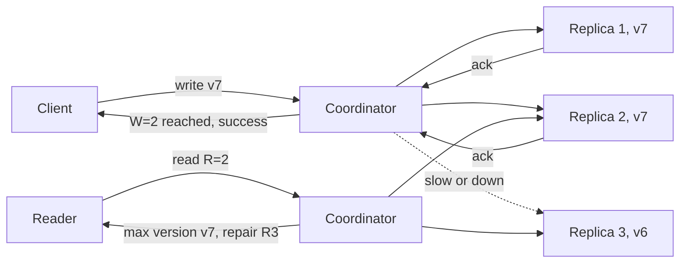

# Quorums

> [!abstract] In one sentence
> Quorums make agreement possible without unanimity: require writes to reach W of N replicas and reads to consult R of N with R + W > N, and every read set is guaranteed to overlap every write set, so the latest write is always visible to someone in the read — and the same overlap argument is what makes majority voting safe for elections and consensus.

> [!tip] Deeper treatment in your system-design vault
> `system-design/08 Distributed Systems Theory/Quorum Reads and Writes.md` — read it *after* you have written your own explanation below.

**Map:** [[Distributed Systems MOC]] → [[HLD MOC]]

## Definition

A **quorum** is a subset of replicas (or voters) chosen so that any two quorums intersect. With `N` replicas, a write is acknowledged once `W` replicas have durably stored it, and a read collects responses from `R` replicas and returns the most recent version among them; if `R + W > N`, at least one replica in every read set holds the latest acknowledged write. The common choice is **majority quorums**, `R = W = floor(N/2) + 1`, which also tolerate `floor((N−1)/2)` failed replicas for both reads and writes. The same intersection property applied to votes is what prevents two leaders in one term ([[Leader Election]], [[Consensus]]). A **strict quorum** uses the designated home replicas for a key; a **sloppy quorum** accepts any reachable nodes instead and repairs later.

## Problem solved

With a single primary, every write and every strongly consistent read depends on one machine: its failure stops the system until a failover completes, and its slowness is everyone's slowness. Waiting for *all* replicas instead (synchronous replication to every copy) removes the single point but makes the slowest or most broken replica the bottleneck, and one partitioned replica blocks all writes. Quorums are the middle: no single replica is required for progress, yet consistency can still be guaranteed because of overlap. They also solve the voting problem that elections and consensus need — "how many agreements are enough?" — with the only answer that provably prevents two conflicting decisions: more than half.

For a stack like yours this is less abstract than it looks. Kafka's `acks=all` with `min.insync.replicas=2` on a replication factor of 3 is a write quorum in spirit; a three-node etcd or ZooKeeper cluster behind Kubernetes or Kafka is a majority quorum; a Cassandra or DynamoDB-style store with `LOCAL_QUORUM` is the textbook `R + W > N`.

## How it works

1. **Write path.** The coordinator sends the write (with a version — a per-key sequence or a timestamp from a [[Clocks and Time|clock]] you trust) to all `N` replicas in parallel and returns success after `W` acknowledgements. The remaining replicas may receive it later or never (until repair). The write is "acknowledged" only at `W`; a client that times out before `W` learns nothing about whether it will eventually be visible.
2. **Read path.** The coordinator queries `R` replicas (often all `N`, returning after `R` respond, to cut tail latency), compares versions and returns the highest. Because `R + W > N`, at least one of the `R` holds the latest acknowledged write. If the replicas disagree, **read repair** writes the newest version back to the stale ones; a background **anti-entropy** process (Merkle-tree comparison in Dynamo and Cassandra) fixes replicas that reads never touch.
3. **Tunable consistency.** Each operation chooses its `R` and `W`. `W = N, R = 1` gives fast reads but writes block on every replica; `W = 1, R = N` the reverse; `R = W = 2` with `N = 3` balances. `R + W ≤ N` deliberately gives up the overlap for latency and availability, and reads may return stale data — the [[Eventual Consistency]] setting.
4. **Sloppy quorums and hinted handoff.** When some home replicas for a key are unreachable, a sloppy quorum writes to `W` *reachable* nodes, including ones that are not the key's home, storing a hint that the data belongs elsewhere. When the home replica returns, the hint is handed off. Availability during partitions goes up; the overlap guarantee goes away, because a later read against the home replicas may not include the nodes that took the write ([[Dynamo Paper]]).
5. **Voting quorums.** For elections and consensus the "write" is a vote and the "read" is counting: a candidate needs votes from a majority, each voter votes once per term, and because two majorities share at least one voter, two candidates cannot both win the same term. Raft's commit rule — an entry is committed once a majority has it — is the same overlap guaranteeing that any future leader (elected by a majority) has the entry.
6. **Choosing N.** Odd `N` wastes nothing: `N = 4` tolerates one failure for a majority, same as `N = 3`, but costs an extra replica. Five tolerates two failures and is common for coordination services; three is common for data replication where the storage cost is per shard.

```text
N = 3 replicas, versions held after a write that reached W = 2:
  r1: v7   r2: v7   r3: v6 (lagging)
Read with R = 2 may hit {r1, r3} -> returns v7 (max), repairs r3
Read with R = 1 may hit {r3}     -> returns v6 (stale): R + W = 3, not > 3
```

## Architecture



> [!example]- Excalidraw version — the same diagram as an editable canvas
> ![[Quorums.excalidraw]]
> [[Quorums.excalidraw|Open in Excalidraw]] — needs the Excalidraw plugin (see [[Plugins to Install]]).


## Use cases

- "No single replica may be a point of failure for writes or reads" — the requirement for leaderless or multi-leader storage ([[Design a Distributed Key-Value Store]]).
- "Acknowledged writes must survive the loss of any one node" — `W ≥ 2` with `N = 3`, or Kafka `acks=all` with `min.insync.replicas=2` ([[Kafka]], [[Replication]]).
- Coordination services and metadata stores (etcd, ZooKeeper, Consul) where the requirement is "exactly one decision" — majority voting ([[Consensus]]).
- Per-request consistency choices: a product that wants strong reads for account balances but fast, possibly stale reads for activity feeds, from the same store — tunable `R` and `W`.
- Multi-region designs where a `LOCAL_QUORUM` keeps latency regional while `EACH_QUORUM` guarantees durability in every region.

## Limitations

- `R + W > N` guarantees that the latest *acknowledged* write is in the read set; it does not give linearizability on its own — concurrent writes, partial writes (reached fewer than `W` then failed) and read-repair races can still produce anomalies without additional protocol (the [[Jepsen Consistency Models]] hierarchy makes this precise).
- Latency is governed by the `W`-th or `R`-th slowest replica, so the tail of one replica becomes the tail of the operation; quorums across regions pay cross-region round trips on every write ([[The Tail at Scale]]).
- Sloppy quorums trade the overlap guarantee for availability; many teams enable them without realising their strong reads became probabilistic.
- The write cost is `N` copies for every write regardless of `W`; quorums do not reduce storage or replication bandwidth.
- Version resolution needs a sound version scheme; last-writer-wins on wall-clock timestamps turns a quorum store into a data-loss machine under clock skew.

## Trade-offs

| You gain | You sacrifice |
|---|---|
| Progress with any `N − W` replicas down for writes and `N − R` for reads | Latency tied to the slowest replica in the quorum rather than the fastest |
| Per-operation consistency tuning on the same data | A larger surface for misconfiguration (`R + W ≤ N` by accident) |
| No election or failover needed for leaderless writes | Conflict resolution, read repair and anti-entropy as permanent background work |
| Majority voting that provably prevents two leaders | Unavailability when fewer than a majority are reachable, even if the rest are healthy |

## Failure modes

- **Stale read after a sloppy write** — a write landed on substitute nodes during a partition; a read against the home replicas misses it. Noticed as "I wrote X and read Y"; blast radius is the keys written during the partition until hinted handoff completes.
- **Partial write below W** — the coordinator reached one replica then died; the client saw a failure, but the value is on one replica and may win a future read repair. Noticed as a "failed" write that later appears; radius is single keys, but for a ledger that is enough.
- **Quorum loss** — two of three replicas (or three of five voters) are unreachable; all quorum operations fail even though one healthy replica is up. Noticed as a cliff in error rate; radius is every key on the affected shard or every decision in the coordination cluster.
- **Majority with a lagging member** — `N = 5`, two members are slow; every operation waits for the third-fastest, so throughput is governed by a struggling node. Noticed as p99 tracking one replica's disk latency.
- **Clock-skew overwrite** — timestamps resolve versions; a replica with a fast clock makes its stale write "newest" and read repair spreads it. Noticed late, as lost updates with no errors ([[Clocks and Time]]).

## Performance

Each write fans out to `N` replicas and waits for `W`; each read fans out to `R` (or `N`) and waits for `R`. Within one region this adds roughly one inter-AZ round trip (about 1–2 ms typical) over a single-replica write; across regions it adds tens to hundreds of milliseconds. Sending to all `N` and taking the first `R` responses is the standard tail-latency trick. Read repair adds write traffic proportional to replica divergence; anti-entropy costs CPU and I/O for Merkle-tree builds and should be scheduled off-peak. Majority voting in Raft-style systems costs one round trip to a majority per committed batch, with batching and pipelining making throughput far higher than the naive one-entry-per-round-trip bound.

## Scalability

Quorums scale by partitioning: each key range has its own `N` replicas chosen by [[Consistent Hashing]] or a placement table, and the quorum argument is local to that range. Adding nodes adds ranges, not quorum size. Voting quorums for coordination do *not* scale with members — every vote crosses the whole group — so coordination clusters stay at 3, 5 or 7 nodes and scale by sharding the *data* they coordinate, not by growing the group. At 10x traffic the pressure points are coordinator fan-out (every operation becomes `N` network calls) and anti-entropy cost, which grows with data volume.

## Operational impact

Operators must understand which `R`/`W` each client uses, because availability and consistency are decided per call site. Monitor per-replica latency (one slow disk sets the quorum latency), hinted-handoff backlog, read-repair rate and replica divergence; alert on quorum unavailability per shard. Capacity must include the dead-node case: with `N = 3`, losing one node sends all of its reads and writes to two, so each must run below two-thirds of its ceiling ([[Capacity Planning]]). Replacing a node means streaming its range from peers, and the cluster is below full redundancy until that completes.

## Alternatives

- **Single-leader synchronous replication** — the primary waits for one or more standbys; wins for relational databases where transactions and a single write order matter more than leaderless availability ([[Replication]]).
- **Consensus-backed replication (Raft groups per shard)** — a leader plus majority commit, giving linearizable operations with the same fault tolerance; wins when you need a single consistent log per shard (CockroachDB, TiKV, Kafka's KRaft) ([[Consensus]]).
- **Chain replication** — writes flow down a chain and reads come from the tail, giving strong consistency with reads at one replica; wins for storage systems with a separate membership service.
- **Asynchronous replication with one writer** — no quorum, accept a window of data loss; wins for read-heavy workloads where [[Recovery Point Objective|RPO]] of a few seconds is acceptable.

## Real-world examples

- **Amazon Dynamo** popularised configurable `N`, `R`, `W` with sloppy quorums and hinted handoff; the paper's discussion of `(3, 2, 2)` as the common setting is still the reference ([[Dynamo Paper]]).
- **Apache Cassandra** exposes consistency levels (`ONE`, `QUORUM`, `LOCAL_QUORUM`, `EACH_QUORUM`, `ALL`) per statement, with read repair and Merkle-tree anti-entropy repair.
- **Raft and ZooKeeper's Zab** commit entries at a majority, and **etcd** documents fault tolerance as `floor((N−1)/2)` failed members for clusters of 3, 5 and 7.
- In a stack like yours: a Kafka topic with replication factor 3, `acks=all` and `min.insync.replicas=2` survives one broker loss without losing acknowledged events, while the same topic with `min.insync.replicas=1` can lose them on a single-broker failure — the difference between a quorum write and a single-copy write, hidden in a producer setting.

## Practical exercise

1. Build a tiny key-value store in Java or TypeScript with three replica processes and a coordinator; each value carries a monotonically increasing version assigned by the coordinator.
2. Implement `put` with configurable `W` and `get` with configurable `R`, sending to all three and returning after the required count; add read repair.
3. Use [[Toxiproxy]] to make replica 3 slow (500 ms) and then unreachable; measure put/get latency for `(W, R)` in `{(1,1), (2,2), (3,1), (1,3)}` and record which combinations return stale values under a write–read sequence from a test client.
4. Add sloppy quorums with a hint store on a fourth node; partition replica 1, write, heal, and read with `R = 2` against replicas 1 and 2 before handoff completes — observe the stale read.
5. Stretch: replace versions with wall-clock timestamps and skew one replica's clock by 2 s to watch last-writer-wins discard a newer value.

## Related concepts

### Prerequisites
- [[Replication]] — quorums are a rule for how many replicas must participate
- [[Network Partitions]] — the failures that make "wait for everyone" impossible
- [[Consistency Models]] — what `R + W > N` does and does not guarantee

### Related
- [[Eventual Consistency]] — what you get with `R + W ≤ N` or sloppy quorums
- [[Consistent Hashing]] — how the `N` home replicas for a key are chosen
- [[Clocks and Time]] — version resolution must not rely on wall clocks
- [[Split-Brain]] — the failure majority voting prevents
- [[Fault Tolerance]] — tolerating `floor((N−1)/2)` failures without losing data

### Builds on this
- [[Leader Election]] — a majority vote per term is a quorum
- [[Consensus]] — Raft's commit rule is quorum overlap applied to a log
- [[Kafka]] — `acks=all` and `min.insync.replicas` as a durability quorum

### Design problems where it applies
- [[Design a Distributed Key-Value Store]]
- [[Design a Distributed Cache]]
- [[Design a Message Queue]]
- [[Design a Digital Wallet and Ledger]]

### Projects where it can be implemented
- [[Mini-KV Store]]
- [[Chaos Lab]]

### Resources
- [[Dynamo Paper]] — N, R, W, sloppy quorums and hinted handoff from the source
- [[Kleppmann Distributed Systems Lecture Notes]] — the overlap proof and its limits
- [[Designing Data-Intensive Applications]] — chapter 5 on leaderless replication and quorum anomalies
- [[Raft Paper]] — majority commit as the safety argument

## Personal understanding

> [!question] Explain it without the source
> Write your own explanation here, from memory. Then compare it with the sections above and note what you missed.

### Mastery checklist
- [ ] I can explain it without the original resource
- [ ] I can describe the problem it solves
- [ ] I can compare it with its alternatives
- [ ] I can name its limitations and failure modes
- [ ] I can recognise when it is appropriate in a real system
- [ ] I have applied it in a system design
- [ ] I have validated my assumptions with an experiment or implementation

## Open questions

- [ ] Kafka's ISR mechanism is not a classic `R + W > N` quorum — what exactly does it guarantee with `acks=all`, `min.insync.replicas=2` and RF 3 when the ISR shrinks to one broker, and when can an acknowledged write still be lost?
- [ ] For a DynamoDB-style store, what do "strongly consistent reads" cost in latency and capacity units compared with eventually consistent reads, and where in a ledger read path would each be acceptable?
- [ ] How does read repair interact with a value that was written below `W` and then abandoned — can a failed write resurrect, and how do Cassandra and Riak handle it?
