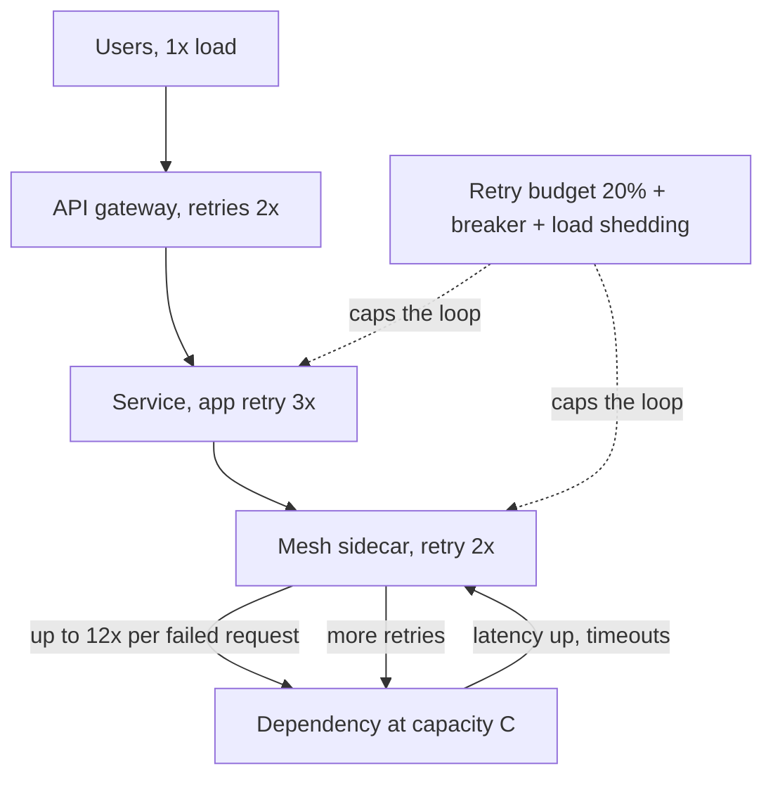

# Retry Storms

> [!abstract] In one sentence
> A retry storm happens when a dependency slows down, every caller times out and retries, the retries multiply across layers until the dependency is receiving several times its normal load, and it can no longer recover even after the original cause is gone — a metastable failure whose only fix is to make the system *reduce* offered load under failure instead of increasing it.

> [!tip] Deeper treatment in your system-design vault
> `system-design/12 Resilience/Failure Modes in Distributed Systems.md` — read it *after* you have written your own explanation below.

**Map:** [[Distributed Systems MOC]] → [[HLD MOC]]

## Definition

A **retry storm** is a positive feedback loop in which the response to failure — retrying — is itself the cause of continued failure. When a service's latency rises, callers hit their timeouts and retry; each retry is new work for the slow service, which now has its original load *plus* the retries, pushing latency higher and causing more timeouts. With retries at several layers (client SDK, service mesh, API gateway, application code), the multiplication compounds: three layers each retrying three times can turn one user request into 27 calls. The resulting state is **metastable**: the system stays overloaded even after the trigger (a deploy, a GC pause, a brief network blip) has passed, because the retry load alone exceeds capacity; it recovers only when offered load is forcibly reduced.

## Problem solved

Naming the retry storm is what lets you design against it; the pattern itself was learned from outages. Classic incidents share a shape: a short-lived cause (a database failover of 30 s, a bad deploy rolled back in two minutes) was followed by an hour or more of outage in which nothing was broken except the load, and the service only came back when operators shed traffic — blocking clients at the edge, scaling to many times normal capacity, or restarting everything at once. The underlying mechanism is queueing: once a server is running at or above its capacity, its queue grows without bound, latency rises with queue length, every request exceeds the client timeout, and the client's retry adds to the queue while the original request is still in it, wasted. [[Timeouts and Retries]] describes the correct per-call discipline; this note is about the *system-level* consequence when that discipline is absent in even one layer.

In a stack like yours — Spring Boot and NestJS services behind an API gateway on EKS, calling each other, RDS, Redis, Kafka or SQS and partner APIs, each with its own client retry policy, plus Kubernetes probes that restart pods that look slow — there are at least five independent retry layers, and nobody has summed them.

## How it works

1. **Amplification arithmetic.** A dependency at capacity `C` requests per second gets a slowdown that makes 20% of calls exceed the client timeout. Each failed call is retried up to 3 times (4 attempts). Offered load becomes `L × (1 + 0.2 × 3) = 1.6 L` immediately; if `L` was 0.9 C, it is now 1.44 C and the failure rate rises, which raises the retry rate, which raises the load. Add a mesh retry (2 attempts) under the application retry (3 attempts): a request that times out at the bottom costs 6 attempts; with the gateway retrying as well, 12. The dependency sees its own capacity exceeded several times over while each layer believes it is being "resilient".
2. **The queueing cliff.** Below saturation, latency is roughly flat; as utilisation approaches 100% queue length grows steeply, and above it the queue grows linearly with time. Requests spend most of their life waiting, then exceed the timeout, so the server does work that the client has already abandoned — **wasted work** that is still charged against capacity. Goodput (useful completed work) falls toward zero while the server is 100% busy ([[Latency]], [[Capacity Planning]]).
3. **Why it does not self-heal.** When the trigger ends, the dependency is still receiving `k × L` from retries; `k × L > C`, so timeouts continue, so retries continue. The system is in a stable overloaded state. Recovery requires offered load to drop below `C` for long enough to drain queues — which no individual client will do voluntarily ([[Graceful Degradation]]).
4. **Synchronised retries.** Without jitter, every client that failed at time `t` retries at `t + 1 s`, then `t + 3 s`, in lockstep, producing waves that hit a recovering dependency exactly together. Exponential backoff *with full jitter* spreads them; AWS's analysis of jitter strategies shows full jitter minimising both total calls and completion time ([[Retry Strategies]]).
5. **The cures, in order of leverage.**
   - **Retry budgets**: cap retries as a percentage of first attempts (Finagle and Envoy default to 20%); when the dependency is down rather than flaky, the budget is exhausted and retries stop. This bounds amplification at 1.2× instead of 4×.
   - **Retry at one layer**: decide where retries live (usually once, close to the caller that can judge idempotency) and make every other layer pass failures through.
   - **[[Circuit Breakers]]**: after a failure threshold, stop calling for a cooling period and fail fast; the dependency gets the breathing room no retry policy provides.
   - **Load shedding and admission control** at the dependency: reject excess work immediately with `503` or `429` (cheap) rather than queueing it (expensive); prioritise by request class; drop requests whose deadline has already passed ([[Backpressure]], [[Rate Limiting]]).
   - **Deadline propagation**: a request whose end-to-end deadline has elapsed is not retried and not processed.
   - **Capacity headroom** so a brief slowdown does not cross the cliff in the first place.

```yaml
# Envoy route-level retry policy with a budget: retries capped at 20% of active requests
retry_policy:
  retry_on: "5xx,reset,connect-failure"
  num_retries: 2
  per_try_timeout: 0.5s
  retry_back_off: { base_interval: 0.05s, max_interval: 0.5s }
# cluster circuit_breakers.thresholds.retry_budget: { budget_percent: 20, min_retry_concurrency: 3 }
```

## Architecture



> [!example]- Excalidraw version — the same diagram as an editable canvas
> ![[Retry Storms.excalidraw]]
> [[Retry Storms.excalidraw|Open in Excalidraw]] — needs the Excalidraw plugin (see [[Plugins to Install]]).


## Use cases

- Any synchronous call chain of three or more hops with retries configured independently at each — the requirement "resilient to transient failures" must be read as "resilient *without* amplifying".
- Dependencies with hard capacity limits (a database, a third-party API with a rate limit, a payment processor): the requirement to "never overload the PSP" is a retry-storm requirement.
- Systems that have experienced "it only came back when we scaled 5x / blocked traffic": that history is the signature of metastability and the design should add budgets and shedding before it recurs.
- Mobile and browser clients at scale: millions of clients retrying on their own schedule are the largest retry layer and the hardest to change after shipping ([[Client State and Reconnection]]).
- Consumers of queues with redelivery: a slow handler that times out and lets messages redeliver is a retry storm fed by the broker ([[Dead-Letter Queues]]).

## Limitations

- Retry budgets and breakers reduce *amplification*; they do not add capacity. A dependency that is genuinely undersized still fails, just without the storm.
- Shedding load means failing requests on purpose; product owners must accept that a fraction of users see errors during overload instead of everyone seeing a hang.
- Budgets measured per client instance do not bound fleet-wide retries if the fleet autoscales; the dependency sees the sum.
- Breakers and budgets need tuning per dependency, and wrong thresholds either trip on noise or never trip.
- Client-side controls cannot be enforced on third-party callers; the dependency must protect itself with admission control regardless.

## Trade-offs

| You gain | You sacrifice |
|---|---|
| Offered load that falls under failure, so brief slowdowns stay brief | Some requests fail fast that a retry would have rescued |
| Bounded amplification (budget) instead of multiplicative (attempts per layer) | Retry configuration that must be designed across layers, not per library |
| Recovery without manual traffic blocking or emergency scaling | Deliberate error responses during overload, visible to users and in SLOs |
| Wasted work eliminated by deadline checks and early rejection | Deadline plumbing through every hop and every queue |

## Failure modes

- **Metastable outage** — trigger resolved, dependency still at 3× capacity from retries, error rate stays at 100% for an hour. You notice as request volume at the dependency far above user traffic with high latency and low goodput; blast radius is every caller of that dependency and their callers.
- **Synchronised retry waves** — error-rate graphs with sharp periodic spikes at the backoff intervals; the dependency recovers between waves and collapses on each. Noticed by the periodicity; fixed with jitter.
- **Queue redelivery storm** — handler timeout shorter than processing time under load; the broker redelivers every message, the consumer processes each several times, lag grows. Noticed as consumer lag rising while throughput looks high and duplicates appear downstream ([[Duplicate Message Processing]]).
- **Probe-induced restarts** — Kubernetes liveness probes time out on an overloaded pod, the pod is restarted, its in-flight work is lost and retried, and the remaining pods take its share. Noticed as a rolling wave of restarts across the deployment; radius is the whole service ([[Health Checks]]).
- **Pool exhaustion upstream** — callers waiting on the slow dependency hold connections and threads; the *callers* become unavailable for unrelated work. Noticed as services two hops away failing with no errors of their own ([[Connection Pooling]], [[Bulkheads]]).

## Performance

The arithmetic is the performance model: amplification factor `A = 1 + f × r` where `f` is the failure fraction and `r` the retries per failure, compounded per layer; a budget replaces `r` with a cap. Goodput near saturation falls faster than throughput because wasted (post-deadline) work consumes capacity; shedding at admission costs microseconds per rejected request against milliseconds of processing, which is why rejecting early is the cheapest capacity you can buy. Jitter adds no cost. Breakers add a counter per dependency and trip in O(1).

## Scalability

Retry storms scale *super-linearly* with system size: more layers mean more multiplication, more client instances mean more independent retry budgets summing at the dependency, and autoscaling callers in response to latency adds capacity on the wrong side of the bottleneck. At 10x, the protective mechanisms must move to the dependency's edge (admission control, per-client quotas) because client-side discipline cannot be assumed across teams. Fleet-wide retry budgets (a shared token bucket in Redis, or quotas enforced at the gateway) are the scale-up of the per-instance budget ([[Design a Rate Limiter]]).

## Operational impact

Make amplification observable: at each dependency, graph *attempts* versus *first attempts* (or requests received versus user requests at the edge); a ratio climbing above the budget is the storm starting. Alert on goodput (successful completions within deadline), not just on error rate. The on-call playbook for metastability is counter-intuitive and should be written down: shed or block load at the edge *first*, then scale, then investigate; restarting the dependency without reducing load just restarts the loop. Chaos drills should inject latency (not failure) into a dependency and verify the system does not enter the loop ([[Chaos Lab]]).

## Alternatives

- **No retries, fail fast, let the user retry** — the simplest bound on amplification; wins for interactive flows where a human will press the button again at human speed.
- **Asynchronous queues with controlled consumers** — convert synchronous calls into queued work consumed at the dependency's pace, so overload becomes lag rather than a storm; wins for anything that does not need a synchronous answer ([[Synchronous vs Asynchronous Communication]], [[Message Queues]]).
- **Over-provisioning** — enough headroom that slowdowns never reach the cliff; wins when capacity is cheap relative to the engineering of budgets and shedding, and fails the first time traffic doubles ([[Capacity Planning]]).
- **Hedged requests with strict caps** — for latency rather than failure, a second attempt after p95 capped at a few percent of traffic; wins for idempotent reads ([[The Tail at Scale]]).

## Real-world examples

- The Amazon Builders' Library article on timeouts, retries and backoff describes retry storms from AWS's own incidents and is the origin of the "retry at one layer" and jitter guidance ([[AWS Builders Library - Timeouts Retries and Backoff]]).
- The 2021 HotOS paper on metastable failures by engineers from Facebook and academia gave the phenomenon its name and catalogued retry-induced sustained overload as its most common trigger.
- Envoy and Finagle both implement retry budgets as a first-class feature, a direct product of operating service meshes where per-call retry counts had proven unsafe.
- In a stack like yours: a payment service calling a PSP with a 2 s timeout and 3 retries, behind a gateway with its own 2 retries, will send the PSP up to 12 attempts per failed authorisation during a PSP slowdown — and the PSP's rate limiter will then reject *all* traffic including the healthy share; a 10% retry budget, a breaker per PSP and idempotency keys on every attempt is the standard remedy.

## Practical exercise

1. Run a "dependency" service in Docker Compose with a fixed capacity (a single worker, 10 ms per request, so about 100 requests per second) and a caller with configurable timeout (50 ms), retries (0–3) and jitter; drive the caller with k6 at 80 requests per second.
2. Inject 100 ms of latency into the dependency with [[Toxiproxy]] for 20 s and then remove it; with 3 retries and no jitter, record the dependency's request rate, latency and goodput for the following five minutes — expect it to stay overloaded.
3. Repeat with full-jitter exponential backoff; then with a 20% retry budget; then with a circuit breaker (open after 50% failures over 10 s, half-open after 5 s); record time-to-recovery for each.
4. Add admission control at the dependency: reject with `503` when the in-flight count exceeds 10; measure goodput during overload compared with queueing.
5. Add a second retrying layer (an Nginx or Envoy proxy with `retries=2`) and show the amplification factor rising; then remove retries from one layer and show it falling.

## Related concepts

### Prerequisites
- [[Timeouts and Retries]] — the per-call mechanism whose misuse creates the storm
- [[Retry Strategies]] — backoff, jitter and budgets as the tools
- [[Latency]] — queueing behaviour near saturation is the physics behind the cliff

### Related
- [[Backpressure]] — the dependency's side of the same problem
- [[Cache Stampedes]] — the same feedback loop with cache misses instead of retries
- [[Connection Pooling]] — where the storm exhausts the callers
- [[Capacity Planning]] — headroom decides how close to the cliff you run
- [[Fan-Out]] — fan-out multiplies both load and retries

### Builds on this
- [[Circuit Breakers]] — exist to break the loop
- [[Graceful Degradation]] — load shedding is the system-level cure
- [[Bulkheads]] — isolate the blast radius of a storm to one dependency
- [[Rate Limiting]] — quotas at the dependency bound what retries can do

### Design problems where it applies
- [[Design a Payment System]]
- [[Design a Webhook Delivery System]]
- [[Design a Notification System]]
- [[Design an API Gateway]]

### Projects where it can be implemented
- [[Chaos Lab]]
- [[Load Test and Latency Lab]]
- [[Webhook Relay]]

### Resources
- [[AWS Builders Library - Timeouts Retries and Backoff]] — the canonical practitioner account
- [[AWS Architecture Blog - Exponential Backoff and Jitter]] — the jitter analysis with numbers
- [[Release It!]] — stability patterns born from retry-induced outages
- [[AWS Builders Library - Load Shedding]] — the dependency-side cure

## Personal understanding

> [!question] Explain it without the source
> Write your own explanation here, from memory. Then compare it with the sections above and note what you missed.

### Mastery checklist
- [ ] I can explain it without the original resource
- [ ] I can describe the problem it solves
- [ ] I can compare it with its alternatives
- [ ] I can name its limitations and failure modes
- [ ] I can recognise when it is appropriate in a real system
- [ ] I have applied it in a system design
- [ ] I have validated my assumptions with an experiment or implementation

## Open questions

- [ ] For one request path end to end (client, gateway, service, mesh or HTTP client, database driver), what is the actual worst-case attempt multiplier today, and which layer should be the single owner of retries?
- [ ] How do SQS visibility-timeout redeliveries and Kafka consumer retries differ as storm generators, and what changes when consumers move to Redis Streams with `XAUTOCLAIM`?
- [ ] What goodput-based signal would let an autoscaler or a shedding policy distinguish "more capacity will help" from "we are in a retry loop and more capacity will be consumed by retries"?
